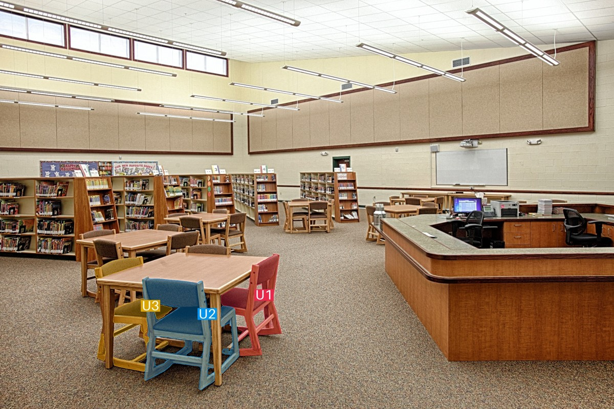
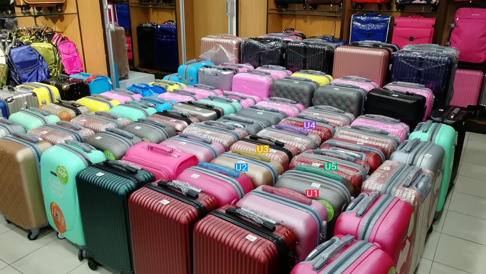
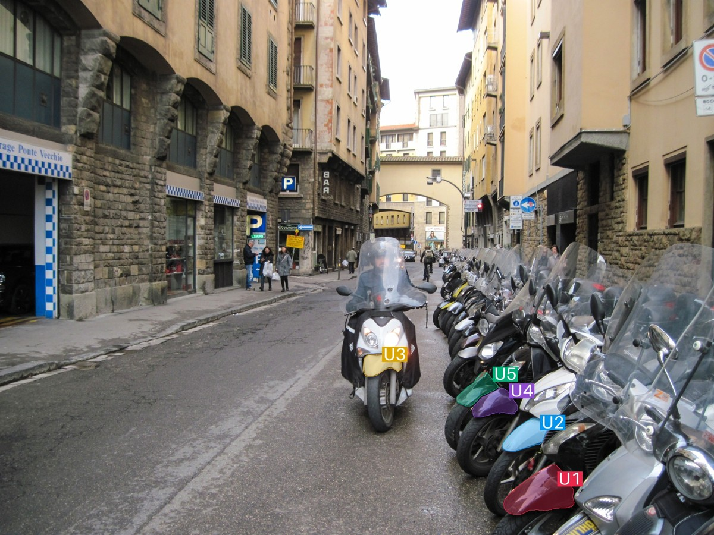
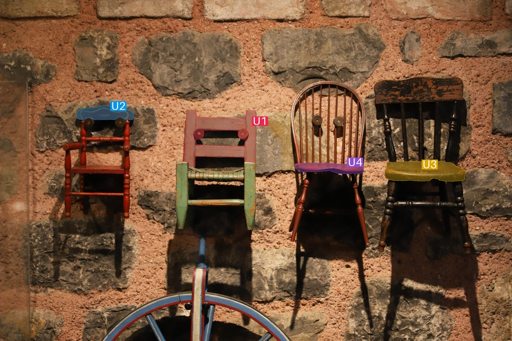

# SAMTok Benchmark v2：SA-1B 多对象细粒度交互编辑

当前唯一版本为 **v2 / release 2.2.0：200 张 SA-1B 源图、785 个独立目标，每图 2–5 个目标**。全部源图与所选 mask 已由 assistant 逐图查看，本轮又逐条查看图片和叠加区域后撰写中英文指令。当前冻结的是源图、任务和交互标注，尚无模型编辑结果或独立人工验收。

此文档是仓库唯一维护的说明，审核包和数据目录中的同名内容是它的发布副本。旧 212 条和旧说明已退出当前清单，历史保存在 Git 与数据归档目录；不与这 200 条混合统计。

## 1. 评测目标与判定方式

研究问题是：同一复杂场景中，用户分别指定多个物体或部件，以不同形式输入，模型能否同时准确、完整地执行全部编辑，保护其余内容，并保证每个编辑的自然质量。评测重点包括实例选择、部件指代、遮挡后的多块可见区域覆盖、细长区域和孔洞边界、相邻内容保护，以及不同对象指令之间的干扰。

| 维度 | 判断内容 | 失败示例 |
| --- | --- | --- |
| E：目标与执行完整性 | 每条指令选中正确实例和部件；实际完成要求的操作、数量、位置和全部相关可见部分 | 改错同款箱子的提手；只改被遮挡部件的一段；只新增替代物却留下原物 |
| P：非目标保持 | 保留该对象未指定部分、邻近物、遮挡者和背景；同图其他指令明确允许的变化除外 | 修改提手时改变箱体；改衣袖时改变躯干或旁人 |
| Q：编辑质量 | 每个目标的形状、材质、边缘、接触、遮挡、光照与阴影合理 | 新配件悬空；断裂边缘；部件融合；不合理的局部结构 |

每个 U 独立判断 E/P/Q，同时判断整图 global_P/global_Q。**JointPass = 所有 U 的 E∧P∧Q ∧ global_P ∧ global_Q**。任一目标漏改、错改、越界或质量失败，整条 case 失败；大目标的成功不能补偿小目标的失败。报告同时分解 E/P/Q、目标数、编辑类型、交互形式、困难标签；主指标是整图联合成功率。

评估查看原图/结果全图及逐目标固定坐标的配对局部裁剪。允许操作必需的局部显露背景、连接、光影调整。**源 mask 是语义定位标注，不是输出差分金标准**，不能用差分与 mask 的 IoU 代替 E/P/Q。尤其 add、replace 和移除子部件，允许变化范围由具体指令决定。全量源标注和验收规则属于 evaluator 私有信息。

## 2. 源数据与可追溯路径

本版图片全部来自前期分析的 **SA-1B 图片库及配套 dense annotation**，不含 PACO-LVIS 或 ADE20K 的旧 212 条。SA-1B 是为通用图像分割建立的大规模自然图像与区域资源；本地 handoff 给出的图片/标注索引口径为 **11,185,362 条**，这里沿用 handoff 的统计，没有重新扫描全库。场景包含人群、街市、店铺、衣物配件、车辆、器物、建筑设施等。

配套 dense TFRecord 中有 `key`、图片 caption、tags、`objects_json` 和 `associations_json`。对象记录包含 object_id、类别/描述与 COCO RLE 可见区域。它们是本地配套的 dense 标注；本文不把这些语义对象与官方 SA-1B 自动 mask 集逐项等同。类别和描述可有误，实际入选及指令以图像、mask 和实物归属核查为准。

- Handoff：`/mnt/hdfs/byte_ttlive_strategy_llm/user/haobo.yuan/datasets/SA1B_HANDOFF.md`。
- 图片 TFRecord：`/mnt/hdfs/byte_ttlive_strategy_llm/user/haobo.yuan/datasets/sa1b_tfd_1k/`。
- 图片索引：上述目录的 `sa_000000_unified_tot1000.index`。
- Dense TFRecord：`/mnt/hdfs/byte_ttlive_strategy_llm/user/haobo.yuan/datasets/sa1b_dense_label/annotation/`。
- Dense 索引：上述目录的 `all1000.index`。
- 当前源素材及筛选过程：`/mnt/bn/strategy-mllm-train/user/tanyue/datasets/samtok_edit_benchmark_v2/sa1b_source_selection/`。
- 正式来源追溯：仓库 `data/v2/provenance.jsonl`，记录 SA ID、所选原 object_id、原始/解析后的 TFRecord 文件、offset、length、原素材清单 SHA256 和训练目录匹配。

索引中的旧 `/mnt/hdfs/sg_byte_ttlive_strategy_llm/` 前缀解析为本机 `/mnt/hdfs/byte_ttlive_strategy_llm/`。按已给出的偏移读取记录，不重建图片全量索引。原始 RLE 和所选区域清单保存在 `sa1b_source_selection/selected_sources.jsonl`；正式 PNG 记录逐文件 SHA256。

## 3. 如何挑选和筛选

先按固定 seed 抽样读取标注并安排候选查看顺序，再实际查看图片决定入选。初始 seed 20261011 抽 800 条，取回优先候选 320 张，另外补充器物等方向 74 张；扩充 seed 20261012 再抽不重叠的 2,000 条，取回 850 张。累计数字如下，阶段不是相加关系。

| 阶段 | 数量 |
| --- | --- |
| 解析 dense 标注 | 2800 |
| 取回候选图片 | 1244 |
| 实际查看原图场景 | 622 |
| 进一步检查原图、叠加图和局部并记录决定 | 252 |
| 细查后保留 | 200 |
| 细查后备用 | 41 |
| 细查后淘汰 | 11 |

候选召回先排除 sky/ground/wall 等背景类别，并把面积约 0.08%–30%、重复类别、部件关键词、较小区域较多的图片排前。初始排序分数为 `2×min(重复量,12)+min(部件量,15)+min(小区域量,12)+min(候选量,12)`，仅用于安排查看顺序。类别重复、面积小、mask 多都不能单独构成入选证据。

**逐图入选标准：**

1. 每图实际选出 2–5 个不同实物的目标。不能把一个物体的碎块、同一个人的两只衣袖、同一辆车的多个零件冒充多个物体。每个 U 记录 `physical_parent_zh`；独立背包等配件可以与使用者分别作为目标。
2. 难点落实到所选区域：同类近似实例、被人/物遮挡、细杆/窄带/孔洞、小部件、相邻接触边界、不同粒度并存等，记录具体证据；背景热闹而目标只是孤立大块不够。
3. 对照较大原图、mask 叠加和目标局部，检查实物归属、全部可见部分、遮挡关系、孔洞、边缘及需要保护的邻居。同一对象分离的可见块保留为一个 U。
4. 目标足够清晰且指代可写；纯 ref 使用方位、所属人物/物体及部件关系区分实例。point/box 可以含更强的干扰，但真实目标必须可识别。
5. 舍弃 mask 把背景孔洞填满、整个人误标为衣物、错误覆盖邻居、目标明显失焦、镜面/印刷物冒充实物、同一实物重复计数等问题；可只剔除某张图的不合格 mask。
6. 未看过、未记录 accept、备用及淘汰项均不进入正式 200 条。所有入选图本轮又查看并写任务；审查归属如实记录为 `ai_direct_visual`，不冒充人工验收。

场景初筛 `review/scene_review.tsv`、细查决定 `review/decisions.jsonl`、候选图片 `candidates/`、检索/审图脚本 `scripts/` 均在源素材过程目录。仓库 `data/v2/selection/` 保存关键筛选日志、统计及原 RLE 验证结果。指令审查记录在 `data/v2/instruction_reviews.jsonl`，对应 50 张四图审查页的路径和 SHA256；大图回看保留在各源图的 `review.jpg`。

这是困难场景定向精选，并非 SA-1B 全库无偏样本。衣物、包带、提手等仍较多，领域没有做均衡配额；“高难”来自视觉结构审查，尚无模型成功率标定。

## 4. 区域标注与交互协议

mask 使用 dense annotation 中该目标原始可见区域，转为与原图同尺寸的 0/255 PNG；逐像素与原 RLE 核对，不扩张、补画或合并不同实物。box 为 mask 紧致轴对齐框，整数 xyxy，右下不含。point 取 mask 内距边界最远的像素，保证落在目标内；这是确定性构造点，不代表真实用户点击分布。

英文 ref 由本轮逐图编写，中文给出对应实例/部件；无 ref 的指令仅用 `the selected <part type>` 表明粒度，不泄露完整位置描述。mask 是所选对象/部件的定位范围：196 个 add 定位承载物或安装部位，77 个 remove 进一步明确其中子部件，余下 512 个直接针对所选可见对象或部件。衣领、logo、衣袖等子部件任务不能被误评为“必须改完整件衣服”。

**Add 的区域语义（benchmark DCO contract）：** add 的公开 mask、box 或 point 标记的是源图中已经存在的承载物/安装面，即新增物体的锚点（host/attachment anchor），不标记新增物体在结果图中的预计轮廓，也不是输出差分金标准。新增物体在 source 中不存在；因此 instruction 使用 `Add <new item> to/on/onto <target>.`，其中 `<target>` 与该锚点绑定，原承载物必须保留，新增物体必须以指令要求的数量、位置和接触关系附着到该锚点。add 的 `edit_contract.locator_semantics` 为 `addition_support`；其允许的结果变化可以因连接、遮挡、边缘、光照或阴影而超出锚点，但不能借此改动无关对象。评测时应检查新增物体是否出现、是否附着在指定锚点、原承载物及邻近内容是否保持，以及整体编辑质量。

每个对象独立取一种正式模式，无 ref 必须有 point/box/mask；有 ref 可以无区域。冻结时按 manifest 顺序循环七种模式，保证每图至少两种形式；未按模型效果挑模式。

| 正式模式 | 目标数 |
| --- | --- |
| noref+point | 113 |
| ref+box | 112 |
| noref+mask | 112 |
| ref+none | 112 |
| ref+mask | 112 |
| noref+box | 112 |
| ref+point | 112 |

`ref+none` 是纯 ref。公开输入不会附送其 point/box/mask；no-ref 不附送私有 full ref。中文翻译默认仅供审核。审核页“全部 ref”会把私有目标标签画到原图，用于复核；**不等同于模型的正式输入**。

支持两个协议：`native_regions_v2` 直接提供对应坐标或 mask，且只暴露实际指定的形式；`visual_locator_v2` 提供干净源图和仅画指定定位形式的第二张提示图。审核包内 JPEG 提示图用于浏览；正式运行生成 PNG，保持原分辨率。支持 `mixed` 主评测、`all_ref`、`all_mask_noref` 和 `single` 消融。不同协议/消融需分别报告。

## 5. Instruction 如何撰写

先看具体场景和选区，再决定操作与结果；随后统一句式，最后检查中英文、实例指代、局部范围、单图多样性、四类占比和长度。`construction/instructions/design.tsv` 的 785 行逐对象记录人工式设计内容；构建脚本只拼句、检查和冻结，不依据类别随机生成操作语义。

| 类型 | 主要句式 | 判别原则 |
| --- | --- | --- |
| add | `Add <new item> to <target>.` | 添加实际配件/物件；说明必要数量和安装点，原承载物仍在 |
| replace | `Replace <target> with <new object/part>.` | 原目标被结构或品类不同的替代物取代；不把单纯换色伪称替换 |
| remove | `Remove <target>.` / `Remove <part> from <target>.` | 删除目标或明确子部件；必要时说明连同内容物、截去下段等范围 |
| attribute | `Change the color/material of <target> to <value>.` | 改外观属性；透明物体用 `Tint ...` 表示染色，保留合理透明性质 |

每条只写操作必需信息，不重复“保留其他内容”。保持要求是全局默认行为，私有验收标注会明确同体部件和邻近对象的保护。英文 full-ref 指令长度 **4–26 词，中位 17**；no-ref **4–16 词，中位 10**。一张图中每个 U 分别一条指令，通过 U 编号绑定，不把多目标任务挤进一个含糊长句。

2–4 目标的图各任务类型不重复，5 目标图覆盖全部四类且仅一类重复。全局按编辑目标计，四类最多相差 1 个。中文完整保留操作、数量和部件要求；需要纠正源标签颜色/方位时根据图像修正。

场景适配示例：密集箱包提手分别做移除、换环形皮提手、挂行李牌和换色；玻璃吊灯做金属护笼、长管灯泡、移除单灯泡和浅色染色；衣物做袖型、口袋、布贴或局部裁短。add 当前全部是局部增添/附着，没有自由空间新增大型物体；attribute 中 183 个颜色/染色、13 个材质；remove 有 77 个针对所选对象内部子部件，含裁短服装，7 个为移除已有徽标、印花或文字。需要解读为本版的具体任务分布。

## 6. 当前构建结果

| 编辑类型 | 目标数 | 占比 | 包含该类型的 case |
| --- | --- | --- | --- |
| add | 196 | 24.97% | 177 |
| replace | 196 | 24.97% | 178 |
| remove | 197 | 25.10% | 178 |
| attribute | 196 | 24.97% | 167 |

| 每图独立目标数 | case 数 | 占比 |
| --- | --- | --- |
| 2 | 26 | 13.0% |
| 3 | 48 | 24.0% |
| 4 | 41 | 20.5% |
| 5 | 85 | 42.5% |

平均每图 **3.925** 个目标。4–5 目标图共 **126 条（63%）**。5 目标图的重复类型分别为 add 19、replace 18、remove 19、attribute 29 条；完整组合分布见 `statistics.json` 的 `case_operation_combinations`。

| 难点标签（可重叠） | case 数 |
| --- | --- |
| 紧邻保护 | 199 |
| 同类多实例 | 187 |
| 遮挡 | 176 |
| 局部部件 | 148 |
| 细长狭窄 | 72 |
| 小目标 | 24 |
| 孔洞结构 | 16 |
| 分离可见区域 | 14 |
| 粒度差异 | 8 |
| 动态姿态 | 3 |
| 透明材质 | 1 |
| 反射干扰 | 1 |

mask 面积占整图中位数 **0.5725%**，最小 **0.0814%**、最大 **13.1828%**；小于 1% 的有 **535/785** 个目标。**203 个目标 / 115 张图**含多个显著连通块，但仍按 785 个实物目标计数。连通块采用 4 邻接，忽略小于 max(9 像素, mask 面积 0.1%) 的分量；与“分离可见区域”人工场景标签的 14 条不是同一统计。

| 操作子类 | 目标数 |
| --- | --- |
| R | 196 |
| C | 179 |
| D | 109 |
| A | 196 |
| D:part | 56 |
| D:contents | 11 |
| C:material | 13 |
| D:hem | 3 |
| D:lowerlegs | 18 |
| C:tint | 4 |

其中 A/R/D/C 分别对应 add/replace/remove/attribute，D:part 指删选中对象的指定子部件，D:contents 包含内容物，D:lowerlegs/D:hem 为裁去服装下段，C:material/C:tint 为材质/透明染色。全部 130 种英文部件类型及数量、操作×交互交叉表均保存在 `statistics.json`，不把近义英文名称当成严格语义 taxonomy。

### 训练目录交集与评测状态

`/mnt/bn/strategy-mllm-train/user/tanyue/datasets/SAMTok_Training_Data/sam_info.json` 中匹配到本版 **200/200** 张 SA ID；抽样 2800 条中匹配 2799 条。目录成员关系不等于某个 checkpoint 实际训练过，但本版不能被描述为已经审计过的独立 holdout。正式研究比较前需结合实际训练清单与近重复检查界定模型暴露情况。

当前 81 项测试、全 200 case 浏览器加载与叠加检查通过；生成并校验了 200 个 native mixed 输入 job，未调用模型。源资产/标注校验通过，200 个源图 SHA256 唯一，1185 个资产逐文件核对；无模型运行、无模型得分、独立人工复核为 0。此处统计描述构建完成的任务集，不代表编辑模型已通过它。

## 7. 代码、数据与审核包路径

| 内容 | 路径 |
| --- | --- |
| 唯一 v2 repo | `/opt/tiger/samtok_edit_benchmark_v2branch`，分支 `v2branch` |
| 唯一维护文档 | repo `README.md`；`/opt/tiger/SAMTok Benchmark v2.md` 指向它 |
| 正式版本元数据 | repo `data/v2/`，同步到 `/mnt/bn/strategy-mllm-train/user/tanyue/datasets/samtok_edit_benchmark_v2/benchmark/` |
| 数据总根目录 | `/mnt/bn/strategy-mllm-train/user/tanyue/datasets/samtok_edit_benchmark_v2` |
| 正式源图 | `assets/v2-sa_<id>/source.jpg` |
| 正式单目标 mask | `assets/v2-sa_<id>/U1.png` … `U5.png` |
| 选区复核图 | `assets/v2-sa_<id>/selection_review.jpg`，原标注 ID 见元数据 |
| 源素材筛选过程 | `sa1b_source_selection/`，候选/备用/原 RLE/检索日志 |
| 指令过程 | `construction/instructions/`，design.tsv、审图 sheets、进度记录 |
| 正式模型运行与输出 | `evaluation/`，与任务源资产分开；本版尚无运行 |
| 历史归档 | `archive/pre_sa1b_212_v2_2.1.0/`、`archive/previous_review_packages/`，不属当前评测 |
| 本机审核包目录 | `/opt/tiger/samtok_edit_benchmark_v2_review` |
| 本机审核压缩包 | `/opt/tiger/samtok_edit_benchmark_v2_review_20261010.zip` |

相对资产路径都以数据总根目录或便携包根目录为基准。仓库只保留当前任务元数据、代码、唯一说明及少量说明插图，不提交正式大图、过程图片、审核 zip、模型结果。历史 v1 单对象 API 的基础兼容代码/合成测试保留；当前数据仅 `data/v2/`，不携带旧评测清单。

正式元数据：`cases.jsonl` 为完整任务；`asset_manifest.jsonl` 为 1185 项资产清单；`provenance.jsonl` 为来源；`instruction_design.jsonl` 和 `instruction_reviews.jsonl` 为逐对象设计/逐图审查；`statistics.json`、`release.json`、`validation.json` 为统计、版本和验证；`selection/` 为选择依据。`release.json` 的 manifest SHA256 绑定当前任务，编辑输入、模型输出与评分均有摘要绑定。

[Hugging Face 当前审核包](https://huggingface.co/datasets/TTangenty/samtok_edit/resolve/main/samtok_edit_benchmark_v2_review_20261010.zip?download=true)。原 `sa1b_source_selection_200cases_review_20261010.zip` 下载名也更新为同一新版内容，作为兼容入口，两个链接 SHA256 相同，不是两套 benchmark。包 SHA256 和 HF revision 信息在 `data/v2/review_package.json`；文件名中的日期是原有稳定下载名，内容版本以 `package_metadata.json` 为准。

解压整个压缩包后，在包内运行：

```bash
python run_review.py
# 不自动打开浏览器时：
python run_review.py --no-browser --port 8766
```

打开 `http://127.0.0.1:8766/`。只需 Python 3.10+ 标准库与现代浏览器，不依赖编辑器的 html.showPreview 扩展。左侧选 case 后再加载图片。支持按目标数（含 5）、任务、来源、状态搜索；默认原图；一键全部 point/mask/box/ref，也可点击“全部 mask + box + ref”同时开启三层，各层可叠加，第二次点击关闭该层；逐对象也可切换。英文和中文指令同时展示，正式混合输入可恢复冻结交互形式。

审核决定、每对象问题和指令建议写入包内 `reviews/review_results.json`，刷新保留，可导出 JSON。正式任务清单不会被审核建议直接改写。发布包初始没有虚构的用户复核记录。

## 8. 构建、验证与运行

```bash
cd /opt/tiger/samtok_edit_benchmark_v2branch
python -m pip install -e '.[dev,review]'

python construction/build_sa1b_v2.py \
  --dataset-root /mnt/bn/strategy-mllm-train/user/tanyue/datasets/samtok_edit_benchmark_v2
python construction/write_document.py \
  --dataset-root /mnt/bn/strategy-mllm-train/user/tanyue/datasets/samtok_edit_benchmark_v2

samtok-benchmark-v2 validate --manifest data/v2/cases.jsonl \
  --dataset-root /mnt/bn/strategy-mllm-train/user/tanyue/datasets/samtok_edit_benchmark_v2 \
  --minimum-cases 200 --output data/v2/validation.json

# 从冻结标注生成英文模型输入；不能直接把整个审核包喂给编辑模型。
samtok-benchmark-v2 prepare --manifest data/v2/cases.jsonl \
  --dataset-root /mnt/bn/strategy-mllm-train/user/tanyue/datasets/samtok_edit_benchmark_v2 \
  --protocol native_regions_v2 --variants mixed \
  --output /mnt/bn/strategy-mllm-train/user/tanyue/datasets/samtok_edit_benchmark_v2/evaluation/native_mixed

# output 必须是空目录；已有审核结果不会被覆盖。
samtok-benchmark-v2 review --manifest data/v2/cases.jsonl \
  --dataset-root /mnt/bn/strategy-mllm-train/user/tanyue/datasets/samtok_edit_benchmark_v2 \
  --output /opt/tiger/samtok_edit_benchmark_v2_review

python -m pytest -q
python -m ruff check .
```

重新冻结需要现有 `sa1b_source_selection/gallery_data.json`、selected 资产和指令审查 sheets；不会重新随机抽图。若改写指令，需回看相应 case、更新设计记录、重新冻结并重建审核包，不能仅改网页文案。浏览器验证还需先运行 `python -m playwright install chromium`。`construction/check_review_browser.py` 检查真实浏览器中的全部 case、图像和叠加交互；`construction/publish_review.py` 归档并校验 HF 远程 SHA256。Git 提交遵循 `feat: ...` 等标准类型信息。

## 9. 可视化样例与实际双语指令

下图展示源图及全部已选 mask，颜色按 U1 红、U2 蓝、U3 金、U4 紫、U5 绿。这里完整展示选区以便审核，正式输入只给每个 U 冻结的形式。**这些是源图标注可视化，不是模型编辑结果。** 表中是正式模式实际发送的英文指令及审核用中文翻译；no-ref 的实例通过图上区域选择。

### Case 001：并肩人物与衣物遮挡

`v2-sa_10063996`。两人靠近，左侧仅选一只袖子、右侧选被头发和纸张遮挡的外套；需区分不同编辑粒度并覆盖外套全部可见区域。


| 目标 | 任务 | 正式输入 | English | 中文 |
| --- | --- | --- | --- | --- |
| U1 | replace | noref+point | Replace the selected sleeve with a flared bell sleeve. | 将选中的衣袖替换为喇叭袖。 |
| U2 | attribute | ref+box | Change the color of the red coat of the woman on the right to navy blue. | 将右侧女性红色外套的可见面料改为藏蓝色。 |

### Case 008：图书馆同款木椅与桌腿交错

`v2-sa_6295141`。三把独立椅子的靠背和横撑、细腿与桌腿交错；左椅被桌面及前椅遮挡，编辑必须保持框架空隙中的地毯和其他椅腿。



| 目标 | 任务 | 正式输入 | English | 中文 |
| --- | --- | --- | --- | --- |
| U1 | remove | noref+mask | Remove the selected chair. | 移除选中的椅子。 |
| U2 | add | ref+none | Add one burgundy seat cushion to the chair facing away in front of the nearest table. | 给前景正面背向镜头的木椅加上一个酒红色坐垫。 |
| U3 | attribute | ref+mask | Change the color of the partly hidden chair on the left of the nearest table to white. | 将前景桌左侧被遮挡的木椅改为白色。 |

### Case 033：食品摊位中交叉的竹签

`v2-sa_3206973`。在大量相似竹签中指定两根；右侧竹签被另一根交叉遮挡，必须覆盖其分离可见部分。


| 目标 | 任务 | 正式输入 | English | 中文 |
| --- | --- | --- | --- | --- |
| U1 | remove | noref+box | Remove the selected skewer. | 移除选中的签子。 |
| U2 | replace | ref+point | Replace the skewer partly crossed by another skewer on the right with a long two-pronged metal serving fork. | 将右侧被斜向竹签遮挡的竹签替换为长柄双齿金属餐叉。 |

### Case 138：装饰物密集的店铺灯具

`v2-sa_37740`。四套独立吊灯只取玻璃灯泡，保护灯座、吊线和贴近的悬挂装饰，亮度与透明反射各不相同。


| 目标 | 任务 | 正式输入 | English | 中文 |
| --- | --- | --- | --- | --- |
| U1 | add | ref+none | Add one small silver wire cage around the glass to the glass light bulb on the far right. | 给右侧吊灯的玻璃灯泡加上一个围住玻璃的小银色金属丝护笼。 |
| U2 | replace | ref+mask | Replace the largest glass light bulb at the upper center with a long tubular glass light bulb. | 将上方中间最大吊灯的玻璃灯泡替换为长管形玻璃灯泡。 |
| U3 | remove | noref+box | Remove the selected light bulb. | 移除选中的灯泡。 |
| U4 | attribute | ref+point | Tint the glass light bulb at the middle left pale blue. | 将左侧中间吊灯的玻璃灯泡染成浅蓝色。 |

### Case 168：商店内密集陈列的旅行箱

`v2-sa_6330783`。五个几乎相同提手嵌在密集重复箱体和拉链之间，必须把提手匹配到正确箱子。



| 目标 | 任务 | 正式输入 | English | 中文 |
| --- | --- | --- | --- | --- |
| U1 | remove | ref+point | Remove the top handle of the pale-purple suitcase at the front right. | 移除前景右侧淡紫色箱子的顶部提手。 |
| U2 | replace | noref+point | Replace the selected suitcase handle with a looped brown leather handle. | 将选中的行李箱提手替换为棕色皮革环形提手。 |
| U3 | add | ref+box | Add one small yellow luggage tag to the top handle of the champagne-colored suitcase behind the bright-pink one. | 给亮粉箱后方香槟色箱子的顶部提手加上一个小黄色行李牌。 |
| U4 | attribute | noref+mask | Change the color of the selected suitcase handle to black. | 将选中的行李箱提手改为黑色。 |
| U5 | replace | ref+none | Replace the top handle of the gray suitcase on the right with a curved wooden handle. | 将右侧灰色箱子的顶部提手替换为弧形木提手。 |

### Case 198：狭窄街道上一排踏板摩托车

`v2-sa_8861209`。五块近似挡泥板在车轮与前叉之间重复出现，停车队列相互重叠，禁止连车胎一起改。



| 目标 | 任务 | 正式输入 | English | 中文 |
| --- | --- | --- | --- | --- |
| U1 | remove | ref+box | Remove the front fender of the nearest dark scooter in the parked row. | 移除右侧前排靠近镜头黑色踏板车的前挡泥板。 |
| U2 | attribute | noref+mask | Change the color of the selected motorcycle fender to glossy red. | 将选中的摩托车挡泥板改为亮红色。 |
| U3 | add | ref+none | Add one small amber reflector on its visible side to the white front fender of the scooter approaching along the road. | 给道路中迎面驶来踏板车的白色前挡泥板加上一个装在可见侧面的小琥珀色反光片。 |
| U4 | replace | ref+mask | Replace the dark front fender immediately behind the white parked scooter with a short angular black front fender. | 将白色踏板车后方黑车的前挡泥板替换为短款棱角形黑色前挡泥板。 |
| U5 | replace | noref+box | Replace the selected motorcycle fender with a long rounded chrome front fender. | 将选中的摩托车挡泥板替换为长圆弧形镀铬前挡泥板。 |

### Case 200：石墙上陈列的四把旧木椅

`v2-sa_8981826`。不同椅子分别选择靠背、顶条或座面，细杆、孔洞与强阴影不能混为部件。



| 目标 | 任务 | 正式输入 | English | 中文 |
| --- | --- | --- | --- | --- |
| U1 | replace | ref+mask | Replace the visible ladder-back frame of the second green chair from the left with a rounded wooden backrest frame with two upright slats. | 将左起第二把绿椅的梯形靠背可见木框替换为带两根竖条的圆弧形木靠背框。 |
| U2 | remove | noref+box | Remove the selected chair rail. | 移除选中的椅子横条。 |
| U3 | attribute | ref+point | Change the color of the seat of the black chair on the far right to dark green. | 将最右黑椅的座面改为深绿色。 |
| U4 | add | noref+point | Add one small cream-colored seat cushion to the selected chair seat. | 给选中的椅子座面加上一个米白色小坐垫。 |
