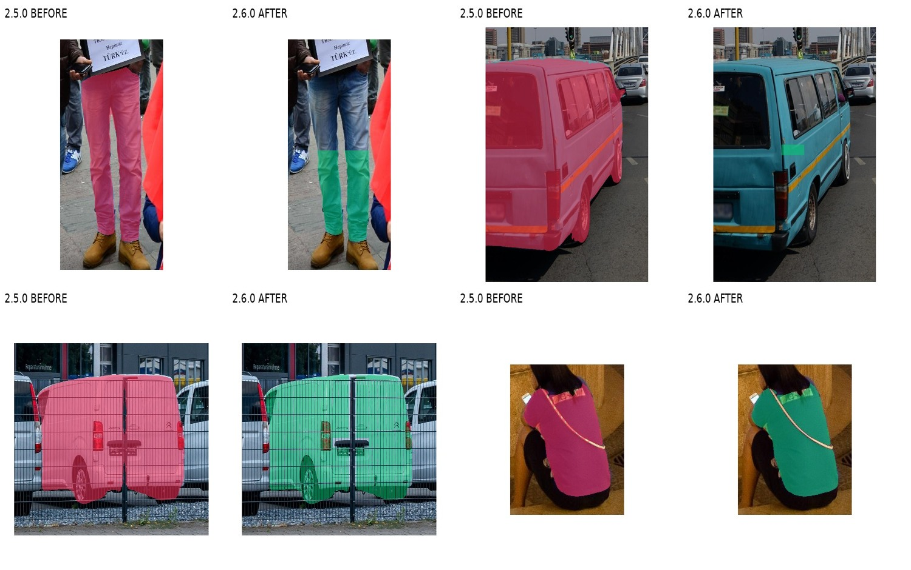

# SAMTok Benchmark v2：SA-1B 多对象细粒度交互编辑

当前版本为 **release 2.6.0**：1,084 张不同源图、3,872 个编辑单元，每图 2–5 个目标，至少两种交互形式。指令协议与 mask 语义均为 **2.0**；no-ref 使用盲指代 `the selected region`，源区域为实际编辑部件或附着部位。804 个修复任务已完成，另 280 个 case 统一迁移协议；708 张经过复核的新版 mask 随仓库提供。

当前入口：[data/current.json](data/current.json)。发布记录、完整路径与复现步骤见 [2.6.0 发布说明](docs/RELEASE_2_6_0_ZH.md)；[修复前后对比](docs/RELEASE_2_6_BEFORE_AFTER_ZH.md)包含 8 组原图、mask 和指令对照。全部数据通过构建及资产校验，**尚无独立人工验收、模型编辑结果或成功率标定**。

## 1. 当前文件入口

仓库：`/opt/tiger/tanyue/samtok_edit_benchmark`，分支 `v2branch`。下表中未加前缀的路径均相对仓库根目录。

| 内容 | 路径 |
|---|---|
| 当前版本指针 | [data/current.json](data/current.json) |
| 当前正式标注 | [data/v2_2.6.0/cases.jsonl](data/v2_2.6.0/cases.jsonl) |
| 发布元信息、统计、全量校验 | `data/v2_2.6.0/{release,statistics,validation}.json` |
| 逐单元前后对比、汇总 | `data/v2_2.6.0/unit_changes.jsonl`、`comparison_summary.json` |
| 可恢复的新版 mask 补丁及 SHA256 | `data/v2_2.6.0/mask_patch/`、`mask_patch_manifest.jsonl` |
| 数据根当前标注 / 旧版备份 | `<数据根>/benchmark/` / `<数据根>/benchmark_history/2.5.0/` |
| 原图、运行时 mask、历史审核卡 | `<数据根>/assets/<case>/`，具体文件名以 manifest 为准 |
| 修订、日志、审查、进度 | `construction/release_2_6/{revisions,logs,audit,status.json}` |
| 旧版冻结数据 | `data/v2_1084/` 为 2.5.0；`data/v2/` 为原版 200 张 |

数据根为 `/mnt/bn/strategy-mllm-train/user/tanyue/datasets/samtok_edit_benchmark_v2`。`release_2_6_work/` 保存分割配方和审图过程，**正式运行不依赖该目录**。`data/v2_1k/` 是早期模板草稿，不用于评测。

## 2. 使用 2.6.0

在仓库根目录运行；本机 Python 为 `/opt/tiger/envs/gen/bin/python`。换机器时把数据根替换为自己的路径，并先准备 2.5.0 原始资产，再安装本仓库中的新版 mask 补丁：

```bash
/opt/tiger/envs/gen/bin/python construction/release_2_6/materialize_masks.py \
  --dataset-root /mnt/bn/strategy-mllm-train/user/tanyue/datasets/samtok_edit_benchmark_v2

PYTHONPATH=src /opt/tiger/envs/gen/bin/python -m samtok_benchmark.v2.cli validate \
  --manifest data/v2_2.6.0/cases.jsonl \
  --dataset-root /mnt/bn/strategy-mllm-train/user/tanyue/datasets/samtok_edit_benchmark_v2 \
  --minimum-cases 1000 --output outputs/release_2_6_validation.json

PYTHONPATH=src /opt/tiger/envs/gen/bin/python -m samtok_benchmark.v2.cli prepare \
  --manifest data/v2_2.6.0/cases.jsonl \
  --dataset-root /mnt/bn/strategy-mllm-train/user/tanyue/datasets/samtok_edit_benchmark_v2 \
  --protocol visual_locator_v2 --variants mixed --output outputs/release_2_6_inputs
```

补丁安装器会校验全部 708 张 PNG 的大小和 SHA256，拒绝覆盖内容不同的同名文件。源图和旧 `U#.png` 保留不变，新文件为 `U#_v2.png`。旧版原始资产的获取说明见[发布说明](docs/RELEASE_2_6_0_ZH.md#5-资产与历史审核材料)。评测必须重新生成 2.6.0 输入；旧 no-ref 结果不能直接与本版比较。

## 3. 修复前后



每组左红为 2.5.0，右绿为 2.6.0；上排为裤腿剪短、车侧板贴花，下排为排除前景栅栏、排除衣服上的包带。这是**源区域标注对比**，不是模型生成效果。完整原图及指令见[对照报告](docs/RELEASE_2_6_BEFORE_AFTER_ZH.md)。

| 项目 | 2.5.0 | 2.6.0 |
|---|---:|---:|
| 源图 / 单元 | 1,084 / 3,872 | 1,084 / 3,872 |
| 指令协议 / mask 语义 | 1.0 / 1.1 | 2.0 / 2.0 |
| no-ref 指代 | selected + 类别/部件，可能含 site | the selected region |
| remove / attribute | 935 / 988 | 921 / 1,002 |
| replace / add | 969 / 980 | 969 / 980 |
| Ref 改写 / no-ref 重渲染 | — | 1,552 / 3,872 |
| 新版 mask / 实际像素改变 | — | 708 / 691 |
| 删除 case / 单元 | — | 0 / 0 |

最后一轮补齐 196 个 case：758 单元中 keep 450、revise 299、retarget 9、drop 0；229 张新版 mask 获确认，其中 224 张新生成、5 张复核已有文件。完整修复计数与被否定的审查见[修复记录](docs/RELEASE_2_6_REPAIR_STATUS_ZH.md)。

## 4. 任务与交互协议

同一复杂场景中，模型按不同形式同时接收多个物体或部件的编辑请求。目标包括同类实例区分、部件归属、遮挡后的可见碎块、窄带与孔洞、相邻内容保护，以及多请求之间的干扰。

| 维度 | 判定 |
|---|---|
| E：目标与执行完整性 | 选中正确实例、部件并完成操作、数量、位置和全部可见部分 |
| P：非目标保持 | 保留未指定部分、邻近物、遮挡者和背景，计入同图其他指令允许的变化 |
| Q：编辑质量 | 形状、材质、边缘、接触、遮挡、光照和阴影合理 |

每个 U 独立判断 E/P/Q，同时判断整图 global_P/global_Q。**JointPass = 所有 U 的 E∧P∧Q ∧ global_P ∧ global_Q**。任一目标失败即整图失败。源 mask 是源定位，不能用输出差分与 mask 的 IoU 代替 E/P/Q。

每个 U 只公开其指定输入。no-ref 不附送私有 ref；ref+none 不附送私有坐标。中文、完整 spec、completion requirement 和 edit contract 用于审查或评测，不直接附送编辑模型。

| 正式模式 | 单元数 |
|---|---:|
| noref+point | 554 |
| ref+box / ref+mask / ref+point / ref+none | 各 553 |
| noref+box / noref+mask | 各 553 |

`native_regions_v2` 提供指定的原生坐标或 mask；`visual_locator_v2` 提供干净原图与仅画指定定位的提示图。支持 `mixed` 主评测和 `all_ref`、`all_mask_noref`、`single` 消融，分别报告。Point 为 mask 内距边界最远像素，box 为整数半开紧致框，不代表真实用户点击分布。

## 5. 指令与区域

完整规则见[统一协议](docs/INSTRUCTION_PROTOCOL_ZH.md)及[协议 2.0 定稿](docs/07_SAMTokEdit_Qwen21_指令协议2.0_noref改为盲指代.md)。

- no-ref 从同一结构化 spec 自动渲染：将“对哪里做”整体换成 `the selected region`，操作、payload、属性值和结果要求保留。
- **源 mask = 实际编辑区域**：remove part 选部件，剪短选被剪掉区段，attribute 选属性变化部位；add 选现有附着部位，不画新增物轮廓。299 个协议要求的部件/site 单元均已换 mask。
- replace 要有结构或类别变化；纯换色、材质变化归 attribute。不把整个人当衣服改色或替换。
- 旧区域保留于 `mask_v1`、`box_v1`、`point_v1`，新版定位重新计算。
- canonical `instruction_protocol.py` 沿用上游共享 2.0 实现；历史 1.0 由归档模块与兼容层分派。

## 6. 来源、审查及复现

所有图片来自 SA-1B 及本地配套 dense annotation，不含 PACO-LVIS/ADE20K 旧 212 条。原版逐图细查 252 张接受 200 张，扩充细查 964 张接受 884 张；这属于困难场景定向精选，并非全库无偏样本。来源 ID、object_id、源图与区域哈希保留在 manifest，原版 TFRecord 追溯在 `data/v2/provenance.jsonl`。历史筛选细节见[扩充记录](docs/BENCHMARK_EXPANSION_1K_ZH.md)与[原版迁移记录](docs/INSTRUCTION_ALIGNMENT_20261013_ZH.md)。

2.6.0 修复依据为 [2026-10-15 审查](docs/BENCHMARK_AUDIT_20261015_ZH.md)，共 645 个 case、1,363 条发现；修复任务并集为 804 个 case，含协议区域迁移与尾段逐图重写。修订和完整日志保留，独立人工验收状态仍为 false。历史审核卡和旧审核包仍是 **2.5.0 证据**，不能作为新版区域展示。

重建须准备原始资产及 work mask，按[发布复现步骤](docs/RELEASE_2_6_0_ZH.md#4-构建与校验)执行。当前正式产物已经提交，直接使用无需重新分割或构建。模型检查点的训练数据暴露尚未审计，使用结果时应单独说明。
