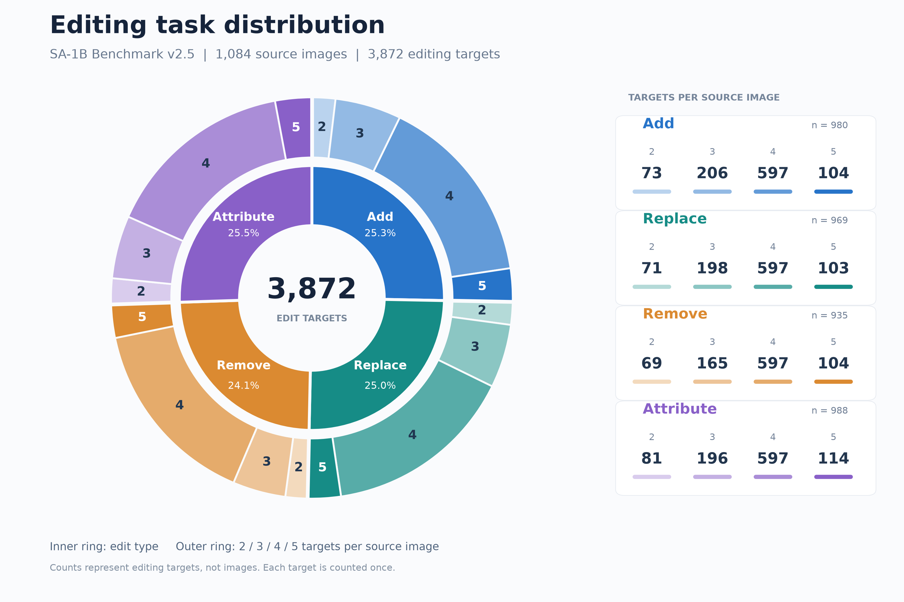

# SAMTok Benchmark v2：SA-1B 多对象细粒度交互编辑

当前版本为 **v2 / release 2.5.0：1,084 张不同 SA-1B 源图、3,872 个独立编辑目标，每图 2–5 个目标**。包括原版 200 张和新增 884 张；所有 case 至少混合两种交互形式。四类任务基本均衡，全部 980 条 add 使用直接承载或附着锚点。源图、mask、任务和交互已冻结，完成构建与全量资产校验；尚无模型编辑结果和独立人工验收。

此文档维护当前规模、任务设置与发布入口；[统一协议](docs/INSTRUCTION_PROTOCOL_ZH.md)维护 instruction / mask 规范，[扩充过程](docs/BENCHMARK_EXPANSION_1K_ZH.md)记录视觉审核依据，[原版协议迁移记录](docs/INSTRUCTION_ALIGNMENT_20261013_ZH.md)仅描述原版 200 张。当前完整元数据为 `data/v2_1084/`；`data/v2/` 保留原版 200 张供追溯，旧 `data/v2_1k/` 是未验收模板草稿，不用于评测。

## 1. 评测目标与判定方式

研究问题是：同一复杂场景中，用户分别指定多个物体或部件，以不同形式输入，模型能否同时准确、完整地执行全部编辑，保护其余内容，并保证每个编辑的自然质量。评测重点包括实例选择、部件指代、遮挡后的多块可见区域覆盖、细长区域和孔洞边界、相邻内容保护，以及不同对象指令之间的干扰。

| 维度 | 判断内容 | 失败示例 |
| --- | --- | --- |
| E：目标与执行完整性 | 每条指令选中正确实例和部件；实际完成要求的操作、数量、位置和全部相关可见部分 | 改错同款箱子的提手；只改被遮挡部件的一段；只新增替代物却留下原物 |
| P：非目标保持 | 保留该对象未指定部分、邻近物、遮挡者和背景；同图其他指令明确允许的变化除外 | 修改提手时改变箱体；改衣袖时改变躯干或旁人 |
| Q：编辑质量 | 每个目标的形状、材质、边缘、接触、遮挡、光照与阴影合理 | 新配件悬空；断裂边缘；部件融合；不合理的局部结构 |

每个 U 独立判断 E/P/Q，同时判断整图 global_P/global_Q。**JointPass = 所有 U 的 E∧P∧Q ∧ global_P ∧ global_Q**。任一目标漏改、错改、越界或质量失败，整条 case 失败；大目标的成功不能补偿小目标的失败。报告同时分解 E/P/Q、目标数、编辑类型、交互形式、困难标签；主指标是整图联合成功率。

评估查看原图/结果全图及逐目标固定坐标的配对局部裁剪。允许操作必需的局部显露背景、连接、光影调整。**源 mask 是语义定位标注，不是输出差分金标准**，不能用差分与 mask 的 IoU 代替 E/P/Q。尤其 add、replace 和移除子部件，允许变化范围由具体指令决定。全量源标注和验收规则属于 evaluator 私有信息。

## 2. 源数据与可追溯路径

本版图片全部来自前期分析的 **SA-1B 图片库及配套 dense annotation**，不含 PACO-LVIS 或 ADE20K 的旧 212 条。SA-1B 是为通用图像分割建立的大规模自然图像与区域资源；本地 handoff 给出的图片/标注索引口径为 **11,185,362 条**，这里沿用 handoff 的统计，没有重新扫描全库。场景包含人群、街市、店铺、衣物配件、车辆、器物、建筑设施等。

配套 dense TFRecord 中有 `key`、图片 caption、tags、`objects_json` 和 `associations_json`。对象记录包含 object_id、类别/描述与 COCO RLE 可见区域。它们是本地配套的 dense 标注；本文不把这些语义对象与官方 SA-1B 自动 mask 集逐项等同。类别和描述可有误，实际入选及指令以图像、mask 和实物归属核查为准。

- Handoff：`/mnt/hdfs/byte_ttlive_strategy_llm/user/haobo.yuan/datasets/SA1B_HANDOFF.md`。
- 图片 TFRecord：`/mnt/hdfs/byte_ttlive_strategy_llm/user/haobo.yuan/datasets/sa1b_tfd_1k/`。
- 图片索引：上述目录的 `sa_000000_unified_tot1000.index`。
- Dense TFRecord：`/mnt/hdfs/byte_ttlive_strategy_llm/user/haobo.yuan/datasets/sa1b_dense_label/annotation/`。
- Dense 索引：上述目录的 `all1000.index`。
- 当前源素材及筛选过程：`/mnt/bn/strategy-mllm-train/user/tanyue/datasets/samtok_edit_benchmark_v2/sa1b_source_selection/`。
- 正式来源追溯：当前 `data/v2_1084/cases.jsonl` 保存 SA ID、原 object_id、源图与 mask 哈希以及审查记录。原版详细 TFRecord 追溯保留在 `data/v2/provenance.jsonl`；新增作者记录及修订保存在 `construction/expansion_reviews/`。

索引中的旧 `/mnt/hdfs/sg_byte_ttlive_strategy_llm/` 前缀解析为本机 `/mnt/hdfs/byte_ttlive_strategy_llm/`。按已给出的偏移读取记录，不重建图片全量索引。原始 RLE 和所选区域清单保存在 `sa1b_source_selection/selected_sources.jsonl`；正式 PNG 记录逐文件 SHA256。

## 3. 如何挑选和筛选

原版通过场景初筛和逐目标细查保留 200 张；扩充阶段逐图查看原图、mask 裁剪和全图定位，并冻结决定。两阶段统计单独记录，不把取回图片、模型提议或备用样本算作正式样本。

| 阶段 | 原版 | 扩充阶段 |
| --- | ---: | ---: |
| 逐图细查并冻结决定 | 252 | 964 |
| 接受且完成构建校验 | 200 | 884 |
| 保留待补查 | 41 | 75 |
| 不采用 | 11 | 5 |

扩充阶段视觉接受率 884/964 = 91.7%；该值是 benchmark 输入筛选结果。新增接受样本的构建校验为 884/884；两者均不是训练 pipeline 的目标图审核通过率。累计 1,084 个源图 SHA256 唯一。

候选召回先排除 sky/ground/wall 等背景类别，并把面积约 0.08%–30%、重复类别、部件关键词、较小区域较多的图片排前。初始排序分数为 `2×min(重复量,12)+min(部件量,15)+min(小区域量,12)+min(候选量,12)`，仅用于安排查看顺序。类别重复、面积小、mask 多都不能单独构成入选证据。

**逐图入选标准：**

1. 每图实际选出 2–5 个不同实物的目标。不能把一个物体的碎块、同一个人的两只衣袖、同一辆车的多个零件冒充多个物体。每个 U 记录 `physical_parent_zh`；独立背包等配件可以与使用者分别作为目标。
2. 难点落实到所选区域：同类近似实例、被人/物遮挡、细杆/窄带/孔洞、小部件、相邻接触边界、不同粒度并存等，记录具体证据；背景热闹而目标只是孤立大块不够。
3. 对照较大原图、mask 叠加和目标局部，检查实物归属、全部可见部分、遮挡关系、孔洞、边缘及需要保护的邻居。同一对象分离的可见块保留为一个 U。
4. 目标足够清晰且指代可写；纯 ref 使用方位、所属人物/物体及部件关系区分实例。point/box 可以含更强的干扰，但真实目标必须可识别。
5. 舍弃 mask 把背景孔洞填满、整个人误标为衣物、错误覆盖邻居、目标明显失焦、镜面/印刷物冒充实物、同一实物重复计数等问题；可只剔除某张图的不合格 mask。
6. 未看过、未记录 accept、备用及淘汰项均不进入正式集合。所有入选图均有实际看图与任务记录；审查归属如实记录为 `ai_direct_visual`，不冒充人工验收。

场景初筛 `review/scene_review.tsv`、细查决定 `review/decisions.jsonl`、候选图片 `candidates/`、检索/审图脚本 `scripts/` 均在源素材过程目录。仓库 `data/v2/selection/` 保存关键筛选日志、统计及原 RLE 验证结果。指令审查记录在 `data/v2/instruction_reviews.jsonl`，对应 50 张四图审查页的路径和 SHA256；大图回看保留在各源图的 `review.jpg`。

这是困难场景定向精选，并非 SA-1B 全库无偏样本。衣物、包带、提手等仍较多，领域没有做均衡配额；“高难”来自视觉结构审查，尚无模型成功率标定。

## 4. 区域标注与交互协议

mask 使用 dense annotation 中该目标原始可见区域，转为与原图同尺寸的 0/255 PNG；逐像素与原 RLE 核对，不扩张、补画或合并不同实物。box 为 mask 紧致轴对齐框，整数 xyxy，右下不含。point 取 mask 内距边界最远的像素，保证落在目标内；这是确定性构造点，不代表真实用户点击分布。

英文 ref 由本轮逐图编写，中文给出对应实例/部件；无 ref 的指令仅用 `the selected <part type>` 表明粒度，不泄露完整位置描述。mask 是所选对象/部件的定位范围。全部 980 个 add 定位现有承载物或附着部位；remove、replace、attribute 定位被编辑的对象或包含指定子部件的宿主。子部件必须在指令中明确，不能将其扩大为整个宿主。

**Add 的区域语义（benchmark DCO contract）：** add 的公开 mask、box 或 point 标记的是源图中已经存在的承载物/安装面，即新增物体的锚点（host/attachment anchor），不标记新增物体在结果图中的预计轮廓，也不是输出差分金标准。新增物体在 source 中不存在；因此 instruction 使用 `Add <new item> to/on/onto <target>.`，其中 `<target>` 与该锚点绑定，原承载物必须保留，新增物体必须以指令要求的数量、位置和接触关系附着到该锚点。add 的 `edit_contract.locator_semantics` 为 `addition_support`；其允许的结果变化可以因连接、遮挡、边缘、光照或阴影而超出锚点，但不能借此改动无关对象。评测时应检查新增物体是否出现、是否附着在指定锚点、原承载物及邻近内容是否保持，以及整体编辑质量。

每个对象独立取一种正式模式，无 ref 必须有 point/box/mask；有 ref 可以无区域。冻结时按 manifest 顺序循环七种模式，保证每图至少两种形式；未按模型效果挑模式。

| 正式模式 | 目标数 |
| --- | --- |
| noref+point | 554 |
| ref+box | 553 |
| noref+mask | 553 |
| ref+none | 553 |
| ref+mask | 553 |
| noref+box | 553 |
| ref+point | 553 |

`ref+none` 是纯 ref。公开输入不会附送其 point/box/mask；no-ref 不附送私有 full ref。中文翻译默认仅供审核。审核页“全部 ref”会把私有目标标签画到原图，用于复核；**不等同于模型的正式输入**。

支持两个协议：`native_regions_v2` 直接提供对应坐标或 mask，且只暴露实际指定的形式；`visual_locator_v2` 提供干净源图和仅画指定定位形式的第二张提示图。审核包内 JPEG 提示图用于浏览；正式运行生成 PNG，保持原分辨率。支持 `mixed` 主评测、`all_ref`、`all_mask_noref` 和 `single` 消融。不同协议/消融需分别报告。

## 5. 统一 instruction 与源区域协议

### 一条指令与一个源区域

Benchmark 与训练数据共用以下规范：英文语义记录/渲染格式为 `instruction_protocol_version=1.0`，mask 含义契约为 `mask_semantics.version=1.1`，写作风格为 `benchmark-concise-2-direct-add-1`。三者分别描述可序列化字段、区域的意义和语言写法，不是三套不同任务协议。代码与本段正文在两个仓库逐字核对。

每个编辑目标 U 绑定一个源实例或部件 S、一种操作及其指令。Point、box、mask 和文字 ref 是 S 的不同定位形式，互相转换不产生新目标。原始 mask 保留可见像素、遮挡和孔洞；不把 bbox 内未选中的醒目物体误当成 S。Mask 不因编辑改成结果轮廓，也不是允许任意修改其内部全部内容的授权。

实际编辑对象 T 可以等于 S，也可以是 S 内明确命名的部件。若 mask 已指向袖口，直接说“选中的袖口”；若 mask 指向上衣而只编辑袖口，指令必须写明袖口，构造记录必须表达这一层级，不能把 scope 偷换成袖口以绕过执行区域约束。

### 四类指令与 mask 的含义

| 类型 | 标准句式 | 源 mask 的含义 | 必须保持的边界 |
|---|---|---|---|
| add | `Add <item> <relation> <anchor>.` | 现有直接承载物、容器、穿戴对象、安装面或附着部位；少数符合条件的紧邻参照物 | 宿主保留；新增数量、接触、尺度及位置自然；不是新增物最终轮廓 |
| replace | `Replace <target> with <replacement>.` | 被替换的现有物体/部件；宿主选择时显式指定内部部件 | 新旧对应同一对象层级，有真实结构/品类变化；单纯换色归 attribute |
| remove | `Remove <target>.` 或 `Remove <part> from <host>.` | 要删除的现有目标，或包含所述删除部件的宿主 | 只删除指明范围；不把整个宿主清空；不设计不自然的断肢任务 |
| attribute | `Change the <property> of <target> to <value>.` | 属性变化所属的现有物体、表面或明确部件 | 保留身份、结构及未指定内容；不得把“给人改色”含糊代指衣服 |

Attribute 支持 color/material/finish/pattern/texture/text；透明物染色用 `Tint <target> <color>.`，透明度用 `Make <target> transparent/translucent/opaque.`。文字内容逐字保留并加引号；仅必要时在一句话内列多个属性。加实体徽章/布贴属于 add，改变原表面图案属于 attribute，删除已有标志属于 remove。

删除内容物、连同内容物删除、剪短衣物等须写明范围和终点。一个 U 不混入不同操作；同一锚点添加多个同类物品可为一个 U，但必须说明数量。多目标 case 的每个 U 独立绑定指令，其他 U 授权的变化不算该 U 的越界。

### Add：直接锚点优先，安装部位与关系分开

1. 优先在所选对象上直接承载、容纳、穿戴、附着或印制。先根据宿主功能、材质、尺寸和可见空间选择自然的新物，而不是先想好物品再寻找远处参照。
2. `placement.relation` 写新增物与宿主/安装部位的关系，如 `on/in/attached to/mounted on/sewn onto/clipped to/hanging from`；`placement.site` 只写必要的宿主内部位置。`ref` 负责区分哪个宿主，不重复承担 site 的内容。
3. “在袖口下方的衣袖上缝补丁”是直接附着：`relation=sewn onto`、`site=area below the cuff`、`anchor_mode=support`。Site 里出现 below/near 不会把它变成参照添加。“椅子旁的包”用于识别包，给包提手加牌子仍是直接锚点。
4. 新物边缘、必要接触阴影和遮挡可超出源 mask，不能要求全部新增像素都落在原 mask 内。但必须与该宿主保持真实接触/支撑，且不妨碍原有功能、不改动无关实例。
5. 只有直接添加不自然时，才允许 `anchor_mode=reference`：位置真正紧邻、可见支撑面明确、侧别/安装位置唯一。远距离地标、悬浮新物、可落在多个位置的“附近”均不接受。训练构造必须有可信执行区域；缺少时换类型或拒绝该指令，不判原 mask 无效。
6. 本版 benchmark 的全部 add 均使用直接锚点。协议允许紧邻例外，不等于当前样本含此例外。Benchmark 用户只提供源定位，不需要预先画出新物轮廓；训练内部执行 mask 不能冒充 benchmark 输入。

### 精简、准确、无歧义

默认一句祈使句：动作＋最短无歧义目标短语＋必要结果。目标唯一时停止添加限定；有竞争实例时才增加一个经图像核实的所属、方位、颜色或序数。序数必须说明可见计数组和方向；身体左右易混淆时用 image-left/image-right。颜色从无标注原图读取，不从彩色 mask 叠加读取。

不要另起 `which is/located/the one...` 分句解释位置，不堆叠宿主、颜色、方向，不列排除项。不要附加“其他都不变”“保留材质/光照”等通用保留列表：这些由公共契约和内部生成提示承担。`qualifier` 默认空，仅当省略会改变请求语义时保留短限定。必要的计数、精确文字、安装位置和删除范围不可为缩句而删除。

常规目标是 Ref 不超过26个英文空格词、No-ref 不超过16词；不是硬截断阈值，不填充到目标长度。Replace 的新形态写在一个完整替换物短语中，内部 form_change 证据不再追加到句尾。模型在同一次请求内检查并删冗，不默认增加润色调用。

### Ref / No-ref 和结构化记录

两种指令从同一 `instruction_spec` 渲染；No-ref 只把识别源实例的 ref 换成 `the selected <scope>`。操作、部件层级、物品、数量、目标属性、局部安装位置和必要限定必须相同。No-ref 必须有 point/box/mask；ref-only 不泄露私有区域或完整语义字段。

例如 Ref 为 `Add a red tag clipped to the handle of the left suitcase.`，No-ref 为 `Add a red tag clipped to the handle of the selected suitcase.`。若源区域已经选中提手，则 No-ref 是 `Add a red tag clipped to the selected handle.`，不能重复“提手的提手”。

作者记录包含 operation、核实后的 ref/scope、payload、target_part/remove_mode、attributes、placement 与必要 qualifier。Add 的物品 payload 不保留指代宿主的悬空 its/it，连接关系和 site 单独存储；构造器不得靠扫描 near/below/above 猜测锚点语义。英文、中文、completion requirement、edit contract 和摘要必须随同一条作者记录一起更新。

### 训练执行与质量检查

源定位 mask、实际执行区域 execution/support mask、邻近保护区域是不同概念。宿主内子部件及紧邻参照任务必须有可信执行区域；检查区域与语义层级相符，不能仅把 ref 改成部件名称而仍开放整个宿主。区域外像素不变只能证明合成边界，不能证明区域内改对、自然或没有误伤。

检查依次覆盖：原图/mask 绑定及几何；逐条 Ref/No-ref 等价与规范；图像中的实例归属和最接近竞争目标；操作自然性与类别边界；add 接触关系和局部位置；生成后完成度、非目标保护和自然质量。自动校验、模型视觉审核、assistant 目视复核和独立人工验收分别记录，不能互相冒充。

本版 3,872 组 Ref / No-ref：Ref 平均 13.19 词、中位 13、最长 27；No-ref 平均 8.65 词、中位 9、最长 18。指令遵循精简单句和最短无歧义目标短语；必要的部件、数量、位置与替换结果保留。长度是描述性统计，不证明语义无歧义。

原版作者记录保留于 `construction/instructions/`；新增记录、视觉审核依据与显式修订位于 `construction/expansion_reviews/`。不重写历史审核版本。当前发布清单与全量统计见 `data/v2_1084/`。


## 6. 当前构建结果

| 编辑类型 | 目标数 | 占比 | 包含该类型的 case |
| --- | ---: | ---: | ---: |
| add | 980 | 25.31% | 961 |
| replace | 969 | 25.03% | 951 |
| remove | 935 | 24.15% | 916 |
| attribute | 988 | 25.52% | 959 |



图中内环为编辑类型，外环为该类型所在源图的目标总数，均按编辑目标计数；图片分布见下表。

| 每图独立目标数 | case 数 | 占比 |
| --- | ---: | ---: |
| 2 | 147 | 13.56% |
| 3 | 255 | 23.52% |
| 4 | 597 | 55.07% |
| 5 | 85 | 7.84% |

平均每图 **3.572** 个目标；4–5 目标图 **682 张（62.92%）**。原版与新增的目标数分布不同：新增 884 张中，2/3/4 目标分别 121/207/556 张，没有新增 5 目标图。因此总规模和编辑类型均衡不代表目标数均衡。

| 主要难点标签（可重叠） | case 数 |
| --- | ---: |
| 同类多实例 | 279 |
| 遮挡 | 687 |
| 紧邻保护 | 328 |
| 局部部件 | 152 |
| 细长狭窄 | 156 |
| 小目标 | 238 |
| 孔洞结构 | 29 |
| 分离可见区域 | 34 |
| 反射干扰 | 56 |
| 透视 | 117 |

展示统计合并原版中文与新增英文的同义标签，每张图每个标签只计一次；原始标签和完整映射后统计均保存在 `statistics.json`。标签依赖作者记录，不表示所有相关难点均被穷尽标注。

mask 面积占整图中位数 **0.5558%**，范围 **0.0097%–60.5229%**；小于 1% 的有 **2512/3872** 个目标。**586 个目标 / 418 张图**含多个显著连通块。连通块采用 4 邻接，忽略小于 max(9 像素, mask 面积 0.1%) 的分量；它与视觉难点标签不是同一统计。

### 质量核查与评测状态

累计 1,084 张源图、3,872 个目标及 6,040 项源资产完成全量构建校验，manifest SHA256 为 `f90849e776ce6269d4851f4c4b1380226de65ce68a7ce4739c4769e2be609d38`。校验覆盖二值 mask、原始像素、尺寸、point/box 几何、独立目标重叠、混合交互、协议绑定、资产哈希和源图去重。每张图具有 assistant 直接视觉审核依据；**独立人工复核为 0，尚无编辑模型输出或评分**。原版 95 项测试和 200 case 浏览器检查是历史证据，不能冒充 1,084 case 的浏览器验收。

发布排版抽查发现 **1 个 case 的 2 条指令仍需修复**：`v2-sa_9357354`（完整 PDF 第 1,084 页）U1 将整个人含糊写成改蓝色，U2 将舞者替换成服装，均涉及人物与衣物层级错误。详情见 `data/v2_1084/known_issues.json`。当前包保留冻结清单供审核，未静默改写作者记录；结构/哈希校验通过不代表语义全部合格。该问题清单来自有限抽查，不能当作全量问题数，正式评测前仍需修复与复核。

新增源图排除了原版和当前正式四机训练的冻结 reservoir。原版 200 张均曾匹配 `SAMTok_Training_Data/sam_info.json`；目录成员关系不等于某个 checkpoint 实际训练过。全量历史训练暴露和近重复尚未审计，不能将本版声明为已验证的独立 holdout。

## 7. 代码、数据与审核包路径

| 内容 | 路径 |
| --- | --- |
| v2 repo | `/opt/tiger/tanyue/samtok_edit_benchmark_v2branch`，分支 `v2branch` |
| 当前完整元数据 | repo `data/v2_1084/` |
| 当前数据根目录 | `/mnt/bn/strategy-mllm-train/user/tanyue/datasets/samtok_edit_benchmark_v2` |
| 正式源图、mask、复核图 | 数据根目录 `assets/v2-sa_<id>/` |
| 原版 200 张追溯 | repo `data/v2/`，原始数据根 `samtok_edit_benchmark_v2/` |
| 新增审核与修订 | repo `construction/expansion_reviews/`；扩充目录 `decisions/`、`revisions/` |
| 当前便携审核目录 | 扩充目录 `publication_20261015/review_1084/` |
| 当前审核压缩包 | 扩充目录 `publication_20261015/samtok_edit_benchmark_v2_review_1084_20261015.zip` |
| 完整离线 PDF | 审核包 `benchmark_all_1084_cases.pdf`，1,084 页，每页一个 case |

[下载全部 1,084 case 审核包](https://huggingface.co/datasets/TTangenty/samtok_edit/resolve/main/samtok_edit_benchmark_v2_review_1084_20261015.zip?download=true)；[直接查看全部 case 的 PDF](https://huggingface.co/datasets/TTangenty/samtok_edit/resolve/main/samtok_edit_benchmark_v2_all_1084_cases.pdf?download=true)。旧审核 zip 下载名同步指向此次完整包；旧 `all_200_cases.pdf` 保留为原版历史文件。远端状态以 `data/v2_1084/review_package.json` 发布回执为准。

相对资产路径以数据根目录或便携包根目录为基准。审核包包含全部源图、原始 mask、正式混合定位图、中英指令、全量 PDF、校验报告和冻结审核记录；大图和 zip 不纳入 Git。没有模型生成后的目标图，不附带虚构的用户审核记录。

解压整个压缩包后运行 `python run_review.py --no-browser --port 8766`，访问 `http://127.0.0.1:8766/`。仅需 Python 3.10+ 标准库和浏览器；图片按 case 加载。也可直接打开嵌入图片的 PDF，无需启动服务。用户审核保存于 `reviews/review_results.json`，不直接改写冻结清单。

## 8. 构建、验证与运行

```bash
cd /opt/tiger/tanyue/samtok_edit_benchmark_v2branch
python -m pip install -e '.[dev,review]'
export SAMTOK_BENCHMARK_ROOT=/mnt/bn/strategy-mllm-train/user/tanyue/datasets/samtok_edit_benchmark_v2

samtok-benchmark-v2 validate --manifest data/v2_1084/cases.jsonl \
  --dataset-root "$SAMTOK_BENCHMARK_ROOT" --minimum-cases 1000 \
  --output data/v2_1084/validation.json

# 只从冻结标注构造模型正式输入。
samtok-benchmark-v2 prepare --manifest data/v2_1084/cases.jsonl \
  --dataset-root "$SAMTOK_BENCHMARK_ROOT" --protocol native_regions_v2 \
  --variants mixed --output /tmp/samtok_1084_native_mixed

# 新目录，避免覆盖已有用户审核。
samtok-benchmark-v2 review --manifest data/v2_1084/cases.jsonl \
  --dataset-root "$SAMTOK_BENCHMARK_ROOT" --output /tmp/samtok_1084_review
```

扩充与冻结记录的重放方式见 [扩充文档](docs/BENCHMARK_EXPANSION_1K_ZH.md)。原版构造器 `build_sa1b_v2.py` 和 `write_document.py` 用于复现 200 张历史版本，不用于重写当前 1,084 张文档。修改指令时须回看对应图片、更新作者记录并重新校验和打包。浏览器验收、构建校验、视觉审核和模型评测分别记录。

## 9. 可视化样例与实际双语指令

下图展示源图及全部已选 mask，颜色按 U1 红、U2 蓝、U3 金、U4 紫、U5 绿。这里完整展示选区以便审核，正式输入只给每个 U 冻结的形式。**这些是源图标注可视化，不是模型编辑结果。** 表中是正式模式实际发送的英文指令及审核用中文翻译；no-ref 的实例通过图上区域选择。

### Case 001：并肩人物与衣物遮挡

`v2-sa_10063996`。两人靠近，左侧仅选一只袖子、右侧选被头发和纸张遮挡的外套；需区分不同编辑粒度并覆盖外套全部可见区域。


| 目标 | 任务 | 正式输入 | English | 中文 |
| --- | --- | --- | --- | --- |
| U1 | replace | noref+point | Replace the selected sleeve with a flared bell sleeve. | 将选中的衣袖替换为喇叭袖。 |
| U2 | attribute | ref+box | Change the color of the red coat of the woman on the right to navy blue. | 将右侧女性红色外套的可见面料改为藏蓝色。 |

### Case 008：图书馆同款木椅与桌腿交错

`v2-sa_6295141`。三把独立椅子的靠背和横撑、细腿与桌腿交错；左椅被桌面及前椅遮挡，编辑必须保持框架空隙中的地毯和其他椅腿。


| 目标 | 任务 | 正式输入 | English | 中文 |
| --- | --- | --- | --- | --- |
| U1 | remove | noref+mask | Remove the selected chair. | 移除选中的椅子。 |
| U2 | add | ref+none | Add one burgundy seat cushion on the chair facing away in front of the nearest table. | 给前景正面背向镜头的木椅加上一个酒红色坐垫。 |
| U3 | attribute | ref+mask | Change the color of the partly hidden chair on the left of the nearest table to white. | 将前景桌左侧被遮挡的木椅改为白色。 |

### Case 033：食品摊位中交叉的竹签

`v2-sa_3206973`。在大量相似竹签中指定两根；右侧竹签被另一根交叉遮挡，必须覆盖其分离可见部分。


| 目标 | 任务 | 正式输入 | English | 中文 |
| --- | --- | --- | --- | --- |
| U1 | remove | noref+box | Remove the selected skewer. | 移除选中的签子。 |
| U2 | replace | ref+point | Replace the skewer partly crossed by another skewer on the right with a long two-pronged metal serving fork. | 将右侧被斜向竹签遮挡的竹签替换为长柄双齿金属餐叉。 |

### Case 138：装饰物密集的店铺灯具

`v2-sa_37740`。四套独立吊灯只取玻璃灯泡，保护灯座、吊线和贴近的悬挂装饰，亮度与透明反射各不相同。


| 目标 | 任务 | 正式输入 | English | 中文 |
| --- | --- | --- | --- | --- |
| U1 | add | ref+none | Add one small silver wire cage around the glass light bulb on the far right. | 给右侧吊灯的玻璃灯泡加上一个围住玻璃的小银色金属丝护笼。 |
| U2 | replace | ref+mask | Replace the largest glass light bulb at the upper center with a long tubular glass light bulb. | 将上方中间最大吊灯的玻璃灯泡替换为长管形玻璃灯泡。 |
| U3 | remove | noref+box | Remove the selected light bulb. | 移除选中的灯泡。 |
| U4 | attribute | ref+point | Tint the glass light bulb at the middle left pale blue. | 将左侧中间吊灯的玻璃灯泡染成浅蓝色。 |

### Case 168：商店内密集陈列的旅行箱

`v2-sa_6330783`。五个几乎相同提手嵌在密集重复箱体和拉链之间，必须把提手匹配到正确箱子。


| 目标 | 任务 | 正式输入 | English | 中文 |
| --- | --- | --- | --- | --- |
| U1 | remove | ref+point | Remove the top handle of the pale-purple suitcase at the front right. | 移除前景右侧淡紫色箱子的顶部提手。 |
| U2 | replace | noref+point | Replace the selected suitcase handle with a looped brown leather handle. | 将选中的行李箱提手替换为棕色皮革环形提手。 |
| U3 | add | ref+box | Add one small yellow luggage tag attached to the top handle of the champagne-colored suitcase behind the bright-pink one. | 给亮粉箱后方香槟色箱子的顶部提手加上一个小黄色行李牌。 |
| U4 | attribute | noref+mask | Change the color of the selected suitcase handle to black. | 将选中的行李箱提手改为黑色。 |
| U5 | replace | ref+none | Replace the top handle of the gray suitcase on the right with a curved wooden handle. | 将右侧灰色箱子的顶部提手替换为弧形木提手。 |

### Case 198：狭窄街道上一排踏板摩托车

`v2-sa_8861209`。五块近似挡泥板在车轮与前叉之间重复出现，停车队列相互重叠，禁止连车胎一起改。


| 目标 | 任务 | 正式输入 | English | 中文 |
| --- | --- | --- | --- | --- |
| U1 | remove | ref+box | Remove the front fender of the nearest dark scooter in the parked row. | 移除右侧前排靠近镜头黑色踏板车的前挡泥板。 |
| U2 | attribute | noref+mask | Change the color of the selected motorcycle fender to glossy red. | 将选中的摩托车挡泥板改为亮红色。 |
| U3 | add | ref+none | Add one small amber reflector on the visible side of the white front fender of the scooter approaching along the road. | 给道路中迎面驶来踏板车的白色前挡泥板加上一个装在可见侧面的小琥珀色反光片。 |
| U4 | replace | ref+mask | Replace the dark front fender immediately behind the white parked scooter with a short angular black front fender. | 将白色踏板车后方黑车的前挡泥板替换为短款棱角形黑色前挡泥板。 |
| U5 | replace | noref+box | Replace the selected motorcycle fender with a long rounded chrome front fender. | 将选中的摩托车挡泥板替换为长圆弧形镀铬前挡泥板。 |

### Case 200：石墙上陈列的四把旧木椅

`v2-sa_8981826`。不同椅子分别选择靠背、顶条或座面，细杆、孔洞与强阴影不能混为部件。


| 目标 | 任务 | 正式输入 | English | 中文 |
| --- | --- | --- | --- | --- |
| U1 | replace | ref+mask | Replace the visible ladder-back frame of the second green chair from the left with a rounded wooden backrest frame with two upright slats. | 将左起第二把绿椅的梯形靠背可见木框替换为带两根竖条的圆弧形木靠背框。 |
| U2 | remove | noref+box | Remove the selected chair rail. | 移除选中的椅子横条。 |
| U3 | attribute | ref+point | Change the color of the seat of the black chair on the far right to dark green. | 将最右黑椅的座面改为深绿色。 |
| U4 | add | noref+point | Add one small cream-colored seat cushion on the selected chair seat. | 给选中的椅子座面加上一个米白色小坐垫。 |
