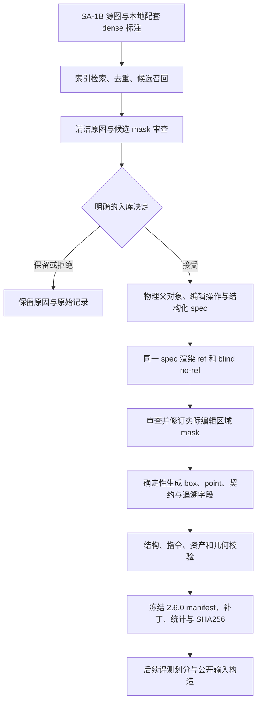
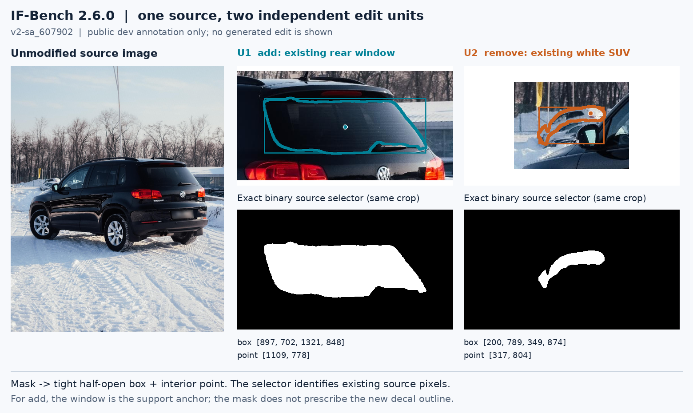

# IF-Bench 数据构建说明

本文说明 **数据 release 2.6.0** 的来源、筛选、标注、修订、发布与复现方式。一个 case 对应一张真实源图及 2–5 个同时执行的编辑单元；每个单元指定一个不同的物理父对象及其可见物体、部件或附着部位。发布的是源图引用、区域标注和编辑要求，不包含唯一正确的编辑后图像。

数据版本、标注协议与模型评测协议分别管理。本文的 `release_version=2.6.0`、`schema_version=2.0`、`instruction_protocol_version=2.0`、`mask_semantics.version=2.0`，不能与评测协议的版本号混用。评测输入如何按 setting 暴露，见 [使用说明](USAGE.md)。当前数据入口为 [data/current.json](../data/current.json)，其 manifest 是 [data/v2_2.6.0/cases.jsonl](../data/v2_2.6.0/cases.jsonl)。

## 1. 发布内容与规模

当前 manifest 的 SHA256 为：

```text
818ce524a1d1f363dc8ea5caa7a887b2dd0355c17a5600d1cbd696cffcf263fb
```

| 项目 | release 2.6.0 |
|---|---:|
| case / 唯一源图 | 1,084 |
| 编辑单元 | 3,872 |
| 每图 K=2 / 3 / 4 / 5 的 case 数 | 147 / 255 / 597 / 85 |
| add / replace / remove / attribute 单元数 | 980 / 969 / 921 / 1,002 |
| 目标面积小于源图 1% 的单元 | 2,650 |
| 含多个显著连通分量的单元 | 567 |
| 新版 `_v2.png` mask | 708 |
| 资产清单条目 | 6,040：1,084 源图、1,084 审查图、3,872 当前 mask |

manifest 中保存了每个单元的一种混合交互配置；它不是一次具体模型实验的输入清单。七种配置的数量为 `noref+point` 554，其余 `ref+none`、`ref+point`、`ref+box`、`ref+mask`、`noref+box`、`noref+mask` 各 553。每张图至少包含两种配置；`noref+none` 不合法。分层评测可在同一份冻结标注上构造不同 setting，不修改这些标注。统计依据为 [statistics.json](../data/v2_2.6.0/statistics.json)、[asset_manifest.jsonl](../data/v2_2.6.0/asset_manifest.jsonl) 和 [验证回执](../data/v2_2.6.0/validation.json)。



## 2. 源数据与来源边界

SA-1B 是 Meta 为通用分割研究发布的数据集，官方说明约有 1,100 万张图像、11 亿个 mask，mask 为类别无关标注，**不含官方语义类别标签**。IF-Bench 只使用其中选出的 1,084 张图像。源数据介绍与获取条件见 [SA-1B 官方数据页](https://ai.meta.com/datasets/segment-anything/)。

本项目同时使用本地配套 dense 标注，manifest 将其记为 `SA-1B companion dense labels`。检索代码读取 `objects` 中的 `object_id`、`category`、`segmentation`，并保存原始 RLE、dense 文件 SHA256 和图像索引。因此，本项目的类别词、对象描述及编辑任务不能归因于 SA-1B 官方类别标注；配套语义标签的完整上游生产流程并不由本仓库重建。[检索代码](../src/construction/retrieve_expansion_sources.py#L47-L62) 和 [源数据追溯记录](../data/v2/provenance.jsonl) 给出了实际字段及本地 TFRecord 索引。

源图使用 `family_id`、`image_id` 与文件 SHA256 关联；当前 1,084 个 case 的源家族和源图哈希均唯一。所有源记录的 `training_catalog_member=true` 只说明它们在本地来源目录索引中，不表示已经证明各编辑模型的训练数据与这些图像无重叠。扩充候选对指定本地训练 reservoir 的排除检查，也不能推广为对任意模型预训练数据的去重保证。

仓库保存 manifest、审查及修订记录和新版 mask 补丁；完整源图与旧 mask 存放在外部数据根。SA-1B 官方页面另有数据许可入口，不能从本项目代码或补丁的可见性推导完整源图的再分发权限。

## 3. 候选检索与入库

当前 1,084 张图由已记录的 200 张源图和扩充接受的 884 张组成。两部分最终都经过 2.6.0 的统一协议迁移与修订；它们不是两个不同的当前评测集合。

| 构建记录 | 可核实的数量与含义 |
|---|---|
| 初始源图筛选 | 2,800 条抽样标注、1,244 张检索图像；详细决定 252 条，其中接受 200、保留 41、拒绝 11 |
| 扩充审查台账 | 964 个不同 source ID；接受 884、保留 75、拒绝 5 |
| 当前发布 | 200 + 884 = 1,084 个唯一源图；保留/拒绝项不计入 release |

初始数字来自 [selection/statistics.json](../data/v2/selection/statistics.json)；扩充数字可从 [expansion_reviews 的 batch JSON](../data/provenance/construction/expansion_reviews) 按 `source_id` 和 `decision` 重算。这些是构建阶段的来源记录，不是模型表现筛选。

候选处理分为三个环节：

1. **检索与排除。** 扩充检索从本地图像和 dense 标注索引读取数据，排除已选源图、已有候选及指定训练 reservoir 的 source ID；核对 TFRecord key，验证图像可读，并保留图像和 dense 文件哈希。日常物体类别、类别多样性等只用于提高候选召回率，检索结果的状态仍是未审核。[retrieve_expansion_sources.py](../src/construction/retrieve_expansion_sources.py#L24-L70)
2. **候选对象排序。** 扩充卡片的默认 shortlist 最多显示 16 个候选；候选原始 mask 面积比在 `0.00035…0.65` 之外时被跳过，常见可编辑物体优先，宽泛背景/人体类别降权，并先限制同类候选重复。**这是检索阶段的启发式，不是当前 release 的面积门槛**；后续部件精修可以得到更小的有效区域。[expand_reviewed_v2.py](../src/construction/expand_reviewed_v2.py#L43-L90)
3. **明确入库。** 提议文件不会自动成为发布标注。builder 只接受显式 `decision=accept` 的记录，并检查 `review_kind=ai_direct_visual`、源图及选中 mask 已查看标志、审查卡/源图/dense 哈希、源图不重复，以及候选 RLE 与原始 dense 标注一致。其余项保留原因或退回。[入库实现](../src/construction/expand_reviewed_v2.py#L105-L139)

审查需要在清洁原图中核实类别、颜色、前后、左右、同类实例、遮挡和父对象归属，并结合 mask 局部图判断边界。低对比、透明、孔洞、小目标或被遮挡的目标可以成为困难样本；无法稳定解释目标或边界时，应换目标或不入库。不能把标注覆盖层的颜色误当作物体颜色。

当前每个 case 的所有单元必须有不同的 `parent_instance_id`，并非只要求“至少有两个父对象”：同一人的多件身体部件、同一车辆的多个零件不能重复计为多个独立父对象。独立携带物可单独标记父对象，但这种语义归属依赖审查记录；代码对字符串唯一性的检查本身不能证明物理独立性。[当前 validator](../src/samtok_benchmark/v2/dataset.py#L22-L97)

候选阶段存在可选 VLM 提议工具，提议输出标为 `pending_direct_visual_review`；实际接受仍依赖显式台账。它属于数据构建辅助，不能被描述成模型评测时的原生编辑能力，也不能把 AI 审查标为独立人工审查。[提议工具](../src/construction/propose_expansion_v2.py#L21-L47)、[authoring 台账](../src/construction/expansion_reviews/authoring.py#L26-L46)

## 4. 当前标注结构

当前格式的可执行约束是 [dataset.py](../src/samtok_benchmark/v2/dataset.py) 与 [instruction_protocol.py](../src/samtok_benchmark/v2/instruction_protocol.py)。原目录中的 `data/legacy/schema.v1.json` 标题和字段属于 v1，不能用于校验 2.6.0 case。

| 层级 | 关键字段 | 含义 |
|---|---|---|
| case | `schema_version`、`id`、`selection_index` | 格式版本、稳定 case ID、来源顺序 |
| source | `dataset`、`annotation_dataset`、`family_id`、`image`、`sha256`、`size` | 图像来源、资产相对路径、内容绑定、原始 `[W,H]` |
| units | `id`、`operation` | 图内单元 ID 和一种编辑操作 |
| instruction_spec | `ref`、`scope`、`payload`、`target_part`、`remove_mode`、`attributes`、`placement`、`qualifier` | 定位语义与编辑内容的结构化来源 |
| target | `parent_instance_id`、`annotation_id`、`mask`、`mask_sha256`、`box`、`point`、`geometry` | 原实例来源及当前选择区域 |
| interaction | `has_ref`、`locator` | 发布数据的混合输入分配；无 ref 时必须有区域定位 |
| rendered instructions | `instruction_ref`、`instruction_noref` 及中文字段 | 从同一 spec 生成的成对指令与审核翻译 |
| semantic contract | `mask_semantics`、`completion_requirement`、`preserve`、`edit_contract` | 区域含义、完成条件及必须保留的内容 |
| provenance | `review`、`instruction_review`、`instruction_design`、`revision_2_6` | 入库证据、修订原因、审核类型与追溯信息 |

完整 manifest 比模型公开输入包含更多信息。`completion_requirement`、`preserve`、完整 target/spec 及审查元数据不能因其存在于数据文件中而自动交给编辑器；评测器应按具体 setting 构造公开请求。审查图也不是编辑器的额外参考图。

## 5. 编辑操作、ref 与 blind no-ref

一个单元绑定一个源区域和一种操作。设计时要区分“编辑什么内容”和“靠什么定位源对象”：

| 操作 | 正确的任务范围 | 当前源 mask 的含义 |
|---|---|---|
| `add` | 指定新增物、数量及附着/承载关系；优先直接承载、穿戴、容纳或印制 | 已存在的附着部位或支撑锚点，不是新增物轮廓 |
| `replace` | 有实际类别或结构替换；单纯换色/材质归入 attribute | 被替换的可见源物体或部件 |
| `remove` | 明确 whole、part、contents、contents_only 或被剪去区段及所需终点 | 实际删除的源区域；部件任务不能继续使用整个宿主作 mask |
| `attribute` | 改变明确属性，同时保留身份和非授权结构 | 属性作用的可见物体、表面或部件 |

canonical spec 支持 `color/material/finish/pattern/texture/text/tint/opacity`；属性必须有非空值，不能重复 property。`add/replace` 必须有 payload；`remove` 的 payload 为空，通过 `remove_mode/target_part/qualifier` 表达范围。`add` 的 site 存在 `placement.site`，不借用 `target_part`。当前 980 条 add 的 `anchor_mode` 都是 `support`；代码支持的 reference-anchor 例外不等于当前数据已经包含该类任务。[字段校验](../src/samtok_benchmark/v2/instruction_protocol.py#L91-L159)

英文指令由 `render(spec, True/False)` 成对生成。ref 保留源实例、部件或 site 的定位信息；no-ref 将整个源定位槽替换为 **`the selected region`**，保留操作、新增/替换内容、属性值、附着关系和必要结果要求。例如“剪到及膝长度”仍是编辑目标，不能因出现空间词就删掉；新增物的类别也不能被误当作源类别泄漏。

no-ref 不是对 ref 做简单字符串删词，也不是把目标类别改成“selected + 类别”。校验器要求 no-ref 与 canonical 渲染精确一致，拒绝未分类的 qualifier 及依赖原物体的含糊 payload。场景保护信息另存契约，不把指向源图中特定对象的保护短语带入盲指代。中文 no-ref 使用“选中区域”，英文 ref 改写时需同步提供中文 ref。[渲染及 no-ref 校验](../src/samtok_benchmark/v2/instruction_protocol.py#L162-L292)、[发布构建器](../src/construction/release_2_6/build.py#L183-L224)

长度检查的 ref 26 词、no-ref 16 词是触发长度复核的提示阈值，不是自动截断或丢弃规则；当前 release 记录的最长英文 no-ref 为 19 词。不能为满足长度提示而删除编辑含义。[length_advice](../src/samtok_benchmark/v2/instruction_protocol.py#L295-L300)、[发布统计](../data/v2_2.6.0/statistics.json)

## 6. 区域语义与确定性几何

**源 mask 表示实际编辑的源区域；它不是输出差分真值，也不授权随意重画整个区域。** 合法编辑可能在 mask 外产生必要的接触、遮挡变化、揭露背景、边缘、光照或阴影。add 的新物体也可以超出作为锚点的源 mask。ref、point、box、mask 都指向同一 source selector，但三种区域形式提供的信息精度不同。[mask 契约](../src/samtok_benchmark/v2/instruction_protocol.py#L312-L338)

当前资产采用与源图相同大小的二值 PNG，背景 0、前景 255，且非空。几何约定为左上角原点、x 向右、y 向下的整数像素：

- box 为半开 `[x1,y1,x2,y2]`。构建器对前景像素计算 `[min(x),min(y),max(x)+1,max(y)+1]`。
- point 为 `[x,y]`。新版构建器对补零边界后的 mask 做欧氏距离变换，取距离最大位置，映回源图坐标；不是另行调用定位模型。
- `area_fraction` 为前景像素数除以 `W×H`。显著连通分量按面积至少 `max(16, mask_area×0.005)` 统计；不能把任意噪声像素块都算作困难结构。
- 同图任意两单元的可见 mask 交集不能超过较小 mask 面积的 4%；它用于发现明显重叠，不能代替父对象语义判断。

构建器产生紧致 box；当前完整 validator 检查半开坐标、边界范围、包含 mask 和 point 在 mask 内，**没有单独断言 box 与最小外接框严格相等**。若更换几何生成器，需要额外对 tight box 做精确比较。[几何生成](../src/construction/release_2_6/build.py#L99-L111)、[资产与几何校验](../src/samtok_benchmark/v2/dataset.py#L100-L168)

### 一个真实的 dev 标注例子

以下图只使用已公开 dev case `v2-sa_607902` 的源图和区域标注；没有生成编辑后图像。左侧是源图，中间 U1 是黑色 SUV 后窗，右侧 U2 是另一辆白色 SUV 的可见部分。白色 SUV 被前车遮挡的部分不应补画到可见源 mask 中。



| 单元 | ref | blind no-ref |
|---|---|---|
| U1 / add | Add a small white BABY ON BOARD decal on the rear window of the black SUV. | Add a small white BABY ON BOARD decal on the selected region. |
| U2 / remove | Remove the white SUV behind the black SUV at the left. | Remove the selected region. |

U1 的 mask 是后窗的现有承载面，不是未来贴花的形状。U2 的 mask 是第二辆车的可见像素，不包含前景黑色车辆。两项分别绑定 `sa_607902:black_suv` 和 `sa_607902:white_suv`。图中几何直接核对公开 point/box/mask 请求；文件哈希与展示裁剪坐标见 [图例来源记录](assets/construction/annotation_example_provenance.json)。

## 7. 标注审查、修复与发布

2.6.0 构建以冻结的来源 manifest、显式 revision JSON 和审查后的 work mask 为输入，不临时让模型自由生成任务语义。修订记录指定 case/unit、动作、原因及 spec/翻译等变更；需要修订的部件/site mask 缺失时，builder 报告问题，不能悄悄保留不相符的大宿主区域。

mask 修复工具提供 SAM3 文本或点/框候选、已有候选的并/交/差组合、宿主或框裁剪、排除其他单元，以及检查图。`compose` 输出 `final.png/final.json/final.jpg`；审核后 `commit` 将最终 mask 及配方保存为 `U#_v2.png/U#_v2.json`。这是**数据标注阶段**的区域制作，冻结之后各方法按 setting 读取相同公开区域；它不允许评测时给某个编辑模型额外运行 SAM、定位器或改写器。[segment.py](../src/construction/release_2_6/segment.py#L146-L193)、[组合与提交](../src/construction/release_2_6/segment.py#L284-L314)

并非每张 `_v2.png` 都意味着一次新的神经分割调用：配方还包含从已有宿主 mask 裁剪、组合和像素修正的情况。发布的 708 张补丁均带配方；没有完整模型调用计数时，不据补丁数推算 SAM 调用数。`commit` 的存在性/非空检查也不能自动证明审查者确实看过图，审查行为应以实际台账为证据。

发布 builder 保留旧 `mask_v1/mask_sha256_v1/box_v1/point_v1/geometry_v1`，当前路径切换至新版 mask；更新 spec、ref/no-ref、中文、契约和几何，检查每图目标数、父对象、交互组合及区域重叠，再导出新 manifest、资产清单、统计、revision 应用记录和已知问题。[build.py](../src/construction/release_2_6/build.py#L139-L247)、[构建与发布元数据](../src/construction/release_2_6/build.py#L280-L398)

| 2.6.0 修订事实 | 发布记录 |
|---|---:|
| 专项修复 case / 无专项任务但统一迁移协议的 case | 804 / 280 |
| ref 改写 / no-ref 重渲染 | 1,552 / 3,872 |
| 新版 mask / 其中像素确实改变 | 708 / 691 |
| 因部件/site 语义要求的待修 mask 总数 | 299，发布时剩余 0 |
| 操作类型修订 | 24 个单元 |
| 删除 case / 删除单元 | 0 / 0 |
| 未解决 findings / 已记录 mask 豁免 | 0 / 0 |

数据来源图像保持不变。这些统计来自 [comparison_summary.json](../data/v2_2.6.0/comparison_summary.json)、[status.json 的 summary](../data/provenance/construction/release_2_6/status.json)、[known_issues.json](../data/v2_2.6.0/known_issues.json)，逐单元动作见 [revisions_applied.jsonl](../data/v2_2.6.0/revisions_applied.jsonl)。`known_issues` 为空表示当前记录中没有开放项，不是对未知标注错误的保证。

## 8. 校验层次与已知边界

| 校验层 | 实际检查内容 | 不由这一层证明的内容 |
|---|---|---|
| 元数据结构 | source/case 唯一；2–5 个单元；父对象 ID 不重复；合法操作及混合交互；入库证据存在 | 所有父对象语义都正确 |
| 指令协议 | spec 与操作、target ref/scope 对齐；ref/no-ref canonical 一致；mask contract 一致 | 中文与英文语义完全等价、任务一定自然 |
| 资产 | 文件存在、图像大小、SHA256；资产清单与 manifest 完全匹配 | 源图训练暴露、许可链的完整独立审计 |
| 几何 | 二值非空 mask、同画布、有效半开框、point 在 mask 内、目标重叠阈值 | mask 边界必然符合人类语义判断 |
| 视觉审查台账 | 当前 1,084 个 case 都记录 `ai_direct_visual`；修订问题有动作与证据 | 独立人工终审或标注者一致性 |

发布 [validation.json](../data/v2_2.6.0/validation.json) 记录 `status=passed`，检查了 6,040 个资产条目。当前 [release.json](../data/v2_2.6.0/release.json) 明确保留 **`independent_human_verified=false`、`semantic_signoff=false`**。不能把脚本通过、AI 看图或空的 remaining 清单改写成“已完成独立人工验收”。本数据的困难性来自已记录的真实场景选择及区域要求，不代表随机采样后覆盖了所有现实编辑任务。

## 9. 使用已发布数据与重建

以下命令在仓库根执行，均不运行编辑模型或 Judge。先安装包和构建依赖，并将数据根指向具有所需源图、旧 mask 和审查图的目录。变量使用示例路径；不要将临时校验回执写回冻结发布文件。

```bash
python -m pip install -e '.[construction]'
export IFBENCH_DATA_ROOT=/path/to/samtok_edit_benchmark_v2
export IFBENCH_CHECK_OUT=/tmp/ifbench/release-2.6.0-check
mkdir -p "$IFBENCH_CHECK_OUT"
```

### 9.1 核对元数据和版本

该步骤只读 manifest，不打开图像、不加载神经模型。

```bash
python - <<'PY'
import hashlib
import json
from pathlib import Path
from samtok_benchmark.v2.dataset import load_cases

manifest = Path('data/v2_2.6.0/cases.jsonl')
release = json.loads(manifest.with_name('release.json').read_text())
actual = hashlib.sha256(manifest.read_bytes()).hexdigest()
assert actual == release['manifest_sha256']
cases = load_cases(manifest)
print({'manifest_sha256': actual, 'cases': len(cases),
       'units': sum(len(c['units']) for c in cases)})
PY
```

期望得到本页的 manifest SHA、1,084 case、3,872 unit。该结果只说明结构与指令契约通过，不能替代资产检查。

### 9.2 安装当前 mask 补丁并校验全部资产

```bash
python src/construction/release_2_6/materialize_masks.py \
  --dataset-root "$IFBENCH_DATA_ROOT"

if-bench validate-data \
  --manifest data/v2_2.6.0/cases.jsonl \
  --dataset-root "$IFBENCH_DATA_ROOT" \
  --minimum-cases 1084 \
  --output "$IFBENCH_CHECK_OUT/validation.json"
```

补丁安装器检查每张补丁的路径、字节数和 SHA256，安装 708 张 mask；若目标位置已有内容不同的文件则拒绝覆盖。它不会下载源图或重新分割。完整 `validate` 会读取源图、当前 mask 和资产清单，可能产生较多共享盘 I/O；预期为 1,084 源图、3,872 单元、6,040 资产条目通过。[安装器](../src/construction/release_2_6/materialize_masks.py#L16-L42)、[真实 CLI 参数](../src/samtok_benchmark/ifbench/cli.py)

### 9.3 从冻结标注记录重放构建

重放所需材料是冻结来源 manifest、804 个 revision 文件、源图/旧 mask/审查图，以及已审查的 708 个新版 mask 和配方。无需重新运行 SAM3；先用 `--restore-work` 从 Git 补丁恢复 work mask。该选项恢复的是 `release_2_6_work/`，与安装到 `assets/` 是不同目标。

```bash
python src/construction/release_2_6/materialize_masks.py \
  --dataset-root "$IFBENCH_DATA_ROOT" --restore-work
```

当前构建入口显式接受数据根、work mask 与输出目录。先只读检查，再把重放结果写到临时目录：

```bash
python -m construction.release_2_6.build \
  --dataset-root "$IFBENCH_DATA_ROOT" \
  --output "$IFBENCH_CHECK_OUT/rebuilt" --check-only

python -m construction.release_2_6.build \
  --dataset-root "$IFBENCH_DATA_ROOT" \
  --output "$IFBENCH_CHECK_OUT/rebuilt"
```

可用 `--base`、`--revisions`、`--work` 显式指定来源；默认读取仓库冻结的来源 manifest、`data/provenance/construction/release_2_6/revisions/`，以及数据根下的 `release_2_6_work/`。

这会生成临时 release 元数据，并在数据根缺少新版 mask 时安装对应资产；它拒绝覆盖不同内容的已有 mask。使用已经完成 9.2 的数据根时，这些 mask 已存在。随后比较 `rebuilt/cases.jsonl` 与发布 manifest 的 SHA256，并对重建 manifest 运行相同完整 validator。若哈希不一致，应检查代码版本、来源 manifest、revision 与 work mask；不能直接把不一致的构建当作同一 release。

`publish.py` 的职责是导出逐单元比较、mask 补丁、current pointer 与展示图；`sync_data_root.py` 的职责是校验通过后将元数据镜像到数据根，并保留已知旧来源备份。它们包含仓库/数据根写入，属于维护者发布步骤，不是普通使用者每次评测的准备命令。[发布实现](../src/construction/release_2_6/publish.py#L69-L148)、[数据根同步检查](../src/construction/release_2_6/sync_data_root.py#L17-L52)

从原始 SA-1B 重新开始构造另一份标注，还需要本地 TFRecord 索引、配套 dense 记录、指定 reservoir、检索脚本及逐项 authoring/审查决定。仓库现有候选脚本含外部路径和冻结阶段假设，不能仅给一份 SA-1B 下载目录就自动复现全部语义决定；**发布标注的确定性重放**与**重新进行开放式数据标注**是不同的复现范围。

## 10. 数据 release 与后续 dev/test 的区别

2.6.0 manifest 自身没有把 1,084 张图分成训练、dev、test；其 `interaction` 字段也是数据标注的一部分，不是一次开发集选择。后续分层评测在冻结 manifest 上另建 split，按 source family 而非单元分组，防止同一张图的不同 setting 分散到 dev 和 test。

当前 split 实现使用 seed `20261027` 和 SHA256 确定性排序，固定两个已经用于接口审查的 case 在 dev 中，得到 **108 张 dev、976 张 test**。保存的元数据还明确标记 `historical_full_release_exposure=true`，因此不能把这一 split 宣称为此前从未使用过的全新隐藏测试集。[split 实现](../src/samtok_benchmark/ifbench/plan.py#L12-L39)、[常量与已暴露 case](../src/samtok_benchmark/ifbench/__init__.py#L3-L21)

加速验证的 dev20 是从这 108 张 dev 中，按 K 分层比例配额及 `SHA256(seed:case_id)` 选出的固定子集：K=2/3/4/5 分别为 3/4/11/2 张。选择只读取 source ID 和公开目标数，不读取生成结果或分数。其余 **88 张仍属于 dev**，不会转入 test；也不因此形成一个新的数据 release。[dev20 选择实现](../src/evaluation/protocol_audit/prepare_fairness_dev20.py#L70-L110)

这几个边界共同保证数据来源、标注质量和评测输入选择能够分别追溯；它们不代替仍待完成的独立人工语义验收和模型训练暴露审计。
