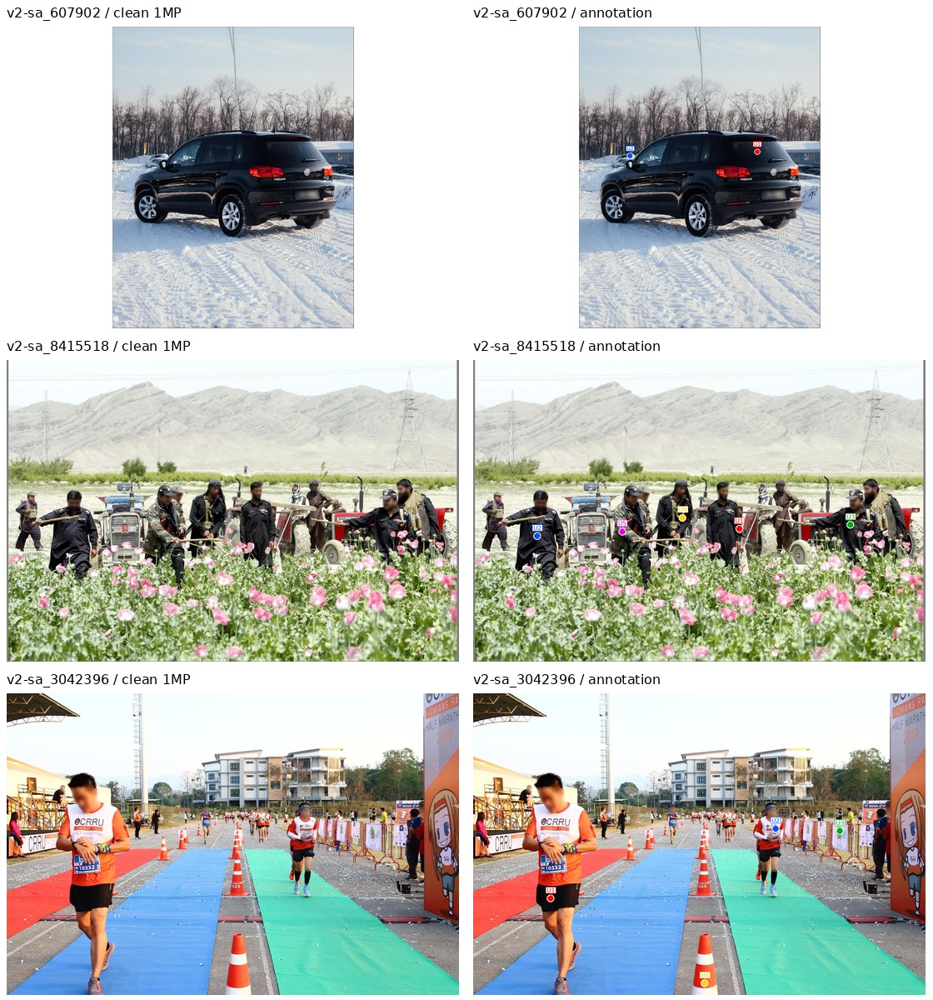
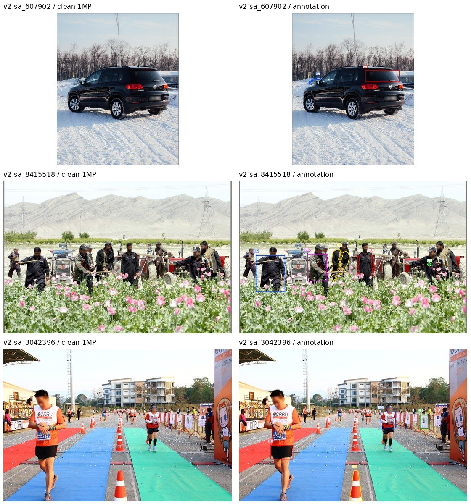
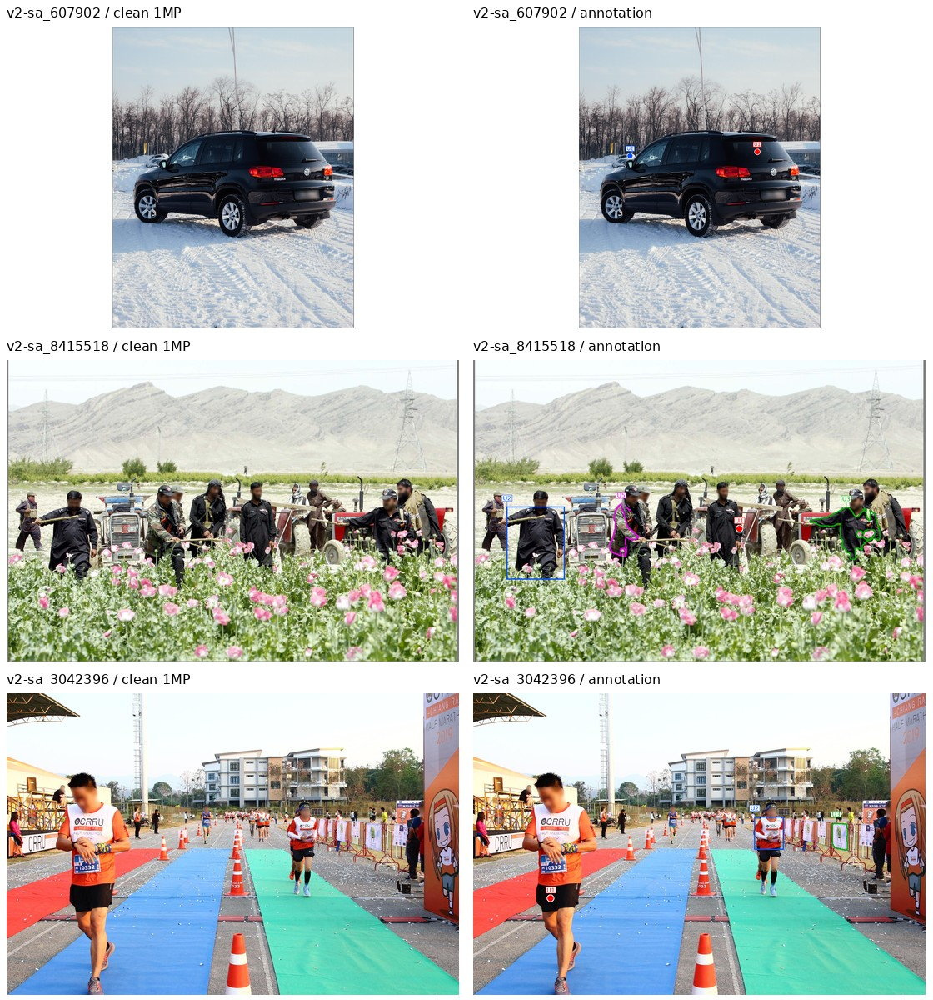

# 当前 1MP 输入样例

每个 setting 展示三个固定请求：清图、标注图及最终共享 prompt。模型专用路由见 [使用说明](USAGE.md)。所有图均来自本轮真实公共输入；S1 没有区域标注图。

## S1


### v2-sa_607902

双图模型的最终共享 prompt：

```text
Apply all of the following edits to the image. Keep everything else unchanged.
U1. Add a small white BABY ON BOARD decal on the rear window of the black SUV.
U2. Remove the white SUV behind the black SUV at the left.
```

七模型实际请求：[目录](/mnt/bn/strategy-mllm-train/user/tanyue/.ifbench-tmp/one-mp-probe-20261031/requests)，键为 `<model>/S1/v2-sa_607902/request.json`。RePlan/MIRAGE 的完整原生规划消息另保存在本轮结果的 `planners/` 中。

### v2-sa_8415518

双图模型的最终共享 prompt：

```text
Apply all of the following edits to the image. Keep everything else unchanged.
U1. Remove the sleeves from the long shirt of the front-facing person in the middle.
U2. Add one large flap chest pocket sewn onto the long shirt of the front-left person holding a pole horizontally.
U3. Change the color of the shirt of the capped person at the front right to light khaki.
U4. Replace the uniform top of the headscarf-wearing person in the middle with a knee-length utility coat with large patch pockets.
U5. Replace the camouflage jacket of the rifle-carrying man beside the blue tractor with a short-sleeved work shirt with a square collar.
```

七模型实际请求：[目录](/mnt/bn/strategy-mllm-train/user/tanyue/.ifbench-tmp/one-mp-probe-20261031/requests)，键为 `<model>/S1/v2-sa_8415518/request.json`。RePlan/MIRAGE 的完整原生规划消息另保存在本轮结果的 `planners/` 中。

### v2-sa_3042396

双图模型的最终共享 prompt：

```text
Apply all of the following edits to the image. Keep everything else unchanged.
U1. Replace the black shorts on the nearest runner on the left with knee-length black running tights.
U2. Change the color of the white-and-orange shirt on the nearest runner on the green carpet to green.
U3. Remove the nearest banner on the right-hand barrier.
U4. Add a small black arrow sticker on the cropped traffic cone at the bottom.
```

七模型实际请求：[目录](/mnt/bn/strategy-mllm-train/user/tanyue/.ifbench-tmp/one-mp-probe-20261031/requests)，键为 `<model>/S1/v2-sa_3042396/request.json`。RePlan/MIRAGE 的完整原生规划消息另保存在本轮结果的 `planners/` 中。

## S2-point



### v2-sa_607902

双图模型的最终共享 prompt：

```text
Image 1 is the clean source image to edit. Image 2 is the same image with colored marks and U labels. Use the marks only to identify the selected regions in Image 1. Return only the edited Image 1. Do not reproduce any marks, labels, or leader lines.
Each supplied region selects a source object, part, or anchor. For an addition, it selects the attachment or support location, not the outline of the new object.
Apply all of the following edits to the image. Keep everything else unchanged.
U1. [red point, label U1] Add a small white BABY ON BOARD decal on the rear window of the black SUV.
U2. [blue point, label U2] Remove the white SUV behind the black SUV at the left.
```

单图标注形式的最终共享 prompt：

```text
Edit the supplied image using its colored marks and U labels to identify the selected regions. Remove all marks, labels, and leader lines from the final edited image.
Each supplied region selects a source object, part, or anchor. For an addition, it selects the attachment or support location, not the outline of the new object.
Apply all of the following edits to the image. Keep everything else unchanged.
U1. [red point, label U1] Add a small white BABY ON BOARD decal on the rear window of the black SUV.
U2. [blue point, label U2] Remove the white SUV behind the black SUV at the left.
```

七模型实际请求：[目录](/mnt/bn/strategy-mllm-train/user/tanyue/.ifbench-tmp/one-mp-probe-20261031/requests)，键为 `<model>/S2-point/v2-sa_607902/request.json`。RePlan/MIRAGE 的完整原生规划消息另保存在本轮结果的 `planners/` 中。

### v2-sa_8415518

双图模型的最终共享 prompt：

```text
Image 1 is the clean source image to edit. Image 2 is the same image with colored marks and U labels. Use the marks only to identify the selected regions in Image 1. Return only the edited Image 1. Do not reproduce any marks, labels, or leader lines.
Each supplied region selects a source object, part, or anchor. For an addition, it selects the attachment or support location, not the outline of the new object.
Apply all of the following edits to the image. Keep everything else unchanged.
U1. [red point, label U1] Remove the sleeves from the long shirt of the front-facing person in the middle.
U2. [blue point, label U2] Add one large flap chest pocket sewn onto the long shirt of the front-left person holding a pole horizontally.
U3. [green point, label U3] Change the color of the shirt of the capped person at the front right to light khaki.
U4. [yellow point, label U4] Replace the uniform top of the headscarf-wearing person in the middle with a knee-length utility coat with large patch pockets.
U5. [magenta point, label U5] Replace the camouflage jacket of the rifle-carrying man beside the blue tractor with a short-sleeved work shirt with a square collar.
```

单图标注形式的最终共享 prompt：

```text
Edit the supplied image using its colored marks and U labels to identify the selected regions. Remove all marks, labels, and leader lines from the final edited image.
Each supplied region selects a source object, part, or anchor. For an addition, it selects the attachment or support location, not the outline of the new object.
Apply all of the following edits to the image. Keep everything else unchanged.
U1. [red point, label U1] Remove the sleeves from the long shirt of the front-facing person in the middle.
U2. [blue point, label U2] Add one large flap chest pocket sewn onto the long shirt of the front-left person holding a pole horizontally.
U3. [green point, label U3] Change the color of the shirt of the capped person at the front right to light khaki.
U4. [yellow point, label U4] Replace the uniform top of the headscarf-wearing person in the middle with a knee-length utility coat with large patch pockets.
U5. [magenta point, label U5] Replace the camouflage jacket of the rifle-carrying man beside the blue tractor with a short-sleeved work shirt with a square collar.
```

七模型实际请求：[目录](/mnt/bn/strategy-mllm-train/user/tanyue/.ifbench-tmp/one-mp-probe-20261031/requests)，键为 `<model>/S2-point/v2-sa_8415518/request.json`。RePlan/MIRAGE 的完整原生规划消息另保存在本轮结果的 `planners/` 中。

### v2-sa_3042396

双图模型的最终共享 prompt：

```text
Image 1 is the clean source image to edit. Image 2 is the same image with colored marks and U labels. Use the marks only to identify the selected regions in Image 1. Return only the edited Image 1. Do not reproduce any marks, labels, or leader lines.
Each supplied region selects a source object, part, or anchor. For an addition, it selects the attachment or support location, not the outline of the new object.
Apply all of the following edits to the image. Keep everything else unchanged.
U1. [red point, label U1] Replace the black shorts on the nearest runner on the left with knee-length black running tights.
U2. [blue point, label U2] Change the color of the white-and-orange shirt on the nearest runner on the green carpet to green.
U3. [green point, label U3] Remove the nearest banner on the right-hand barrier.
U4. [yellow point, label U4] Add a small black arrow sticker on the cropped traffic cone at the bottom.
```

单图标注形式的最终共享 prompt：

```text
Edit the supplied image using its colored marks and U labels to identify the selected regions. Remove all marks, labels, and leader lines from the final edited image.
Each supplied region selects a source object, part, or anchor. For an addition, it selects the attachment or support location, not the outline of the new object.
Apply all of the following edits to the image. Keep everything else unchanged.
U1. [red point, label U1] Replace the black shorts on the nearest runner on the left with knee-length black running tights.
U2. [blue point, label U2] Change the color of the white-and-orange shirt on the nearest runner on the green carpet to green.
U3. [green point, label U3] Remove the nearest banner on the right-hand barrier.
U4. [yellow point, label U4] Add a small black arrow sticker on the cropped traffic cone at the bottom.
```

七模型实际请求：[目录](/mnt/bn/strategy-mllm-train/user/tanyue/.ifbench-tmp/one-mp-probe-20261031/requests)，键为 `<model>/S2-point/v2-sa_3042396/request.json`。RePlan/MIRAGE 的完整原生规划消息另保存在本轮结果的 `planners/` 中。

## S2-box


### v2-sa_607902

双图模型的最终共享 prompt：

```text
Image 1 is the clean source image to edit. Image 2 is the same image with colored marks and U labels. Use the marks only to identify the selected regions in Image 1. Return only the edited Image 1. Do not reproduce any marks, labels, or leader lines.
Each supplied region selects a source object, part, or anchor. For an addition, it selects the attachment or support location, not the outline of the new object.
Apply all of the following edits to the image. Keep everything else unchanged.
U1. [red box, label U1] Add a small white BABY ON BOARD decal on the rear window of the black SUV.
U2. [blue box, label U2] Remove the white SUV behind the black SUV at the left.
```

单图标注形式的最终共享 prompt：

```text
Edit the supplied image using its colored marks and U labels to identify the selected regions. Remove all marks, labels, and leader lines from the final edited image.
Each supplied region selects a source object, part, or anchor. For an addition, it selects the attachment or support location, not the outline of the new object.
Apply all of the following edits to the image. Keep everything else unchanged.
U1. [red box, label U1] Add a small white BABY ON BOARD decal on the rear window of the black SUV.
U2. [blue box, label U2] Remove the white SUV behind the black SUV at the left.
```

七模型实际请求：[目录](/mnt/bn/strategy-mllm-train/user/tanyue/.ifbench-tmp/one-mp-probe-20261031/requests)，键为 `<model>/S2-box/v2-sa_607902/request.json`。RePlan/MIRAGE 的完整原生规划消息另保存在本轮结果的 `planners/` 中。

### v2-sa_8415518

双图模型的最终共享 prompt：

```text
Image 1 is the clean source image to edit. Image 2 is the same image with colored marks and U labels. Use the marks only to identify the selected regions in Image 1. Return only the edited Image 1. Do not reproduce any marks, labels, or leader lines.
Each supplied region selects a source object, part, or anchor. For an addition, it selects the attachment or support location, not the outline of the new object.
Apply all of the following edits to the image. Keep everything else unchanged.
U1. [red box, label U1] Remove the sleeves from the long shirt of the front-facing person in the middle.
U2. [blue box, label U2] Add one large flap chest pocket sewn onto the long shirt of the front-left person holding a pole horizontally.
U3. [green box, label U3] Change the color of the shirt of the capped person at the front right to light khaki.
U4. [yellow box, label U4] Replace the uniform top of the headscarf-wearing person in the middle with a knee-length utility coat with large patch pockets.
U5. [magenta box, label U5] Replace the camouflage jacket of the rifle-carrying man beside the blue tractor with a short-sleeved work shirt with a square collar.
```

单图标注形式的最终共享 prompt：

```text
Edit the supplied image using its colored marks and U labels to identify the selected regions. Remove all marks, labels, and leader lines from the final edited image.
Each supplied region selects a source object, part, or anchor. For an addition, it selects the attachment or support location, not the outline of the new object.
Apply all of the following edits to the image. Keep everything else unchanged.
U1. [red box, label U1] Remove the sleeves from the long shirt of the front-facing person in the middle.
U2. [blue box, label U2] Add one large flap chest pocket sewn onto the long shirt of the front-left person holding a pole horizontally.
U3. [green box, label U3] Change the color of the shirt of the capped person at the front right to light khaki.
U4. [yellow box, label U4] Replace the uniform top of the headscarf-wearing person in the middle with a knee-length utility coat with large patch pockets.
U5. [magenta box, label U5] Replace the camouflage jacket of the rifle-carrying man beside the blue tractor with a short-sleeved work shirt with a square collar.
```

七模型实际请求：[目录](/mnt/bn/strategy-mllm-train/user/tanyue/.ifbench-tmp/one-mp-probe-20261031/requests)，键为 `<model>/S2-box/v2-sa_8415518/request.json`。RePlan/MIRAGE 的完整原生规划消息另保存在本轮结果的 `planners/` 中。

### v2-sa_3042396

双图模型的最终共享 prompt：

```text
Image 1 is the clean source image to edit. Image 2 is the same image with colored marks and U labels. Use the marks only to identify the selected regions in Image 1. Return only the edited Image 1. Do not reproduce any marks, labels, or leader lines.
Each supplied region selects a source object, part, or anchor. For an addition, it selects the attachment or support location, not the outline of the new object.
Apply all of the following edits to the image. Keep everything else unchanged.
U1. [red box, label U1] Replace the black shorts on the nearest runner on the left with knee-length black running tights.
U2. [blue box, label U2] Change the color of the white-and-orange shirt on the nearest runner on the green carpet to green.
U3. [green box, label U3] Remove the nearest banner on the right-hand barrier.
U4. [yellow box, label U4] Add a small black arrow sticker on the cropped traffic cone at the bottom.
```

单图标注形式的最终共享 prompt：

```text
Edit the supplied image using its colored marks and U labels to identify the selected regions. Remove all marks, labels, and leader lines from the final edited image.
Each supplied region selects a source object, part, or anchor. For an addition, it selects the attachment or support location, not the outline of the new object.
Apply all of the following edits to the image. Keep everything else unchanged.
U1. [red box, label U1] Replace the black shorts on the nearest runner on the left with knee-length black running tights.
U2. [blue box, label U2] Change the color of the white-and-orange shirt on the nearest runner on the green carpet to green.
U3. [green box, label U3] Remove the nearest banner on the right-hand barrier.
U4. [yellow box, label U4] Add a small black arrow sticker on the cropped traffic cone at the bottom.
```

七模型实际请求：[目录](/mnt/bn/strategy-mllm-train/user/tanyue/.ifbench-tmp/one-mp-probe-20261031/requests)，键为 `<model>/S2-box/v2-sa_3042396/request.json`。RePlan/MIRAGE 的完整原生规划消息另保存在本轮结果的 `planners/` 中。

## S2-mask


### v2-sa_607902

双图模型的最终共享 prompt：

```text
Image 1 is the clean source image to edit. Image 2 is the same image with colored marks and U labels. Use the marks only to identify the selected regions in Image 1. Return only the edited Image 1. Do not reproduce any marks, labels, or leader lines.
Each supplied region selects a source object, part, or anchor. For an addition, it selects the attachment or support location, not the outline of the new object.
Apply all of the following edits to the image. Keep everything else unchanged.
U1. [red mask contour, label U1] Add a small white BABY ON BOARD decal on the rear window of the black SUV.
U2. [blue mask contour, label U2] Remove the white SUV behind the black SUV at the left.
```

单图标注形式的最终共享 prompt：

```text
Edit the supplied image using its colored marks and U labels to identify the selected regions. Remove all marks, labels, and leader lines from the final edited image.
Each supplied region selects a source object, part, or anchor. For an addition, it selects the attachment or support location, not the outline of the new object.
Apply all of the following edits to the image. Keep everything else unchanged.
U1. [red mask contour, label U1] Add a small white BABY ON BOARD decal on the rear window of the black SUV.
U2. [blue mask contour, label U2] Remove the white SUV behind the black SUV at the left.
```

七模型实际请求：[目录](/mnt/bn/strategy-mllm-train/user/tanyue/.ifbench-tmp/one-mp-probe-20261031/requests)，键为 `<model>/S2-mask/v2-sa_607902/request.json`。RePlan/MIRAGE 的完整原生规划消息另保存在本轮结果的 `planners/` 中。

### v2-sa_8415518

双图模型的最终共享 prompt：

```text
Image 1 is the clean source image to edit. Image 2 is the same image with colored marks and U labels. Use the marks only to identify the selected regions in Image 1. Return only the edited Image 1. Do not reproduce any marks, labels, or leader lines.
Each supplied region selects a source object, part, or anchor. For an addition, it selects the attachment or support location, not the outline of the new object.
Apply all of the following edits to the image. Keep everything else unchanged.
U1. [red mask contour, label U1] Remove the sleeves from the long shirt of the front-facing person in the middle.
U2. [blue mask contour, label U2] Add one large flap chest pocket sewn onto the long shirt of the front-left person holding a pole horizontally.
U3. [green mask contour, label U3] Change the color of the shirt of the capped person at the front right to light khaki.
U4. [yellow mask contour, label U4] Replace the uniform top of the headscarf-wearing person in the middle with a knee-length utility coat with large patch pockets.
U5. [magenta mask contour, label U5] Replace the camouflage jacket of the rifle-carrying man beside the blue tractor with a short-sleeved work shirt with a square collar.
```

单图标注形式的最终共享 prompt：

```text
Edit the supplied image using its colored marks and U labels to identify the selected regions. Remove all marks, labels, and leader lines from the final edited image.
Each supplied region selects a source object, part, or anchor. For an addition, it selects the attachment or support location, not the outline of the new object.
Apply all of the following edits to the image. Keep everything else unchanged.
U1. [red mask contour, label U1] Remove the sleeves from the long shirt of the front-facing person in the middle.
U2. [blue mask contour, label U2] Add one large flap chest pocket sewn onto the long shirt of the front-left person holding a pole horizontally.
U3. [green mask contour, label U3] Change the color of the shirt of the capped person at the front right to light khaki.
U4. [yellow mask contour, label U4] Replace the uniform top of the headscarf-wearing person in the middle with a knee-length utility coat with large patch pockets.
U5. [magenta mask contour, label U5] Replace the camouflage jacket of the rifle-carrying man beside the blue tractor with a short-sleeved work shirt with a square collar.
```

七模型实际请求：[目录](/mnt/bn/strategy-mllm-train/user/tanyue/.ifbench-tmp/one-mp-probe-20261031/requests)，键为 `<model>/S2-mask/v2-sa_8415518/request.json`。RePlan/MIRAGE 的完整原生规划消息另保存在本轮结果的 `planners/` 中。

### v2-sa_3042396

双图模型的最终共享 prompt：

```text
Image 1 is the clean source image to edit. Image 2 is the same image with colored marks and U labels. Use the marks only to identify the selected regions in Image 1. Return only the edited Image 1. Do not reproduce any marks, labels, or leader lines.
Each supplied region selects a source object, part, or anchor. For an addition, it selects the attachment or support location, not the outline of the new object.
Apply all of the following edits to the image. Keep everything else unchanged.
U1. [red mask contour, label U1] Replace the black shorts on the nearest runner on the left with knee-length black running tights.
U2. [blue mask contour, label U2] Change the color of the white-and-orange shirt on the nearest runner on the green carpet to green.
U3. [green mask contour, label U3] Remove the nearest banner on the right-hand barrier.
U4. [yellow mask contour, label U4] Add a small black arrow sticker on the cropped traffic cone at the bottom.
```

单图标注形式的最终共享 prompt：

```text
Edit the supplied image using its colored marks and U labels to identify the selected regions. Remove all marks, labels, and leader lines from the final edited image.
Each supplied region selects a source object, part, or anchor. For an addition, it selects the attachment or support location, not the outline of the new object.
Apply all of the following edits to the image. Keep everything else unchanged.
U1. [red mask contour, label U1] Replace the black shorts on the nearest runner on the left with knee-length black running tights.
U2. [blue mask contour, label U2] Change the color of the white-and-orange shirt on the nearest runner on the green carpet to green.
U3. [green mask contour, label U3] Remove the nearest banner on the right-hand barrier.
U4. [yellow mask contour, label U4] Add a small black arrow sticker on the cropped traffic cone at the bottom.
```

七模型实际请求：[目录](/mnt/bn/strategy-mllm-train/user/tanyue/.ifbench-tmp/one-mp-probe-20261031/requests)，键为 `<model>/S2-mask/v2-sa_3042396/request.json`。RePlan/MIRAGE 的完整原生规划消息另保存在本轮结果的 `planners/` 中。

## S3-point


### v2-sa_607902

双图模型的最终共享 prompt：

```text
Image 1 is the clean source image to edit. Image 2 is the same image with colored marks and U labels. Use the marks only to identify the selected regions in Image 1. Return only the edited Image 1. Do not reproduce any marks, labels, or leader lines.
Each supplied region selects a source object, part, or anchor. For an addition, it selects the attachment or support location, not the outline of the new object.
Apply all of the following edits to the image. Keep everything else unchanged.
U1. [red point, label U1] Add a small white BABY ON BOARD decal on the selected region.
U2. [blue point, label U2] Remove the selected region.
```

单图标注形式的最终共享 prompt：

```text
Edit the supplied image using its colored marks and U labels to identify the selected regions. Remove all marks, labels, and leader lines from the final edited image.
Each supplied region selects a source object, part, or anchor. For an addition, it selects the attachment or support location, not the outline of the new object.
Apply all of the following edits to the image. Keep everything else unchanged.
U1. [red point, label U1] Add a small white BABY ON BOARD decal on the selected region.
U2. [blue point, label U2] Remove the selected region.
```

七模型实际请求：[目录](/mnt/bn/strategy-mllm-train/user/tanyue/.ifbench-tmp/one-mp-probe-20261031/requests)，键为 `<model>/S3-point/v2-sa_607902/request.json`。RePlan/MIRAGE 的完整原生规划消息另保存在本轮结果的 `planners/` 中。

### v2-sa_8415518

双图模型的最终共享 prompt：

```text
Image 1 is the clean source image to edit. Image 2 is the same image with colored marks and U labels. Use the marks only to identify the selected regions in Image 1. Return only the edited Image 1. Do not reproduce any marks, labels, or leader lines.
Each supplied region selects a source object, part, or anchor. For an addition, it selects the attachment or support location, not the outline of the new object.
Apply all of the following edits to the image. Keep everything else unchanged.
U1. [red point, label U1] Remove the selected region.
U2. [blue point, label U2] Add one large flap chest pocket sewn onto the selected region.
U3. [green point, label U3] Change the color of the selected region to light khaki.
U4. [yellow point, label U4] Replace the selected region with a knee-length utility coat with large patch pockets.
U5. [magenta point, label U5] Replace the selected region with a short-sleeved work shirt with a square collar.
```

单图标注形式的最终共享 prompt：

```text
Edit the supplied image using its colored marks and U labels to identify the selected regions. Remove all marks, labels, and leader lines from the final edited image.
Each supplied region selects a source object, part, or anchor. For an addition, it selects the attachment or support location, not the outline of the new object.
Apply all of the following edits to the image. Keep everything else unchanged.
U1. [red point, label U1] Remove the selected region.
U2. [blue point, label U2] Add one large flap chest pocket sewn onto the selected region.
U3. [green point, label U3] Change the color of the selected region to light khaki.
U4. [yellow point, label U4] Replace the selected region with a knee-length utility coat with large patch pockets.
U5. [magenta point, label U5] Replace the selected region with a short-sleeved work shirt with a square collar.
```

七模型实际请求：[目录](/mnt/bn/strategy-mllm-train/user/tanyue/.ifbench-tmp/one-mp-probe-20261031/requests)，键为 `<model>/S3-point/v2-sa_8415518/request.json`。RePlan/MIRAGE 的完整原生规划消息另保存在本轮结果的 `planners/` 中。

### v2-sa_3042396

双图模型的最终共享 prompt：

```text
Image 1 is the clean source image to edit. Image 2 is the same image with colored marks and U labels. Use the marks only to identify the selected regions in Image 1. Return only the edited Image 1. Do not reproduce any marks, labels, or leader lines.
Each supplied region selects a source object, part, or anchor. For an addition, it selects the attachment or support location, not the outline of the new object.
Apply all of the following edits to the image. Keep everything else unchanged.
U1. [red point, label U1] Replace the selected region with knee-length black running tights.
U2. [blue point, label U2] Change the color of the selected region to green.
U3. [green point, label U3] Remove the selected region.
U4. [yellow point, label U4] Add a small black arrow sticker on the selected region.
```

单图标注形式的最终共享 prompt：

```text
Edit the supplied image using its colored marks and U labels to identify the selected regions. Remove all marks, labels, and leader lines from the final edited image.
Each supplied region selects a source object, part, or anchor. For an addition, it selects the attachment or support location, not the outline of the new object.
Apply all of the following edits to the image. Keep everything else unchanged.
U1. [red point, label U1] Replace the selected region with knee-length black running tights.
U2. [blue point, label U2] Change the color of the selected region to green.
U3. [green point, label U3] Remove the selected region.
U4. [yellow point, label U4] Add a small black arrow sticker on the selected region.
```

七模型实际请求：[目录](/mnt/bn/strategy-mllm-train/user/tanyue/.ifbench-tmp/one-mp-probe-20261031/requests)，键为 `<model>/S3-point/v2-sa_3042396/request.json`。RePlan/MIRAGE 的完整原生规划消息另保存在本轮结果的 `planners/` 中。

## S3-box


### v2-sa_607902

双图模型的最终共享 prompt：

```text
Image 1 is the clean source image to edit. Image 2 is the same image with colored marks and U labels. Use the marks only to identify the selected regions in Image 1. Return only the edited Image 1. Do not reproduce any marks, labels, or leader lines.
Each supplied region selects a source object, part, or anchor. For an addition, it selects the attachment or support location, not the outline of the new object.
Apply all of the following edits to the image. Keep everything else unchanged.
U1. [red box, label U1] Add a small white BABY ON BOARD decal on the selected region.
U2. [blue box, label U2] Remove the selected region.
```

单图标注形式的最终共享 prompt：

```text
Edit the supplied image using its colored marks and U labels to identify the selected regions. Remove all marks, labels, and leader lines from the final edited image.
Each supplied region selects a source object, part, or anchor. For an addition, it selects the attachment or support location, not the outline of the new object.
Apply all of the following edits to the image. Keep everything else unchanged.
U1. [red box, label U1] Add a small white BABY ON BOARD decal on the selected region.
U2. [blue box, label U2] Remove the selected region.
```

七模型实际请求：[目录](/mnt/bn/strategy-mllm-train/user/tanyue/.ifbench-tmp/one-mp-probe-20261031/requests)，键为 `<model>/S3-box/v2-sa_607902/request.json`。RePlan/MIRAGE 的完整原生规划消息另保存在本轮结果的 `planners/` 中。

### v2-sa_8415518

双图模型的最终共享 prompt：

```text
Image 1 is the clean source image to edit. Image 2 is the same image with colored marks and U labels. Use the marks only to identify the selected regions in Image 1. Return only the edited Image 1. Do not reproduce any marks, labels, or leader lines.
Each supplied region selects a source object, part, or anchor. For an addition, it selects the attachment or support location, not the outline of the new object.
Apply all of the following edits to the image. Keep everything else unchanged.
U1. [red box, label U1] Remove the selected region.
U2. [blue box, label U2] Add one large flap chest pocket sewn onto the selected region.
U3. [green box, label U3] Change the color of the selected region to light khaki.
U4. [yellow box, label U4] Replace the selected region with a knee-length utility coat with large patch pockets.
U5. [magenta box, label U5] Replace the selected region with a short-sleeved work shirt with a square collar.
```

单图标注形式的最终共享 prompt：

```text
Edit the supplied image using its colored marks and U labels to identify the selected regions. Remove all marks, labels, and leader lines from the final edited image.
Each supplied region selects a source object, part, or anchor. For an addition, it selects the attachment or support location, not the outline of the new object.
Apply all of the following edits to the image. Keep everything else unchanged.
U1. [red box, label U1] Remove the selected region.
U2. [blue box, label U2] Add one large flap chest pocket sewn onto the selected region.
U3. [green box, label U3] Change the color of the selected region to light khaki.
U4. [yellow box, label U4] Replace the selected region with a knee-length utility coat with large patch pockets.
U5. [magenta box, label U5] Replace the selected region with a short-sleeved work shirt with a square collar.
```

七模型实际请求：[目录](/mnt/bn/strategy-mllm-train/user/tanyue/.ifbench-tmp/one-mp-probe-20261031/requests)，键为 `<model>/S3-box/v2-sa_8415518/request.json`。RePlan/MIRAGE 的完整原生规划消息另保存在本轮结果的 `planners/` 中。

### v2-sa_3042396

双图模型的最终共享 prompt：

```text
Image 1 is the clean source image to edit. Image 2 is the same image with colored marks and U labels. Use the marks only to identify the selected regions in Image 1. Return only the edited Image 1. Do not reproduce any marks, labels, or leader lines.
Each supplied region selects a source object, part, or anchor. For an addition, it selects the attachment or support location, not the outline of the new object.
Apply all of the following edits to the image. Keep everything else unchanged.
U1. [red box, label U1] Replace the selected region with knee-length black running tights.
U2. [blue box, label U2] Change the color of the selected region to green.
U3. [green box, label U3] Remove the selected region.
U4. [yellow box, label U4] Add a small black arrow sticker on the selected region.
```

单图标注形式的最终共享 prompt：

```text
Edit the supplied image using its colored marks and U labels to identify the selected regions. Remove all marks, labels, and leader lines from the final edited image.
Each supplied region selects a source object, part, or anchor. For an addition, it selects the attachment or support location, not the outline of the new object.
Apply all of the following edits to the image. Keep everything else unchanged.
U1. [red box, label U1] Replace the selected region with knee-length black running tights.
U2. [blue box, label U2] Change the color of the selected region to green.
U3. [green box, label U3] Remove the selected region.
U4. [yellow box, label U4] Add a small black arrow sticker on the selected region.
```

七模型实际请求：[目录](/mnt/bn/strategy-mllm-train/user/tanyue/.ifbench-tmp/one-mp-probe-20261031/requests)，键为 `<model>/S3-box/v2-sa_3042396/request.json`。RePlan/MIRAGE 的完整原生规划消息另保存在本轮结果的 `planners/` 中。

## S3-mask


### v2-sa_607902

双图模型的最终共享 prompt：

```text
Image 1 is the clean source image to edit. Image 2 is the same image with colored marks and U labels. Use the marks only to identify the selected regions in Image 1. Return only the edited Image 1. Do not reproduce any marks, labels, or leader lines.
Each supplied region selects a source object, part, or anchor. For an addition, it selects the attachment or support location, not the outline of the new object.
Apply all of the following edits to the image. Keep everything else unchanged.
U1. [red mask contour, label U1] Add a small white BABY ON BOARD decal on the selected region.
U2. [blue mask contour, label U2] Remove the selected region.
```

单图标注形式的最终共享 prompt：

```text
Edit the supplied image using its colored marks and U labels to identify the selected regions. Remove all marks, labels, and leader lines from the final edited image.
Each supplied region selects a source object, part, or anchor. For an addition, it selects the attachment or support location, not the outline of the new object.
Apply all of the following edits to the image. Keep everything else unchanged.
U1. [red mask contour, label U1] Add a small white BABY ON BOARD decal on the selected region.
U2. [blue mask contour, label U2] Remove the selected region.
```

七模型实际请求：[目录](/mnt/bn/strategy-mllm-train/user/tanyue/.ifbench-tmp/one-mp-probe-20261031/requests)，键为 `<model>/S3-mask/v2-sa_607902/request.json`。RePlan/MIRAGE 的完整原生规划消息另保存在本轮结果的 `planners/` 中。

### v2-sa_8415518

双图模型的最终共享 prompt：

```text
Image 1 is the clean source image to edit. Image 2 is the same image with colored marks and U labels. Use the marks only to identify the selected regions in Image 1. Return only the edited Image 1. Do not reproduce any marks, labels, or leader lines.
Each supplied region selects a source object, part, or anchor. For an addition, it selects the attachment or support location, not the outline of the new object.
Apply all of the following edits to the image. Keep everything else unchanged.
U1. [red mask contour, label U1] Remove the selected region.
U2. [blue mask contour, label U2] Add one large flap chest pocket sewn onto the selected region.
U3. [green mask contour, label U3] Change the color of the selected region to light khaki.
U4. [yellow mask contour, label U4] Replace the selected region with a knee-length utility coat with large patch pockets.
U5. [magenta mask contour, label U5] Replace the selected region with a short-sleeved work shirt with a square collar.
```

单图标注形式的最终共享 prompt：

```text
Edit the supplied image using its colored marks and U labels to identify the selected regions. Remove all marks, labels, and leader lines from the final edited image.
Each supplied region selects a source object, part, or anchor. For an addition, it selects the attachment or support location, not the outline of the new object.
Apply all of the following edits to the image. Keep everything else unchanged.
U1. [red mask contour, label U1] Remove the selected region.
U2. [blue mask contour, label U2] Add one large flap chest pocket sewn onto the selected region.
U3. [green mask contour, label U3] Change the color of the selected region to light khaki.
U4. [yellow mask contour, label U4] Replace the selected region with a knee-length utility coat with large patch pockets.
U5. [magenta mask contour, label U5] Replace the selected region with a short-sleeved work shirt with a square collar.
```

七模型实际请求：[目录](/mnt/bn/strategy-mllm-train/user/tanyue/.ifbench-tmp/one-mp-probe-20261031/requests)，键为 `<model>/S3-mask/v2-sa_8415518/request.json`。RePlan/MIRAGE 的完整原生规划消息另保存在本轮结果的 `planners/` 中。

### v2-sa_3042396

双图模型的最终共享 prompt：

```text
Image 1 is the clean source image to edit. Image 2 is the same image with colored marks and U labels. Use the marks only to identify the selected regions in Image 1. Return only the edited Image 1. Do not reproduce any marks, labels, or leader lines.
Each supplied region selects a source object, part, or anchor. For an addition, it selects the attachment or support location, not the outline of the new object.
Apply all of the following edits to the image. Keep everything else unchanged.
U1. [red mask contour, label U1] Replace the selected region with knee-length black running tights.
U2. [blue mask contour, label U2] Change the color of the selected region to green.
U3. [green mask contour, label U3] Remove the selected region.
U4. [yellow mask contour, label U4] Add a small black arrow sticker on the selected region.
```

单图标注形式的最终共享 prompt：

```text
Edit the supplied image using its colored marks and U labels to identify the selected regions. Remove all marks, labels, and leader lines from the final edited image.
Each supplied region selects a source object, part, or anchor. For an addition, it selects the attachment or support location, not the outline of the new object.
Apply all of the following edits to the image. Keep everything else unchanged.
U1. [red mask contour, label U1] Replace the selected region with knee-length black running tights.
U2. [blue mask contour, label U2] Change the color of the selected region to green.
U3. [green mask contour, label U3] Remove the selected region.
U4. [yellow mask contour, label U4] Add a small black arrow sticker on the selected region.
```

七模型实际请求：[目录](/mnt/bn/strategy-mllm-train/user/tanyue/.ifbench-tmp/one-mp-probe-20261031/requests)，键为 `<model>/S3-mask/v2-sa_3042396/request.json`。RePlan/MIRAGE 的完整原生规划消息另保存在本轮结果的 `planners/` 中。

## S4-ref


### v2-sa_607902

双图模型的最终共享 prompt：

```text
Image 1 is the clean source image to edit. Image 2 is the same image with colored marks and U labels. Use the marks only to identify the selected regions in Image 1. Return only the edited Image 1. Do not reproduce any marks, labels, or leader lines.
Each supplied region selects a source object, part, or anchor. For an addition, it selects the attachment or support location, not the outline of the new object.
Apply all of the following edits to the image. Keep everything else unchanged.
U1. [red box, label U1] Add a small white BABY ON BOARD decal on the rear window of the black SUV.
U2. [blue mask contour, label U2] Remove the white SUV behind the black SUV at the left.
```

单图标注形式的最终共享 prompt：

```text
Edit the supplied image using its colored marks and U labels to identify the selected regions. Remove all marks, labels, and leader lines from the final edited image.
Each supplied region selects a source object, part, or anchor. For an addition, it selects the attachment or support location, not the outline of the new object.
Apply all of the following edits to the image. Keep everything else unchanged.
U1. [red box, label U1] Add a small white BABY ON BOARD decal on the rear window of the black SUV.
U2. [blue mask contour, label U2] Remove the white SUV behind the black SUV at the left.
```

七模型实际请求：[目录](/mnt/bn/strategy-mllm-train/user/tanyue/.ifbench-tmp/one-mp-probe-20261031/requests)，键为 `<model>/S4-ref/v2-sa_607902/request.json`。RePlan/MIRAGE 的完整原生规划消息另保存在本轮结果的 `planners/` 中。

### v2-sa_8415518

双图模型的最终共享 prompt：

```text
Image 1 is the clean source image to edit. Image 2 is the same image with colored marks and U labels. Use the marks only to identify the selected regions in Image 1. Return only the edited Image 1. Do not reproduce any marks, labels, or leader lines.
Each supplied region selects a source object, part, or anchor. For an addition, it selects the attachment or support location, not the outline of the new object.
Apply all of the following edits to the image. Keep everything else unchanged.
U1. [red mask contour, label U1] Remove the sleeves from the long shirt of the front-facing person in the middle.
U2. [blue box, label U2] Add one large flap chest pocket sewn onto the long shirt of the front-left person holding a pole horizontally.
U3. [green point, label U3] Change the color of the shirt of the capped person at the front right to light khaki.
U4. [yellow mask contour, label U4] Replace the uniform top of the headscarf-wearing person in the middle with a knee-length utility coat with large patch pockets.
U5. [magenta box, label U5] Replace the camouflage jacket of the rifle-carrying man beside the blue tractor with a short-sleeved work shirt with a square collar.
```

单图标注形式的最终共享 prompt：

```text
Edit the supplied image using its colored marks and U labels to identify the selected regions. Remove all marks, labels, and leader lines from the final edited image.
Each supplied region selects a source object, part, or anchor. For an addition, it selects the attachment or support location, not the outline of the new object.
Apply all of the following edits to the image. Keep everything else unchanged.
U1. [red mask contour, label U1] Remove the sleeves from the long shirt of the front-facing person in the middle.
U2. [blue box, label U2] Add one large flap chest pocket sewn onto the long shirt of the front-left person holding a pole horizontally.
U3. [green point, label U3] Change the color of the shirt of the capped person at the front right to light khaki.
U4. [yellow mask contour, label U4] Replace the uniform top of the headscarf-wearing person in the middle with a knee-length utility coat with large patch pockets.
U5. [magenta box, label U5] Replace the camouflage jacket of the rifle-carrying man beside the blue tractor with a short-sleeved work shirt with a square collar.
```

七模型实际请求：[目录](/mnt/bn/strategy-mllm-train/user/tanyue/.ifbench-tmp/one-mp-probe-20261031/requests)，键为 `<model>/S4-ref/v2-sa_8415518/request.json`。RePlan/MIRAGE 的完整原生规划消息另保存在本轮结果的 `planners/` 中。

### v2-sa_3042396

双图模型的最终共享 prompt：

```text
Image 1 is the clean source image to edit. Image 2 is the same image with colored marks and U labels. Use the marks only to identify the selected regions in Image 1. Return only the edited Image 1. Do not reproduce any marks, labels, or leader lines.
Each supplied region selects a source object, part, or anchor. For an addition, it selects the attachment or support location, not the outline of the new object.
Apply all of the following edits to the image. Keep everything else unchanged.
U1. [red box, label U1] Replace the black shorts on the nearest runner on the left with knee-length black running tights.
U2. [blue box, label U2] Change the color of the white-and-orange shirt on the nearest runner on the green carpet to green.
U3. [green box, label U3] Remove the nearest banner on the right-hand barrier.
U4. [yellow mask contour, label U4] Add a small black arrow sticker on the cropped traffic cone at the bottom.
```

单图标注形式的最终共享 prompt：

```text
Edit the supplied image using its colored marks and U labels to identify the selected regions. Remove all marks, labels, and leader lines from the final edited image.
Each supplied region selects a source object, part, or anchor. For an addition, it selects the attachment or support location, not the outline of the new object.
Apply all of the following edits to the image. Keep everything else unchanged.
U1. [red box, label U1] Replace the black shorts on the nearest runner on the left with knee-length black running tights.
U2. [blue box, label U2] Change the color of the white-and-orange shirt on the nearest runner on the green carpet to green.
U3. [green box, label U3] Remove the nearest banner on the right-hand barrier.
U4. [yellow mask contour, label U4] Add a small black arrow sticker on the cropped traffic cone at the bottom.
```

七模型实际请求：[目录](/mnt/bn/strategy-mllm-train/user/tanyue/.ifbench-tmp/one-mp-probe-20261031/requests)，键为 `<model>/S4-ref/v2-sa_3042396/request.json`。RePlan/MIRAGE 的完整原生规划消息另保存在本轮结果的 `planners/` 中。

## S4-noref



### v2-sa_607902

双图模型的最终共享 prompt：

```text
Image 1 is the clean source image to edit. Image 2 is the same image with colored marks and U labels. Use the marks only to identify the selected regions in Image 1. Return only the edited Image 1. Do not reproduce any marks, labels, or leader lines.
Each supplied region selects a source object, part, or anchor. For an addition, it selects the attachment or support location, not the outline of the new object.
Apply all of the following edits to the image. Keep everything else unchanged.
U1. [red box, label U1] Add a small white BABY ON BOARD decal on the selected region.
U2. [blue mask contour, label U2] Remove the selected region.
```

单图标注形式的最终共享 prompt：

```text
Edit the supplied image using its colored marks and U labels to identify the selected regions. Remove all marks, labels, and leader lines from the final edited image.
Each supplied region selects a source object, part, or anchor. For an addition, it selects the attachment or support location, not the outline of the new object.
Apply all of the following edits to the image. Keep everything else unchanged.
U1. [red box, label U1] Add a small white BABY ON BOARD decal on the selected region.
U2. [blue mask contour, label U2] Remove the selected region.
```

七模型实际请求：[目录](/mnt/bn/strategy-mllm-train/user/tanyue/.ifbench-tmp/one-mp-probe-20261031/requests)，键为 `<model>/S4-noref/v2-sa_607902/request.json`。RePlan/MIRAGE 的完整原生规划消息另保存在本轮结果的 `planners/` 中。

### v2-sa_8415518

双图模型的最终共享 prompt：

```text
Image 1 is the clean source image to edit. Image 2 is the same image with colored marks and U labels. Use the marks only to identify the selected regions in Image 1. Return only the edited Image 1. Do not reproduce any marks, labels, or leader lines.
Each supplied region selects a source object, part, or anchor. For an addition, it selects the attachment or support location, not the outline of the new object.
Apply all of the following edits to the image. Keep everything else unchanged.
U1. [red mask contour, label U1] Remove the selected region.
U2. [blue box, label U2] Add one large flap chest pocket sewn onto the selected region.
U3. [green point, label U3] Change the color of the selected region to light khaki.
U4. [yellow mask contour, label U4] Replace the selected region with a knee-length utility coat with large patch pockets.
U5. [magenta box, label U5] Replace the selected region with a short-sleeved work shirt with a square collar.
```

单图标注形式的最终共享 prompt：

```text
Edit the supplied image using its colored marks and U labels to identify the selected regions. Remove all marks, labels, and leader lines from the final edited image.
Each supplied region selects a source object, part, or anchor. For an addition, it selects the attachment or support location, not the outline of the new object.
Apply all of the following edits to the image. Keep everything else unchanged.
U1. [red mask contour, label U1] Remove the selected region.
U2. [blue box, label U2] Add one large flap chest pocket sewn onto the selected region.
U3. [green point, label U3] Change the color of the selected region to light khaki.
U4. [yellow mask contour, label U4] Replace the selected region with a knee-length utility coat with large patch pockets.
U5. [magenta box, label U5] Replace the selected region with a short-sleeved work shirt with a square collar.
```

七模型实际请求：[目录](/mnt/bn/strategy-mllm-train/user/tanyue/.ifbench-tmp/one-mp-probe-20261031/requests)，键为 `<model>/S4-noref/v2-sa_8415518/request.json`。RePlan/MIRAGE 的完整原生规划消息另保存在本轮结果的 `planners/` 中。

### v2-sa_3042396

双图模型的最终共享 prompt：

```text
Image 1 is the clean source image to edit. Image 2 is the same image with colored marks and U labels. Use the marks only to identify the selected regions in Image 1. Return only the edited Image 1. Do not reproduce any marks, labels, or leader lines.
Each supplied region selects a source object, part, or anchor. For an addition, it selects the attachment or support location, not the outline of the new object.
Apply all of the following edits to the image. Keep everything else unchanged.
U1. [red box, label U1] Replace the selected region with knee-length black running tights.
U2. [blue box, label U2] Change the color of the selected region to green.
U3. [green box, label U3] Remove the selected region.
U4. [yellow mask contour, label U4] Add a small black arrow sticker on the selected region.
```

单图标注形式的最终共享 prompt：

```text
Edit the supplied image using its colored marks and U labels to identify the selected regions. Remove all marks, labels, and leader lines from the final edited image.
Each supplied region selects a source object, part, or anchor. For an addition, it selects the attachment or support location, not the outline of the new object.
Apply all of the following edits to the image. Keep everything else unchanged.
U1. [red box, label U1] Replace the selected region with knee-length black running tights.
U2. [blue box, label U2] Change the color of the selected region to green.
U3. [green box, label U3] Remove the selected region.
U4. [yellow mask contour, label U4] Add a small black arrow sticker on the selected region.
```

七模型实际请求：[目录](/mnt/bn/strategy-mllm-train/user/tanyue/.ifbench-tmp/one-mp-probe-20261031/requests)，键为 `<model>/S4-noref/v2-sa_3042396/request.json`。RePlan/MIRAGE 的完整原生规划消息另保存在本轮结果的 `planners/` 中。

## S5



### v2-sa_607902

双图模型的最终共享 prompt：

```text
Image 1 is the clean source image to edit. Image 2 is the same image with colored marks and U labels. Use the marks only to identify the selected regions in Image 1. Return only the edited Image 1. Do not reproduce any marks, labels, or leader lines.
Each supplied region selects a source object, part, or anchor. For an addition, it selects the attachment or support location, not the outline of the new object.
Apply all of the following edits to the image. Keep everything else unchanged.
U1. [red point, label U1] Add a small white BABY ON BOARD decal on the rear window of the black SUV.
U2. [blue point, label U2] Remove the selected region.
```

单图标注形式的最终共享 prompt：

```text
Edit the supplied image using its colored marks and U labels to identify the selected regions. Remove all marks, labels, and leader lines from the final edited image.
Each supplied region selects a source object, part, or anchor. For an addition, it selects the attachment or support location, not the outline of the new object.
Apply all of the following edits to the image. Keep everything else unchanged.
U1. [red point, label U1] Add a small white BABY ON BOARD decal on the rear window of the black SUV.
U2. [blue point, label U2] Remove the selected region.
```

七模型实际请求：[目录](/mnt/bn/strategy-mllm-train/user/tanyue/.ifbench-tmp/one-mp-probe-20261031/requests)，键为 `<model>/S5/v2-sa_607902/request.json`。RePlan/MIRAGE 的完整原生规划消息另保存在本轮结果的 `planners/` 中。

### v2-sa_8415518

双图模型的最终共享 prompt：

```text
Image 1 is the clean source image to edit. Image 2 is the same image with colored marks and U labels. Use the marks only to identify the selected regions in Image 1. Return only the edited Image 1. Do not reproduce any marks, labels, or leader lines.
Each supplied region selects a source object, part, or anchor. For an addition, it selects the attachment or support location, not the outline of the new object.
Apply all of the following edits to the image. Keep everything else unchanged.
U1. [red point, label U1] Remove the selected region.
U2. [blue box, label U2] Add one large flap chest pocket sewn onto the long shirt of the front-left person holding a pole horizontally.
U3. [green mask contour, label U3] Change the color of the selected region to light khaki.
U4. Replace the uniform top of the headscarf-wearing person in the middle with a knee-length utility coat with large patch pockets.
U5. [magenta mask contour, label U5] Replace the camouflage jacket of the rifle-carrying man beside the blue tractor with a short-sleeved work shirt with a square collar.
```

单图标注形式的最终共享 prompt：

```text
Edit the supplied image using its colored marks and U labels to identify the selected regions. Remove all marks, labels, and leader lines from the final edited image.
Each supplied region selects a source object, part, or anchor. For an addition, it selects the attachment or support location, not the outline of the new object.
Apply all of the following edits to the image. Keep everything else unchanged.
U1. [red point, label U1] Remove the selected region.
U2. [blue box, label U2] Add one large flap chest pocket sewn onto the long shirt of the front-left person holding a pole horizontally.
U3. [green mask contour, label U3] Change the color of the selected region to light khaki.
U4. Replace the uniform top of the headscarf-wearing person in the middle with a knee-length utility coat with large patch pockets.
U5. [magenta mask contour, label U5] Replace the camouflage jacket of the rifle-carrying man beside the blue tractor with a short-sleeved work shirt with a square collar.
```

七模型实际请求：[目录](/mnt/bn/strategy-mllm-train/user/tanyue/.ifbench-tmp/one-mp-probe-20261031/requests)，键为 `<model>/S5/v2-sa_8415518/request.json`。RePlan/MIRAGE 的完整原生规划消息另保存在本轮结果的 `planners/` 中。

### v2-sa_3042396

双图模型的最终共享 prompt：

```text
Image 1 is the clean source image to edit. Image 2 is the same image with colored marks and U labels. Use the marks only to identify the selected regions in Image 1. Return only the edited Image 1. Do not reproduce any marks, labels, or leader lines.
Each supplied region selects a source object, part, or anchor. For an addition, it selects the attachment or support location, not the outline of the new object.
Apply all of the following edits to the image. Keep everything else unchanged.
U1. [red point, label U1] Replace the selected region with knee-length black running tights.
U2. [blue box, label U2] Change the color of the white-and-orange shirt on the nearest runner on the green carpet to green.
U3. [green mask contour, label U3] Remove the selected region.
U4. Add a small black arrow sticker on the cropped traffic cone at the bottom.
```

单图标注形式的最终共享 prompt：

```text
Edit the supplied image using its colored marks and U labels to identify the selected regions. Remove all marks, labels, and leader lines from the final edited image.
Each supplied region selects a source object, part, or anchor. For an addition, it selects the attachment or support location, not the outline of the new object.
Apply all of the following edits to the image. Keep everything else unchanged.
U1. [red point, label U1] Replace the selected region with knee-length black running tights.
U2. [blue box, label U2] Change the color of the white-and-orange shirt on the nearest runner on the green carpet to green.
U3. [green mask contour, label U3] Remove the selected region.
U4. Add a small black arrow sticker on the cropped traffic cone at the bottom.
```

七模型实际请求：[目录](/mnt/bn/strategy-mllm-train/user/tanyue/.ifbench-tmp/one-mp-probe-20261031/requests)，键为 `<model>/S5/v2-sa_3042396/request.json`。RePlan/MIRAGE 的完整原生规划消息另保存在本轮结果的 `planners/` 中。
