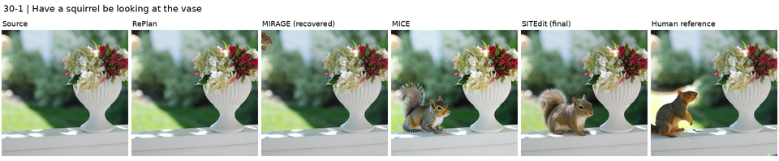
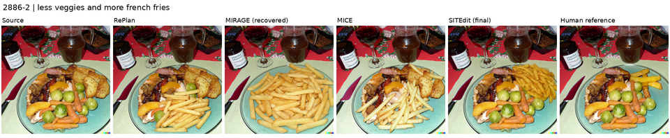
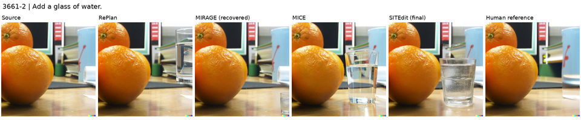
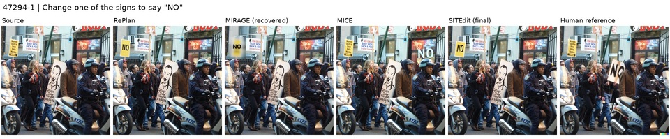
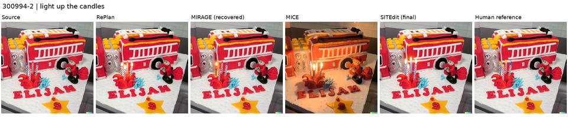

# MagicBrush MIRAGE 规划失败恢复

用户于 2026-11-11 授权修复 MIRAGE 的失败，使其与 RePlan、MICE 一起进入外部评测比较。范围为无 mask、独立单轮、全部 1,053 请求。原 `run_001` 及其分数只读保留；本轮在独立目录记录恢复过程与合并结果，不覆盖原始失败。

<!-- VERIFIED_RESULTS_START -->

## 最终结果

138 条原失败已全部成功生成并评分；与原 915 条成功结果合并，共 1,053 条实测分数，失败惩罚为 0。全部方法使用无 mask 独立单轮、全量数据；SITEdit 只展示最终 R2@1000。

| 方法 | L1 ↓ | L2 ↓ | CLIP-I ↑ | DINO ↑ | CLIP-T ↑ |
|---|---:|---:|---:|---:|---:|
| InstructPix2Pix-MagicBrush | 0.0622 | 0.0199 | 0.9336 | 0.9010 | 0.2776 |
| Qwen-Image-2.1 | 0.0647 | 0.0222 | 0.9297 | 0.8834 | 0.2885 |
| RePlan | 0.0669 | 0.0248 | 0.9257 | 0.8851 | 0.2841 |
| MIRAGE | 0.0571 | 0.0224 | 0.9294 | 0.8778 | 0.2882 |
| MICE | 0.0800 | 0.0257 | 0.9216 | 0.8625 | 0.2903 |
| SITEdit（最终版本） | 0.0576 | 0.0216 | 0.9314 | 0.8709 | 0.2883 |

MIRAGE 在本表采用下文明确说明的条件式错误恢复；原生编辑器及参数不变。该扩展需要在复现配置中披露，不能描述为未修改的官方默认规划器。其余行直接读取既有验证结果，没有重新生成或择优。

| 本轮阶段 | 完成数 | 逐请求实测 GPU·h | 峰值 allocated / GiB |
|---|---:|---:|---:|
| 规划恢复 | 138 | 0.1258 | 18.06 |
| 编辑 | 138 | 2.9029 | 58.02 |
| 评分 | 138 | 0.0173 | 0.68 |

GPU·h 为各请求运行时间之和，不包含权重加载、排队或原失败尝试；原失败和冒烟成本保留在各自记录中。正式控制器于 16:03:56 UTC 启动，评分于 16:38:25 UTC 完成，期间按用户要求从四卡安全切换八卡。

结果文件：
- [六方法中文表格](/mnt/bn/strategy-mllm-train/user/tanyue/experiments2/SAMTokEdit/external_magicbrush/mirage_recovery_20261111/COMPARISON.md)。
- [六方法分数与区间](/mnt/bn/strategy-mllm-train/user/tanyue/experiments2/SAMTokEdit/external_magicbrush/mirage_recovery_20261111/COMPARISON.json)。
- [MIRAGE 全量逐例报告](/mnt/bn/strategy-mllm-train/user/tanyue/experiments2/SAMTokEdit/external_magicbrush/mirage_recovery_20261111/REPORT.json)。
- 独立核验：共享审计目录的 `FINAL_VERIFICATION.json`；138 条规划／生成／评分绑定、38 条切换前记录、五项均值、五组区间及五个冒烟输出字节一致性全部通过。
- REPORT SHA256：`9293f85c7d40bd04470844c097c361cf785f80f93d36ae5dd041b19d6507e2dc`。
- 共享 bootstrap 索引 SHA256：`df43da2a30b8039127793d547cf4eb7106e481db193947c6b31897b8b35ad1e1`，与最新 SITEdit 报告一致。

<!-- VERIFIED_RESULTS_END -->

## 原因与固定规则

138 个失败全部发生在规划阶段：120 个空目标列表（主要为新增对象）、7 个目标与编辑指令数量不一致、8 个定位为空、3 个定位输出在 128-token 上限截断。没有证据将它们归因于显存或硬件。

- 前三类只增加一次原生 Qwen3.5-9B 调用，输入原始公开源图和指令。固定提示词要求输出一一对应的目标、编辑指令、归一化 XYXY 框；新增对象使用模型自行选择的源图放置区域。禁止 GT、目标图、标注 mask、外部模型或人工框。
- 截断类复用原已解析的编辑项，运行原生 `locate` 流程，将输出上限由 128 提至 2,048；原生整体／局部搜索及取首框行为保留。其调用数按实际记录，可能超过一次。
- 无有效规划仍记失败；不按图像或分数选择候选，不静默合成区域，不把空区域调用当作有效编辑。
- 编辑继续调用冻结的 `external_magicbrush.adapters.MirageEditor`：Qwen-Image-Edit-2511、40 步、CFG 4、patch ratio 0.4、seed 42，源图／恢复分辨率不变。每个请求一次生成。

这是**明确披露的条件式错误恢复扩展**，不是声称官方规划源码未变。官方 commit `234a31968df307879a55675873a54258d6c0eae4` 的规划器与编辑器均不修改。最新官方源码改变了 VLM 采样默认值，故不直接升级整个方法，以免混合新旧配置。旧成功输出 915 张保留；所有原失败均应用同一规则。

源码依据：[原生解析／定位](https://github.com/ZiqianLiu666/MIRAGE/blob/234a31968df307879a55675873a54258d6c0eae4/mirage/vlm.py)、[原生局部／全局联合编辑](https://github.com/ZiqianLiu666/MIRAGE/blob/234a31968df307879a55675873a54258d6c0eae4/mirage/qwen_image_edit.py)。其中 `parse_instructions` 使用等长列表配对，`ground` 保留返回的首个框，`locate` 包含原生父对象／局部搜索；恢复不改变后两者的选择逻辑。

## 实现、验证和统计

独立入口：`scripts/magicbrush_mirage_recovery.py`；实现位于 `src/samtok_benchmark/postprocessing/magicbrush_mirage_recovery.py`。原生成／评分模块字节不变。manifest 绑定公开输入、原失败证据、方法源码、恢复策略、配置及代码哈希；admission 与终态不可覆盖，未有终态的 admission 不自动重跑。

冒烟固定覆盖空目标、数量不匹配、定位空、截断四类，不按分数选样。初始使用 GPU 4–7；用户随后明确要求全部八卡，已在 38 张生成完成后安全退出原四个进程，确认无悬空受理，再以八分片续跑剩余请求。每张卡运行前均检查显存，不终止其他任务。规划和编辑分进程，评分使用与原分数相同的软件／权重身份。

恢复输出用原五指标 L1 / L2 / CLIP-I / DINO / CLIP-T 评分。合并保留 1,053 分母，915 张原成功输出的哈希、评分绑定均核验；剩余生成失败沿用已批准的数学最差值。评分缺失不能当作生成失败。95% 区间使用原 535 会话、seed 20261105、10,000 次 bootstrap。

五例功能验证已全部完成规划、出图、评分：`30-1`、`2886-2`、`3661-2`、`47294-1`、`300994-2`。平均生成 75.96 s，峰值 allocated 57.98 GiB。评分实现、权重、软件包、精度、设备类型与原分数身份完全一致。44 项针对性 CPU 测试通过。第一次功能检查的字段读取错误及其日志独立保留，未进入正式结果；五例正式生成输出全部与冒烟逐字节一致。

## 路径与运行

- 正式恢复：`/mnt/bn/strategy-mllm-train/user/tanyue/experiments2/SAMTokEdit/external_magicbrush/mirage_recovery_20261111/`。
- 原始成功／失败：同级 `run_001/`，只读保留。
- 共享审计、冒烟和日志：`/mnt/bn/strategy-mllm-train/user/tanyue/.ifbench-tmp/magicbrush_mirage_repair_20261111/`。
- 最新 SITEdit 比较来源：同级 `r2_20261110/REPORT.json`，仅使用 `rows.R2_1000`。

正式 manifest digest：`a9643cd525aa42ea7461cff1249e10f4f4ac9f859d60c30ba665f11c22d50f16`。入口绑定源文件内容；相同目录的已完成终态只能复用，不能覆写或以新 attempt 重采样。

```bash
python3 -I scripts/run_magicbrush_mirage_recovery.py \
  --root /mnt/bn/strategy-mllm-train/user/tanyue/experiments2/SAMTokEdit/external_magicbrush/mirage_recovery_20261111 \
  --logs /mnt/bn/strategy-mllm-train/user/tanyue/.ifbench-tmp/magicbrush_mirage_repair_20261111/full8-logs \
  --gpus 0,1,2,3,4,5,6,7 --authorized-all-eight --stages edit score --report
```

执行状态：138/138 规划、生成、评分全部完成，新增原生 VLM 调用共 140 次；133 请求产生一个局部区域，5 请求产生两个区域。全部评分于 2026-11-11 16:38:25 UTC 完成，GPU 已释放。终态、分数及成本见 `REPORT.json`、`COMPARISON.json`；出图不等同于编辑要求全部满足。

报告复现（只读核验原始文件，若目标报告已存在则只允许相同内容）：

```bash
CUDA_VISIBLE_DEVICES='' /tmp/ifbench/external_bench_20261102/env_v4/bin/python -I \
  scripts/magicbrush_mirage_recovery.py report \
  --root /mnt/bn/strategy-mllm-train/user/tanyue/experiments2/SAMTokEdit/external_magicbrush/mirage_recovery_20261111
CUDA_VISIBLE_DEVICES='' /tmp/ifbench/external_bench_20261102/env_v4/bin/python -I \
  scripts/report_magicbrush_mirage_recovery.py \
  --root /mnt/bn/strategy-mllm-train/user/tanyue/experiments2/SAMTokEdit/external_magicbrush/mirage_recovery_20261111
```

八卡入口 `scripts/magicbrush_mirage_recovery_8gpu.py` 只扩展可用物理 GPU 范围，仍要求单 worker 单卡、已有占用 ≤2,300 MiB、空闲 ≥70,000 MiB。冻结恢复模块和 manifest 均未改动。结果根的 `execution/20261111-eight-gpu.json` 记录用户授权、38 条已完成记录哈希、原进程安全退出及调度入口代码哈希。

## 固定功能验证样例

以下五例在生成和评分前根据错误类别固定选取，完整展示，不按分数筛选。每行从左至右为源图、RePlan、恢复后 MIRAGE、MICE、最终版 SITEdit、人工参考图。参考图只在评分和展示阶段读取，不进入恢复模型。图像仅等比缩放排版；全部来源哈希见 [provenance.json](assets/magicbrush_mirage_recovery/provenance.json)。

`30-1`：新增对象在源图中不存在，原定位返回空。



`2886-2`：原目标与编辑指令列表数量不匹配。



`3661-2`：添加指令没有指定源图锚点，原解析目标列表为空。



`47294-1` 与 `300994-2`：原定位输出被 token 长度上限截断。





原始高清对比保留于 `/opt/tiger/tanyue/visualization_tmp/MagicBrush_MIRAGE_Recovery_20261111/`。这些图用于检查恢复流程和实际输出，不等同于认定每项编辑全部满足；正式比较使用全部请求的原五指标。
