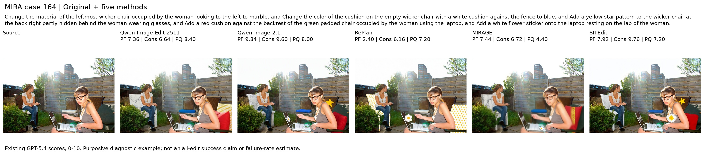
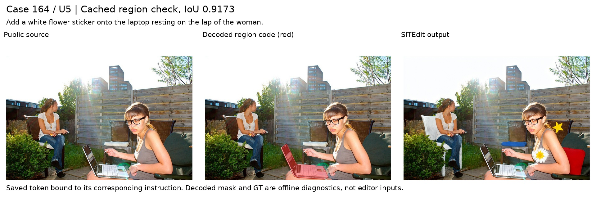
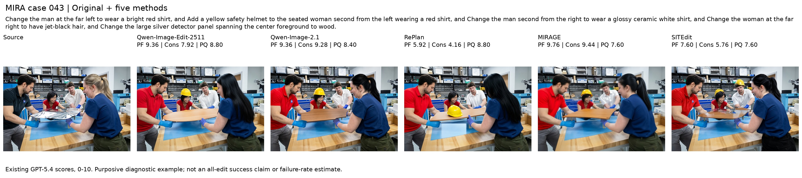
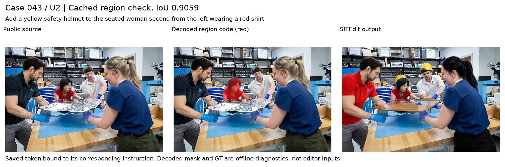
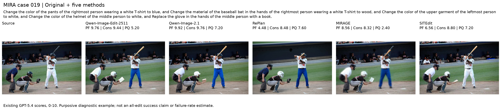
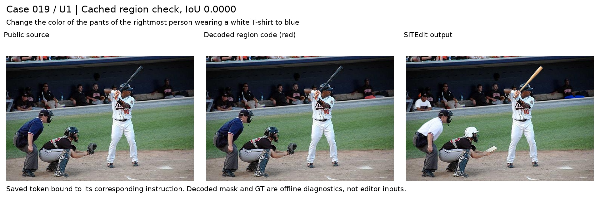
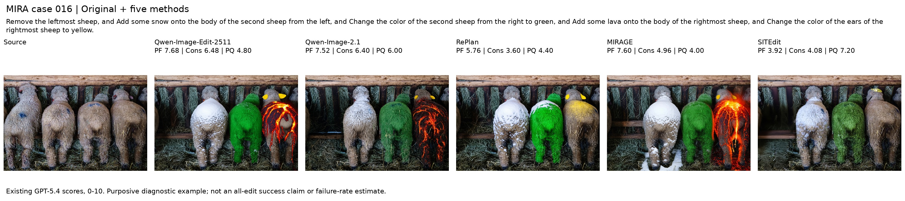
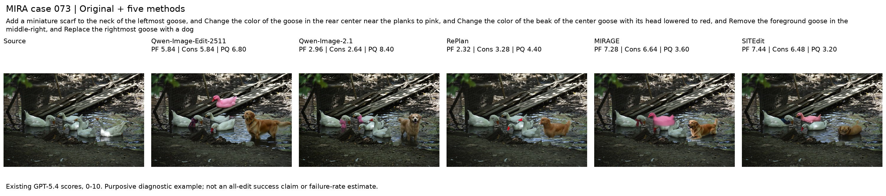

# MIRA-Bench：评测协议、完整结果与 SITEdit 分析

本文件是 `eval-mira` 分支的完整评测说明，记录 **2026-11-02 至 2026-11-03 实际完成的实验**。所有表格来自保存的生成与评分记录，展示图来自实际输出。运行命令见 [MIRA.md](MIRA.md)，原生调用核验与执行记录见 [MIRA_FULL_RUN.md](MIRA_FULL_RUN.md)。

本次覆盖官方当前版本的 **200 张源图 × 5 个方法**，每张源图有 5 项编辑。1,000 个编辑请求全部终结，**999 张有效输出全部完成 GPT-5.4 评分**；RePlan 的 154 号请求生成失败。SITEdit 没有在本次 MIRA 分数上选择 checkpoint、调整超参或挑选多次生成中的最佳图。

当前结论：SITEdit 的综合分低于 Qwen-Image-2.1，主要评分差距在 PQ；PF 均值略高，但配对区间跨零。具体案例同时存在 Pass1 选错目标、正确区域条件接入后仍执行错对象、漏项和生成结构问题。两张源图与实际训练记录重合，因此同时报告官方 200 图及统一排除它们后的 198 图。

## 1. 本实验回答什么问题

MIRA 测试的是**仅给源图与自然语言时，模型能否联合完成多项实例相关编辑**。本实验没有给任何模型提供用户点击、框、mask、标注图或 GT 区域。模型自身的原生解析器、规划器和定位器属于其方法流程。

每图 5 个编辑项不等于 5 个独立目标：同一物体及其部件可能承担多项操作，也有在空白区域添加物体的请求。这一结果不能替代 SITEdit 论文的交互输入对比、细粒度目标实验和按独立目标数 $K$ 分组的 JointPass。

本次五方法是 SITEdit、强文本编辑基座 Qwen-Image-2.1、另一基座 Qwen-Image-Edit-2511，以及带原生规划或局部编辑机制的 RePlan、MIRAGE。所有方法重新使用同一 Judge 评分，未从其他论文复制分数。LoMOE 因数据权限暂缓，不在本文件的已完成实验中。

## 2. 数据版本、公开输入与坐标

### 2.1 固定版本和完整范围

数据来自 [MIRAGE 官方数据仓库](https://huggingface.co/datasets/ziqiangoodgood/MIRAGE/tree/fce5795af4276c5d312d3d68c13879c8d9735f55/benchmark)，revision 为 `fce5795af4276c5d312d3d68c13879c8d9735f55`。使用该版本全部 **200 图、1,000 项**，没有混用早期论文中的 100 图版本或按模型表现筛选源图。

- 数据目录：`/mnt/bn/strategy-mllm-train/user/tanyue/datasets/MIRA-Bench`。
- `benchmark/annotations.jsonl`：原始完整指令、图像文件名和逐项多边形。
- `DOWNLOAD.json`：版本、上游 Git blob/LFS 标识、本地 SHA-256 和文件大小。下载及准备阶段均检查内容身份。
- 共享输入目录：`/mnt/bn/strategy-mllm-train/user/tanyue/.ifbench-tmp/external_bench_20261102/mira_bundle`。
- bundle digest：`7203038df002475ec31911528889ec8d47e70fa21cba4a47615abcb14fee5ff4`。

### 2.2 文本与私有评分信息分离

[data.py](../src/samtok_benchmark/external_mira/data.py) 仅根据原始公开文本的固定标点语法拆分 5 项：在逗号或句号后的 `and Change/Add/Replace/Remove/Wrap` 处划分，保留每项原文及字符区间，依次标为 U1–U5。`Change` 对应 attribute，`Add/Wrap` 对应 add；计数与顺序不从 GT mask 推断。

`public/<case>/public.json` 只有源图、原始复合指令、从公开文本拆出的单元和身份摘要。每项均为 `has_ref=true, locator=none`。字段验证拒绝混入 GT mask 或私有元数据。SITEdit 使用这些单元，两个直接编辑基座使用完整原文；RePlan、MIRAGE 也接收完整原文，并自行产生原生计划。

`private/evaluation.json` 保存 canonical 源图、原始多边形及评分顺序，只用于导出 Judge 输入和离线诊断。评分对所有方法采用相同的五项原文和 GT 顺序，不能用某方法自己的解析结果替代该方法的评分目标。

### 2.3 所有方法共享约 1MP 清图

使用冻结的 [canvas.py](../src/samtok_benchmark/ifbench/canvas.py)：目标面积 `1024²`，32 像素网格，居中 `RGB(128,128,128)` padding；内容大小四舍五入，画布向上取网格，必要时按 0.995 比例回退以满足面积预算；图像使用 LANCZOS 缩放。记录 `source_size/content_size/canvas_size/content_box/scale_xy/offset_xy`。该策略可能放大较小源图，不是“仅缩小”。

Qwen2511、Qwen2.1、SITEdit 使用公开画布宽高；RePlan、MIRAGE 保留原生近 1MP 输出网格，不声称强制它们输出完全相同的整数尺寸。每次保存：

1. `raw.png`：模型原始输出。
2. `output.png`：将记录中的 content box 映射到 raw 网格，用一次带 crop box 的 LANCZOS resize 去除 padding 并恢复 canonical 源图尺寸。

这只是几何恢复，不使用 GT 贴回背景、修复模型输出或清理编辑痕迹。Judge 只读取 `output.png`。例如 002 的公开画布为 1152×864，RePlan/MIRAGE 的 raw 为 1184×896，五方法最终均恢复为原图 1024×768。

## 3. 每个模型具体如何运行

公共配置见 [mira.json](../configs/external/mira.json)，适配器见 [adapters.py](../src/samtok_benchmark/external_mira/adapters.py)。固定 **seed 42、每请求一张输出、40 个去噪步骤**。没有 best-of-N、按分数重采样、外挂 SAM/grounder、额外 prompt enhancer 或逐项连续编辑后合成结果。

| 方法 | 输入及流程 | 生成参数与区域来源 |
|---|---|---|
| Qwen-Image-Edit-2511 | 共享清图 + 完整原始指令，一次原生编辑 | true CFG 4，guidance 1，negative prompt 为单个空格；无区域条件 |
| Qwen-Image-2.1 | 同上，一次原生编辑 | true CFG 1，KV cache，原生 model CPU offload；无区域条件 |
| RePlan | 完整原文与清图 → 自带 VLM 规划 → Qwen2511 区域编辑 | 原生预测框和局部 hint；CFG 4，expand 0，attention switch 0.5 |
| MIRAGE | 完整原文 → 自带 parser；清图 → locator；随后局部/全局联合去噪 | 原生预测框和局部指令；CFG 4，patch ratio 0.4，padding 10 px |
| SITEdit | 清图与 U1–U5 → Pass1 区域码 → S2 一次联合编辑 | 预测 space tokens；token guidance 2，KV cache；不用解码 mask 控制生成 |

### 3.1 Qwen-Image-Edit-2511

使用 Diffusers `QwenImageEditPlusPipeline`，checkpoint 自带的文本/视觉编码器、DiT、VAE 和 scheduler，BF16、CUDA。输入是包含一张 RGB 清图的列表，prompt 是原始完整复合指令。

参数为 `num_inference_steps=40, true_cfg_scale=4, guidance_scale=1, negative_prompt=" ", num_images_per_prompt=1, max_sequence_length=512`，宽高取公共画布；使用 CUDA generator seed 42。没有单独的定位、规划或提示词增强。实际调用由 [dev_runner.py](../src/samtok_benchmark/ifbench/dev_runner.py) 的 Qwen2511 和 [fairness_dev_worker.py](../src/samtok_benchmark/ifbench/fairness_dev_worker.py) 记录。

### 3.2 Qwen-Image-2.1

使用固定 Diffusers `QwenImage21Pipeline`，原版 Qwen3-VL 编码器、DiT、VAE 和 scheduler，BF16。参数为 `num_inference_steps=40, true_cfg_scale=1, output_resolution=1024, use_kv_cache=true`，实际宽高取共享画布。

为满足单卡内存，使用原生 `model_cpu_offload`，顺序为 `text_encoder → transformer → vae`。适配器没有改精度、启用 VAE tiling 或 prompt enhancer。加载时核对实际 pipeline 文件与固定源文件的 SHA；调用见 [smoke_adapters.py](../src/samtok_benchmark/ifbench/smoke_adapters.py) 的 Qwen21。CPU offload 是已披露的执行配置，不能把它与常驻 GPU 方法的阶段耗时直接当作算法速度比较。

### 3.3 RePlan

规划器为 `TainU/RePlan-Qwen2.5-VL-7B`，输入清图与完整原始复合指令。使用原生 `replan.txt` 模板、`build_messages/get_vlm_response` 和处理器；原生 `generate` 显式设置 `max_new_tokens=2048`，其余生成选项沿用 checkpoint/native 默认，未额外声称它是另一套 greedy 配置。

由于本环境没有可用 FlashAttention2，规划器以 **SDPA** 加载；权重、原生模板和生成选项不变。这项工程差异记录在实际规划结果的 `engineering_deviations` 中，不能省略。

编辑器为 Qwen-Image-Edit-2511 的原生 RePlan 区域注意力流程。原始 VLM 响应原样进入 `region_edit_with_attention`，框、hint 和全局提示由原生方法解释，不强制恰好 5 个预测区域。使用 `expand_value=0, attention_switch_step=0.5, true_cfg_scale=4, guidance_scale=1, negative_prompt=" "`；原生区域流自行决定输出网格。规划和编辑分进程进行，以保存计划并释放显存，接口见 [fairness_flux3_replan.py](../src/evaluation/protocol_audit/fairness_flux3_replan.py)。

正式运行不补框、不删除失效项、不手工改计划。154 的零宽度框导致生成失败；额外恢复实验单独说明于第 6 节。

### 3.4 MIRAGE

使用固定原生生成代码及其支持的 `Qwen3.5-9B` parser/locator，BF16，`thinking=false, do_sample=false`。parser 收到**完整原始复合指令的一元素列表**，不是我们预先拆好的五项；`parse_max_new_tokens=512`。locator 使用清图和 parser 产生的 refer object，`grounding_max_new_tokens=128`，不添加空间 hint。保留原生拆分、定位和调用次数，不要求 parser 输出数等于标注数。

原生 `to_pixels(..., padding=10)` 将预测框转为像素坐标；局部 prompt 使用官方 `qwen_prompt`。编辑调用为原生 `run_qwen_image_edit`：原始完整指令作为 global prompt，预测局部指令与框作为局部条件，Qwen2511 骨干，40 steps、true CFG 4、patch ratio 0.4、seed 42。多分支计算不是五次顺序编辑。

针对早期观察到的模糊，已重放原生 parser/locator，并直接调用官方生成函数核验 001：与适配器的 raw 图逐像素一致，最大/平均绝对误差均为 0。这支持“该例模糊并非适配器或回源操作引入”，不能扩展为对所有质量问题的机制解释。核验细节见 [MIRA_FULL_RUN.md](MIRA_FULL_RUN.md)。

### 3.5 SITEdit

方法固定为 [samtok_edit@aa5a414](https://github.com/Tangent0308/samtok_edit/tree/aa5a414e36c01eba60b37fc46cb9e32f803f8a93)。

**Pass1：公开文本到逐项区域码。**

- 输入同一清图和五项原文，协议使用 `normalized_0_1000`，每项目标标签为 U1–U5，`has_ref=true, locator=none`。
- 使用 `Qwen3-VL-8B-SAMTok` 及定位 LoRA `pass1_localization_lora_formal_20261030_0939/runs/formal/step_2000`，上限 512 个新 token，`pass1_max_pixels=2097152`。完整 checkpoint 路径见第 4 节。
- 一次 grounder 请求产生整组区域码，按标签验证 token span。若某项没有有效码，代码保留该项原文并记为 `fallback_text`；本次 200 图的 `fallback_units` 全为 0。
- 将预测码解码并保存 U1–U5 mask，**仅供离线诊断**；decode 单独计时，不作为 S2 输入。语法有效、无 fallback 不等于选对了目标。

**S2：逐项绑定后一次联合编辑。**

- 使用 Qwen-Image-2.1 DiT/VAE、SAMTok 文本编码器、CodeInjector 和 S2 DiT LoRA `qwen21_v3/runs/s2_4n_001/train/adapter_16000`。
- 沿用方法仓库 `place_token` 将区域码接到该项被指代对象/添加锚点之后，再由 `multi_edit_prompt` 组成编号指令。其前缀为 `Execute all numbered instructions and keep everything else unchanged.`，后接 U1–U5。没有根据评分修订指令。实际 token 位置和正负提示均可从 `call.json` 复核。
- `pass2_te="raw"` 表示关闭 Pass1 的 PEFT adapter、使用**发布的 SAMTok TE**，不表示恢复原版 Qwen TE。不能把两者混称为“原版编码器”。
- 40 steps，`mode="inline", cfg_scale=2, use_kv_cache=true`，宽高取公共画布，seed 42；保持方法训练时的 attention 路径。
- 正分支是带 token 的编号指令；负分支是**同一编号指令去掉所有区域 token**，不是空白负提示。形式为 $v=v_{neg}+2(v_{pos}-v_{neg})$。每步预期两次 DiT 前向；SITEdit 记录字段为 `expected_dit_forwards=80`，应与基线的实测 hook 计数区分。
- 推理不输入解码 mask，不加 GT attention bias，不做 latent blending 或背景贴回；也不运行 OPSD teacher。一次 S2 调用联合生成整图。

原版 Qwen2.1 使用完整原始 prompt、原版 TE 和 CFG 1；SITEdit 使用编号/token prompt、SAMTok TE、训练 adapter 和 token guidance 2。因此主表比较完整系统，不能把两行差值直接归因于“多了 space tokens”这单一因素。

## 4. 固定代码、权重与实际环境

### 4.1 源码和权重版本

完整配置为 [mira.json](../configs/external/mira.json)，本次使用的副本保存在正式目录 `run_001/CONFIG.json`。下表的 revision 与 config 一致；运行源码的实际 SHA 存于 `run_001/RUN.json`，副本存于 `run_001/source_snapshot/`。

| 对象 | 固定 revision / commit |
|---|---|
| Qwen2511 权重 | `6f3ccc0b56e431dc6a0c2b2039706d7d26f22cb9` |
| Qwen2.1 权重缓存 | `b3179ad355be050328e483a9dfdd9e60cd62adfa` |
| Qwen2.1 已核对等价权重元数据 | `d26bb61231c349cf6b7896fa83353113880e1ba3` |
| Qwen2.1 方法仓库 | `ab96caa944157ca28a4f36b695c3047549f48f98` |
| Diffusers pipeline | `06a9cfb86ae8aa69c6a220ba0da0f37b819dde6a` |
| RePlan 生成代码 | `6c9b12f0c619cc8ca6f50b536b24aff377525f8c` |
| RePlan planner 权重 | `518f82339520058d043c4fbc270481876d8463e4` |
| MIRAGE 生成代码 | `234a31968df307879a55675873a54258d6c0eae4` |
| MIRAGE Qwen3.5-9B planner 权重 | `c202236235762e1c871ad0ccb60c8ee5ba337b9a` |
| SITEdit 方法源码 | `aa5a414e36c01eba60b37fc46cb9e32f803f8a93` |
| MIRA 官方评分代码 | `ff01782a27018ce59f01760e62fe0bcdf518c586` |

MIRAGE 的生成与评分代码采用不同固定 commit，分别记录，不能把当前评分 commit 当作生成版本。

完整 SITEdit checkpoint：

```text
/mnt/bn/strategy-mllm-train/user/tanyue/models/pretrained_models/Qwen-Image-2.1
/mnt/bn/strategy-mllm-train/user/tanyue/models/SAMTok/Qwen3-VL-8B-SAMTok
/mnt/bn/strategy-mllm-train/user/tanyue/experiments2/SAMTokEdit/pass1_localization_lora_formal_20261030_0939/runs/formal/step_2000
/mnt/bn/strategy-mllm-train/user/tanyue/experiments2/SAMTokEdit/qwen21_v3/runs/s2_4n_001/train/adapter_16000
```

其他生成权重在 `/mnt/bn/strategy-mllm-train/user/tanyue/models/pretrained_models/`；RePlan planner 和原生源码位于 config 的共享 NAS `paths`。方法源码只读副本在 `.ifbench-tmp/external_bench_20261102/deps/sitedit-aa5a414`。

### 4.2 实际环境与计算记录

本次单节点使用 GPU 0–4，设备记录为 NVIDIA H100 80GB HBM3。基线/原生 planner 和 SITEdit Pass1 使用 Torch 2.8.0（CUDA 12.8）、Transformers 5.19.0；SITEdit S2 使用 Torch 2.8.0+cu128、Transformers 5.12.1。图像运行时 Pillow 为 12.3.0。三个 Python 环境独立，路径见 config；安装与检查入口为 [setup_mira_runtime.py](../scripts/setup_mira_runtime.py)。

模型在每一阶段只加载一次并处理整批源图；RePlan、MIRAGE、SITEdit 的前后阶段分别加载。每条 result 保存 `packages`、阶段 `inference_seconds/wall_seconds`、显存等字段；首次请求另记加载时间。SITEdit 的 codec decode 是额外诊断成本。Judge 与剩余模型生成重叠进行，最多三个 Judge 进程。

这些是运行日志，不是受控速度基准。不同 CPU offload、加载/缓存状态、planner 调用数及诊断 decode 使阶段耗时不可直接作为端到端方法排名。需要比较速度时应另列加载、规划、编辑、恢复和总成本。

## 5. Judge 到底怎样评分

### 5.1 评分实现与接口

沿用官方固定 [evaluate_gpt.py](https://github.com/ZiqianLiu666/MIRAGE/blob/ff01782a27018ce59f01760e62fe0bcdf518c586/metrics/evaluate_gpt.py) 和 [common.py](https://github.com/ZiqianLiu666/MIRAGE/blob/ff01782a27018ce59f01760e62fe0bcdf518c586/metrics/common.py) 的提示、掩码构造、换算与聚合。通过官方 `request_fn` 接入用户指定的 GPT-5.4；未改评分规则。配置见 [mira_judge_gpt54.json](../configs/external/mira_judge_gpt54.json)。

| 项目 | 本次实际设置 |
|---|---|
| PF / Cons / PQ 模型 | `gpt-5.4-2026-03-05` |
| transport | `AzureOpenAI`，ModelHub 统一接口 |
| 实际 endpoint | `https://aidp-i18ntt-sg.byteintl.net/api/modelhub/online/v2/crawl` |
| 办公网可选 endpoint | `https://aidp-i18ntt-sg.tiktok-row.net/api/modelhub/online/v2/crawl`，通过 `MIRA_AZURE_ENDPOINT` 设置 |
| API version | `2024-02-01` |
| 请求 | `stream=false, max_tokens=8192`，strict JSON schema，`image_detail=high` |
| 超时 / SDK 重试 | 180 s / `max_retries=0` |
| 随机选项 | 未显式设置 Judge temperature 或 seed；不能声称 Judge 确定性 |
| 凭据 | `MIRA_API_KEY_FILE` 指向受限文件，或 `OPENAI_API_KEY`；不存入仓库 |
| 可追溯信息 | 每请求独立 `X-TT-LOGID`，消息 SHA、schema、完整返回、实际返回模型与 finish reason |

上游脚本默认 Judge 为 GPT-5.1，本次按用户要求改用 GPT-5.4。这里的数值只能与本次同 Judge 重评的各方法比较，不能和论文或其他 Judge 的分数直接拼表。

### 5.2 每张图的两次请求

实际执行顺序是先 PQ，后批量 PF/Cons。图像都以 PNG 编码、`detail=high` 送入 API。

**PF 与 Cons：一次请求评五项。** 对每个原始 GT 多边形，在 canonical 源图尺寸上栅格化并集 mask，将 mask 外像素乘为黑色；对 source 和 restored output 使用相同的 mask。保持整幅画布尺寸，**不是裁剪出 bbox 后缩放**。`source-frame` 表示输出已恢复到源图坐标，无二次目标追踪或语义对齐。

一次请求包含 5 项原始局部指令、对应 crop index，以及 5 对原图/编辑后的 masked image，共 10 张图。要求逐项独立评分，不将一项的证据传递到另一项：

- **PF**：指定修改是否在指定目标上正确执行；额外修改或画质本身不应影响该项分数。
- **Cons**：该项证据里是否出现指令之外的对象或属性变化；纯画质、光照、纹理差异不应单独影响分数，除非构成额外对象/属性改变。

**重要解释边界：本实现中的 Cons 并不是全图非目标区域保持度。** PF/Cons 都读取目标 mask 内保留、外部置黑的图像对，没有独立输入整个 mask 外区域。跨目标传播可能在其他编辑项中被看到，但本指标不完整覆盖全局未授权变化。目标移动、删除后背景修补和 replacement 的形状变化也可能受固定源图区域影响。

**PQ：另一次请求看完整图像对。** 输入整张 canonical 原图与 restored output，**不提供编辑指令**。规则要求关注技术伪影、异常部位/比例/形状，不因情境不自然而扣分。返回 score 数组时沿用官方实现取最小值。因为没有指令，smooth、wood、lava 等被明确要求的超现实变化需要结合原文复核，不能把自动理由直接视为已证实的形体错误。

### 5.3 分数换算与聚合

Judge 请求范围为 0–25，返回分数除以 2.5，报告为 0–10；分数越高越好，**不是成功率，也不是 JointPass**。

每图 $i$ 的 PF 与 Cons 是五项的算术平均；PQ 是该图的全图评分。先在所报告的可评分源图集合上求三个均值，再计算官方 Overall：

$$
\mathrm{Overall}=\sqrt{\min(\overline{\mathrm{PF}},\overline{\mathrm{Cons}})\,\overline{\mathrm{PQ}}}.
$$

不使用逐图 Overall 的平均作为主表数值。逐图 `sqrt(min(PF_i,Cons_i)*PQ_i)` 只在诊断选例中作为排序量，不能混同主指标。所有源图恰有五项时，逐图 PF/Cons 均值也等于逐项总体均值。

每方法保留 `per_edit_results.jsonl`、`per_image_results.jsonl`、原始 Judge 响应与官方 `summary.json/csv`；外层汇总检查分数范围、重复源图和输出绑定。`JOB.json` 固定源图/输出/生成 result SHA、canonical 标注、Judge 配置及官方评分代码身份，`JUDGE.json` 绑定该 JOB 与实际参数。

### 5.4 重试、缺失与本次实际 API 数

SDK 自动重试关闭。流水线只对已识别的限流、网络、超时、服务器错误执行最多 **3 次评分进程尝试**，间隔 30 s；不是每张图最多三次择优打分。官方 resume 以完整逐图记录为提交标记，已完成整图不重评；单图若尚未提交完整记录，恢复时可能重发该图之前已成功的一部分请求。内部 JSONL 损坏会拒绝续跑；可恢复尾部写入按官方规则处理。

本次 999 图通常需要 1,998 次成功请求。实际留有 **2,003 份 request、1,999 份成功 response**：4 次传输失败恢复后完成，另有一次尚未完成整图的成功部分响应被重发。所有成功返回均为指定 GPT-5.4、`finish_reason=stop`；最终每个已评分源图只有一个有效逐图记录。没有根据返回分数选优。

| 方法 | 请求记录 | 成功响应 | 最终已评分图 |
|---|---:|---:|---:|
| Qwen2511 | 400 | 400 | 200 |
| Qwen2.1 | 401 | 400 | 200 |
| RePlan | 398 | 398 | 199 |
| MIRAGE | 403 | 401 | 200 |
| SITEdit | 401 | 400 | 200 |

生成失败与 Judge 缺失分开记录。两者均不填 0，不偷偷从请求分母消失。本次没有剩余 Judge 缺分，唯一不可评分的是 RePlan 154 的生成失败。

## 6. 完成状态、失败与独立恢复测试

正式流水线开始于 **2026-11-02 18:02:35 UTC**，结束于 **2026-11-03 05:24:08 UTC**。最终 `STATUS.json` 为 `finished_with_missing`，退出码 1，表示所有工作已终结、仍有一个生成失败，不表示还在等待评分。

每请求在调用前排他写入 `ADMITTED.json`，终结后写 `result.json`。相同输入/源码/配置/输出身份才可复用；admission 存在但没有终态时不能自动再采样。原生规划失败不阻止其他成功计划继续编辑；致命加载/CUDA 错误会停止该方法后续阶段。

正式结果包含 002 的五张、八阶段 smoke 记录，通过同输入、同配置、同源码和输出 SHA 核验后导入，由 `CACHE_IMPORT.json` 记录，未再次生成。早期 smoke Judge 分数未移植，正式评分重新导出整套输入。001 的早期 smoke 记录属于另一份历史运行，不能冒充本次缓存结果。

**RePlan 154 的具体失败。** 原生 planner 返回 `[630,65,630,417]`，宽度为 0。原生编辑器在扩张前检查并报错，发生在扩散调用前；检查全部 200 个保存计划，仅该项存在非正面积框。没有证据显示适配器改坏了坐标。

评测结束后进行了两个独立诊断：完整计划反馈未能合法修复；只重新定位失效项的一次额外原生规划得到合法框并成功出图。但其他原始绑定错误仍在，未完成五项正确编辑。新增两次规划、一次编辑，没有新 Judge；恢复输出留在临时目录，不纳入主表。完整原因、参数、耗时和可视化见 [MIRA_REPLAN_FAILURE.md](MIRA_REPLAN_FAILURE.md)。

## 7. 训练重合审计与统计方法

### 7.1 统一的 198 图子集

审计范围包括 Pass1 step 2000 的实际/计划行、前置 S1 step 6000、S2 step 16000 及已声明开发/测试图像；实际暴露与尚未训练的计划行分别记录。扫描 **646,908 个图像路径，读取错误 0**。这些是路径数，不是唯一照片数。

11 对有限感知哈希候选经实际图像复核，确认源图 **138、175** 与实际 S2 训练记录重合：138 对应一条训练记录，编辑内容不同；175 对应四条训练记录，其中一项删除前景鸟的语义也与 MIRA 重合。143 为误报，保留。对应训练行落在实际训练范围内。

保留官方 200 图，同时五方法统一排除 138、175，得到 198 图子集。子集名单由重合证据决定，不能因某方法分数好坏改变。有限哈希不保证发现任意裁剪、镜像等变换；基础模型预训练与未记录的开发使用不在审计覆盖内，所以称为“排除已确认重合”，不声称完全无泄漏。详见[重合审计报告](/mnt/bn/strategy-mllm-train/user/tanyue/experiments2/SAMTokEdit/external_mira/overlap_audit/REPORT.md)。

### 7.2 区间与缺失口径

总体表使用源图为重采样单位的 **10,000 次配对 bootstrap，seed 20261027，percentile 95% CI**。相同源图集合共用抽样索引，每次重采样后重新计算官方非线性聚合，不能先平均各节点 CI 或逐图 Overall。

完整覆盖的四个方法给出总体 Overall CI。RePlan 均值仅来自其成功生成的 199/200 或 197/198，不给完整分母 CI；与 SITEdit 的配对比较只使用双方共同可评分的源图，并明确标为条件诊断，存在幸存者偏差。

第 8.3 节的分量诊断另固定 seed 20261103，同样 10,000 次源图配对 bootstrap。所有区间均条件于本次一次生成、一次有效评分，不包含多 seed 生成或重复 Judge 的方差。统计实现见 [report_mira_audited.py](../scripts/report_mira_audited.py) 和 [analyze_mira_results.py](../scripts/analyze_mira_results.py)。

## 8. 完整评测结果

### 8.1 官方 200 图

| 方法 | PF | Cons | PQ | Overall | Overall 95% CI | 已评分/请求数 |
|---|---:|---:|---:|---:|---|---:|
| Qwen-Image-Edit-2511 | 7.372 | 6.996 | 6.960 | 6.978 | [6.802, 7.145] | 200/200 |
| Qwen-Image-2.1 | 7.443 | 7.760 | 7.276 | 7.359 | [7.175, 7.541] | 200/200 |
| RePlan | 4.593 | 6.442 | 6.923 | 5.639 | 不提供完整分母 CI | 199/200 |
| MIRAGE | 7.730 | 7.182 | 4.336 | 5.580 | [5.390, 5.770] | 200/200 |
| SITEdit | 7.596 | 7.613 | 6.264 | 6.898 | [6.697, 7.072] | 200/200 |

### 8.2 排除已确认重合的 198 图

| 方法 | PF | Cons | PQ | Overall | Overall 95% CI | 已评分/请求数 |
|---|---:|---:|---:|---:|---|---:|
| Qwen-Image-Edit-2511 | 7.375 | 6.986 | 6.972 | 6.979 | [6.805, 7.146] | 198/198 |
| Qwen-Image-2.1 | 7.451 | 7.759 | 7.269 | 7.359 | [7.169, 7.545] | 198/198 |
| RePlan | 4.575 | 6.452 | 6.924 | 5.628 | 不提供完整分母 CI | 197/198 |
| MIRAGE | 7.737 | 7.194 | 4.337 | 5.586 | [5.393, 5.772] | 198/198 |
| SITEdit | 7.608 | 7.616 | 6.253 | 6.897 | [6.688, 7.069] | 198/198 |

以下是 **SITEdit − 基线** 的 Overall 配对差值；正值有利于 SITEdit。

| 基线 | 官方 200 图：差值 [95% CI] | 排除重合 198 图：差值 [95% CI] | 配对范围 |
|---|---|---|---|
| Qwen2511 | −0.080 [−0.246, +0.068] | −0.082 [−0.257, +0.069] | 分别为完整 200 / 198 图 |
| Qwen2.1 | −0.461 [−0.637, −0.308] | −0.462 [−0.644, −0.303] | 分别为完整 200 / 198 图 |
| RePlan | +1.273 [+1.053, +1.468] | +1.282 [+1.062, +1.481] | 共同可评分 199 / 197 图；条件诊断 |
| MIRAGE | +1.317 [+1.097, +1.513] | +1.311 [+1.086, +1.515] | 分别为完整 200 / 198 图 |

RePlan 的两列都不含失败源图 154，不能用该条件差值替代全分母结论。排除已确认训练重合后，其余主要结论保持一致。

### 8.3 SITEdit 相对 Qwen2.1 的分量差异

以下统计使用完整固定 198 图，而不是后面展示的 12 个案例。

| 指标 | 均值差 | 配对 95% CI | SITEdit 更低 / 相同 / 更高 |
|---|---:|---|---:|
| PF | +0.157 | [−0.093, +0.408] | 101 / 4 / 93 |
| Cons | −0.143 | [−0.377, +0.096] | 101 / 8 / 89 |
| PQ | −1.016 | [−1.261, −0.764] | 136 / 30 / 32 |

当前自动评分中，PQ 有 **68.7% 的源图更低**，不是只由少数极端低分图构成。PF 和 Cons 的均值差区间跨零，不能宣称 PF 已有稳定优势或 Cons 已建立稳定劣势。PQ 差距值得优先诊断，但仍需结合第 5 节的 Judge 边界。

## 9. 可视化案例与两层失败诊断

### 9.1 选例范围与可复现性

完整 [12 页轻量 PDF](/opt/tiger/tanyue/visualization_tmp/MIRA_failure_comparisons_20261103/MIRA_12cases_all_models_light.pdf)、[总览 1](/opt/tiger/tanyue/visualization_tmp/MIRA_failure_comparisons_20261103/overview_01.jpg)、[总览 2](/opt/tiger/tanyue/visualization_tmp/MIRA_failure_comparisons_20261103/overview_02.jpg)、[总览 3](/opt/tiger/tanyue/visualization_tmp/MIRA_failure_comparisons_20261103/overview_03.jpg) 及[逐例长分析](/opt/tiger/tanyue/visualization_tmp/MIRA_failure_comparisons_20261103/README_案例分析.md) 保存在用户指定展示目录。

这些是定向诊断样本：在 198 图中，再排除没有 RePlan 输出的 154 及已展示过的 064/099/036/097，按 PQ、PF、Cons 落差及中等单图差距形成 18 个候选，实际查看后选择 12 个不同场景/现象。完整规则、六个未选案例的原因和中文观察固定在 [mira_cases_20261103.json](../configs/analysis/mira_cases_20261103.json)。不能用它们估计某种失败的总体占比。

下面的少量预览可直接在远程仓库查看。其完整源图/输出仍在 NAS；[provenance.json](assets/mira/provenance.json) 记录预览、生成 result、评分 JOB、源图/输出及诊断证据的 SHA。新 CPU 工具已重画 12 例，分量统计和三例区域 IoU 与此前分析一致。图像仅缩放展示，没有修复实验输出。

### 9.2 164：定位到电脑，花却落在上衣



SITEdit 多数请求已呈现，最清楚的错误是白花贴在女性上衣而非电脑。Qwen2.1 的花位于电脑屏幕，其他几个方法也大致落在电脑一带，但它们的椅子、星星等编辑各有问题，不能视为全部正确。



U5 的保存区域码解码后覆盖电脑，与该项 GT 的离线 IoU 为 **0.9173**；同一 token 确实接入 S2 的 U5 指令行。该例支持“区域条件接入后仍未正确执行”，不能直接证明某种具体 attention 或 loss 是根因。

### 9.3 043：帽子扩散到另一个人



SITEdit 给后方男子加了完整黄安全帽，指定的红衣女性头上只有局部黄色物；木质面板仍有银色中心。Qwen2.1、Qwen2511、MIRAGE 更接近把帽子限定到红衣女性，RePlan 把帽子放在面板上。基线在陶瓷白衣质感、手与面板接合等方面也并非无误。



U2 解码区域覆盖红衣女性，离线 IoU 为 **0.9059**，保存 token 与实际 U2 行一致。不能简单将该失败解释为 Pass1 先选中了后方男子；需要进一步验证生成阶段的跨目标传播。

### 9.4 019：Pass1 已经选择错误的人



SITEdit 没有把击球手裤子变蓝，却把最右背景坐着者的腿部变蓝。两个 Qwen 基座把击球手裤子改蓝，尽管书本/手部等细节仍有问题。



U1 的解码区域确实位于背景人物腿部，与目标 GT 的离线 IoU 为 **0**；该 token 也正确传给了 U1。因此这是有证据支持的上游目标选择错误，与 164/043 的“定位合理后执行错误”分属不同环节。

三例 IoU 均按记录中的 content box 去 padding，再以 NEAREST 回源，将原始对应项多边形用 PIL 栅格化求并集后计算。红色覆盖是**区域码的诊断解码结果**，不是编辑器的图像 mask 或 attention map。GT 仅用于离线检查；这些诊断不代表总体 Pass1 准确率，也没有做因果干预。

### 9.5 漏项、部件与结构问题



016 中，SITEdit 的雪和绿色可见，但最右羊身上没有所要求的熔岩，黄色落在头顶一带而非清楚覆盖耳部；PQ 较高并不代表请求完成更好。Qwen2511、Qwen2.1、MIRAGE 做出了熔岩，但仍有合成质感或局部结构问题。



073 中，SITEdit 替换出的狗头颈和躯干衔接显得不自然，但部分颜色/目标修改比 Qwen2.1 更准确。其 PF 为 7.44 对 2.96，PQ 为 3.20 对 8.40；应分开讨论执行与质量。

其余案例：008/009 是人物属性或邻近实例错位；068 是额外属性与颈部/躯干部位混淆；010 涉及墨镜扩散和删除附近姿态变化；013 将一个风筝变成两个；130 有遮挡目标漏删和改动幅度问题。075 的 smooth、010 的 wood 都是明确指令，不能将材质本身作为失败证据。部分删除/替换的自动理由与全图直观不完全一致，逐例报告保留了这种不确定性。

## 10. 对 SITEdit 的分析、结论与下一步

1. **本次 MIRA 不支持整体优于 Qwen2.1。** 两套子集的 Overall 配对区间均为负。与 Qwen2511 的差值区间跨零；与 MIRAGE 的差值为正；与 RePlan 的比较必须附带失败覆盖率和共同可评分子集限定。
2. **PQ 是当前最明确的评分短板，PF 优势尚未建立。** 198 图上的 PQ 均差 −1.016 且多数源图更低；PF +0.157 的区间跨零。不能只强调平均 PF 略高而忽略质量回退。
3. **需要分开处理表示/定位层与生成器使用条件的学习层。** 019 支持 Pass1 选错；164、043 的区域与输入绑定已经检查合理，生成器仍错放或扩散编辑。只改 Pass1 不能解释后两例。
4. **可见的错误类型包括漏项、对象—属性串位、部件位置错误和结构质量问题。** 这些是案例观察，不是已测得的失败分类占比。需要更多按源图固定抽取的逐项标注，才能判断哪个类型最常见。
5. **当前图像证据没有确定 TE、guidance、LoRA 或某项 loss 的因果责任。** 主表同时改变编码器、训练权重、prompt 形式和引导方式。首先在独立开发集固定区域码、指令、seed、checkpoint，对比 guidance 1/1.5/2；再检查匹配的原版 TE/SAMTok TE 与已有 S2 检查点。无 token 对照仅作归因诊断，不作为替代论文核心任务的验收目标。
6. **优先验证正确区域条件下的联合执行。** 对检查过的正确码比较单条与联合请求；用无歧义的 selected-region 指令做 token 交换、完整“指令+码”对重排等对照。分别记录定位准确性、指令执行、额外修改和画质，避免把“码能解码”当成“生成器一定使用了码”。这些实验是建议，尚未执行。
7. **不要将已有训练机制重新包装为未尝试的解决方案。** 当前方法已有读写双向路由、反事实样本和多目标训练；方法记录中的两轮 OPSD pilot 未达到预设标准。新增训练应由上述归因结果决定；同时检查 JointPass，避免用少编辑换取较高画质。
8. **Judge 验证仍是独立待办。** 保留官方分数，另做结合完整指令、隐藏方法身份的人工核验，检查 PQ 是否误罚合理材质变化及固定区域对删除/替换的影响。现有助手看图不等同于独立人工标注，没有人类一致率或 κ 结果。
9. **论文主张应围绕实际主任务证据。** MIRA 展示外部文本多项编辑的能力与局限，交互输入、细粒度目标和 Multi-target 优势仍由自建主表、按 $K$ 的 JointPass 与消融决定。MIRA 已被用于诊断，后续调参应在独立开发集进行，不能把根据本次测试挑出的设置继续称为未触碰的测试结果。

这些判断与本地《任务定义与 Benchmark 写作指南》的 §3.5（指标对应约束）、§3.6（兼顾执行与保持/质量）、§3.7（裁判可信度）、§3.9（诚实报告劣势）、§3.10（分类失败分析）一致。

## 11. 结果路径与证据入口

正式根目录 **R**：`/mnt/bn/strategy-mllm-train/user/tanyue/experiments2/SAMTokEdit/external_mira`。

共享临时/依赖根目录 **T**：`/mnt/bn/strategy-mllm-train/user/tanyue/.ifbench-tmp/external_bench_20261102`。它含复现必需的输入、源码和历史诊断证据，不能因目录名含 tmp 自动删除。

| 相对于 R 的路径 | 内容 |
|---|---|
| `STATUS.json`, `PIPELINE.json` | 最终状态、流水线配置、入口和审计身份 |
| `run_001/RUN.json`, `run_001/CONFIG.json`, `run_001/source_snapshot/` | 本次生成的输入、配置和实际源码 |
| `run_001/<method>/edit/<case>/` | `ADMITTED.json`, `call.json`, `raw.png`, `output.png`, `result.json` |
| `run_001/replan/plan/<case>/`, `run_001/mirage/plan/<case>/` | 原生规划、调用 trace 与返回 |
| `run_001/sitedit/tokens/<case>/` | Pass1 原文、区域码、诊断 mask 和耗时 |
| `scores_gpt54_001/<method>/JOB.json`, `JUDGE.json` | 评分输入、输出 SHA 和实际 Judge 配置 |
| `scores_gpt54_001/<method>/scores/` | 逐项、逐图 JSONL 与官方 summary |
| `scores_gpt54_001/<method>/judge_requests/`, `ATTEMPTS.json` | 全部实际请求/响应和进程尝试 |
| `TABLE.md`, `TABLE.csv`, `scores_gpt54_001/SCORES.json` | 原始流水线汇总，保留原样 |
| `audited_report_v2/TABLE.md`, `REPORT.json` | 两套子集、Overall CI 和配对差值；正文表格来源 |
| `execution_audit/REPORT.json` | 1,000 个终态、999 张评分、请求数与原始均值一致性核验 |
| `overlap_audit/REPORT.md`, `SOURCE_SUBSETS.json`, `evidence/` | 重合审计、统一子集与证据 |
| `diagnostics/REPORT.md`, `MANIFEST.json` | 早期四个极端案例及 SHA |

本轮整理新增的 CPU 复算与可视化不进入正式运行目录：

- [分析 REPORT.json](/mnt/bn/strategy-mllm-train/user/tanyue/.ifbench-tmp/external_bench_20261102/mira_branch_review_20261103/REPORT.json)：分量配对统计、固定 12 例、三项区域检查与所有读取/展示文件的身份。
- 展示目录：`/opt/tiger/tanyue/visualization_tmp/MIRA_branch_review_20261103/`，12 张六列 JPG、3 张区域检查 JPG。
- 之前的 PDF/总览：`/opt/tiger/tanyue/visualization_tmp/MIRA_failure_comparisons_20261103/`。
- RePlan 恢复证据：`T/replan_repair_154_20261103/`、`T/replan_single_region_154_20261103/`、`T/replan_failure_analysis_20261103/`；展示在 `/opt/tiger/tanyue/visualization_tmp/MIRA_replan_failure_20261103/`。

## 12. 代码组织与复现

| 入口 | 职责 |
|---|---|
| [external_mira/data.py](../src/samtok_benchmark/external_mira/data.py) | 固定下载、公开文本拆分、共享输入及私有评分标注 |
| [external_mira/adapters.py](../src/samtok_benchmark/external_mira/adapters.py) | 五方法原生输入与 SITEdit 两阶段接口 |
| [external_mira/worker.py](../src/samtok_benchmark/external_mira/worker.py) | admission、身份校验、原始/回源图、失败终态 |
| [external_mira/cli.py](../src/samtok_benchmark/external_mira/cli.py) | download / prepare / run / report / score 命令 |
| [external_mira/score.py](../src/samtok_benchmark/external_mira/score.py) | 评分导出、ModelHub transport、覆盖率与原始聚合 |
| [run_mira_full.py](../scripts/run_mira_full.py) | 前台生成、最多三个并发 Judge、有限网络恢复与最终表 |
| [audit_mira_protocol.py](../scripts/audit_mira_protocol.py) | 源码、公开输入、评分区域和原生重放核验 |
| [audit_mira_overlap.py](../scripts/audit_mira_overlap.py) | 图像重合候选审计；最终判定另有保存证据 |
| [report_mira_audited.py](../scripts/report_mira_audited.py) | 完整/条件分母及两套子集的统计表 |
| [analyze_mira_results.py](../scripts/analyze_mira_results.py) | CPU 分量统计、绑定核验、固定案例绘图和区域诊断 |
| [diagnose_mira_replan_failure.py](../scripts/diagnose_mira_replan_failure.py) | 独立 audit / plan / edit 恢复实验，不改变正式流程 |

生成和 Judge 使用的源码、参数及正式证据保持冻结；此次整理只增加独立分析入口、选例记录、文档和少量带来源记录的预览。分析脚本放在 `scripts/`，不加入 worker 扫描的冻结生成源码目录。

完整运行命令见 [MIRA.md](MIRA.md)，已完成运行的实际启动命令见 [MIRA_FULL_RUN.md](MIRA_FULL_RUN.md)。任何新实验使用新目录；不得拿改过的配置覆盖 `run_001`。

只复算本次诊断，不加载 GPU 模型或调用 Judge：

```bash
cd /opt/tiger/tanyue/if-bench-mira
python3 scripts/analyze_mira_results.py \
  --root /mnt/bn/strategy-mllm-train/user/tanyue/experiments2/SAMTokEdit/external_mira \
  --bundle /mnt/bn/strategy-mllm-train/user/tanyue/.ifbench-tmp/external_bench_20261102/mira_bundle \
  --output /mnt/bn/strategy-mllm-train/user/tanyue/.ifbench-tmp/external_bench_20261102/mira_analysis_new \
  --preview-dir /opt/tiger/tanyue/visualization_tmp/MIRA_analysis_new
```

需要 NumPy、Pillow 和 DejaVu Sans（可用 `--font` 指定），不需要 Torch、模型权重、API key 或额外 PDF 库。`--cases` 默认读取本次固定选例 JSON；不是每次重新按分数挑图。工具检查正式运行已终结、重合子集身份、图像/评分绑定、token 指令行及坐标；拒绝向正式目录写诊断或覆盖已有非空输出目录。

CPU 验证覆盖配对抽样源图对齐、缺失不静默排除、坐标去 padding、错误 token 绑定与证据哈希拒绝，以及既有公开输入隔离、原生参数和聚合规则。检查命令：

```bash
PYTHONPATH="$PWD/src:/mnt/bn/strategy-mllm-train/user/tanyue/.ifbench-tmp/external_bench_20261102/deps/sitedit-aa5a414/src" \
  python3 -m pytest -q tests/test_external_mira.py tests/test_mira_audited_report.py \
  tests/test_mira_overlap.py tests/test_mira_replan_diagnostic.py tests/test_mira_analysis.py
uv tool run ruff check scripts/analyze_mira_results.py scripts/check_docs.py tests/test_mira_analysis.py
python3 scripts/check_docs.py
```

本轮整理实际通过 **28 项 CPU 测试**、修改 Python 文件的 Ruff 检查，以及 21 份文档、256 个本地链接、29 张嵌入图像的检查。14 个冻结推理源码文件和生成配置与正式 run 身份一致；五方法评分文件 SHA 与正式统计报告一致，正文十行结果逐项核对通过。新增分析入口已在全部现有评分上运行，分量统计及三项 IoU 与此前报告一致；8 张仓库预览与展示目录原件及其证据 SHA 一致。[检查记录](/mnt/bn/strategy-mllm-train/user/tanyue/.ifbench-tmp/external_bench_20261102/mira_branch_review_20261103/DELIVERY_CHECKS.json) 保存在临时证据目录。

本文件、结果及可视化对应一次已完成实验；未来的 guidance、TE、训练或人工 Judge 验证应作为新实验记录，不能回写成此次评测已经得出的因果结论。
