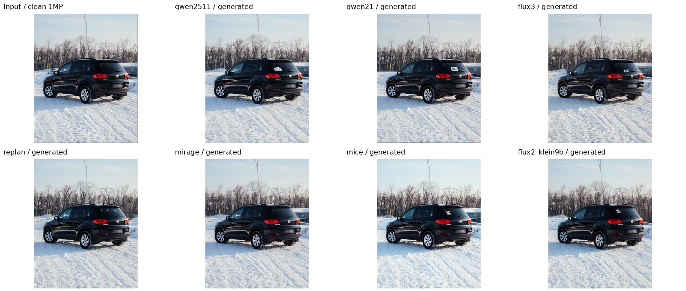
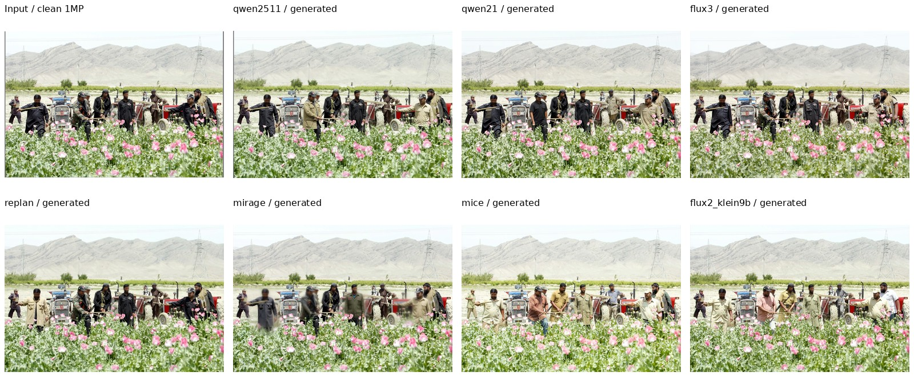
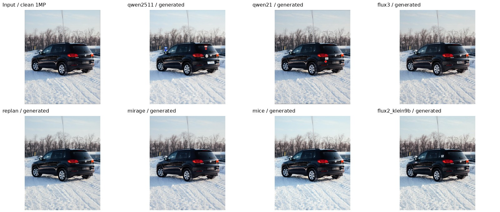
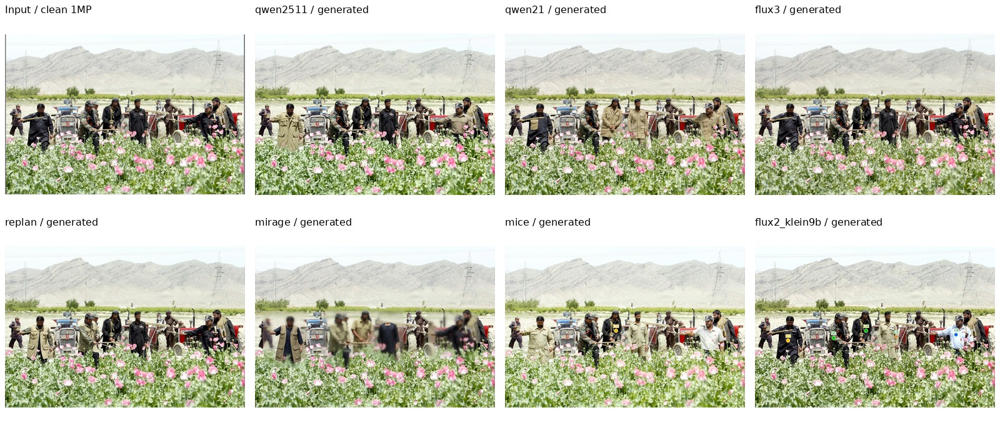
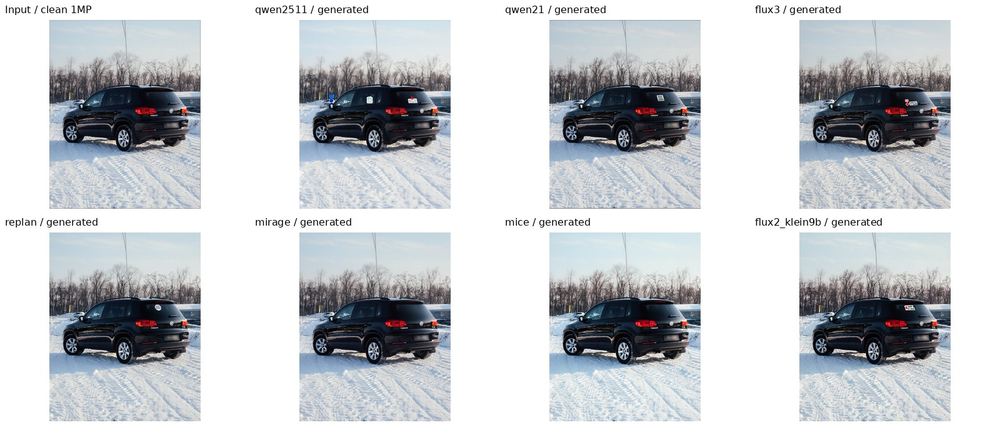
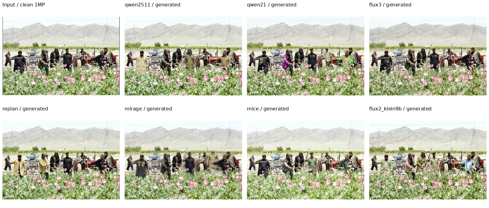

# 当前评测结果与分析

**主协议：统一约 1MP；正式全量结果：待评测。**

本轮快速验证固定两张 dev 图（K=2、K=5），每模型运行 S1、S3-point、S5，共42个生成请求。另对三张固定图的十种 setting、七模型共210个请求完成CPU输入检查。样本只按公开K和固定名单选取，不按模型分数选择。

本轮没有调用 Judge，因此没有 UnitPass / JointPass 分数或置信区间。下表的出图数量仅表示工程执行成功，不等同于编辑任务通过。

| 模型 | 成功出图 | 失败 | 待完成 | 实测平均编辑调用秒数 | 实际原生输出尺寸 |
|---|---:|---:|---:|---:|---|
| qwen2511 | 6/6 | 0 | 0 | 113.8 | 896×1120, 1248×832 |
| qwen21 | 6/6 | 0 | 0 | 44.0 | 896×1120, 1248×832 |
| flux3 | 6/6 | 0 | 0 | 13.8 | 896×1120, 1248×832 |
| replan | 6/6 | 0 | 0 | 81.8 | 928×1152, 1248×832 |
| mirage | 6/6 | 0 | 0 | 131.1 | 928×1152, 1248×832 |
| mice | 6/6 | 0 | 0 | 7.0 | 896×1120, 1248×832 |
| flux2_klein9b | 6/6 | 0 | 0 | 7.2 | 896×1120, 1248×832 |

调用耗时来自实际 worker 记录，不含模型加载；包含该调用内的同步与结果落盘，不能当作纯GPU算子性能。

## 各 setting 的模型对照

表中仅列本轮工程出图数；未纳入此次GPU短测的setting标为“未短测”，不标为N/A。

| Setting | qwen2511 | qwen21 | flux3 | replan | mirage | mice | flux2_klein9b |
|---|---|---|---|---|---|---|---|
| S1 | 2/2 | 2/2 | 2/2 | 2/2 | 2/2 | 2/2 | 2/2 |
| S2-point | 未短测 | 未短测 | 未短测 | 未短测 | 未短测 | 未短测 | 未短测 |
| S2-box | 未短测 | 未短测 | 未短测 | 未短测 | 未短测 | 未短测 | 未短测 |
| S2-mask | 未短测 | 未短测 | 未短测 | 未短测 | 未短测 | 未短测 | 未短测 |
| S3-point | 2/2 | 2/2 | 2/2 | 2/2 | 2/2 | 2/2 | 2/2 |
| S3-box | 未短测 | 未短测 | 未短测 | 未短测 | 未短测 | 未短测 | 未短测 |
| S3-mask | 未短测 | 未短测 | 未短测 | 未短测 | 未短测 | 未短测 | 未短测 |
| S4-ref | 未短测 | 未短测 | 未短测 | 未短测 | 未短测 | 未短测 | 未短测 |
| S4-noref | 未短测 | 未短测 | 未短测 | 未短测 | 未短测 | 未短测 | 未短测 |
| S5 | 2/2 | 2/2 | 2/2 | 2/2 | 2/2 | 2/2 | 2/2 |

## 正式评分表

每格为 UnitPass / JointPass；分母为全量1,084图和3,872单元，最终附按源图配对bootstrap的95%置信区间。

| Setting | qwen2511 | qwen21 | flux3 | replan | mirage | mice | flux2_klein9b |
|---|---|---|---|---|---|---|---|
| S1 | 待评测 | 待评测 | 待评测 | 待评测 | 待评测 | 待评测 | 待评测 |
| S2-point | 待评测 | 待评测 | 待评测 | 待评测 | 待评测 | 待评测 | 待评测 |
| S2-box | 待评测 | 待评测 | 待评测 | 待评测 | 待评测 | 待评测 | 待评测 |
| S2-mask | 待评测 | 待评测 | 待评测 | 待评测 | 待评测 | 待评测 | 待评测 |
| S3-point | 待评测 | 待评测 | 待评测 | 待评测 | 待评测 | 待评测 | 待评测 |
| S3-box | 待评测 | 待评测 | 待评测 | 待评测 | 待评测 | 待评测 | 待评测 |
| S3-mask | 待评测 | 待评测 | 待评测 | 待评测 | 待评测 | 待评测 | 待评测 |
| S4-ref | 待评测 | 待评测 | 待评测 | 待评测 | 待评测 | 待评测 | 待评测 |
| S4-noref | 待评测 | 待评测 | 待评测 | 待评测 | 待评测 | 待评测 | 待评测 |
| S5 | 待评测 | 待评测 | 待评测 | 待评测 | 待评测 | 待评测 | 待评测 |

## 当前输入与输出

每张图依次展示公共清图和七模型回源输出。输入形式与最终prompt另见 [十种setting输入样例](INPUT_EXAMPLES.md)。

### S1 · v2-sa_607902

### S1 · v2-sa_8415518

### S3-point · v2-sa_607902

### S3-point · v2-sa_8415518

### S5 · v2-sa_607902

### S5 · v2-sa_8415518

## 结论与边界

- 公共输入严格限制在约1MP，清图和标注图同画布；原生planner也不读取更高清源图。
- RePlan和MIRAGE保留原生约1MP输出网格，其他模型固定公共画布尺寸。所有输出按记录的内容框去留边、回到canonical尺寸。
- 原生内部视觉编码与局部放大不同，统一全图分辨率不等于统一计算预算。
- 这组极小样本只验证可运行性和几何流程，不能推断模型排名、全量正确率或置信区间。
- 固定样例 `S3-point / v2-sa_607902` 中，Qwen2511 输出仍可见彩点和 U 标签。成功出图不代表编辑与去标记要求全部达成；保留真实输出供后续 Judge/残留审查，不据此修改输入或擦除标记。
- 上述缩略图检查为工程目视检查，不是独立人工评分或标记残留率统计。

## 结果位置与复现

- 运行包：`/mnt/bn/strategy-mllm-train/user/tanyue/.ifbench-tmp/one-mp-probe-20261031`。
- 请求与输入：`/mnt/bn/strategy-mllm-train/user/tanyue/.ifbench-tmp/one-mp-probe-20261031/requests`、`/mnt/bn/strategy-mllm-train/user/tanyue/.ifbench-tmp/one-mp-probe-20261031/assets/shared_inputs`。
- 输出与原生规划：`/mnt/bn/strategy-mllm-train/user/tanyue/.ifbench-tmp/one-mp-probe-20261031/results/runs/`。
- 本轮plan SHA256：`02a1bd9348bdbd6728802da1202a9a5b5123ffb124110e140ca6656159a7edc5`。
- seed=42，每请求一次采样；失败保留完整记录，不挑图或额外采样。
- 正式四机运行及路径见 [FULL_RUN.md](FULL_RUN.md)。
