# IF-Bench 当前结果

**正式结果：待评测。** 本页仅展示最新修复完成的固定 dev20 结果；尚未确认正式冻结，也未启动 test。

当前范围为 7 个模型 × 10 个 setting × 20 张共享源图，共 1400 个逻辑请求。每条模型×setting结果含 **72 个编辑单元、20 张源图**。本页不包含早期分数或历史模型行。

[聚合数据 JSON](assets/results/latest_dev20.json) · [70行分数 CSV](assets/results/latest_dev20.csv) · [生成脚本](../scripts/render_current_results.py)

## 分数含义与评测口径

- **UnitPass（UP）**：通过的编辑单元数 ÷ 72。单元执行 E=4、保护 P≥3、质量 Q≥3 才通过。
- **JointPass（JP）**：全部单元通过且全局保护/质量通过的源图数 ÷ 20。它比UP要求更严格；两个百分数不是两个Judge的意见。
- **95% CI**：按源图成对 bootstrap，seed=20261027，10,000次，共用抽样索引。区间使用percentile方法；K桶在桶内重采样。某行JP全零时，经验bootstrap区间会退化为[0,0]；这不表示总体通过率确定为零。
- 生成/原生规划失败保留在完整分母；Judge缺分不补零。本次已完成评分，没有Judge缺分。输出统一回到源图分辨率后评分。
- 目标数分布：K2=3图、K3=4图、K4=11图、K5=2图。尤其不能把K=5的极小样本当成稳定结论。

所有模型共用相同公开文本和区域信息；只做确定性呈现/转换。使用原生方法流程，主结果不接外部SAM、定位器、caption改写器、PE或PUP。RePlan/MIRAGE保留其方法自带planner。每请求一次采样，seed=42，不根据本页分数重新选输入。

ref是指令中用于辨认目标的文字指称；no-ref去掉目标指称，保留编辑动作，并依靠该setting公开提供的区域信息。

| Setting | 公开输入信息 |
|---|---|
| S1 | 语言ref＋编辑指令，无区域 |
| S2-point / box / mask | 语言ref＋编辑指令＋指定区域形式 |
| S3-point / box / mask | 不含语言ref的编辑指令＋指定区域形式 |
| S4-ref | 语言ref＋编辑指令＋各目标共享冻结的混合区域形式 |
| S4-noref | 不含语言ref的编辑指令＋共享冻结的混合区域形式 |
| S5 | manifest冻结的ref/no-ref与none/point/box/mask组合；none必须有ref，不补区域 |

| 表头简称 | 当前模型 |
|---|---|
| Qwen2511 | Qwen-Image-Edit-2511 |
| Qwen2.1 | Qwen-Image-2.1 |
| FLUX3 | FLUX.3 Klein distilled |
| RePlan | RePlan（Qwen-2511骨干） |
| MIRAGE | MIRAGE（Qwen-2511骨干） |
| MICE | MICE（Klein-4B骨干） |
| FLUX2-9B | FLUX.2 Klein-9B distilled |

## UnitPass：编辑单元通过率（%）

| Setting | Qwen2511 | Qwen2.1 | FLUX3 | RePlan | MIRAGE | MICE | FLUX2-9B |
|---|---:|---:|---:|---:|---:|---:|---:|
| S1 | 50.00 | 72.22 | 62.50 | 37.50 | 45.83 | 51.39 | 58.33 |
| S2-point | 45.83 | 62.50 | 52.78 | 36.11 | 61.11 | 43.06 | 59.72 |
| S2-box | 51.39 | 80.56 | 59.72 | 41.67 | 61.11 | 65.28 | 55.56 |
| S2-mask | 54.17 | 69.44 | 59.72 | 45.83 | 58.33 | 40.28 | 59.72 |
| S3-point | 5.56 | 44.44 | 20.83 | 11.11 | 29.17 | 13.89 | 9.72 |
| S3-box | 15.28 | 56.94 | 19.44 | 29.17 | 23.61 | 38.89 | 12.50 |
| S3-mask | 12.50 | 63.89 | 20.83 | 20.83 | 25.00 | 38.89 | 19.44 |
| S4-ref | 43.06 | 72.22 | 55.56 | 43.06 | 59.72 | 48.61 | 56.94 |
| S4-noref | 6.94 | 47.22 | 15.28 | 20.83 | 19.44 | 34.72 | 15.28 |
| S5 | 31.94 | 66.67 | 40.28 | 22.22 | 44.44 | 50.00 | 40.28 |

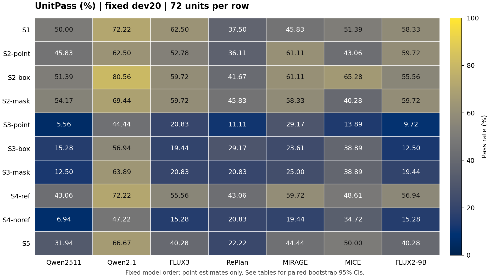

[下载SVG](assets/results/unitpass_heatmap.svg)。两图均使用0–100%的同一色阶；仅展示点估计，不表示显著性排名。


## JointPass：整图联合通过率（%）

| Setting | Qwen2511 | Qwen2.1 | FLUX3 | RePlan | MIRAGE | MICE | FLUX2-9B |
|---|---:|---:|---:|---:|---:|---:|---:|
| S1 | 15.00 | 25.00 | 30.00 | 0.00 | 20.00 | 10.00 | 5.00 |
| S2-point | 0.00 | 20.00 | 5.00 | 10.00 | 30.00 | 5.00 | 20.00 |
| S2-box | 20.00 | 50.00 | 25.00 | 25.00 | 35.00 | 10.00 | 10.00 |
| S2-mask | 25.00 | 35.00 | 25.00 | 10.00 | 15.00 | 0.00 | 5.00 |
| S3-point | 0.00 | 10.00 | 0.00 | 0.00 | 10.00 | 5.00 | 0.00 |
| S3-box | 0.00 | 10.00 | 0.00 | 15.00 | 10.00 | 5.00 | 0.00 |
| S3-mask | 0.00 | 30.00 | 0.00 | 0.00 | 5.00 | 0.00 | 0.00 |
| S4-ref | 5.00 | 25.00 | 25.00 | 5.00 | 35.00 | 5.00 | 10.00 |
| S4-noref | 0.00 | 20.00 | 0.00 | 10.00 | 5.00 | 5.00 | 0.00 |
| S5 | 0.00 | 25.00 | 10.00 | 5.00 | 5.00 | 20.00 | 0.00 |

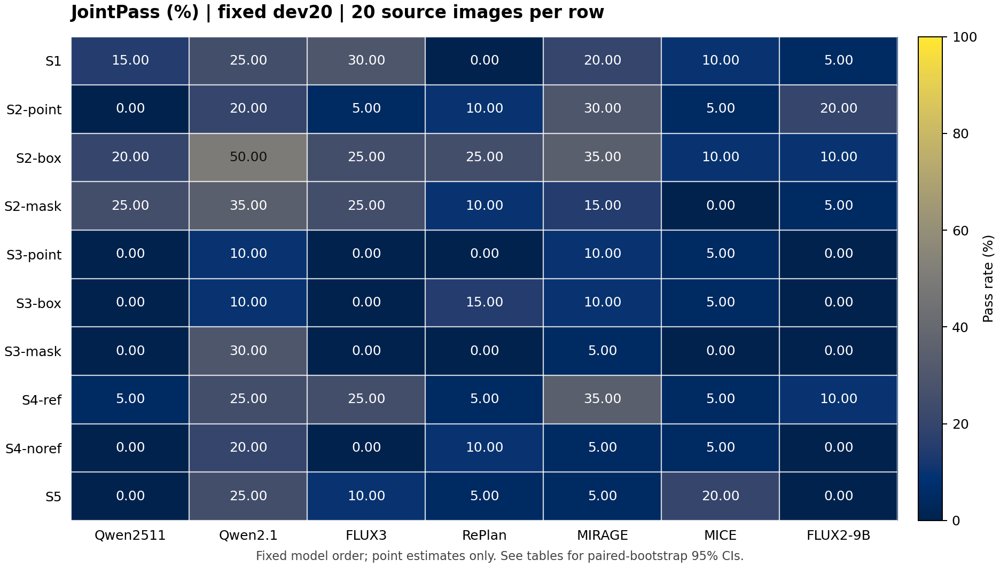

[下载SVG](assets/results/jointpass_heatmap.svg)。两图均使用0–100%的同一色阶；仅展示点估计，不表示显著性排名。

## 结果说明

- **语言ref仍有作用，但强度不同。** 21/21组S2−S3的UP点估计为正。Qwen2.1的mask差为5.56个百分点，95% CI [-4.41, 16.42]个百分点，区间跨零；不能把全部正点估计概括为全部显著。
- **加入区域不保证提高分数。** Qwen2.1的S2-point为45/72个单元通过，S1为52/72；差-9.72个百分点，95% CI [-17.39, -1.45]。JP差-5.00个百分点，95% CI [-20.00, 10.00]，包含零。S2主行不因此改成discard。
- **应同时看单元完成与整图完成。** 例如Qwen2.1的S2-box为UP 58/72=80.56%，JP 10/20=50.00%；S3-mask为UP 46/72=63.89%，JP 6/20=30.00%。局部任务可完成，不代表同图全部任务及保护/质量同时通过。
- **这不是模型最大能力或显著性排名。** 双图角色理解、标记残留、原生planner定位偏差、MICE的global/local路由均可能影响结果；低分不自动证明接口不公平，API能运行也不证明用法已覆盖最大能力。S2−S1还包含原生分辨率/流程变化（例如FLUX3单图与多图限制），不能称为区域信息的纯因果增益。固定输入、组件与参数边界应独立于分数审查。
- **补充行不参与选型。** 21条S2 discard补充是同模型S1已评分输出的精确复用，不是新调用，不替代主行。完整派生指标、K桶与补充统计保存在当前聚合JSON。

## 执行完成度与失败

已得到 **1399个可评分逻辑请求、1377个唯一输出评分键**。相同实际输出与canonical绑定可以被多个逻辑请求精确复用，因此两数不同。1个MIRAGE原生planner失败仍保留在S1分母；没有隐藏失败或补造输出。

| 模型 | 逻辑请求 | 实际生成 | 原生规划失败 | 本轮新增编辑API | 精确复用终态 |
|---|---:|---:|---:|---:|---:|
| Qwen2511 | 200 | 200 | 0 | 0 | 200 |
| Qwen2.1 | 200 | 200 | 0 | 177 | 23 |
| FLUX3 | 200 | 200 | 0 | 0 | 200 |
| RePlan | 200 | 200 | 0 | 0 | 200 |
| MIRAGE | 200 | 199 | 1 | 0 | 200 |
| MICE | 200 | 200 | 0 | 0 | 200 |
| FLUX2-9B | 200 | 200 | 0 | 0 | 200 |

Qwen2.1使用原生model CPU offload完成177个新请求，并精确复用23个原resident成功输出；当前共200个有效生成。40步、CFG1、2K、KV cache、输入和seed保持固定。其余六模型复用既有终态，包括原生失败；缓存不计新调用。

本轮新增Judge调用177次：173份原始回答直接解析，4份仅经已授权的确定性JSON修复，额外推理调用=0；原文和独立overlay均保留。复用1200个已核验唯一评分键，不把旧分数绑定到新输出。

| 本轮测得的执行量 | 实际值 |
|---|---:|
| Qwen2.1新增编辑API / DiT forward | 177 / 7080 |
| Qwen2.1编辑阶段墙钟 | 4304.67秒 |
| Qwen2.1逐请求墙钟之和 | 30068.06秒 |
| 本轮Judge执行墙钟 | 1787.24秒 |

这些时间来自实际receipt，范围含加载、CPU/offload、序列化或等待；逐请求秒数之和不等于总墙钟，不能当成GPU内核活跃时长或完整七模型GPU-hours。历史成本与全部原始调用账本留在外部审计记录。

## 固定样例：所有模型与setting的实际输出

以下使用统一随机抽检名单第一张`v2-sa_5335541`；抽样seed=20261031，名单在查看输出质量前已固定。所有setting使用同一例，未按结果挑选。每张图依次为清图、公开视觉条件、七个模型真实输出；各模型原生输入路由的完整prompt和证据留在外部图册。图中可见的标记残留或编辑错误未被修图去除。

本组图的两条canonical任务如下；这是本图的目标说明，不是S3/S4-noref编辑器额外收到的文字：

- **U1**：将粉蓝色立面的中层阳台栏杆改成白色。`Change the color of the middle-floor balcony railing on the pink-and-blue facade to white.`
- **U2**：将201号门前的圆形绿植替换为红花天竺葵。`Replace the round leafy plant in front of door 201 with a red-flowering geranium plant.`

### S1

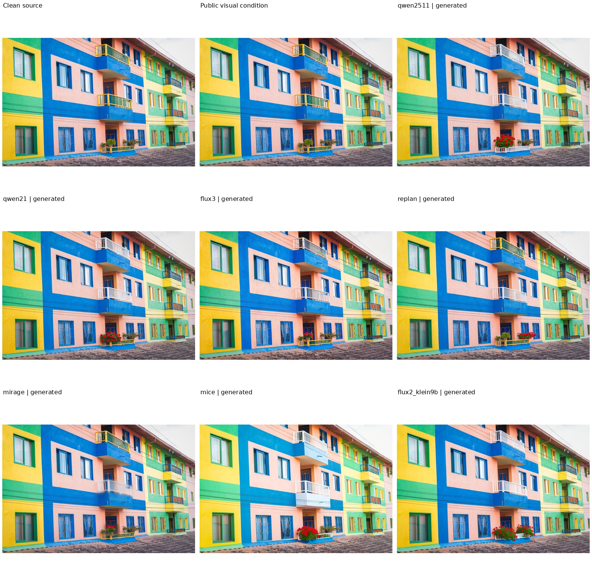

### S2-point

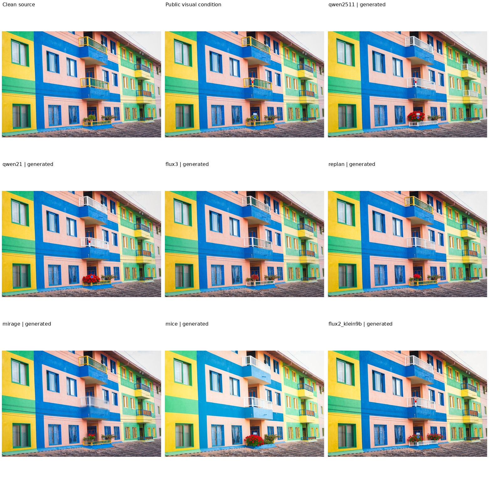

### S2-box

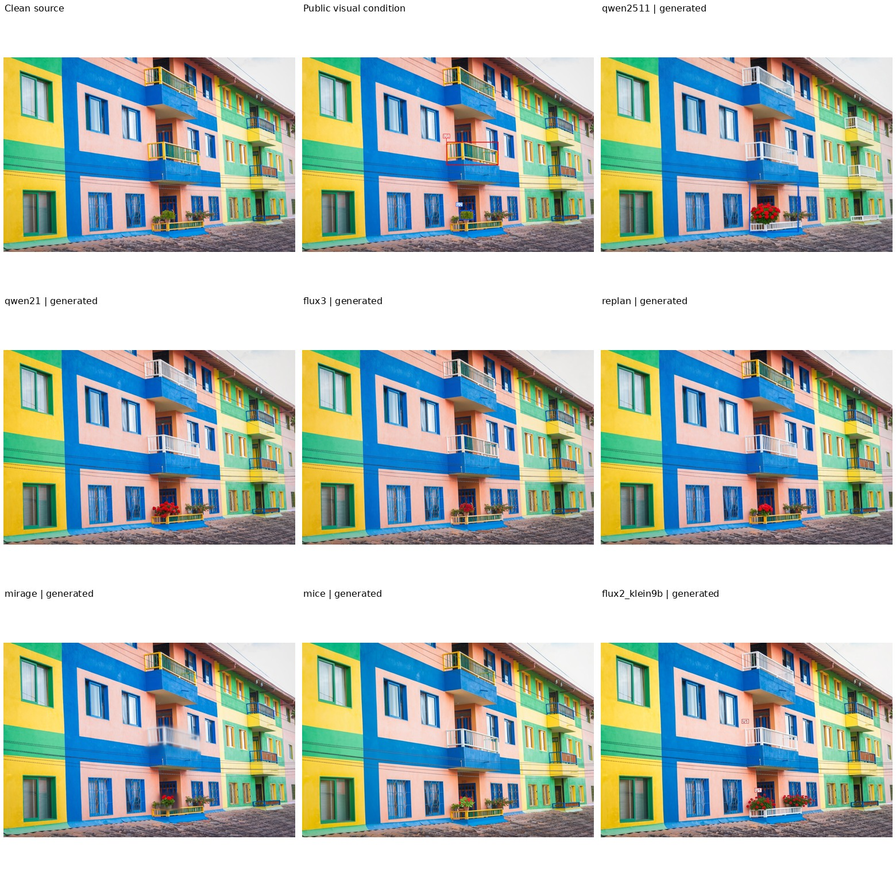

### S2-mask

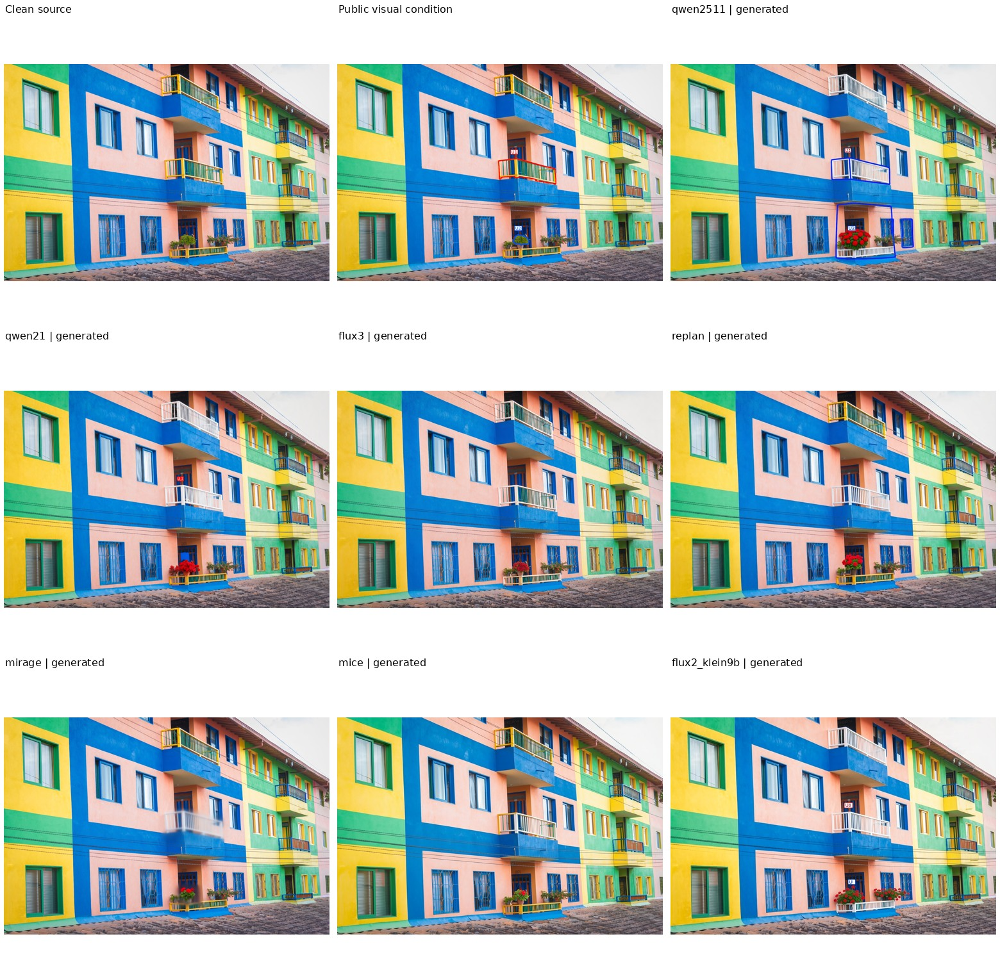

### S3-point

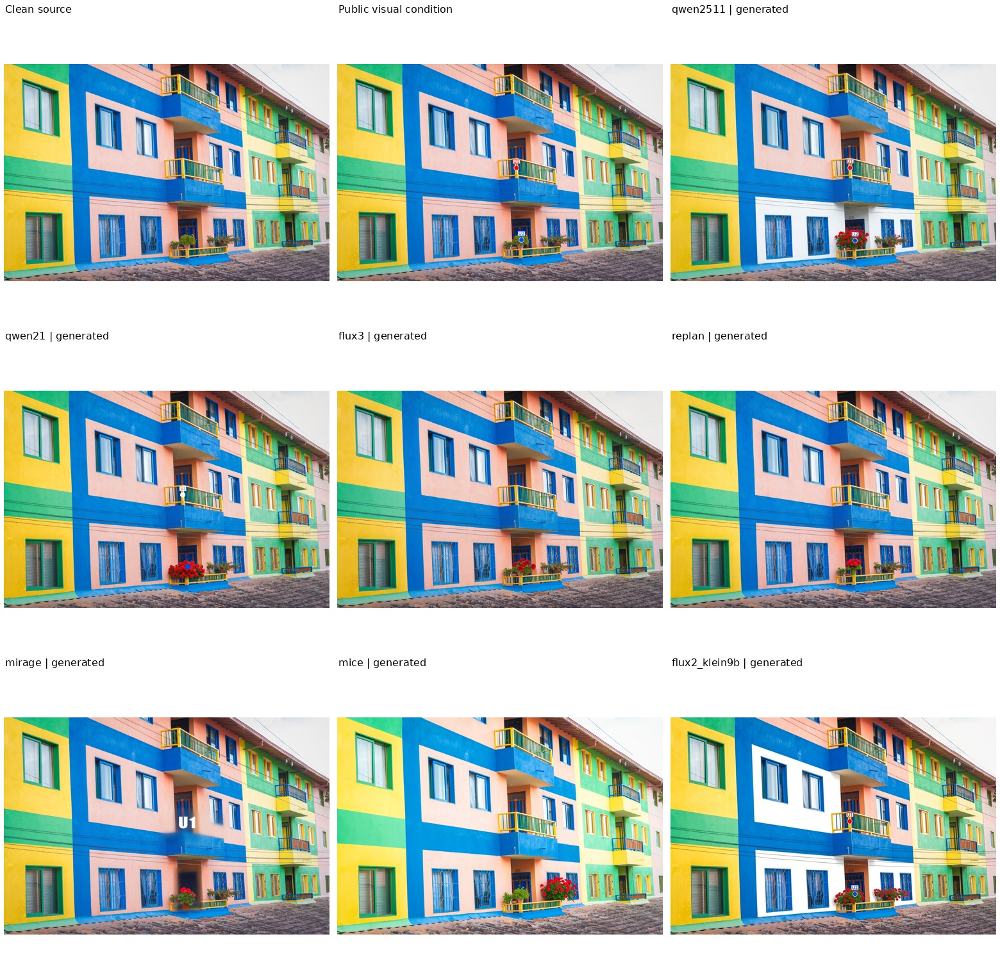

### S3-box

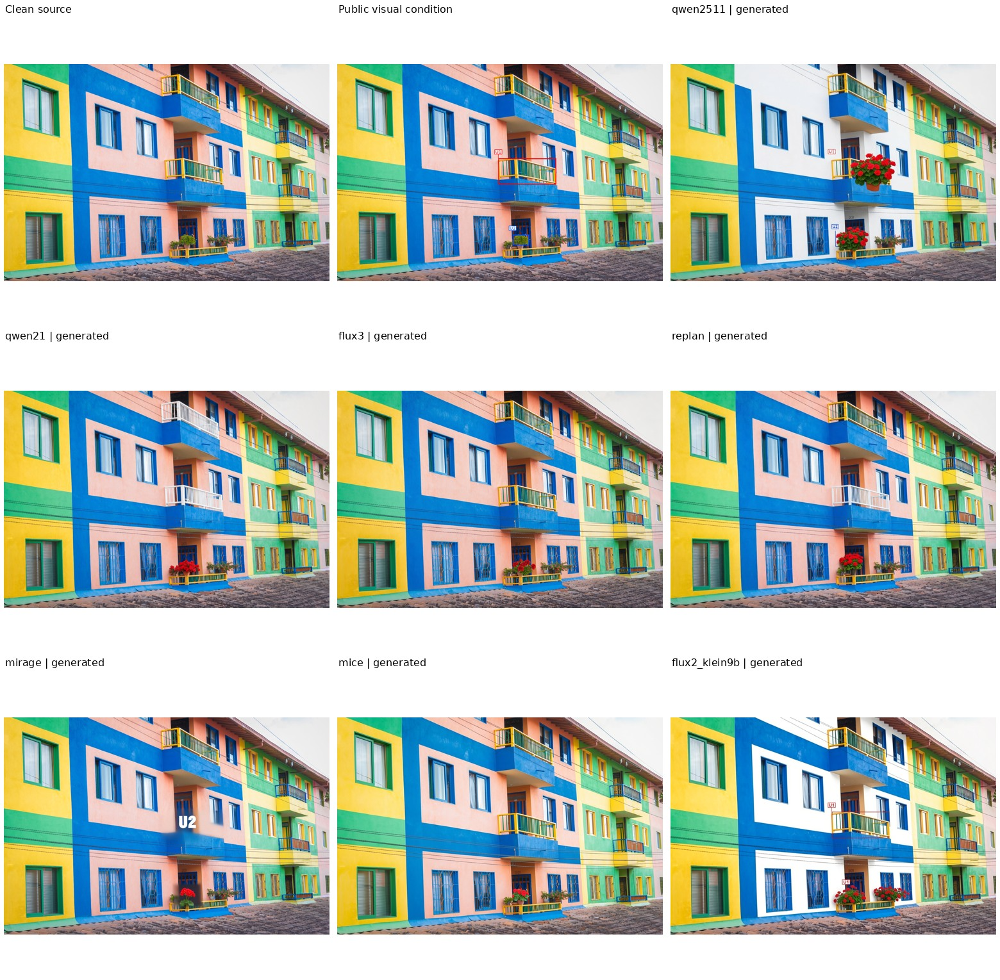

### S3-mask

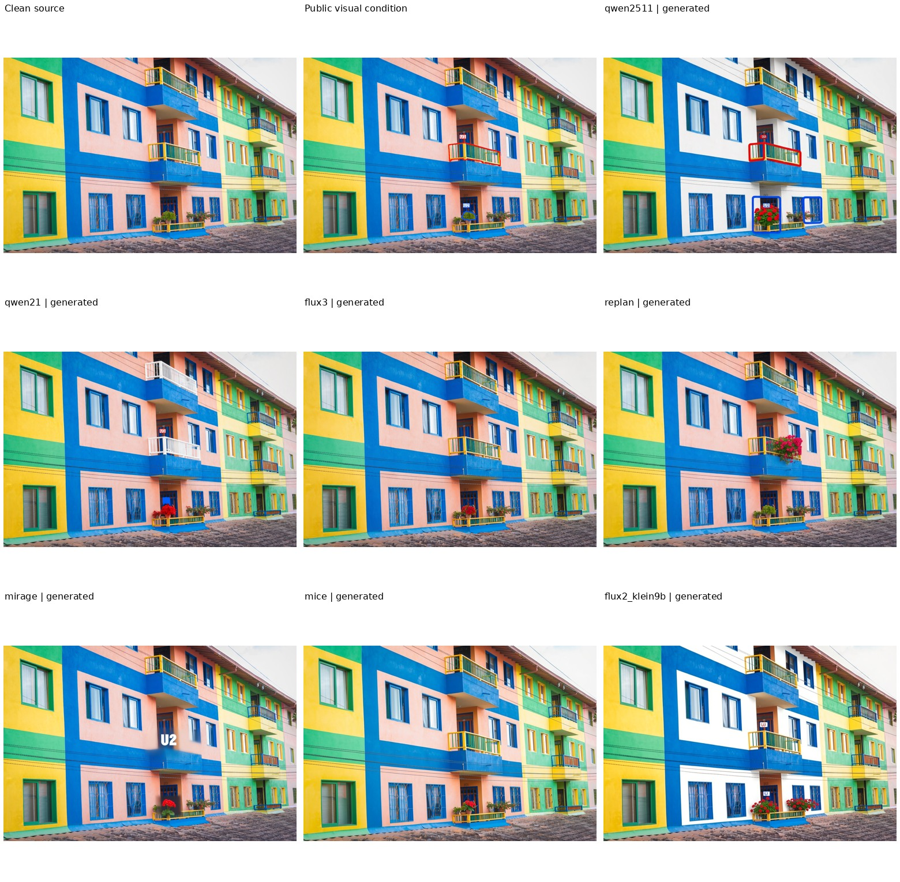

### S4-ref

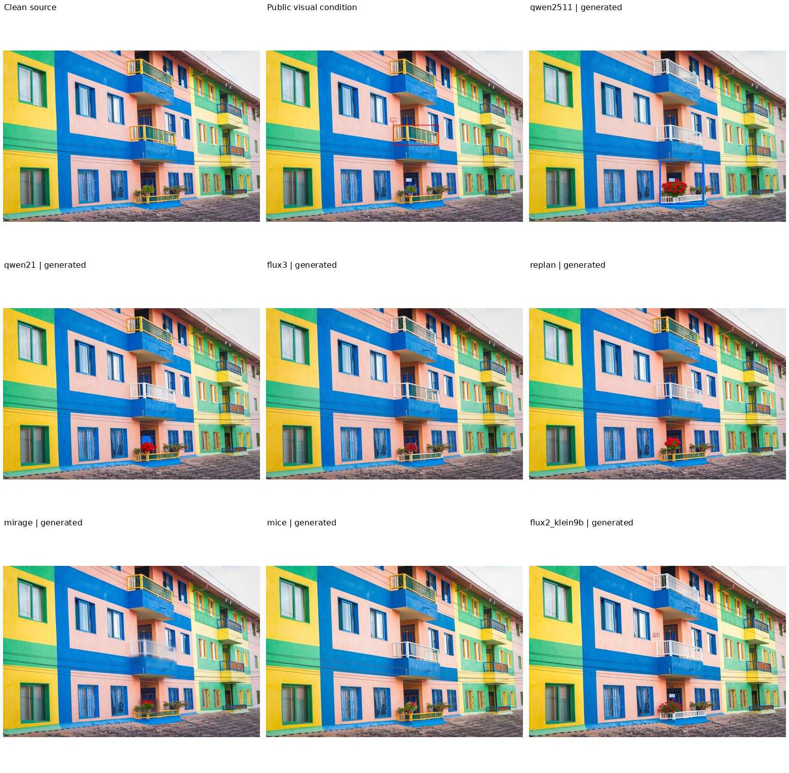

### S4-noref

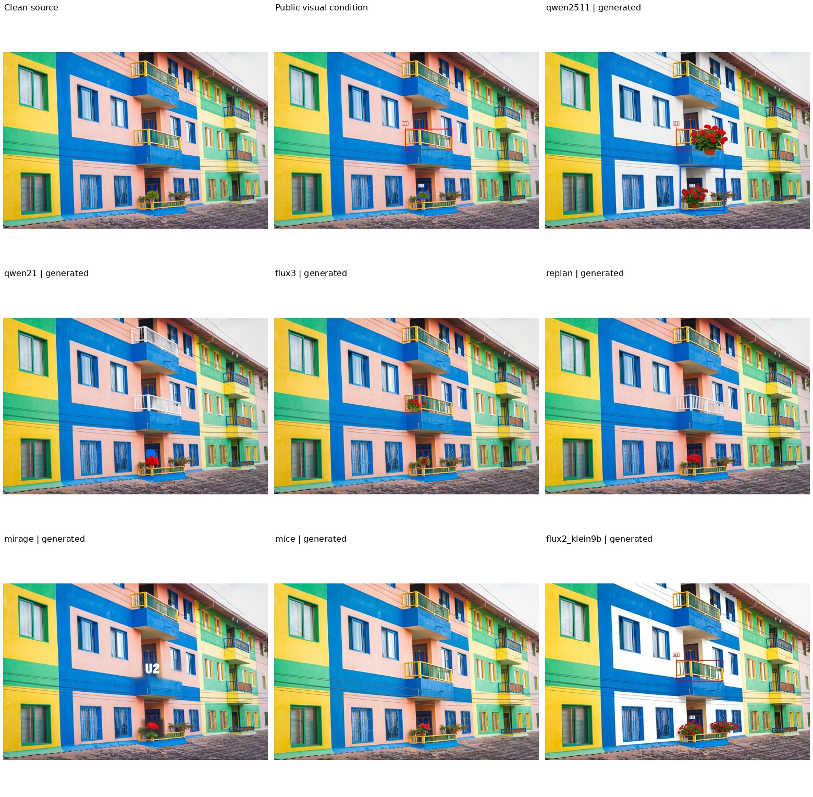

### S5

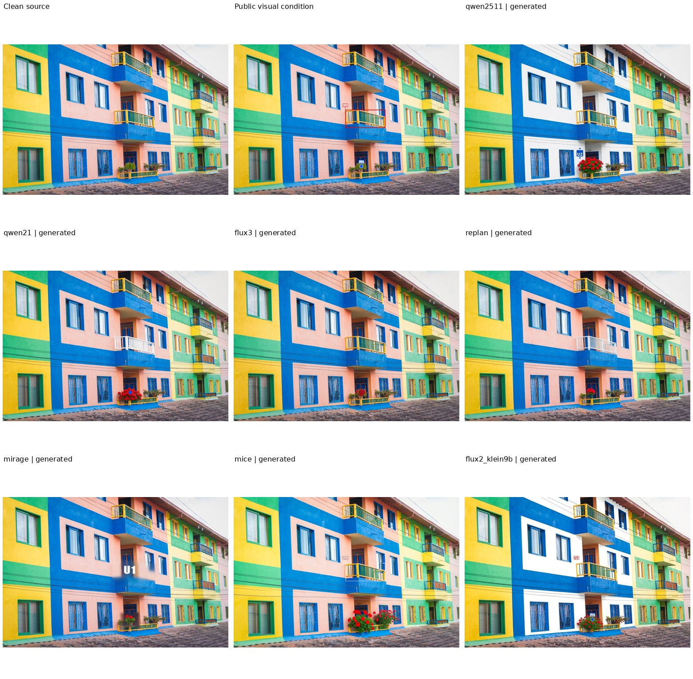

## 全部70行与95%置信区间

单位均为%。每行保留实际分子/分母；MIRAGE S1的失败仍计入完整分母。

<details>
<summary>展开完整当前dev20统计表</summary>

| 模型 | Setting | UP分子/分母 | UP | UP 95% CI | JP分子/分母 | JP | JP 95% CI | 生成/规划失败 | Judge缺分 |
|---|---|---:|---:|---|---:|---:|---|---:|---:|
| Qwen2511 | S1 | 36/72 | 50.00 | [38.71, 61.64] | 3/20 | 15.00 | [0.00, 30.00] | 0 | 0 |
| Qwen2511 | S2-point | 33/72 | 45.83 | [35.71, 55.85] | 0/20 | 0.00 | [0.00, 0.00] | 0 | 0 |
| Qwen2511 | S2-box | 37/72 | 51.39 | [37.50, 66.22] | 4/20 | 20.00 | [5.00, 40.00] | 0 | 0 |
| Qwen2511 | S2-mask | 39/72 | 54.17 | [41.33, 67.65] | 5/20 | 25.00 | [10.00, 45.00] | 0 | 0 |
| Qwen2511 | S3-point | 4/72 | 5.56 | [1.33, 10.96] | 0/20 | 0.00 | [0.00, 0.00] | 0 | 0 |
| Qwen2511 | S3-box | 11/72 | 15.28 | [9.23, 21.43] | 0/20 | 0.00 | [0.00, 0.00] | 0 | 0 |
| Qwen2511 | S3-mask | 9/72 | 12.50 | [5.80, 19.72] | 0/20 | 0.00 | [0.00, 0.00] | 0 | 0 |
| Qwen2511 | S4-ref | 31/72 | 43.06 | [32.89, 53.62] | 1/20 | 5.00 | [0.00, 15.00] | 0 | 0 |
| Qwen2511 | S4-noref | 5/72 | 6.94 | [1.35, 14.08] | 0/20 | 0.00 | [0.00, 0.00] | 0 | 0 |
| Qwen2511 | S5 | 23/72 | 31.94 | [23.44, 41.18] | 0/20 | 0.00 | [0.00, 0.00] | 0 | 0 |
| Qwen2.1 | S1 | 52/72 | 72.22 | [63.64, 80.56] | 5/20 | 25.00 | [10.00, 45.00] | 0 | 0 |
| Qwen2.1 | S2-point | 45/72 | 62.50 | [52.00, 73.53] | 4/20 | 20.00 | [5.00, 40.00] | 0 | 0 |
| Qwen2.1 | S2-box | 58/72 | 80.56 | [70.59, 89.86] | 10/20 | 50.00 | [30.00, 70.00] | 0 | 0 |
| Qwen2.1 | S2-mask | 50/72 | 69.44 | [57.89, 81.08] | 7/20 | 35.00 | [15.00, 55.00] | 0 | 0 |
| Qwen2.1 | S3-point | 32/72 | 44.44 | [33.33, 56.00] | 2/20 | 10.00 | [0.00, 25.00] | 0 | 0 |
| Qwen2.1 | S3-box | 41/72 | 56.94 | [45.21, 68.49] | 2/20 | 10.00 | [0.00, 25.00] | 0 | 0 |
| Qwen2.1 | S3-mask | 46/72 | 63.89 | [51.56, 76.12] | 6/20 | 30.00 | [10.00, 50.00] | 0 | 0 |
| Qwen2.1 | S4-ref | 52/72 | 72.22 | [62.86, 81.82] | 5/20 | 25.00 | [10.00, 45.00] | 0 | 0 |
| Qwen2.1 | S4-noref | 34/72 | 47.22 | [35.62, 60.53] | 4/20 | 20.00 | [5.00, 40.00] | 0 | 0 |
| Qwen2.1 | S5 | 48/72 | 66.67 | [56.76, 77.14] | 5/20 | 25.00 | [10.00, 45.00] | 0 | 0 |
| FLUX3 | S1 | 45/72 | 62.50 | [47.69, 77.03] | 6/20 | 30.00 | [10.00, 50.00] | 0 | 0 |
| FLUX3 | S2-point | 38/72 | 52.78 | [38.81, 66.20] | 1/20 | 5.00 | [0.00, 15.00] | 0 | 0 |
| FLUX3 | S2-box | 43/72 | 59.72 | [46.05, 73.61] | 5/20 | 25.00 | [5.00, 45.00] | 0 | 0 |
| FLUX3 | S2-mask | 43/72 | 59.72 | [47.37, 72.31] | 5/20 | 25.00 | [5.00, 45.00] | 0 | 0 |
| FLUX3 | S3-point | 15/72 | 20.83 | [11.76, 31.34] | 0/20 | 0.00 | [0.00, 0.00] | 0 | 0 |
| FLUX3 | S3-box | 14/72 | 19.44 | [9.72, 30.88] | 0/20 | 0.00 | [0.00, 0.00] | 0 | 0 |
| FLUX3 | S3-mask | 15/72 | 20.83 | [11.84, 31.82] | 0/20 | 0.00 | [0.00, 0.00] | 0 | 0 |
| FLUX3 | S4-ref | 40/72 | 55.56 | [40.28, 70.67] | 5/20 | 25.00 | [10.00, 45.00] | 0 | 0 |
| FLUX3 | S4-noref | 11/72 | 15.28 | [6.49, 26.32] | 0/20 | 0.00 | [0.00, 0.00] | 0 | 0 |
| FLUX3 | S5 | 29/72 | 40.28 | [27.78, 53.42] | 2/20 | 10.00 | [0.00, 25.00] | 0 | 0 |
| RePlan | S1 | 27/72 | 37.50 | [26.76, 48.00] | 0/20 | 0.00 | [0.00, 0.00] | 0 | 0 |
| RePlan | S2-point | 26/72 | 36.11 | [26.39, 47.06] | 2/20 | 10.00 | [0.00, 25.00] | 0 | 0 |
| RePlan | S2-box | 30/72 | 41.67 | [28.38, 56.92] | 5/20 | 25.00 | [5.00, 45.00] | 0 | 0 |
| RePlan | S2-mask | 33/72 | 45.83 | [37.68, 55.00] | 2/20 | 10.00 | [0.00, 25.00] | 0 | 0 |
| RePlan | S3-point | 8/72 | 11.11 | [4.35, 18.84] | 0/20 | 0.00 | [0.00, 0.00] | 0 | 0 |
| RePlan | S3-box | 21/72 | 29.17 | [18.18, 42.62] | 3/20 | 15.00 | [0.00, 30.00] | 0 | 0 |
| RePlan | S3-mask | 15/72 | 20.83 | [11.43, 31.82] | 0/20 | 0.00 | [0.00, 0.00] | 0 | 0 |
| RePlan | S4-ref | 31/72 | 43.06 | [32.88, 53.42] | 1/20 | 5.00 | [0.00, 15.00] | 0 | 0 |
| RePlan | S4-noref | 15/72 | 20.83 | [10.67, 33.33] | 2/20 | 10.00 | [0.00, 25.00] | 0 | 0 |
| RePlan | S5 | 16/72 | 22.22 | [13.16, 32.79] | 1/20 | 5.00 | [0.00, 15.00] | 0 | 0 |
| MIRAGE | S1 | 33/72 | 45.83 | [29.87, 62.86] | 4/20 | 20.00 | [5.00, 40.00] | 1 | 0 |
| MIRAGE | S2-point | 44/72 | 61.11 | [45.59, 76.06] | 6/20 | 30.00 | [10.00, 50.00] | 0 | 0 |
| MIRAGE | S2-box | 44/72 | 61.11 | [48.00, 74.29] | 7/20 | 35.00 | [15.00, 55.00] | 0 | 0 |
| MIRAGE | S2-mask | 42/72 | 58.33 | [46.03, 70.00] | 3/20 | 15.00 | [0.00, 30.00] | 0 | 0 |
| MIRAGE | S3-point | 21/72 | 29.17 | [17.33, 43.24] | 2/20 | 10.00 | [0.00, 25.00] | 0 | 0 |
| MIRAGE | S3-box | 17/72 | 23.61 | [10.81, 38.24] | 2/20 | 10.00 | [0.00, 25.00] | 0 | 0 |
| MIRAGE | S3-mask | 18/72 | 25.00 | [13.16, 38.46] | 1/20 | 5.00 | [0.00, 15.00] | 0 | 0 |
| MIRAGE | S4-ref | 43/72 | 59.72 | [43.94, 74.67] | 7/20 | 35.00 | [15.00, 55.00] | 0 | 0 |
| MIRAGE | S4-noref | 14/72 | 19.44 | [9.21, 31.34] | 1/20 | 5.00 | [0.00, 15.00] | 0 | 0 |
| MIRAGE | S5 | 32/72 | 44.44 | [32.00, 56.72] | 1/20 | 5.00 | [0.00, 15.00] | 0 | 0 |
| MICE | S1 | 37/72 | 51.39 | [38.36, 64.71] | 2/20 | 10.00 | [0.00, 25.00] | 0 | 0 |
| MICE | S2-point | 31/72 | 43.06 | [30.56, 55.26] | 1/20 | 5.00 | [0.00, 15.00] | 0 | 0 |
| MICE | S2-box | 47/72 | 65.28 | [56.16, 74.29] | 2/20 | 10.00 | [0.00, 25.00] | 0 | 0 |
| MICE | S2-mask | 29/72 | 40.28 | [27.54, 52.05] | 0/20 | 0.00 | [0.00, 0.00] | 0 | 0 |
| MICE | S3-point | 10/72 | 13.89 | [6.33, 22.54] | 1/20 | 5.00 | [0.00, 15.00] | 0 | 0 |
| MICE | S3-box | 28/72 | 38.89 | [25.97, 52.17] | 1/20 | 5.00 | [0.00, 15.00] | 0 | 0 |
| MICE | S3-mask | 28/72 | 38.89 | [26.09, 51.43] | 0/20 | 0.00 | [0.00, 0.00] | 0 | 0 |
| MICE | S4-ref | 35/72 | 48.61 | [41.18, 55.88] | 1/20 | 5.00 | [0.00, 15.00] | 0 | 0 |
| MICE | S4-noref | 25/72 | 34.72 | [24.68, 44.93] | 1/20 | 5.00 | [0.00, 15.00] | 0 | 0 |
| MICE | S5 | 36/72 | 50.00 | [39.73, 61.76] | 4/20 | 20.00 | [5.00, 40.00] | 0 | 0 |
| FLUX2-9B | S1 | 42/72 | 58.33 | [47.06, 69.01] | 1/20 | 5.00 | [0.00, 15.00] | 0 | 0 |
| FLUX2-9B | S2-point | 43/72 | 59.72 | [47.30, 71.23] | 4/20 | 20.00 | [5.00, 40.00] | 0 | 0 |
| FLUX2-9B | S2-box | 40/72 | 55.56 | [45.59, 65.43] | 2/20 | 10.00 | [0.00, 25.00] | 0 | 0 |
| FLUX2-9B | S2-mask | 43/72 | 59.72 | [52.11, 67.14] | 1/20 | 5.00 | [0.00, 15.00] | 0 | 0 |
| FLUX2-9B | S3-point | 7/72 | 9.72 | [4.17, 15.49] | 0/20 | 0.00 | [0.00, 0.00] | 0 | 0 |
| FLUX2-9B | S3-box | 9/72 | 12.50 | [5.63, 19.72] | 0/20 | 0.00 | [0.00, 0.00] | 0 | 0 |
| FLUX2-9B | S3-mask | 14/72 | 19.44 | [13.51, 25.40] | 0/20 | 0.00 | [0.00, 0.00] | 0 | 0 |
| FLUX2-9B | S4-ref | 41/72 | 56.94 | [47.76, 66.15] | 2/20 | 10.00 | [0.00, 25.00] | 0 | 0 |
| FLUX2-9B | S4-noref | 11/72 | 15.28 | [6.25, 25.35] | 0/20 | 0.00 | [0.00, 0.00] | 0 | 0 |
| FLUX2-9B | S5 | 29/72 | 40.28 | [31.65, 50.00] | 0/20 | 0.00 | [0.00, 0.00] | 0 | 0 |

</details>

## 尚未完成

| 项目 | 当前状态 |
|---|---|
| 正式冻结与test主结果 | **待评测；等待下一次确认** |
| 人工标记残留率、独立双人一致性κ | **待评测**；已提供随机十例材料，AI目视不算人工标签 |
| GT selector paste-back诊断 | **待评测**；不称上界，不替换主结果 |
| 尚未执行的消融与扩展补充 | **待评测**；本页不填估计数字 |
| 完整模型运行GPU-hours | 尚未汇总；不由请求秒数推算 |

## 数据、原始结果与复现

仓库只保存当前聚合统计、公开展示图和生成脚本；原始prompt、GT、逐请求评分与输出保留在外部挂载目录。

- 数据manifest：`/mnt/bn/strategy-mllm-train/user/tanyue/.ifbench-tmp/fairness-v21-qwen-repaired-dev20-20261031/repo/data/v2_2.6.0/cases.jsonl`
- 当前run：`/mnt/bn/strategy-mllm-train/user/tanyue/.ifbench-tmp/fairness-v21-qwen-repaired-dev20-20261031`
- 原始模型输出：`/mnt/bn/strategy-mllm-train/user/tanyue/.ifbench-tmp/fairness-v21-qwen-repaired-dev20-20261031/results/runs`
- canonical评分与overlay：`/mnt/bn/strategy-mllm-train/user/tanyue/.ifbench-tmp/fairness-v21-qwen-repaired-dev20-20261031/results/judge`
- [外部完整报告](/mnt/bn/strategy-mllm-train/user/tanyue/.ifbench-tmp/fairness-v21-qwen-repaired-dev20-20261031/results/report/REPORT.md) · [700组抽检图册与最终prompt](/mnt/bn/strategy-mllm-train/user/tanyue/.ifbench-tmp/fairness-v21-qwen-repaired-dev20-20261031/results/report/appendix/AUDIT_GALLERY.md)
- 主报告SHA256：`b162e196a726b2f59304956516fc27d3aa109895a57d2b5c053fa4785b5210d1`
- 数据manifest SHA256：`818ce524a1d1f363dc8ea5caa7a887b2dd0355c17a5600d1cbd696cffcf263fb`
- 独立统计核验：16,423/16,423项通过；源文件SHA、固定样例SHA见[聚合JSON](assets/results/latest_dev20.json)。

在独立CPU环境重绘当前聚合结果，无需权重、GPU、Judge或原始私有数据：

```bash
python -m pip install -r scripts/results_plot_requirements.txt
python scripts/render_current_results.py
```

脚本默认读取仓库中的当前聚合JSON，不重新计算评分。只有显式提供`--source-report`时，才从固定SHA的最新原始REPORT提取允许公开的聚合字段；不会写回原始结果。
