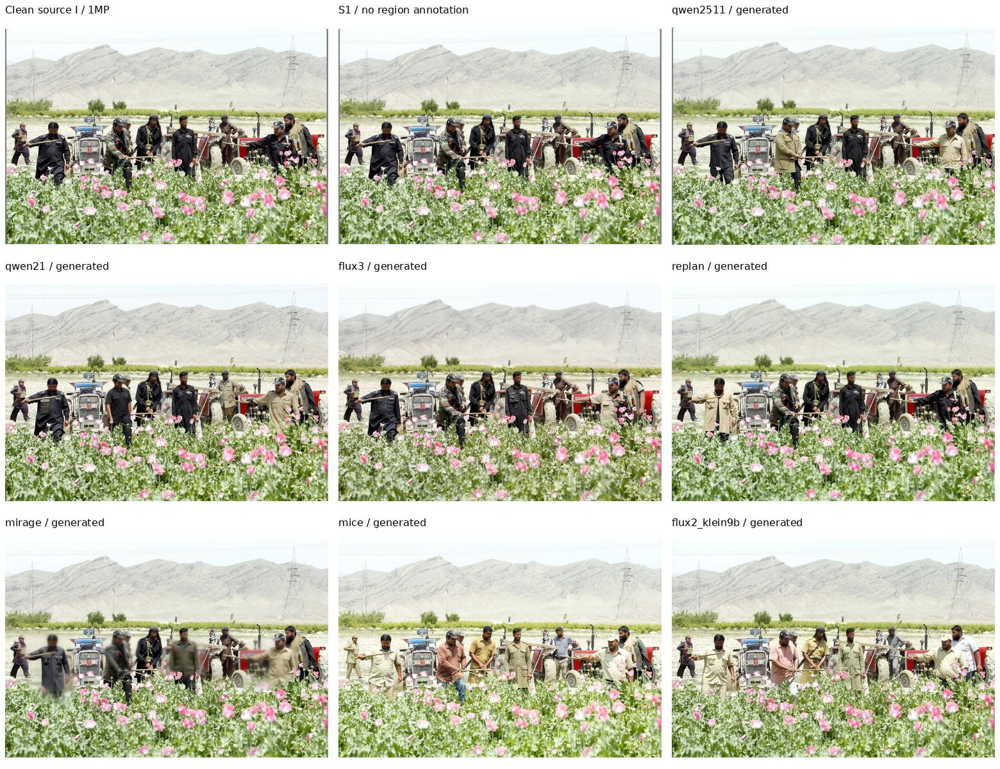
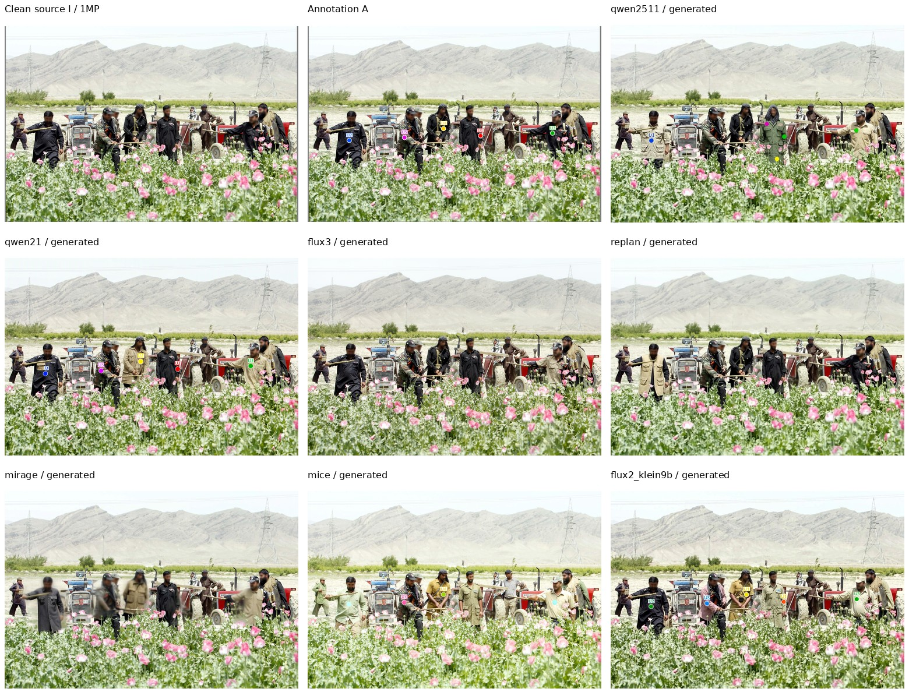
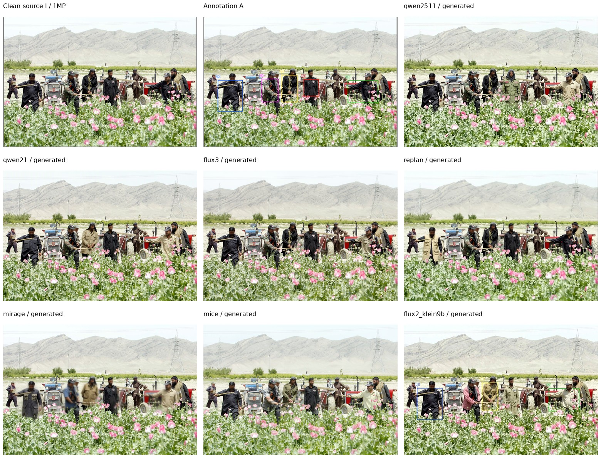
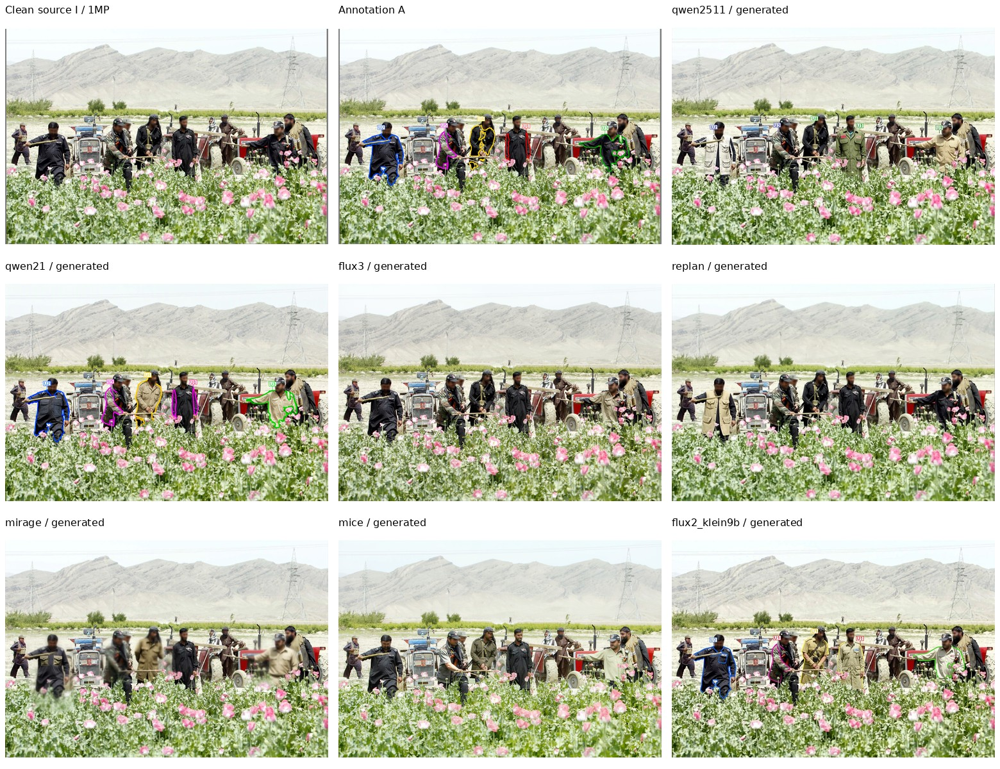
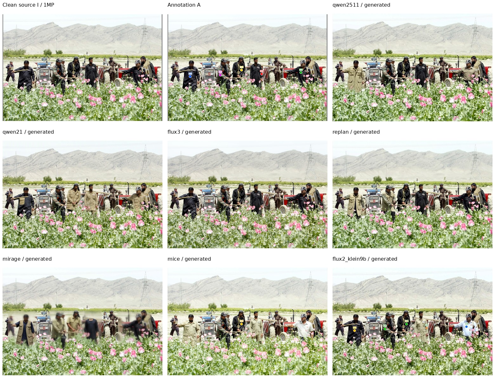
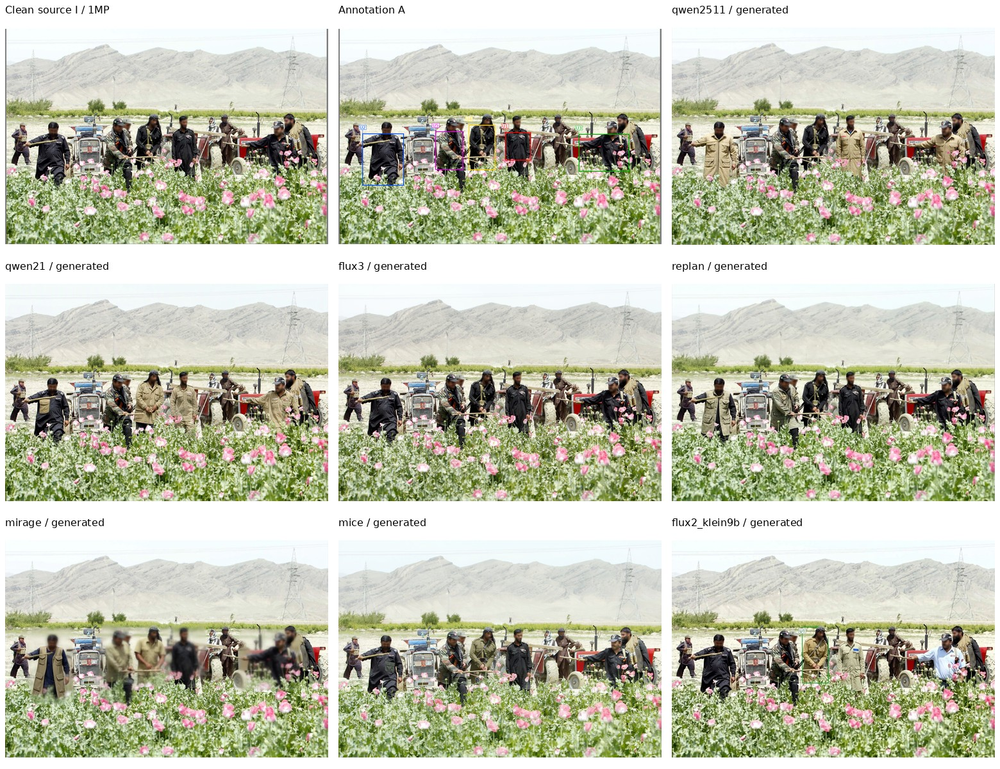
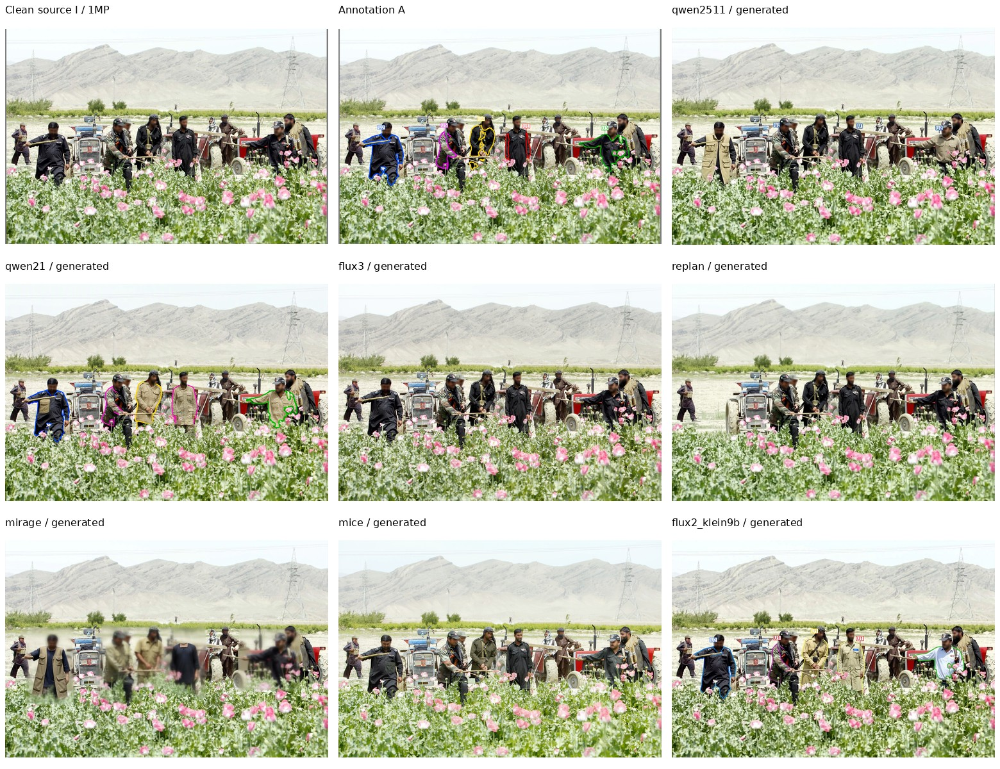
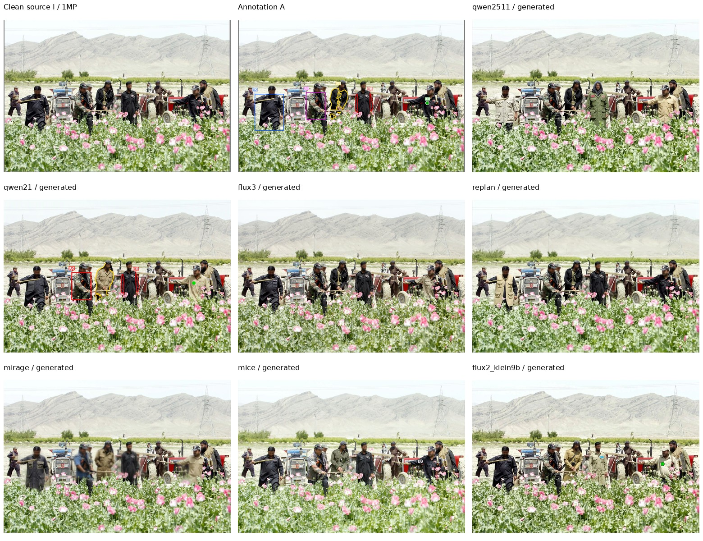
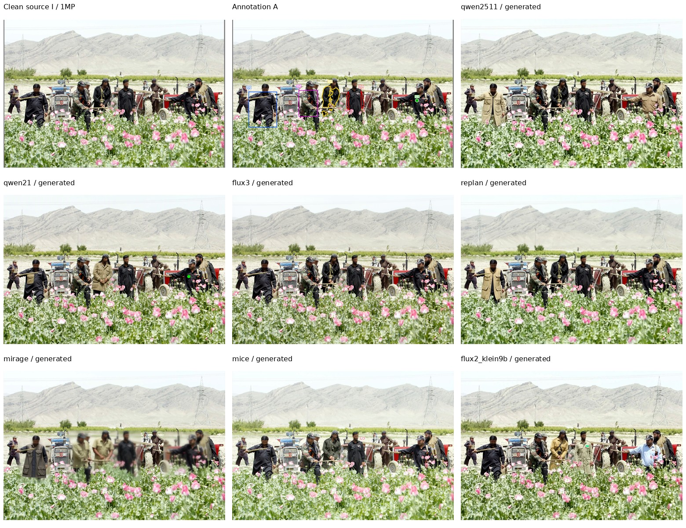
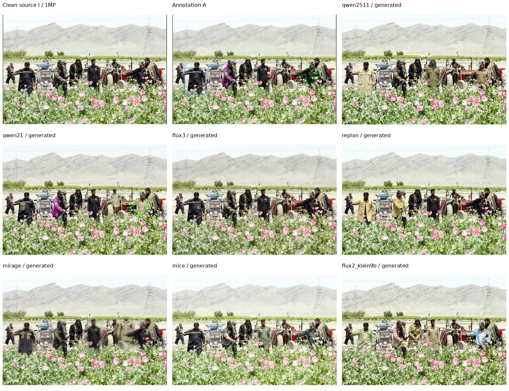

# 当前评测结果与分析

**统一约1MP；以下为极小规模端到端验证。正式全量结果仍待评测。**

固定K=5 dev图 `v2-sa_8415518` 覆盖七模型×十种setting，共70个组合。另有固定K=2图在S1/S3-point/S5下的21个生成请求，合计91条固定生成请求；本轮补齐其中尚未执行的49条请求。输入、prompt、权重、原生参数和seed42保持冻结，不按分数择优或重采样。

Judge只评分上述同一张K=5图的70个组合。调用使用原始源图、canonical ref、GT selector及回源输出，不提供setting或模型实际输入形式。每个组合只有一张图，因此结果仅用于核对链路和样例表现，不给总体排名、全量通过率或置信区间。

## 执行状态

| 模型 | 成功出图 / 13 | 生成或原生规划失败 | 已评分 / 10 | Judge失败或缺分 |
|---|---:|---:|---:|---:|
| qwen2511 | 13/13 | 0 | 10/10 | 0 |
| qwen21 | 13/13 | 0 | 10/10 | 0 |
| flux3 | 13/13 | 0 | 10/10 | 0 |
| replan | 13/13 | 0 | 10/10 | 0 |
| mirage | 13/13 | 0 | 10/10 | 0 |
| mice | 13/13 | 0 | 10/10 | 0 |
| flux2_klein9b | 13/13 | 0 | 10/10 | 0 |

70条逻辑请求对应70个独立评分key；实际新增70次Judge调用，保存70份原始响应，70条逻辑请求获得有效评分。确定性JSON恢复0条，不产生额外推理。生成失败与Judge缺分分开记录；缺分不能补0。

## 每个 setting 的完整链路

单元格依次表示“生成状态 / Judge状态”；成功出图不代表编辑正确。

| Setting | qwen2511 | qwen21 | flux3 | replan | mirage | mice | flux2_klein9b |
|---|---|---|---|---|---|---|---|
| S1 | 已出图 / 已评分 | 已出图 / 已评分 | 已出图 / 已评分 | 已出图 / 已评分 | 已出图 / 已评分 | 已出图 / 已评分 | 已出图 / 已评分 |
| S2-point | 已出图 / 已评分 | 已出图 / 已评分 | 已出图 / 已评分 | 已出图 / 已评分 | 已出图 / 已评分 | 已出图 / 已评分 | 已出图 / 已评分 |
| S2-box | 已出图 / 已评分 | 已出图 / 已评分 | 已出图 / 已评分 | 已出图 / 已评分 | 已出图 / 已评分 | 已出图 / 已评分 | 已出图 / 已评分 |
| S2-mask | 已出图 / 已评分 | 已出图 / 已评分 | 已出图 / 已评分 | 已出图 / 已评分 | 已出图 / 已评分 | 已出图 / 已评分 | 已出图 / 已评分 |
| S3-point | 已出图 / 已评分 | 已出图 / 已评分 | 已出图 / 已评分 | 已出图 / 已评分 | 已出图 / 已评分 | 已出图 / 已评分 | 已出图 / 已评分 |
| S3-box | 已出图 / 已评分 | 已出图 / 已评分 | 已出图 / 已评分 | 已出图 / 已评分 | 已出图 / 已评分 | 已出图 / 已评分 | 已出图 / 已评分 |
| S3-mask | 已出图 / 已评分 | 已出图 / 已评分 | 已出图 / 已评分 | 已出图 / 已评分 | 已出图 / 已评分 | 已出图 / 已评分 | 已出图 / 已评分 |
| S4-ref | 已出图 / 已评分 | 已出图 / 已评分 | 已出图 / 已评分 | 已出图 / 已评分 | 已出图 / 已评分 | 已出图 / 已评分 | 已出图 / 已评分 |
| S4-noref | 已出图 / 已评分 | 已出图 / 已评分 | 已出图 / 已评分 | 已出图 / 已评分 | 已出图 / 已评分 | 已出图 / 已评分 | 已出图 / 已评分 |
| S5 | 已出图 / 已评分 | 已出图 / 已评分 | 已出图 / 已评分 | 已出图 / 已评分 | 已出图 / 已评分 | 已出图 / 已评分 | 已出图 / 已评分 |

## 固定单图的评分诊断

每格为 **通过单元数/5；整图是否通过**。单元通过要求E=4且P/Q≥3；整图通过还要求五个单元全部通过、全局P/Q≥3。它们分别对应此样例的UnitPass和JointPass判定，不能当作全数据成绩。

| Setting | qwen2511 | qwen21 | flux3 | replan | mirage | mice | flux2_klein9b |
|---|---|---|---|---|---|---|---|
| S1 | 1/5；未通过 | 2/5；未通过 | 2/5；未通过 | 0/5；未通过 | 0/5；未通过 | 1/5；未通过 | 1/5；未通过 |
| S2-point | 1/5；未通过 | 3/5；未通过 | 1/5；未通过 | 0/5；未通过 | 0/5；未通过 | 1/5；未通过 | 0/5；未通过 |
| S2-box | 1/5；未通过 | 3/5；未通过 | 0/5；未通过 | 0/5；未通过 | 0/5；未通过 | 5/5；通过 | 3/5；未通过 |
| S2-mask | 1/5；未通过 | 3/5；未通过 | 1/5；未通过 | 0/5；未通过 | 0/5；未通过 | 4/5；未通过 | 3/5；未通过 |
| S3-point | 1/5；未通过 | 3/5；未通过 | 0/5；未通过 | 0/5；未通过 | 0/5；未通过 | 0/5；未通过 | 0/5；未通过 |
| S3-box | 0/5；未通过 | 3/5；未通过 | 0/5；未通过 | 0/5；未通过 | 0/5；未通过 | 2/5；未通过 | 1/5；未通过 |
| S3-mask | 1/5；未通过 | 3/5；未通过 | 0/5；未通过 | 1/5；未通过 | 0/5；未通过 | 3/5；未通过 | 1/5；未通过 |
| S4-ref | 1/5；未通过 | 2/5；未通过 | 1/5；未通过 | 0/5；未通过 | 0/5；未通过 | 2/5；未通过 | 1/5；未通过 |
| S4-noref | 1/5；未通过 | 2/5；未通过 | 0/5；未通过 | 0/5；未通过 | 0/5；未通过 | 1/5；未通过 | 1/5；未通过 |
| S5 | 1/5；未通过 | 3/5；未通过 | 1/5；未通过 | 0/5；未通过 | 0/5；未通过 | 1/5；未通过 | 1/5；未通过 |

## 全量主结果

全量1,084图、3,872单元的UnitPass / JointPass及95%配对bootstrap置信区间均待评测。

| Setting | qwen2511 | qwen21 | flux3 | replan | mirage | mice | flux2_klein9b |
|---|---|---|---|---|---|---|---|
| S1 | 待评测 | 待评测 | 待评测 | 待评测 | 待评测 | 待评测 | 待评测 |
| S2-point | 待评测 | 待评测 | 待评测 | 待评测 | 待评测 | 待评测 | 待评测 |
| S2-box | 待评测 | 待评测 | 待评测 | 待评测 | 待评测 | 待评测 | 待评测 |
| S2-mask | 待评测 | 待评测 | 待评测 | 待评测 | 待评测 | 待评测 | 待评测 |
| S3-point | 待评测 | 待评测 | 待评测 | 待评测 | 待评测 | 待评测 | 待评测 |
| S3-box | 待评测 | 待评测 | 待评测 | 待评测 | 待评测 | 待评测 | 待评测 |
| S3-mask | 待评测 | 待评测 | 待评测 | 待评测 | 待评测 | 待评测 | 待评测 |
| S4-ref | 待评测 | 待评测 | 待评测 | 待评测 | 待评测 | 待评测 | 待评测 |
| S4-noref | 待评测 | 待评测 | 待评测 | 待评测 | 待评测 | 待评测 | 待评测 |
| S5 | 待评测 | 待评测 | 待评测 | 待评测 | 待评测 | 待评测 | 待评测 |

## 十种 setting 的实际输入和七模型输出

每组展示共同清图I、公开标注图A和七模型回源输出。不同方法实际采用I/A及原生区域的方式见[详细用法](USAGE.md)，最终公开prompt见[输入样例](INPUT_EXAMPLES.md)。

### S1

### S2-point

### S2-box

### S2-mask

### S3-point

### S3-box

### S3-mask

### S4-ref

### S4-noref

### S5

## 结论与边界

- 全部七模型×十种setting均有固定样例进入生成与评分核验；具体原生失败或缺分以表中实际状态为准。
- 成功出图、Judge返回有效分数、编辑任务通过是三个独立结论。标记残留、漏编辑或原生定位错误均保留，不据诊断结果修改prompt或模型配置。
- RePlan/MIRAGE保留原生近1MP输出网格，全部输出按冻结几何回到源图尺寸；Judge口径未改变。
- MICE极小mask的原生绑定量化限制见[使用说明](USAGE.md)；不使用膨胀、GT修复或外部组件提高表现。
- 单图不能说明模型总体能力或稳定性；正式成绩需要全量执行。人工标记残留率、κ及GT selector paste-back诊断仍待单独完成。

### 此样例暴露的问题

以下数值及Judge最终证据摘录可在[SAMPLE_ANALYSIS.json](assets/current/SAMPLE_ANALYSIS.json)核对；该文件保留原始有效记录路径和SHA，不修改评分。

- **多目标任务仍有遗漏。** MICE的S2-box为5/5、全局P/Q均为3，是本图唯一整图通过的组合；S2-mask为4/5、全局P=2/Q=3，仍未通过。Qwen-Image-2.1的S2-box为3/5：U2/U3/U4通过，U1/U5未通过。
- **有编辑或图像自然，都不足以通过。** Qwen-Image-Edit-2511的S3-box中，U3虽有E=4，但P=2，该组合最终为0/5。FLUX.3在S3的三种区域形式下均为0/5，全局P/Q却均为4/4；Judge认为所要求的变化未完成。不能只用保留度或自然度评价编辑能力。
- **局部质量和非目标改动需要复核。** MIRAGE在本图十种setting均为0/5；S4-ref的全局Q=2，Judge指出编辑人物模糊。RePlan的S3-mask为1/5、全局P=1/Q=2，Judge指出非目标人物被删除。这些是输出层面的现象，尚不能归因到某个原生规划或生成组件。
- **部分输出保留了可视化标记。** Qwen-Image-2.1的S4-ref为2/5、全局P/Q均为2，Judge指出框、轮廓、点和编号残留；FLUX.2 Klein-9B的S5为1/5、全局Q=2，Judge指出彩色轮廓残留。上方图片保留这些现象，未进行标记清理；本轮没有人工标记残留率。
- **Judge对细节的解释需人工抽检。** 同一源图U2的胸袋，在Qwen-Image-Edit-2511的S1解释中被描述为“已有两个胸袋”，S5中则为“没有带盖胸袋”。两处措辞和细节判断存在差异，需对照原图与裁剪证据人工复核，不能直接认定其中一个评分错误。本轮保留原分，未重评。

这些结果支持当前十种setting的工程可执行性，不证明单图结果代表总体能力，也不据此为任何模型更换输入方式。全量执行仍待正式运行包发布；本次核验没有发现运行阻塞项，Judge细节判读纳入后续人工抽检。

## 结果与复现

- 共享输入和首批42输出：`/mnt/bn/strategy-mllm-train/user/tanyue/.ifbench-tmp/one-mp-probe-20261031`。
- 补齐49请求与输出：`/mnt/bn/strategy-mllm-train/user/tanyue/.ifbench-tmp/one-mp-coverage-20261031`。
- 70组合Judge计划、原始响应和有效评分：`/mnt/bn/strategy-mllm-train/user/tanyue/.ifbench-tmp/one-mp-coverage-judge-20261031`。
- 单图诊断记录：`/mnt/bn/strategy-mllm-train/user/tanyue/.ifbench-tmp/one-mp-coverage-judge-20261031/results/REPORT.json`；SHA256 `da4892ab5cd4009051fc54908725ee276d4542a95d33d6114d886dc418a6c4a0`。
- 记录、raw/effective响应和缩略图均来自真实文件；源SHA见[PROVENANCE.json](assets/current/PROVENANCE.json)。
- 正式运行入口及待发布状态见[FULL_RUN.md](FULL_RUN.md)。
