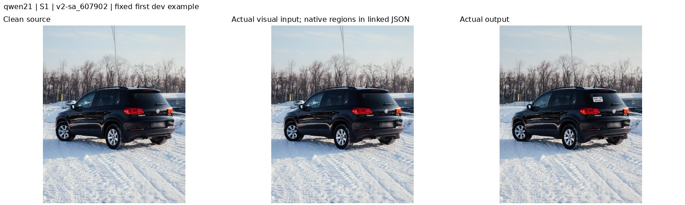
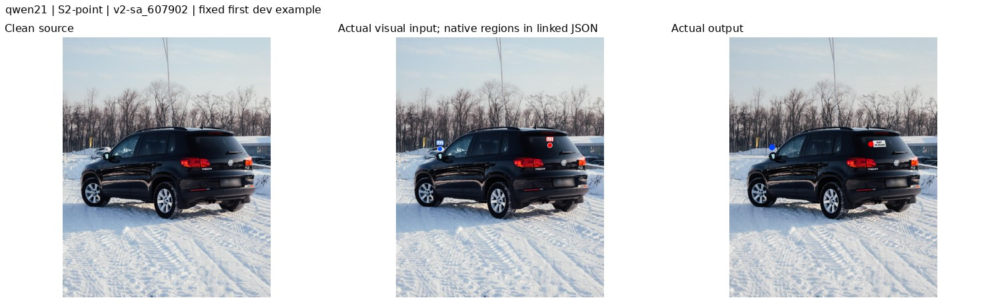
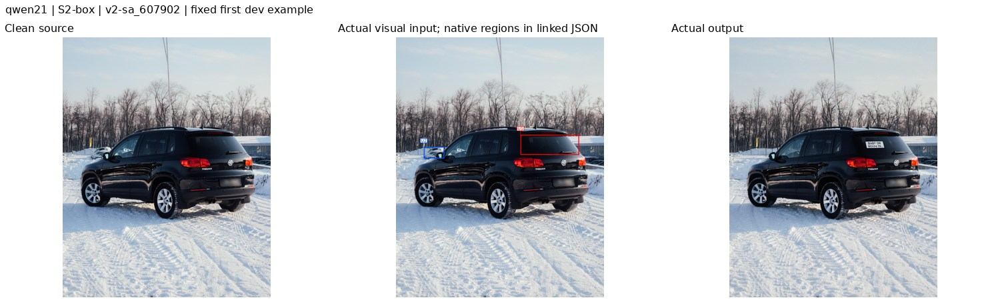
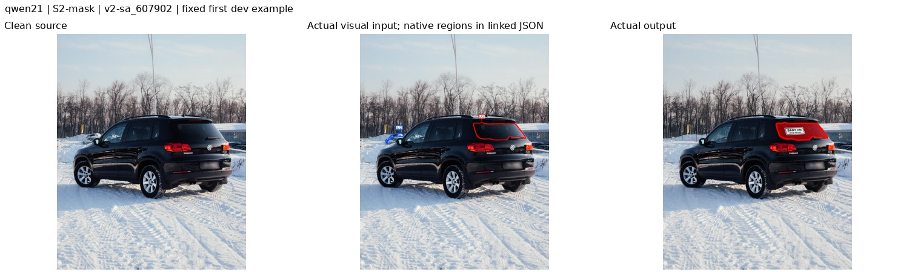
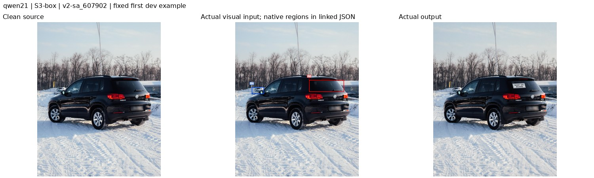
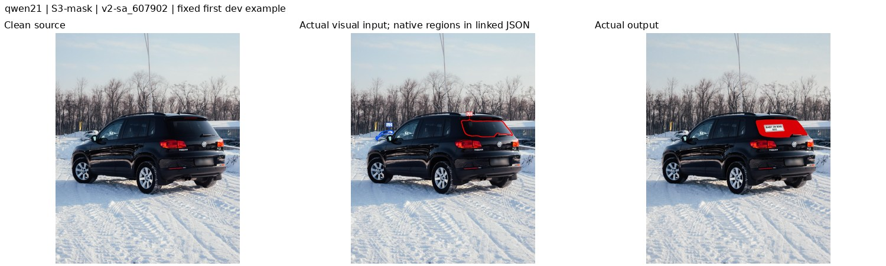
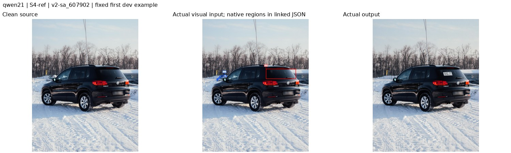
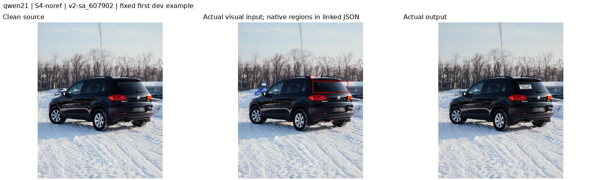
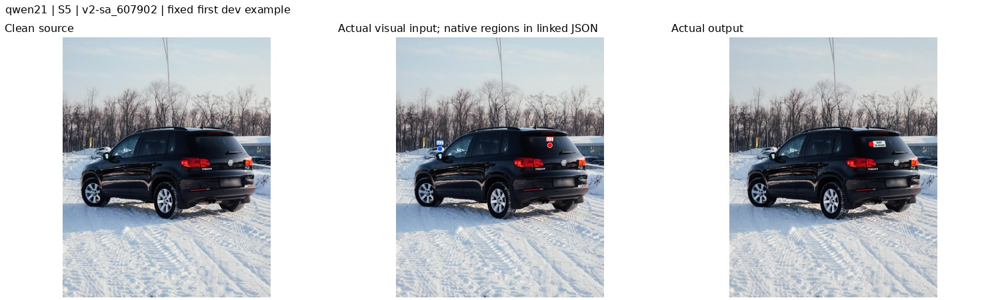
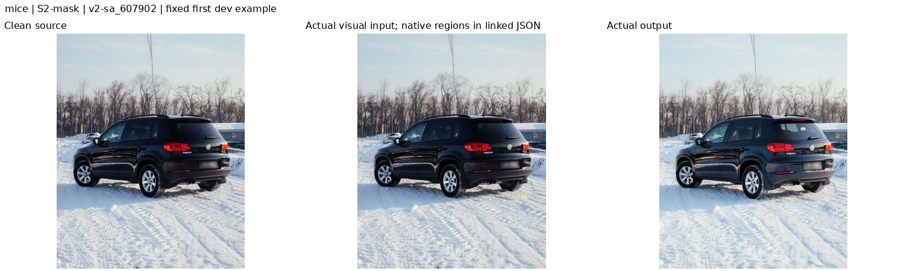

# IF-Bench 使用说明

IF-Bench 评测真实场景中的**联合多目标、细粒度图像编辑**：模型需在同一张源图上同时完成 2–5 个编辑目标，并保持未授权内容。操作包括添加、删除、替换和属性修改；目标可能是一个实例、部件、区段，或新增内容依附的源区域。它同时检查语言指代、区域信息形式、多个目标之间的干扰、编辑完成度、内容保持与视觉质量。

本说明只覆盖七个已确认方法：**Qwen-Image-Edit-2511、Qwen-Image-2.1、FLUX.3 Klein distilled、RePlan（Qwen-2511）、MIRAGE（Qwen-2511）、MICE（Klein-4B）、FLUX.2 Klein-9B distilled**。下面描述的是已完成的 `fairness v2.1 / fixed dev20` 配置，不是任意模型的通用最佳输入建议。

**当前状态：20 图 dev 与其 Judge 已完成；正式配置尚未冻结，976 图 test 尚未运行。** 数据 release 2.6.0、原 108/976 split 和此次 20 图子集分别是不同概念；剩余 88 张 dev 不会转成 test。当前配置见 [fairness_v2_1.json](../configs/evaluation/fairness_v2_1.json)，它是已审核 dev 配置快照，不是正式冻结凭证。

阅读入口：[仓库首页](../README.md) · [数据构造](CONSTRUCTION.md) · [结果与证据](RESULTS.md)。

## 1. 数据、文件与运行环境

### 1.1 已发布数据

release 2.6.0 包含 **1,084 张源图、3,872 个编辑单元**；每图目标数 K=2/3/4/5 分别有 147/255/597/85 张。四种操作的单元数为：add 980、remove 921、replace 969、attribute 1,002。数据入口由 [data/current.json](../data/current.json) 指定，统计来自 [statistics.json](../data/v2_2.6.0/statistics.json)。

| 内容 | 当前实际位置 |
|---|---|
| 版本 manifest | 仓库 `data/v2_2.6.0/cases.jsonl` |
| manifest SHA256 | `818ce524a1d1f363dc8ea5caa7a887b2dd0355c17a5600d1cbd696cffcf263fb` |
| 数据资产根 | `/mnt/bn/strategy-mllm-train/user/tanyue/datasets/samtok_edit_benchmark_v2` |
| 一个源图 | `<数据资产根>/assets/v2-sa_607902/source.jpg` |
| 本例单元 mask | `<数据资产根>/assets/v2-sa_607902/U1.png`、`U2.png`；具体路径以 manifest 为准 |
| 模型检查点根 | `/mnt/bn/strategy-mllm-train/user/tanyue/models/pretrained_models` |
| 统一公开请求的本机别名 | `/tmp/ifbench/tiered_v1/shared_inputs_20261027/requests/<setting>/<case>/` |
| 同一批公开资产的共享持久副本 | `/mnt/bn/strategy-mllm-train/user/tanyue/.ifbench-tmp/fairness-v2-dev20-20261030/assets/shared_inputs/` |
| 最新 dev 运行包 | `/mnt/bn/strategy-mllm-train/user/tanyue/.ifbench-tmp/fairness-v21-qwen-repaired-dev20-20261031/` |
| 只接收最终确认正式产物的目录 | `/mnt/bn/strategy-mllm-train/user/tanyue/experiments2/IF-Bench/` |

上述绝对路径是已审核部署的真实位置，其他机器必须具有同一挂载或显式准备对应资产；`pip install` 不会下载数据、权重或生成运行环境。源码与文档可入 Git，完整数据/权重/模型输出/运行日志留在外部目录。本文仅附少量固定样例 JPEG，其来源和 SHA 见 [插图记录](assets/usage/PROVENANCE.json)。源图、第三方实现和权重遵守各自原始许可；本文不作统一再授权。

构建、资产、几何和协议校验不等于独立人工语义终审；当前 release 仍记录 `independent_human_verified=false`、`semantic_signoff=false`，见 [release.json](../data/v2_2.6.0/release.json)。

### 1.2 当前 dev 范围与复现身份

本轮在原 108 图 dev 池内按 K 比例分层，层内按 SHA256(`20261027:{case_id}`，如 `20261027:v2-sa_607902`) 排序取样；K=2/3/4/5 分别取 3/4/11/2 张，共 **20 张图、72 个单元**。七模型与十种 setting 共用名单，不根据输出或分数选图。

split 文件同时保留 `historical_full_release_exposure=true`：本文“test 未运行”仅指当前分级协议，不能据此声称历史上从未接触过整份 release。原 split 已将先前暴露的 audit case 强制保留在 dev。

生成 seed=42，每请求一次采样。最新运行包的固定源码 commit 为 `2ac9a536e7202f71983b7703493eebecd74493bd`，plan SHA 为 `8c2995419ad71a7b7be0a7f6c6388af45ac944c75360da13bb7e19a569acb484`。仓库目录重组或后续文档修改不会热更新已发布包内的 `repo/` 快照。

## 2. I、A、ref、no-ref 和区域到底是什么

- **I**：未添加 benchmark 标记的清洁源图。
- **A**：从 I 生成的同尺寸、同坐标标注副本，只画当前 setting 已公开的区域和 U 标签；不是另一张参考答案图。
- **ref / T_ref**：包含目标身份或位置描述的原始指令，例如 `Remove the white SUV behind the black SUV at the left.`。
- **no-ref / T_noref**：保留操作与结果要求，把“对哪里编辑”替换为 `the selected region`，例如 `Remove the selected region.`。不能从私有标注把被省略的对象名补回去。
- **U1…UK**：同一 case 内固定的编辑单元编号；指令、颜色、区域与原生 local binding 都按该编号保持对应关系。
- **selector**：选择源对象、部件或 attachment/support anchor。添加任务的 selector 选已有承载位置，**不是新增物的输出轮廓**；源 mask 也不等于允许任意改动的硬差分边界。

### 2.1 十种 setting 的公开信息

| Setting | 每个单元的文字 | 每个单元的区域 | 本例中的含义 |
|---|---|---|---|
| S1 | ref | none | 只靠目标描述，不给区域 |
| S2-point | ref | point | 目标描述 + 点 |
| S2-box | ref | box | 目标描述 + 框 |
| S2-mask | ref | mask | 目标描述 + 二值选择区域 |
| S3-point | no-ref | point | 仅靠点绑定 `selected region` |
| S3-box | no-ref | box | 仅靠框绑定 `selected region` |
| S3-mask | no-ref | mask | 仅靠 mask 绑定 `selected region` |
| S4-ref | ref | 逐单元固定混合 point/box/mask | 同图可有不同区域形式 |
| S4-noref | no-ref | 与 S4-ref 完全相同 | 只换目标语言，不换区域分配 |
| S5 | 逐单元固定 ref/no-ref | 逐单元固定 none/point/box/mask | 同时混合语言与区域；none 单元必须是 ref |

S4 的混合分配只生成一次并由所有模型共享；S5 使用数据中已固定的逐单元组合。同一 setting 中所有模型得到相同公开信息，呈现可为原生区域参数、文字或标注图。不能给 point 额外生成物体框/mask，不能把 mask 偷换成丢细节的 bbox，也不能替 none 单元补区域。

### 2.2 几何与确定性标注

坐标均在源画布上：左上角为原点，x 向右、y 向下。point 是像素 `(x,y)`；box 是半开 `(x1,y1,x2,y2)`，满足 `0≤x1<x2≤W`、`0≤y1<y2≤H`；mask 与源图同尺寸，白色选中、黑色未选中。原生 normalized xyxy 按 `(W,H,W,H)` 分别相除，不改变区域语义。

固定 RGB 颜色为 U1 red `(255,0,0)`、U2 blue `(0,80,255)`、U3 green `(0,170,0)`、U4 yellow `(255,210,0)`、U5 magenta `(230,0,230)`。令 `s=min(W,H)`：点半径 `max(1,round(.01s))`，白环宽 `max(1,round(.002s))`，轮廓宽 `max(1,round(.004s))`，字号 `max(12,round(.02s))`，round 使用 ties-to-even。采用固定 DejaVuSans 字体及 SHA；mask 画完整内部边界，包括洞、分离组件和贴边部分，不填色遮盖目标。标签位置和引线只依赖公开几何。A→I 的空间映射为 identity。

下游 adapter 只接收 `public.py` 投影并校验的公开 schema：point 请求没有隐藏 mask/box，mask 请求没有隐藏 point/box，none 请求没有任何几何。开始调用前核对公开 digest、源图与公开 mask 的资产 SHA；不能绕过这个边界直接读完整私有标注补输入。

标记仅是输入说明，不能成为新增编辑任务，最终输出不应保留彩点、轮廓、标签或引线。若模型仍复制标记，保留真实输出并评分，不后处理擦除。模型自己的视觉编码/缩放会影响细标记可辨性，这一实现限制需要随结果解释。

实现：[公开信息投影](../src/samtok_benchmark/ifbench/public.py) · [标注绘制](../src/samtok_benchmark/ifbench/render.py) · [prompt 序列化](../src/samtok_benchmark/ifbench/inputs.py)。历史转换工具不等于当前模型配置；当前请求以发布包 `requests/` 和 `plan.json` 为准。

## 3. 共享 prompt 与十种 setting 的真实样例

共享 global 模板逐字列出公开任务，不调用改写模型：

```text
Apply all of the following edits to the image. Keep everything else unchanged.
U1. {公开指令1}
U2. {公开指令2}
```

共享双图模板的固定前导为：

```text
Image 1 is the clean source image to edit. Image 2 is the same image with colored marks and U labels. Use the marks only to identify the selected regions in Image 1. Return only the edited Image 1. Do not reproduce any marks, labels, or leader lines.
Each supplied region selects a source object, part, or anchor. For an addition, it selects the attachment or support location, not the outline of the new object.
Apply all of the following edits to the image. Keep everything else unchanged.
```

前导后逐行追加 `U编号. [颜色 point/box/mask contour, label U编号] 原指令`。none 单元省略整个方括号；若请求完全无区域，退到本就规定的 I + global 模板，不创建空标注图。这里的花括号仅是文档变量，实际请求没有占位符。

以下十图都使用预先固定的 **`v2-sa_607902`**，原图为 1500×1875：U1 在黑色 SUV 后窗增加白色 BABY ON BOARD 贴纸，U2 删除左后方白色 SUV。展示 Qwen2.1 的真实请求与实际输出，用于说明信息和路由，不用于推荐高分方案。**三列为 I / 实际视觉输入 / 实际输出**。S1 中列重复展示 I，实际只有一张输入；其余九例实际输入 I+A。S1 输出是已披露的 resident 成功缓存，其他九例是本轮 offload 新输出。

这些是已有报告缩略图的逐字节副本。完整生成结果仍在共享目录，图中的标记残留或编辑错误均未修图。


### S1

公开 U1/U2 的完整目标描述；不给区域。



<details>
<summary>展开本例完整最终 prompt</summary>

```text
Apply all of the following edits to the image. Keep everything else unchanged.
U1. Add a small white BABY ON BOARD decal on the rear window of the black SUV.
U2. Remove the white SUV behind the black SUV at the left.
```

</details>

实际证据：[request.json](/mnt/bn/strategy-mllm-train/user/tanyue/.ifbench-tmp/fairness-v21-qwen-repaired-dev20-20261031/requests/qwen21/S1/v2-sa_607902/request.json)；本例输入图像顺序为 `[I]`。其他模型对相同公开信息的路由如下节所列，不能把这组图直接当作所有模型的实际 API 输入。


### S2-point

两个点固定为 U1=(1109,778)、U2=(317,804)，同时给 ref。



<details>
<summary>展开本例完整最终 prompt</summary>

```text
Image 1 is the clean source image to edit. Image 2 is the same image with colored marks and U labels. Use the marks only to identify the selected regions in Image 1. Return only the edited Image 1. Do not reproduce any marks, labels, or leader lines.
Each supplied region selects a source object, part, or anchor. For an addition, it selects the attachment or support location, not the outline of the new object.
Apply all of the following edits to the image. Keep everything else unchanged.
U1. [red point, label U1] Add a small white BABY ON BOARD decal on the rear window of the black SUV.
U2. [blue point, label U2] Remove the white SUV behind the black SUV at the left.
```

</details>

实际证据：[request.json](/mnt/bn/strategy-mllm-train/user/tanyue/.ifbench-tmp/fairness-v21-qwen-repaired-dev20-20261031/requests/qwen21/S2-point/v2-sa_607902/request.json)；本例输入图像顺序为 `[I, A]`。其他模型对相同公开信息的路由如下节所列，不能把这组图直接当作所有模型的实际 API 输入。


### S2-box

U1 box=(897,702,1321,848)，U2 box=(200,789,349,874)，同时给 ref。



<details>
<summary>展开本例完整最终 prompt</summary>

```text
Image 1 is the clean source image to edit. Image 2 is the same image with colored marks and U labels. Use the marks only to identify the selected regions in Image 1. Return only the edited Image 1. Do not reproduce any marks, labels, or leader lines.
Each supplied region selects a source object, part, or anchor. For an addition, it selects the attachment or support location, not the outline of the new object.
Apply all of the following edits to the image. Keep everything else unchanged.
U1. [red box, label U1] Add a small white BABY ON BOARD decal on the rear window of the black SUV.
U2. [blue box, label U2] Remove the white SUV behind the black SUV at the left.
```

</details>

实际证据：[request.json](/mnt/bn/strategy-mllm-train/user/tanyue/.ifbench-tmp/fairness-v21-qwen-repaired-dev20-20261031/requests/qwen21/S2-box/v2-sa_607902/request.json)；本例输入图像顺序为 `[I, A]`。其他模型对相同公开信息的路由如下节所列，不能把这组图直接当作所有模型的实际 API 输入。


### S2-mask

公开 U1/U2 二值 mask；本双图模型将其编码为完整轮廓，同时给 ref。



<details>
<summary>展开本例完整最终 prompt</summary>

```text
Image 1 is the clean source image to edit. Image 2 is the same image with colored marks and U labels. Use the marks only to identify the selected regions in Image 1. Return only the edited Image 1. Do not reproduce any marks, labels, or leader lines.
Each supplied region selects a source object, part, or anchor. For an addition, it selects the attachment or support location, not the outline of the new object.
Apply all of the following edits to the image. Keep everything else unchanged.
U1. [red mask contour, label U1] Add a small white BABY ON BOARD decal on the rear window of the black SUV.
U2. [blue mask contour, label U2] Remove the white SUV behind the black SUV at the left.
```

</details>

实际证据：[request.json](/mnt/bn/strategy-mllm-train/user/tanyue/.ifbench-tmp/fairness-v21-qwen-repaired-dev20-20261031/requests/qwen21/S2-mask/v2-sa_607902/request.json)；本例输入图像顺序为 `[I, A]`。其他模型对相同公开信息的路由如下节所列，不能把这组图直接当作所有模型的实际 API 输入。


### S3-point

几何与 S2-point 完全相同，只把目标描述替换成 selected region。


<details>
<summary>展开本例完整最终 prompt</summary>

```text
Image 1 is the clean source image to edit. Image 2 is the same image with colored marks and U labels. Use the marks only to identify the selected regions in Image 1. Return only the edited Image 1. Do not reproduce any marks, labels, or leader lines.
Each supplied region selects a source object, part, or anchor. For an addition, it selects the attachment or support location, not the outline of the new object.
Apply all of the following edits to the image. Keep everything else unchanged.
U1. [red point, label U1] Add a small white BABY ON BOARD decal on the selected region.
U2. [blue point, label U2] Remove the selected region.
```

</details>

实际证据：[request.json](/mnt/bn/strategy-mllm-train/user/tanyue/.ifbench-tmp/fairness-v21-qwen-repaired-dev20-20261031/requests/qwen21/S3-point/v2-sa_607902/request.json)；本例输入图像顺序为 `[I, A]`。其他模型对相同公开信息的路由如下节所列，不能把这组图直接当作所有模型的实际 API 输入。


### S3-box

几何与 S2-box 完全相同，只使用 no-ref。



<details>
<summary>展开本例完整最终 prompt</summary>

```text
Image 1 is the clean source image to edit. Image 2 is the same image with colored marks and U labels. Use the marks only to identify the selected regions in Image 1. Return only the edited Image 1. Do not reproduce any marks, labels, or leader lines.
Each supplied region selects a source object, part, or anchor. For an addition, it selects the attachment or support location, not the outline of the new object.
Apply all of the following edits to the image. Keep everything else unchanged.
U1. [red box, label U1] Add a small white BABY ON BOARD decal on the selected region.
U2. [blue box, label U2] Remove the selected region.
```

</details>

实际证据：[request.json](/mnt/bn/strategy-mllm-train/user/tanyue/.ifbench-tmp/fairness-v21-qwen-repaired-dev20-20261031/requests/qwen21/S3-box/v2-sa_607902/request.json)；本例输入图像顺序为 `[I, A]`。其他模型对相同公开信息的路由如下节所列，不能把这组图直接当作所有模型的实际 API 输入。


### S3-mask

区域与 S2-mask 完全相同，只使用 no-ref。



<details>
<summary>展开本例完整最终 prompt</summary>

```text
Image 1 is the clean source image to edit. Image 2 is the same image with colored marks and U labels. Use the marks only to identify the selected regions in Image 1. Return only the edited Image 1. Do not reproduce any marks, labels, or leader lines.
Each supplied region selects a source object, part, or anchor. For an addition, it selects the attachment or support location, not the outline of the new object.
Apply all of the following edits to the image. Keep everything else unchanged.
U1. [red mask contour, label U1] Add a small white BABY ON BOARD decal on the selected region.
U2. [blue mask contour, label U2] Remove the selected region.
```

</details>

实际证据：[request.json](/mnt/bn/strategy-mllm-train/user/tanyue/.ifbench-tmp/fairness-v21-qwen-repaired-dev20-20261031/requests/qwen21/S3-mask/v2-sa_607902/request.json)；本例输入图像顺序为 `[I, A]`。其他模型对相同公开信息的路由如下节所列，不能把这组图直接当作所有模型的实际 API 输入。


### S4-ref

本例固定为 U1 红框、U2 蓝 mask 轮廓，两条均为 ref。



<details>
<summary>展开本例完整最终 prompt</summary>

```text
Image 1 is the clean source image to edit. Image 2 is the same image with colored marks and U labels. Use the marks only to identify the selected regions in Image 1. Return only the edited Image 1. Do not reproduce any marks, labels, or leader lines.
Each supplied region selects a source object, part, or anchor. For an addition, it selects the attachment or support location, not the outline of the new object.
Apply all of the following edits to the image. Keep everything else unchanged.
U1. [red box, label U1] Add a small white BABY ON BOARD decal on the rear window of the black SUV.
U2. [blue mask contour, label U2] Remove the white SUV behind the black SUV at the left.
```

</details>

实际证据：[request.json](/mnt/bn/strategy-mllm-train/user/tanyue/.ifbench-tmp/fairness-v21-qwen-repaired-dev20-20261031/requests/qwen21/S4-ref/v2-sa_607902/request.json)；本例输入图像顺序为 `[I, A]`。其他模型对相同公开信息的路由如下节所列，不能把这组图直接当作所有模型的实际 API 输入。


### S4-noref

与 S4-ref 同一红框/蓝轮廓，只替换为 no-ref。



<details>
<summary>展开本例完整最终 prompt</summary>

```text
Image 1 is the clean source image to edit. Image 2 is the same image with colored marks and U labels. Use the marks only to identify the selected regions in Image 1. Return only the edited Image 1. Do not reproduce any marks, labels, or leader lines.
Each supplied region selects a source object, part, or anchor. For an addition, it selects the attachment or support location, not the outline of the new object.
Apply all of the following edits to the image. Keep everything else unchanged.
U1. [red box, label U1] Add a small white BABY ON BOARD decal on the selected region.
U2. [blue mask contour, label U2] Remove the selected region.
```

</details>

实际证据：[request.json](/mnt/bn/strategy-mllm-train/user/tanyue/.ifbench-tmp/fairness-v21-qwen-repaired-dev20-20261031/requests/qwen21/S4-noref/v2-sa_607902/request.json)；本例输入图像顺序为 `[I, A]`。其他模型对相同公开信息的路由如下节所列，不能把这组图直接当作所有模型的实际 API 输入。


### S5

本例 U1=ref+point、U2=no-ref+point；其他 case 可含 none/box/mask，不能据此例把 S5 简化为纯 point。



<details>
<summary>展开本例完整最终 prompt</summary>

```text
Image 1 is the clean source image to edit. Image 2 is the same image with colored marks and U labels. Use the marks only to identify the selected regions in Image 1. Return only the edited Image 1. Do not reproduce any marks, labels, or leader lines.
Each supplied region selects a source object, part, or anchor. For an addition, it selects the attachment or support location, not the outline of the new object.
Apply all of the following edits to the image. Keep everything else unchanged.
U1. [red point, label U1] Add a small white BABY ON BOARD decal on the rear window of the black SUV.
U2. [blue point, label U2] Remove the selected region.
```

</details>

实际证据：[request.json](/mnt/bn/strategy-mllm-train/user/tanyue/.ifbench-tmp/fairness-v21-qwen-repaired-dev20-20261031/requests/qwen21/S5/v2-sa_607902/request.json)；本例输入图像顺序为 `[I, A]`。其他模型对相同公开信息的路由如下节所列，不能把这组图直接当作所有模型的实际 API 输入。


## 4. 七个模型 × 十种 setting：实际推理方式

模型边界是已确认的完整方法。关闭 PE/PUP，不接外部定位器、分割器、caption 改写器或额外能力增强组件。检查点自身的视觉/文本编码器正常保留；RePlan 与 MIRAGE 自带的 planner/parser/locator 也保留并单独记调用。不能把这两行解释为裸 Qwen 骨干成绩。

协议里的 †（额外 SAM 转换）、‡（外部定位）、§（外接 caption 改写）只适用于另列的补充配置，不进入当前主行。方法自身的已固定 planner/parser 属于方法组成，不据此误标为外部增强。

每个请求的 K 个编辑目标进入一次原生联合编辑流程；多个内部规划或 diffusion forward 不等于把 K 个目标人工串行编辑 K 遍。下面的矩阵和每模型 API/参数一起定义全部 70 个组合。

### 4.1 Qwen2511、Qwen2.1、FLUX3、FLUX2 Klein-9B：四个原生图像列表接口

**此表逐项适用于四个模型中的每一个。** Qwen2511、Qwen2.1、FLUX2 的 prompt 完全按第 3 节构造。FLUX3 只有 S1 的文本格式不同，见随后说明；其余九种也用相同双图模板。

| Setting | 图像列表 | 文本 | 区域呈现 |
|---|---|---|---|
| S1 | `[I]` | ref / global；FLUX3 用其 S1 模板 | 无区域 |
| S2-point | `[I,A]` | ref / dual | 彩点和 U 绑定 |
| S2-box | `[I,A]` | ref / dual | 彩框和 U 绑定 |
| S2-mask | `[I,A]` | ref / dual | 完整 mask 轮廓和 U 绑定 |
| S3-point | `[I,A]` | no-ref / dual | 同一彩点 |
| S3-box | `[I,A]` | no-ref / dual | 同一彩框 |
| S3-mask | `[I,A]` | no-ref / dual | 同一完整轮廓 |
| S4-ref | `[I,A]` | ref / dual | 固定逐单元混合标记 |
| S4-noref | `[I,A]` | no-ref / dual | 与 S4-ref 相同的标记 |
| S5 | 有区域为 `[I,A]`；全 none 为 `[I]` | 冻结的逐单元 ref/no-ref | 只标注已有区域；none 不造标记 |

这些双图接口没有“第二图只用来定位、绝不复制标记”的硬约束；图像角色靠固定 prompt 表达。mask 轮廓不冒称二值 inpainting mask，point 不转换成硬框。

**Qwen-Image-Edit-2511。** 原生 `QwenImageEditPlusPipeline`：`pipe(image=images, prompt=prompt, generator=generator, **parameters).images[0]`。固定 40 步、`true_cfg_scale=4`、`guidance_scale=1`、`negative_prompt=" "`、`max_sequence_length=512`、单输出。40 步取权重卡示例；不把函数的其他默认值混称同一配置。原生 VLM 与 VAE 采用不同尺度处理，保留该流程。入口：[Qwen2511 adapter](../src/samtok_benchmark/ifbench/dev_runner.py)。

**Qwen-Image-2.1。** 原生 `QwenImage21Pipeline`，相同 `image=[...]` 调用；固定 40 步、`true_cfg_scale=1`、`output_resolution=2048`、`use_kv_cache=True`、PE 关闭。按原生宽高比/网格处理，2K 不代表强制 2048×2048。

最新修复明确使用 `execution.memory_policy="model_cpu_offload"`，由官方 `enable_model_cpu_offload(gpu_id=0, device="cuda")` 按 `text_encoder->transformer->vae` 放置组件；不是外接模型，也不改变请求、采样参数、BF16 加载参数、分辨率或原生 KV 流程。没有自行开启 VAE tiling/slicing、低精度或 1K 回退。当前代码的早期 smoke adapter 还保留历史默认值，**执行必须通过固定 plan/worker，不能把直接实例化的 smoke 默认当本轮 2K 配置**。最新 200 个结果包含 177 次新 offload 与 23 个原 resident 成功缓存，这一点不隐藏。入口：[worker](../src/samtok_benchmark/ifbench/fairness_dev_worker.py)、[原生放置选项](../src/samtok_benchmark/ifbench/qwen21_memory.py)。

**FLUX.3 Klein distilled。** 官方 `generate(models, prompt=..., images=..., boxes=None, seed=42, model="distilled", steps=16, guidance=None, pup=False, safety=False)`；`safety=False` 沿用该官方入口默认。全部十种 setting 都固定 `boxes=None`，不捏造 `src_bbox=tgt_bbox` 或添加/删除后的目标框。

S1 本例实际 prompt 如下，指令间以单个空格连接：


```text
Edit <ref_image_0>. Add a small white BABY ON BOARD decal on the rear window of the black SUV. Remove the white SUV behind the black SUV at the left. Keep everything else unchanged.
```


FLUX3 保留原生多图预处理：单图上限约 4 MP，双图每图约 1 MP，并有原生 pad/crop/16 像素网格处理。因此 S2−S1 同时包含区域提示与预处理变化，不能把差值称为纯区域信息的因果增益。PUP 关闭符合此次组件边界，结果不代表启用 PUP 的系统。入口：[Flux3FairnessRunner](../src/evaluation/protocol_audit/fairness_flux3_replan.py)。

**FLUX.2 Klein-9B distilled。** 原生 `Flux2KleinPipeline(image=[...], prompt=..., generator=..., num_inference_steps=4, guidance_scale=1, max_sequence_length=512)`。这是 9B distilled 检查点；内置 Qwen3-8B 文本编码器属于模型组件，不承担额外图像理解。单图按原生 VAE 条件尺度与网格处理；完整 chat token 序列超过 512 时记录失败，不截掉后面的编辑任务。入口：[NativeBackend 的 flux2_klein9b 分支](../src/samtok_benchmark/ifbench/fairness_dev_worker.py)。

### 4.2 RePlan 与 MIRAGE：原生规划/定位后编辑清图

两者的最终 diffusion editor 都编辑清图 I；区域标注给方法自身的规划/定位入口。下表的文本类别由 setting 直接决定，不补 no-ref 中省略的目标描述。

| Setting | RePlan：原生 planner → editor | MIRAGE：原生 parser / locator → editor |
|---|---|---|
| S1 | `I + ref` → `I + 原样 response` | parser 读 ref；locator 看 I → I 联合编辑 |
| S2-point | `A + ref/点/U` → `I + response` | parser 读 ref；locator 看 A + 点/U 提示 → I |
| S2-box | `A + ref/框/U` → `I + response` | parser 读 ref；locator 看 A + 框/U 提示 → I |
| S2-mask | `A + ref/轮廓/U` → `I + response` | parser 读 ref；locator 看 A + 轮廓/U 提示 → I |
| S3-point | `A + no-ref/点/U` → `I + response` | parser 读 no-ref；locator 看 A + 点/U 提示 → I |
| S3-box | `A + no-ref/框/U` → `I + response` | parser 读 no-ref；locator 看 A + 框/U 提示 → I |
| S3-mask | `A + no-ref/轮廓/U` → `I + response` | parser 读 no-ref；locator 看 A + 轮廓/U 提示 → I |
| S4-ref | `A + ref/固定混合` → `I + response` | parser 读 ref；locator 看同一混合 A + 各 U 提示 → I |
| S4-noref | `A + no-ref/同一混合` → `I + response` | parser 读 no-ref；locator 看同一混合 A + 各 U 提示 → I |
| S5 | `A + 冻结混合文字` → I；全 none 时 planner 看 I | parser 读冻结混合文字；locator 看 A/I，none 无额外几何提示 → I |

**RePlan（Qwen-2511）。** 所有 setting 都调用官方 TainU/RePlan-Qwen2.5-VL-7B planner，不是只给缺区域单元补定位。区域请求使用固定前导：

```text
This is an annotated copy of the source image. Use the colored marks and U labels only to identify the selected source regions. The marks, labels, and leader lines are not scene objects or editing targets. Plan the requested edits for the clean source image with the same dimensions and coordinates.
```

随后原样拼接 selector 说明、共享 BASE 与各 U 的绑定/任务行。官方 `build_messages` 仍加入 `replan.txt`，原生 `max_new_tokens=2048`。实际调用顺序为：

```python
response, _, planner_seconds = planner.get_vlm_response(
    final_prompt, planner_image, collect_latency=True
)
image, _, native_record = editor.region_edit_with_attention(
    clean_source, final_prompt, response,
    skip_save=True, collect_latency=True,
    expand_value=0, attention_switch_step=0.5,
    pipeline_kwargs={"generator": generator, **editor_parameters},
)
```

这是**官方两阶段 API 的显式编排**，不是直接原样调用单图 `edit_single` wrapper。A 与 I 同尺寸，response 原样传递，不手改框/hint、global/local 归属或目标数，不把 local 内容再人工并入 global。规划把 U 标记误当对象、漏任务或输出不合法时，保留其原生表现和失败，不用私有 GT 修计划。

editor 固定 40 步、true CFG=4、guidance=1、negative=`" "`。`expand_value=0` 与 `attention_switch_step=.5` 来自官方 Qwen CLI 分支默认；Python 方法默认 .15/0、其他入口可能不同，不能混写为唯一默认。planner 使用 SDPA 的已记录环境差异保留，不承诺和 FlashAttention2 逐位一致。入口：[RePlan 分阶段 helper](../src/evaluation/protocol_audit/fairness_flux3_replan.py)。

**MIRAGE（Qwen-2511）。** 保留官方 Qwen3.5-9B parser/locator 与局部/全局联合去噪。每条公开 U 指令独立作为原生 parser 的一个 batch item；保留返回的全部 `(refer_object, new_instruction)` 对，不额外强制拆分数等于 K。原生 `vlm.locate` 的 direct/parent/part 分支继续执行；none 单元也由该方法自身从 ref 和图像定位。

已有区域的信息只追加到对应原生 grounding message，固定形式为：

```text
Spatial input for this edit: the {color} {shape} labeled {unit_id} indicates the selected source object, part, or anchor. The marks and labels are input annotations, not the target object. For an addition, the selection identifies the existing attachment or support location, not the outline of the new object.
```

不把该说明塞入 `refer_object`，以免改变原生 part 拆分；原生裁剪定位分支也保留同一公开提示。normalized xyxy 经官方 `to_pixels(..., padding=10)` 转换；局部文本使用官方 `qwen_prompt`。最终执行：

```python
run_qwen_image_edit(
    pipe, clean_source, global_original_prompt,
    native_sub_prompts, native_bboxes,
    num_inference_steps=40, true_cfg_scale=4.0,
    patch_ratio=0.4, generator=generator,
)
```

其中 `global_original_prompt` 是所有公开原指令的共享 global 模板，局部内容来自原生 parser；没有外接 caption 改写。parser/locator 固定 `thinking=False`、`do_sample=False`，parser 最多 512 新 token、grounding 最多 128。缺少 FLA 时采用该模型原有 PyTorch reference kernel，记录此实现差异。分别记录 chat API、batch item、原生拆分数和 diffusion forward，不能把 batch item 数当 API 数。入口：[请求和空间提示](../src/evaluation/protocol_audit/fairness_mirage_mice_probe.py) · [实际 worker](../src/samtok_benchmark/ifbench/fairness_dev_worker.py)。

RePlan、MIRAGE 的完整实际 planner prompt/messages/response 与最终 editor call 以包内 `planners/.../call.json`、`traces.json`、`result.json` 和 `outputs/.../call.json` 为准；原生模板会扩展上述公开说明，不能把说明段当作整个 VLM chat。

### 4.3 MICE：单图、原生实例绑定与 global/local 分工

MICE 保留其 Klein-4B distilled 与原生多实例 attention。当前核验实现使用**单张图**；point 通过标注图/global 文本传达，box/mask 使用原生实例区域参数。没有额外点定位模型，也不把点造为框。

| Setting | 实际单图 | global 文本 | local 文本及区域 |
|---|---|---|---|
| S1 | I | 所有 ref 任务 | 无 local / 无实例区域 |
| S2-point | A | 所有 ref + 点/U | 无 local / 无实例区域 |
| S2-box | I | BASE | 各 ref + 原生 normalized box |
| S2-mask | I | BASE | 各 ref + 原生 mask binding |
| S3-point | A | 所有 no-ref + 点/U | 无 local / 无实例区域 |
| S3-box | I | BASE | 各 no-ref + 原生 box |
| S3-mask | I | BASE | 各 no-ref + 原生 mask |
| S4-ref | 有 point 则 A，否则 I | point 的 ref 任务 | box/mask 的 ref + 对应原生区域 |
| S4-noref | 与 S4-ref 相同 | point 的 no-ref 任务 | box/mask 的 no-ref + 对应原生区域 |
| S5 | 有 point 则 A，否则 I | none/point 的冻结指令 | box/mask 的冻结指令 + 原生区域 |

存在 point 时复用**完整共享 A**，其中其他 U 的框/轮廓也保留；这些 U 同时通过原生参数接收同一公开几何，没有扩增区域信息。没有 point 时给 I，不把视觉轮廓当 native mask。

native prompt 为 `[global, local_1, ...]` 按 `$BREAKFLAG$` 连接：global 只列 none/point，local 只列对应 box/mask，顺序与 regional_units 一致，不把 local 任务重复放进 global。存在 point 的 global 使用唯一固定短前导：

```text
U marks select source objects, parts, or attachment points. Remove all marks; keep everything else unchanged.
```

后接原样 U/颜色/任务行；没有 point 时使用 BASE，没有 global 任务时仅保留 BASE。本例的两种实际 prompt：


**MICE S2-point**

```text
U marks select source objects, parts, or attachment points. Remove all marks; keep everything else unchanged.
U1. [red point, label U1] Add a small white BABY ON BOARD decal on the rear window of the black SUV.
U2. [blue point, label U2] Remove the white SUV behind the black SUV at the left.
```


**MICE S2-mask**

```text
Apply all of the following edits to the image. Keep everything else unchanged.$BREAKFLAG$Add a small white BABY ON BOARD decal on the rear window of the black SUV.$BREAKFLAG$Remove the white SUV behind the black SUV at the left.
```


box-only regional 列表传 `instance_bboxes_xyxy_normalized`。regional 列表含 mask 时传 `instance_masks_yx`：box 用官方 floor/ceil 量化函数生成绑定网格，mask 按官方 nearest 缩放到同一网格。mask 不先变 bbox，point 不进入 regional 列表。小区域量化为空时不人工扩大。单图画布按官方约 1024² 面积与 16 网格规则计算，输入图用 LANCZOS，绑定网格为 `(H'/16,W'/16)`。

固定参数为 4 步、CFG=1、`outer_local_prompts`、`apitasmkernelnonlap`、`strict=False`、kernel=11、temperature=3、sigma=.6，实例 binding 覆盖四步。各项来自同一固定官方配置，不是依据本轮分数搜索。

**200-token 完整性门。** 原生实现对每个 global/local 段实际只保留 200 个有效文本条件 token；512 的 tokenizer 上限不能代替这个限制。构建包和提交生成前，使用真实 checkpoint tokenizer、相同 chat 模板（含 assistant/thinking 标记）检查：完整序列长度≤200，且原生 512 补齐后前 200 个有效 IDs 与完整序列逐个相同。超限或不一致则记录 `attempt_admitted=false`、新增调用0；不创建 started、不删任务、不改写文本或更改官方200默认。入口：[完整性检查](../src/samtok_benchmark/ifbench/fairness_dev_revision.py) · [原生绑定调用](../src/samtok_benchmark/ifbench/fairness_dev_worker.py)。

下面是同一固定 case 的 MICE S2-mask：中列是**实际清图输入**，并非 mask。区域经独立 API 参数进入，不因图中没有彩色标记而“丢弃区域”。



原生区域证据：[实际 call.json](/mnt/bn/strategy-mllm-train/user/tanyue/.ifbench-tmp/fairness-v2-dev20-20261030/results/runs/mice/outputs/S2-mask/v2-sa_607902/call.json) · [U1 binding](/mnt/bn/strategy-mllm-train/user/tanyue/.ifbench-tmp/fairness-v2-dev20-20261030/results/runs/mice/outputs/S2-mask/v2-sa_607902/binding-U1.png) · [U2 binding](/mnt/bn/strategy-mllm-train/user/tanyue/.ifbench-tmp/fairness-v2-dev20-20261030/results/runs/mice/outputs/S2-mask/v2-sa_607902/binding-U2.png)。binding PNG 是原生离散网格，可见形状不应被误当成源图分辨率的 GT 或新模型分割结果。

## 5. 固定参数、版本与官方证据

生成全部使用 seed42；下表是此次已确认配置，不是对所有入口默认值的概括。权重和方法源码分别 pin，不能在运行时解析成 main/latest。三个 Diffusers 接口使用 `06a9cfb86ae8aa69c6a220ba0da0f37b819dde6a`。


| 模型 ID | 方法源码 commit | 编辑权重 revision | 原生附加组件 |
|---|---|---|---|
| `qwen2511` | [`06a9cfb86ae8aa69c6a220ba0da0f37b819dde6a`](https://github.com/huggingface/diffusers/tree/06a9cfb86ae8aa69c6a220ba0da0f37b819dde6a) | `6f3ccc0b56e431dc6a0c2b2039706d7d26f22cb9` | 检查点内编码器 |
| `qwen21` | [`ab96caa944157ca28a4f36b695c3047549f48f98`](https://github.com/QwenLM/Qwen-Image-2.1/tree/ab96caa944157ca28a4f36b695c3047549f48f98) | `b3179ad355be050328e483a9dfdd9e60cd62adfa` | 检查点内编码器；PE关闭 |
| `flux3` | [`bfc8889a4497f846416f253a3972a1941ac698b9`](https://github.com/black-forest-labs/flux-3-image-klein/tree/bfc8889a4497f846416f253a3972a1941ac698b9) | `337337621b8526e120f2275d250242f4a6bedd75` | PUP关闭 |
| `replan` | [`6c9b12f0c619cc8ca6f50b536b24aff377525f8c`](https://github.com/JIA-Lab-research/RePlan/tree/6c9b12f0c619cc8ca6f50b536b24aff377525f8c) | `6f3ccc0b56e431dc6a0c2b2039706d7d26f22cb9` | TainU planner `518f82339520058d043c4fbc270481876d8463e4` |
| `mirage` | [`234a31968df307879a55675873a54258d6c0eae4`](https://github.com/ZiqianLiu666/MIRAGE/tree/234a31968df307879a55675873a54258d6c0eae4) | `6f3ccc0b56e431dc6a0c2b2039706d7d26f22cb9` | Qwen3.5-9B `c202236235762e1c871ad0ccb60c8ee5ba337b9a` |
| `mice` | [`43b289de84dfd184c0ee1b551b0e1bea02f6e92d`](https://github.com/Blowing-Up-Groundhogs/mice/tree/43b289de84dfd184c0ee1b551b0e1bea02f6e92d) | `e7b7dc27f91deacad38e78976d1f2b499d76a294` | 原生 instance attention |
| `flux2_klein9b` | [`50fe5162777813d869182b139e83b10743caef15`](https://github.com/black-forest-labs/flux2/tree/50fe5162777813d869182b139e83b10743caef15) | `92196c8e11f7b6cf2b7493e037d8c5345c559216` | 检查点内 Qwen3-8B 文本编码器 |


完整参数在 [当前配置快照](../configs/evaluation/fairness_v2_1.json) 和最新运行 `plan.json` 的 `model_specifications`。Qwen2.1 另记录已核验等价权重 metadata revision `d26bb61231c349cf6b7896fa83353113880e1ba3`；不把 metadata 一致说成任意两份 tensor 字节或任意两次推理逐像素相同。

主要官方接口证据：

- Qwen2511：[Diffusers 接口](https://github.com/huggingface/diffusers/blob/06a9cfb86ae8aa69c6a220ba0da0f37b819dde6a/src/diffusers/pipelines/qwenimage/pipeline_qwenimage_edit_plus.py#L527) · [40步权重卡](https://huggingface.co/Qwen/Qwen-Image-Edit-2511/blob/6f3ccc0b56e431dc6a0c2b2039706d7d26f22cb9/README.md#L39)。
- Qwen2.1：[原生 pipeline](https://github.com/huggingface/diffusers/blob/06a9cfb86ae8aa69c6a220ba0da0f37b819dde6a/src/diffusers/pipelines/qwenimage21/pipeline_qwenimage21.py#L511) · [官方2K示例](https://github.com/QwenLM/Qwen-Image-2.1/blob/ab96caa944157ca28a4f36b695c3047549f48f98/README.md#L230)。
- FLUX3：[可选 boxes / 多图入口](https://github.com/black-forest-labs/flux-3-image-klein/blob/bfc8889a4497f846416f253a3972a1941ac698b9/src/flux3/generate.py#L30) · [单/多图预处理](https://github.com/black-forest-labs/flux-3-image-klein/blob/bfc8889a4497f846416f253a3972a1941ac698b9/src/flux3/pipeline.py#L133)。
- RePlan：[官方 pipeline](https://github.com/JIA-Lab-research/RePlan/blob/6c9b12f0c619cc8ca6f50b536b24aff377525f8c/replan/pipelines/replan.py#L401)；应同时区分 wrapper、分阶段 API 与 CLI 参数。
- MIRAGE：[parser/locator](https://github.com/ZiqianLiu666/MIRAGE/blob/234a31968df307879a55675873a54258d6c0eae4/mirage/vlm.py#L409) · [联合编辑](https://github.com/ZiqianLiu666/MIRAGE/blob/234a31968df307879a55675873a54258d6c0eae4/inference.py#L62)。
- MICE：[原生 CLI/API](https://github.com/Blowing-Up-Groundhogs/mice/blob/43b289de84dfd184c0ee1b551b0e1bea02f6e92d/infer_flux2_mice.py#L30) · [200-token条件](https://github.com/Blowing-Up-Groundhogs/mice/blob/43b289de84dfd184c0ee1b551b0e1bea02f6e92d/flux2/pipeline_flux2_klein.py#L211)。
- FLUX2 Klein-9B：[Diffusers 多图接口](https://github.com/huggingface/diffusers/blob/06a9cfb86ae8aa69c6a220ba0da0f37b819dde6a/src/diffusers/pipelines/flux2/pipeline_flux2_klein.py#L616) · [蒸馏默认4步/CFG1](https://github.com/black-forest-labs/flux2/blob/50fe5162777813d869182b139e83b10743caef15/src/flux2/util.py#L28)。

这些固定链接是已审计版本，不表示自动追随上游最新版本。工程与历史核对细节见 [当前方法证据归档](archive/previous/protocol/if-bench-v1/CURRENT_EVALUATION_ZH.md)；其历史阶段计数不能替代最新运行事实。

## 6. 统一 Judge 与结果含义

原生模型输出同时保留 raw.png 和用 LANCZOS 回到源分辨率的 output.png。Judge 只看清洁源图、回源输出、canonical ref 指令、GT selector 与既有合法效果契约；不把模型名、setting、实际 no-ref/标记 prompt 或模型输入形式传给 Judge。所有 setting 对同一 case 使用同一规范目标，不因 no-ref 放宽要求。

固定 Judge 为 `Qwen3.8-Flash-Next-FP8@236dfdf285828023ca3bcd3f37366c58a3469b13`：temperature0、seed0、max_tokens12288、reasoning_effort=low。全图最多1024²像素、局部最多512²；局部裁剪由 GT selector 确定，源/输出 crop 采用同一 GT 轮廓。计算使用 TP8/EP、batch16；内部按模型依次完成评分。

| 指标 | 通过要求 | 分母 |
|---|---|---|
| E / P / Q | 每项0–4；E=编辑完成，P=应保留内容，Q=视觉质量 | 原子评分，不直接当通过率 |
| UnitPass / UP | 一个 U 同时满足 E=4、P≥3、Q≥3 | 单元微平均；本轮每模型×setting为72个 U |
| JointPass / JP | 同一图所有 U 通过，且 global_P≥3、global_Q≥3 | 源图平均；本轮每模型×setting为20张 |

因此报告里的两个百分数是单元通过率与整图联合通过率；方括号是95%置信区间，不能把它们解释成两个不同评分模型或平均 E/P/Q 分数。

95% CI 使用源图为 cluster 的 paired bootstrap：所有模型/setting 共用重采样索引，10,000次，seed=20261027。每次重新计算 UP 的单元分母；不能把同图多个 U 当独立样本。K=2…5 桶在桶内按图抽样，本轮 K=5 仅两图。

对 `M=UP` 和 `M=JP` 各计算一份：

| 派生量 | 定义 |
|---|---|
| 语言依赖度 | `M(S2-m) - M(S3-m)`，m为point/box/mask |
| 区域增益 | `M(S2-m) - M(S1)` |
| 形式鲁棒性 | `min_m M(S3-m) / max_m M(S3-m)`，最大值为0时 N/A |
| 混合代价 | `mean_m M(S3-m) - M(S4-noref)` |

这些是固定完整方法的表现差异，可能同时包含原生缩放、规划和 global/local attention 的变化，不能一概解释成单因素因果效应。结果实现：[canonical Judge](../src/samtok_benchmark/ifbench/fairness_dev_judge.py) · [统计和报告](../src/samtok_benchmark/ifbench/fairness_dev_report.py)。

## 7. 失败、缓存与真实性

| 情况 | 当前处理 |
|---|---|
| 规划/生成失败 | 保留异常、调用和历史成本，留在完整分母中计编辑失败；不自动换输入、seed或骨干 |
| Judge缺分/失败 | 保留原回答/异常并标缺分；不能补0或当作编辑模型失败 |
| 确定性格式恢复 | 只重组原回答最终段中完整、唯一归属的 score/evidence 原子；保留 raw，另存 effective；没有新增模型调用 |
| started/admitted 后没有终态 | 可能已经采样，禁止自动重试，保留现场 |
| 精确生成缓存 | 核对原请求、公开资产、权重、原生参数、seed、原终态与来源后复用；本轮新调用记0，历史成本另存 |
| 精确评分缓存 | canonical任务/GT、output SHA、Judge配置全一致才复用；不能按模型名直接搬分 |
| 协议规定 N/A | 如实记录，不临时发明输入补结果；当前七模型十setting都有已确认路径，低分/失败不改称 N/A |

Qwen2.1 的177次重跑是对已确认终止的 decode OOM 的特定工程修复授权；不是允许未知尝试、普通低分或原生规划失败随意重试。23个resident成功缓存与177个offload新输出分别披露，独立诊断图不替换正式 dev 输出。

S2 的 discard-region 仅以 S1 精确复用作为补充行，不取代主行、不给它重新择优；S3、S4-noref以及S5的no-ref单元不丢区域。当前不按输出或 JointPass 再搜索输入配置。

## 8. 已存在且可核对的使用入口

### 8.1 安装代码与CPU检查

在仓库根目录执行。Python包名保留 `samtok_benchmark`；源码放入 src 布局后，先 editable install，不靠旧的根目录 PYTHONPATH：

```bash
python -m pip install -e '.[dev]'
python -m pytest -q
if-bench --help
if-bench show-config
```

统一 `if-bench` 入口提供数据校验、公开输入构造、配置查看和已发布 dev 包的检查/启动。以下命令只校验数据，不运行编辑模型：

```bash
if-bench validate-data \
  --manifest data/v2_2.6.0/cases.jsonl \
  --dataset-root /mnt/bn/strategy-mllm-train/user/tanyue/datasets/samtok_edit_benchmark_v2 \
  --output /tmp/ifbench/usage-validation-20261031.json
```

如需从同一 release 在新的临时目录重建共享公开输入：

```bash
if-bench prepare-inputs \
  --manifest data/v2_2.6.0/cases.jsonl \
  --dataset-root /mnt/bn/strategy-mllm-train/user/tanyue/datasets/samtok_edit_benchmark_v2 \
  --output /tmp/ifbench/shared-inputs-local --workers 4
```

这一步构建原 **108 图 dev 池**的公开请求及画图资产，不加载编辑模型、不读取 test 图像，也不自动产生新的20图执行包。输出目录必须在 `/tmp/ifbench/` 下；不要覆盖已发布资产。20图名单与模型特定请求以已发布包为准。

### 8.2 已发布dev运行包

当前可核对的前台启动入口如下。**这是已完成 dev 包的执行入口记录，不是创建一轮新实验或启动 test 的命令。** 已存在的终态不能靠删除记录或改 plan 重新采样。

```bash
IFBENCH_DEV_BUNDLE=/mnt/bn/strategy-mllm-train/user/tanyue/.ifbench-tmp/fairness-v21-qwen-repaired-dev20-20261031
if-bench inspect-run --bundle "$IFBENCH_DEV_BUNDLE"
if-bench run-dev --bundle "$IFBENCH_DEV_BUNDLE" --validate-only
```

`--validate-only` 验证/准备环境、全部请求和精确缓存，不进行生成或 Judge；会写环境检查产物。正常前台入口为 `if-bench run-dev --bundle "$IFBENCH_DEV_BUNDLE"`；它调用运行包自己的 `start.sh`，由固定运行包控制器执行；不要加 nohup 或 &，否则作业入口退出可能终止子进程。运行包中的 ready/plan/source hashes 为准，不能用新 checkout 的文件覆盖其 repo 快照。

该部署需要同一共享挂载、单机8张H100 80GB、每卡至少70GiB空闲及匹配系统环境。生成使用Python3.11.2/torch2.8.0+cu128，Judge使用独立Python3.12.13/torch2.13.0+cu129/vLLM0.31.0+cu129环境；bootstrap核验两套固定归档并隔离PYTHONHOME/PYTHONPATH。不要在开发环境里临时pip升级这些已固定依赖。

生成按模型顺序进行，当前模型的请求分给8个单卡worker；RePlan/MIRAGE先规划后编辑。全部生成进程结束后才切换到TP8/EP Judge，按模型依次评分。八卡请求并行不意味着单个编辑请求共享八卡显存。

CPU准备/发布工具仍保留原Python模块名，例如 `python -m evaluation.protocol_audit.prepare_fairness_dev20_recovery --help`。该 recovery builder 专门核对已批准的177个OOM及其父记录，不是任意新数据或全test的通用启动器。新运行应建新包并经过相应协议/身份核对，不能改写已完成包。

**正式 test 入口需随冻结方案交付，本文不提供未经验证的全 test 命令。** 正式冻结名单、配置和执行计划需要下一次确认；不能把 dev20 脚本的样本数改为976就当作已实现正式评测。

### 8.3 查看输入、输出和报告

在最新运行包中：

| 文件 | 用途 |
|---|---|
| selection.json / plan.json / READY.json | 固定名单、科学配置、提交与SHA |
| requests/<model>/<setting>/<case>/request.json | 生成前确定的公开请求/最终prompt |
| results/runs/<model>/planners/... | 原生planner消息、response、trace和终态 |
| results/runs/<model>/outputs/.../call.json | 实际API参数；缓存时通过original_call追溯原调用 |
| raw.png / output.png | 原生输出 / 回到源分辨率的输出；缓存可引用旧不可变路径 |
| results/judge/raw_records / effective_records | 不可变原回答 / 固定解析或复用封套 |
| results/report/REPORT.md / REPORT.json | 完整70行统计、CI、派生量和可追溯数据 |
| results/COMPLETED.json / REVIEW_REQUIRED.json | 本轮已完成且停在正式freeze/test之前 |

最新运行实际为1399张输出、1条保留的MIRAGE规划失败；1377个去重评分键全部有效。177个新Judge中4条只作原有确定性JSON结构恢复，额外推理为0。完整计数和历史成本以外部审计为准，不把缓存张数称为新增推理。


完整七模型×十setting材料：

- [主报告：70行统计与固定输入/输出图](/mnt/bn/strategy-mllm-train/user/tanyue/.ifbench-tmp/fairness-v21-qwen-repaired-dev20-20261031/results/report/REPORT.md)。
- [七模型同图、各setting并列比较](/mnt/bn/strategy-mllm-train/user/tanyue/.ifbench-tmp/fairness-v21-qwen-repaired-dev20-20261031/results/report/appendix/ANALYSIS.md)。
- [完整七模型图册：每模型×setting固定抽取十例，含实际prompt](/mnt/bn/strategy-mllm-train/user/tanyue/.ifbench-tmp/fairness-v21-qwen-repaired-dev20-20261031/results/report/appendix/AUDIT_GALLERY.md)。
- [Qwen2.1标记残留与漏项的固定例目视记录](/mnt/bn/strategy-mllm-train/user/tanyue/.ifbench-tmp/fairness-v21-qwen-repaired-dev20-20261031/results/report/qualitative/QWEN21_OUTPUT_REVIEW.md)。
- [生成审计](/mnt/bn/strategy-mllm-train/user/tanyue/.ifbench-tmp/fairness-v21-qwen-repaired-dev20-20261031/results/report/audit/FINAL_GENERATION_AUDIT.md) · [Judge来源链审计](/mnt/bn/strategy-mllm-train/user/tanyue/.ifbench-tmp/fairness-v21-qwen-repaired-dev20-20261031/results/report/audit/FINAL_JUDGE_AUDIT.md) · [统计独立复核](/mnt/bn/strategy-mllm-train/user/tanyue/.ifbench-tmp/fairness-v21-qwen-repaired-dev20-20261031/results/report/appendix/STATISTICAL_VALIDATION.md)。

这些链接需要同一共享挂载，完整图册和输出不复制到 Git。700 条抽检图册是人工审核材料，不等于两位人工已经标注。总体标记残留率、Cohen κ、GT selector paste-back **诊断**及未执行消融仍单独列待完成；paste-back可能擦掉合法新增内容，不称上界，也不替代原输出主结果。

本文的固定样例、参数与路径由当前已审计运行构建；文档插图的选择与逐字节复制证据见 [PROVENANCE.md](assets/usage/PROVENANCE.md)。
