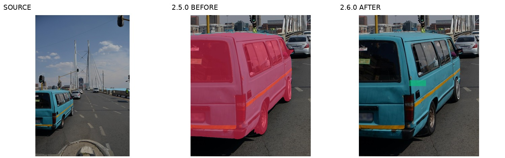
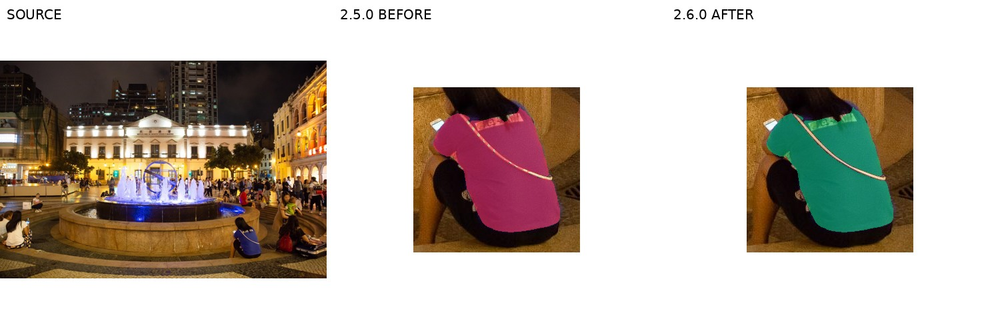
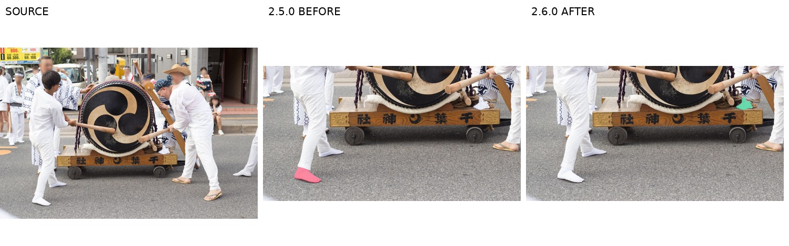
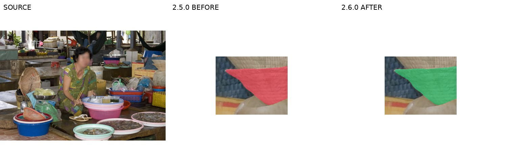
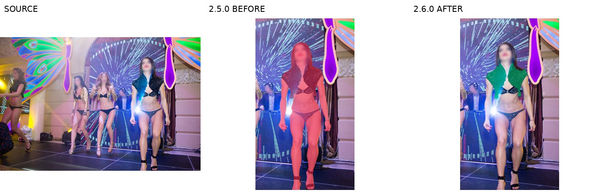
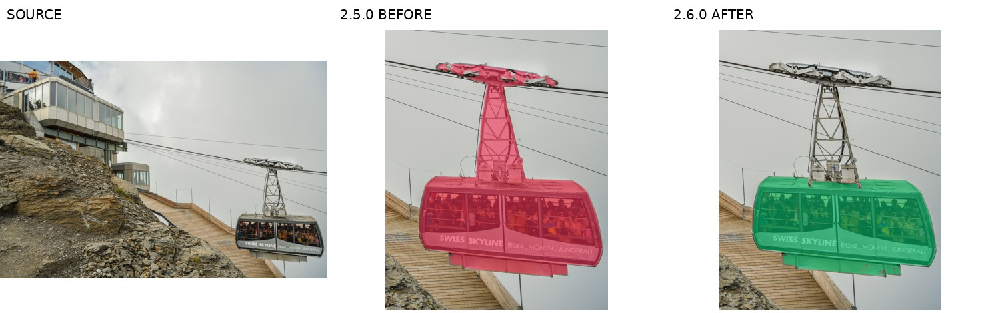

# Release 2.6.0 修复前后对比

比较基线为冻结的2.5.0。图中红色为旧定位，绿色为新版定位；左右使用相同源图裁剪。这些是benchmark指令与源区域标注对比，**不是模型生成的编辑结果图**。

## 全库变化

| 项目 | 2.5.0 | 2.6.0 |
|---|---:|---:|
| 源图 / 单元 | 1084 / 3872 | 1084 / 3872 |
| 指令协议 / mask语义 | 1.0 / 1.1 | 2.0 / 2.0 |
| no-ref重渲染 | — | 3872 |
| Ref内容改写 | — | 1552 |
| 已复核v2 mask / 实际像素改变 | — | 708 / 691 |
| 删除case / 单元 | — | 0 / 0 |

完整逐单元对比：[unit_changes.jsonl](../../data/v2_2.6.0/unit_changes.jsonl)；[汇总JSON](../../data/v2_2.6.0/comparison_summary.json)。

## 最后一轮196例

接续时608例完成，196例未完成（todo 182、partial 2、done_unlogged 12）；现在804例修复任务全部完成，另280例仅做统一协议迁移。最后一轮758单元：keep 450（含96个仅换mask）、revise 299、retarget 9、drop 0；确认229张v2 mask，其中新增224张、复核已有5张。

发布合并补修：7184680 U4回看已审靴筒mask，改为标准部件移除，去掉未分类的结果从句；操作、mask及上述动作数不变。共享canonical协议文件沿用上游版本，历史1.0由兼容层分派。

## 代表性样例

### 1. 裤腿剪短：整条裤子 → 膝下区段 · v2-sa_3397098 U1

| 字段 | 修复前2.5.0 | 修复后2.6.0 |
|---|---|---|
| Ref | Remove the lower legs of the jeans of the blue-flag-draped man in the middle to make knee-length shorts. | Remove the lower legs of the jeans of the blue-flag-draped man in the middle to make knee-length shorts. |
| No-ref | Remove the lower legs of the selected trousers to make knee-length shorts. | Remove the selected region to make knee-length shorts. |

### 2. 新增贴花：整车 → 侧窗下方实心侧板 · v2-sa_5794853 U1

| 字段 | 修复前2.5.0 | 修复后2.6.0 |
|---|---|---|
| Ref | Add a small white CITY SHUTTLE decal on its side panel on the turquoise minibus in the left foreground. | Add one small white CITY SHUTTLE decal on the side panel below the rearmost side window of the turquoise minibus in the left foreground. |
| No-ref | Add a small white CITY SHUTTLE decal on its side panel on the selected minibus. | Add one small white CITY SHUTTLE decal on the selected region. |

### 3. 移除车辆：保留前景细栅栏、门柱和门闩 · v2-sa_6720037 U1

| 字段 | 修复前2.5.0 | 修复后2.6.0 |
|---|---|---|
| Ref | Remove the white panel van in the center. | Remove the windowless white panel van, third from the left among the parked vans. |
| No-ref | Remove the selected panel van. | Remove the selected region. |

### 4. 排除斜包带，并明确长袖高领结构替换 · v2-sa_1254142 U4

| 字段 | 修复前2.5.0 | 修复后2.6.0 |
|---|---|---|
| Ref | Replace the seated woman’s blue top on the right with a beige knitted sweater. | Replace the seated woman’s blue top on the right with a beige turtleneck sweater with long sleeves. |
| No-ref | Replace the selected top with a beige knitted sweater. | Replace the selected region with a beige turtleneck sweater with long sleeves. |

### 5. 改选目标：穿着足袋 → 独立松放白布 · v2-sa_8917525 U1

| 字段 | 修复前2.5.0 | 修复后2.6.0 |
|---|---|---|
| Ref | Remove the nearer white tabi sock of the drummer on the left. | Remove the loose white cloth on the image-right end of the drum cart. |
| No-ref | Remove the selected tabi sock. | Remove the selected region. |

### 6. 结构替换：浅圆容器 → 低直边长方木托盘 · v2-sa_5953627 U3

| 字段 | 修复前2.5.0 | 修复后2.6.0 |
|---|---|---|
| Ref | Replace the lower exposed woven container in the stack at the upper right with a shallow round wooden bowl. | Replace the lower exposed woven container in the stack at the upper right with a rectangular wooden tray with low straight sides. |
| No-ref | Replace the selected container with a shallow round wooden bowl. | Replace the selected region with a rectangular wooden tray with low straight sides. |

### 7. 修复人物与衣物层级 · v2-sa_9357354 U1

| 字段 | 修复前2.5.0 | 修复后2.6.0 |
|---|---|---|
| Ref | Change the color of the dancer at the left to blue. | Change the color of the black bolero jacket of the dancer at the front right to royal blue. |
| No-ref | Change the color of the selected dancer to blue. | Change the color of the selected region to royal blue. |

### 8. 车厢替换：排除悬挂架，明确双层结构 · v2-sa_2176556 U1

| 字段 | 修复前2.5.0 | 修复后2.6.0 |
|---|---|---|
| Ref | Replace the cable car on the right with a red panoramic cable car. | Replace the cable car cabin on the right with a red double-deck cabin with two stacked rows of passenger windows. |
| No-ref | Replace the selected cable car with a red panoramic cable car. | Replace the selected region with a red double-deck cabin with two stacked rows of passenger windows. |

## 待人工复核的已接受判断

AI目视修复和发布校验均已完成，尚无独立人工验收或模型编辑结果。以下是已接受但建议人工抽查的判断，不是未解决case。

| Case | 判断 |
|---|---|
| v2-sa_610993 | U3 transparent plastic sheet has soft edges over equipment; existing v2 final reviewed and accepted. |
| v2-sa_719433 | U3 neck is a small but visible 11x23 px region. |
| v2-sa_3635508 | U1/U5 retarget decisions replace impossible occluded lower-leg edits; mask finals reviewed. |
| v2-sa_6082506 | Audit suggested second woman from left, but a partially cropped purple/yellow woman is also visible at far left; use adjacent pale-blue woman as reference rather than ordinal. |
| v2-sa_6665557 | U3 uses a narrow 50x7 px top-rail attachment site. |
| v2-sa_1165283 | U1 image-right sleeve is a narrow strip partly hidden by torso; accepted SAM3 mask after final review. |
| v2-sa_6791309 | U3 two visible gray cuffs interpreted as attached to one burgundy top; source top is cropped by image boundary. |
| v2-sa_7434362 | U1 chest badge is small (~29x16px,300px mask), but white letters and badge border are visible. |
| v2-sa_2204968 | U2 frame tube is small and seen from rear, 1033 px. |
| v2-sa_200777 | U4 leafy foreground has fine branch boundaries; reviewed final removes visible leaf clusters, mask accepted. |
| v2-sa_2316049 | U3 distant partly occluded car has 1391 px visible selector after bench/bin subtraction. |
| v2-sa_2361184 | U4袖型原图为宽灰色袖口/肩带边缘，使用blue top中性词；不采审查建议的短袖断言。 |
| v2-sa_80787 | U3帽檐为29×22像素、320像素面积；原图及候选/final可辨，可作为小目标抽查。 |
| v2-sa_1725557 | U4右侧白袋位于失焦背景，原图袋体软边界与原mask一致，按白色塑料袋保留；建议人工复核类别与口沿边界。 |
| v2-sa_5799580 | U3远处立体字边缘约百像素高度，SAM候选结合源白字像素排除暗孔；已接受，建议人工复核细窄字间缝。 |
| v2-sa_604786 | U3远处小窗板约68×36px，SAM修全受光左下区域，建议复核小目标边界。 |
| v2-sa_3562449 | U4石墙顶横栏约161×10px，作为花箱附着位已接受，建议复核窄支持区。 |

被否定或部分否定的审查、坐标证据及实际修复动作见[完整日志](../../construction/release_2_6/logs/round2.jsonl)的 round2_final_report 事件；全库审查历史见[审查报告](BENCHMARK_AUDIT_20261015_ZH.md)。
