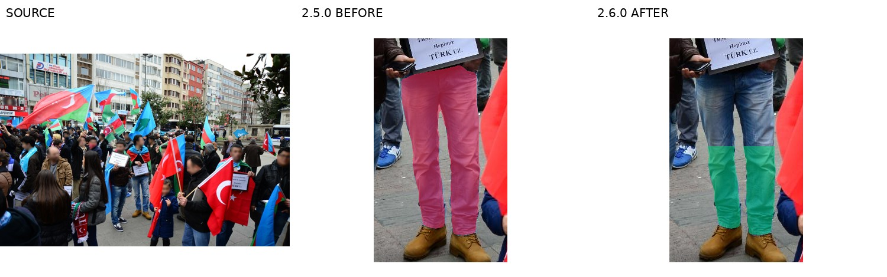
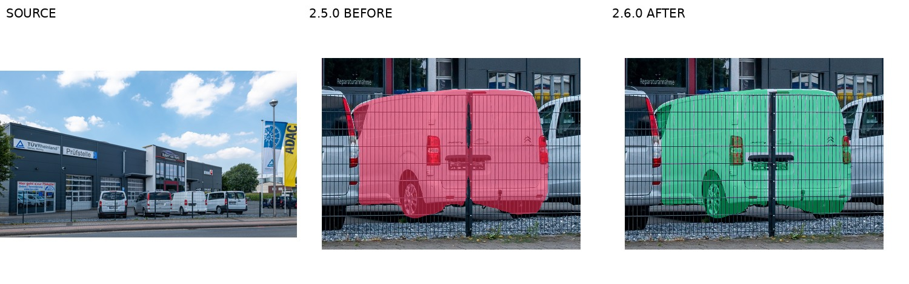

# SAMTok Edit Benchmark 2.6.0：基准说明

> 本文说明冻结数据与方法。七模型全量结果见[结果报告](reports/2.6.0/RESULT_ANALYSIS_2_6_0_ZH.md)，换机恢复见[交接清单](RECOVERY_HANDOFF_2_6_0_ZH.md)。

## 1. 基准评测什么

SAMTok Edit 衡量图像编辑模型在一张真实场景中**同时执行多个细粒度编辑请求**的能力。一个 case 绑定一张 SA-1B 源图和 2–5 个编辑单元 U；每个 U 绑定一个实际源实例、部件、区段或附着部位。任务重点是：

- 在同类实例、部件和遮挡条件下找到正确目标；
- 按 `add / replace / remove / attribute` 完成指定改变；
- 只改授权的粒度，保留邻近物体、背景、遮挡和同一宿主的其他部分；
- 在多个请求同时出现时避免请求之间互相干扰；
- 在 point、box、mask、文字 ref 和 blind no-ref 组合下正确使用区域信息。

这里的源 mask 是实际被编辑的源区域：它不是输出轮廓，也不是“允许任意改动 mask 内全部内容”的授权。`add` 的 mask 是附着或承载部位，不是新增物最终轮廓。

## 2. 当前版本统计

正式入口是 [cases.jsonl](../../../data/v2_2.6.0/cases.jsonl)，manifest SHA256 为 `818ce524a1d1f363dc8ea5caa7a887b2dd0355c17a5600d1cbd696cffcf263fb`。

| 指标 | 数量 |
|---|---:|
| 源图 / case | 1,084 |
| 编辑单元 | 3,872 |
| 每 case 2 / 3 / 4 / 5 个单元 | 147 / 255 / 597 / 85 |
| replace / attribute / remove / add 单元 | 969 / 1,002 / 921 / 980 |
| 含 replace / attribute / remove / add 的 case | 947 / 961 / 903 / 961 |
| 新版 v2 mask | 708 |
| mask 含多个连通分量的单元 | 567 |
| area fraction 中位数 / 最小 / 最大 | 0.004658 / 0.000031 / 0.478551 |
| 面积小于 1% 的单元 | 2,650 |

7 种交互组合近似均衡：`noref+point` 554；`ref+box`、`noref+mask`、`ref+none`、`noref+box`、`ref+mask`、`ref+point` 各 553。每张图至少两种交互形式。

## 3. 任务输入与区域信息方式

### 3.1 协议

- `visual_locator_v2`：编辑器收到干净源图；有 locator 的 case 还收到一张只画指定 point/box/mask 的定位图。定位图上的颜色、边框和 `U#` 只属于输入提示，输出中不得保留。
- `native_regions_v2`：编辑器收到干净源图，以及公开的整数 point、半开 box 或二值 mask 文件；没有渲染的彩色标注图。
- `grayscale_label_map_v1`：诊断模式。第二张图是灰度 label map，U1–U5 分别编码为 51/102/153/204/255，黑色为背景；同一套公开 job、prompt 和输出绑定不变。

在 `visual_locator_v2` 和 `native_regions_v2` 中，`mixed` 保留每个单元原本的 point/box/mask/ref 组合；`single` 用于按定位方式做消融；`all_ref` 和 `all_mask_noref` 是控制条件。所有方式都由 [evaluation/inputs/README.md](../../../src/evaluation/inputs/README.md) 说明，正式输入由 `data/v2_2.6.0/cases.jsonl` 重新 prepare。

### 3.2 no-ref

no-ref 从同一个结构化 instruction spec 自动渲染，把“对哪里做”整体替换为 `the selected region`；操作、payload、属性值、结果要求保留。不得手写 no-ref。2.6.0 的 no-ref 与 2.5.0 及以前不直接可比。

### 3.3 小批量输入形式验证结论

12 个源 case 的严格配对诊断曾观察到：Qwen2.1、Qwen2511 和 FLUX.2 的灰度目标图可减少部分标记残留，FLUX.3 更适合彩色定位图。但灰度方案将原本的 point/box 目标也表示为完整 mask，区域信息量改变，不能作为当前 benchmark 的默认输入。

当前正式评测统一使用 `visual_locator_v2/mixed`，保留原始 point/box/mask。小批量诊断仅作为标记残留研究，路径与复查入口见[交接清单](RECOVERY_HANDOFF_2_6_0_ZH.md)。

## 4. 编辑模型与官方推理入口

模型生成代码在 [evaluation/diffsynth](../../../src/evaluation/diffsynth)；适配器固定 checkpoint、尺寸、seed、输出绑定和可恢复 shard。

| benchmark 名称 | 推理实现 | 当前正式输入 |
|---|---|---|
| `qwen_image_21` | DiffSynth-Studio `QwenImage21Pipeline`，官方 40 steps / 32 网格 | visual locator 双图 |
| `qwen_image_edit_2511` | DiffSynth-Studio `QwenImagePipeline`，官方 `edit_image`、40 steps / 16 网格 | visual locator 双图 |
| `flux2_klein_4b` | DiffSynth-Studio `Flux2ImagePipeline`，官方 distilled 4 steps、`cfg_scale=1.0` | visual locator 双图 |
| `flux3_klein` | Black Forest Labs 官方 FLUX.3 Image Klein reference inference，distilled 16 steps、官方 prompt upsampler | visual locator 彩色定位图 |
| `hunyuan_image_30_instruct` | Tencent 官方 `HunyuanImage-3.0-Instruct-Distil` Transformers 推理，推荐 8 steps；8 卡单进程 `device_map=auto` | visual locator 双图 |
| `hidream_o1_image` | DiffSynth-Studio `HiDreamO1ImagePipeline`，官方 full 50 steps | visual locator 双图 |
| `step1x_edit` | DiffSynth-Studio `FluxImagePipeline` 的官方 Step1X-Edit i1258 路径，28 steps / `cfg_scale=6.0` | 单图 locator |
| `longcat_image_edit` | LongCat 官方 `LongCatImageEditPipeline`，50 steps / `guidance_scale=4.5` | 单图 locator |

DiffSynth 相关官方示例链接和本地模型目录见归档的 [评测说明](archive/BENCHMARK_EVALUATION_2_6_0_ZH.md)。生成入口允许通过 `SAMTOK_INPUTS`、`SAMTOK_INPUT_PROTOCOL`、`SAMTOK_INPUT_VARIANTS` 切换已准备的输入包；默认仍是 `visual_locator_v2/mixed`。

## 5. 评测和打分

评测分成三步：

1. **生成**：每个模型读取公开 job，只保存输出图、seed、配置和 registry；输出必须绑定 source/input digest。
2. **prepare-judge**：加入 source/output 全图、固定坐标局部 crop、私有 gold mask 轮廓和编辑契约。私有信息只给 judge，不给编辑模型。
3. **judge/report**：使用本地 `Qwen3.8-Flash-Next-FP8`，vLLM，temperature 0、seed 0；每个 case 一次联合判断全部 U。

rubric 对每个 U 输出 0–4 分和布尔通过值：

- **E（Execution）**：目标实例/部件、操作、数量、位置及可见碎块是否正确执行；只有 4 分通过。
- **P（Preservation）**：非目标部件、相邻物、遮挡关系和背景是否保持；3–4 分通过。
- **Q（Quality）**：结构、边缘、材质、接触、光照、阴影和局部自然度；3–4 分通过。
- **global_P / global_Q**：整图级非目标保持和整体质量；3–4 分通过。

`JointPass` 要求所有 U 的 E/P/Q 以及 global_P/global_Q 全部通过。分数必须携带具体 before/after evidence；输出不是合法 JSON 时只允许一次格式修复重试。模型自行把输入的 box、point、mask、U 标签画进输出，会被视为未请求内容：覆盖单元的 P/global_P 失败，并在损伤图像时影响 Q。

当前 judge 的完整 rubric 和视图定义在 [samtok_benchmark/v2/judge.py](../../../src/samtok_benchmark/v2/judge.py)；数据汇总在 [samtok_benchmark/v2/evaluation.py](../../../src/samtok_benchmark/v2/evaluation.py)。

## 6. 代表性 case

以下是当前标注修订中用于说明 mask 粒度和实例归属的代表性输入图，不是模型生成结果。完整 before/after 对照在归档的 [修复对照报告](archive/RELEASE_2_6_BEFORE_AFTER_ZH.md)。

| case / 单元 | 说明 | 图 |
|---|---|---|
| `v2-sa_3397098 U1` | 剪短任务把整条裤子收窄到实际被删除的下段 |  |
| `v2-sa_5794853 U1` | add/贴花定位在车身实际承载侧板，不画新增贴花轮廓 |  |
| `v2-sa_6720037 U1` | remove 只删除车辆，保留前景细栅栏、门柱和门闩 |  |
| `v2-sa_1254142 U4` | 结构替换只改袖部，排除斜包带和手部 |  |

## 7. 路径和复现入口

仓库根目录：`/opt/tiger/tanyue/samtok_edit_benchmark`；推荐 Python：`/opt/tiger/envs/gen/bin/python`。数据根：`/mnt/bn/strategy-mllm-train/user/tanyue/datasets/samtok_edit_benchmark_v2`。

| 内容 | 路径 |
|---|---|
| 当前版本指针 | `data/current.json` |
| 正式 manifest | `data/v2_2.6.0/cases.jsonl` |
| 统计 / 验证 / 发布元数据 | `data/v2_2.6.0/{statistics,validation,release}.json` |
| 数据构造与发布 | `construction/`、`construction/release_2_6/` |
| 编辑模型评测 | `evaluation/diffsynth/` |
| 输入 builder | `evaluation/inputs/` |
| 评分实现 | `samtok_benchmark/v2/judge.py`、`evaluation.py` |
| 已完成实验与运行日志 | [results/README.md](../../../results/README.md) 及外部实验根目录 |
| 修订 / 审查日志 | `construction/release_2_6/{revisions,logs,audit}` |
| 数据根正式资产 | `<数据根>/assets/<case>/` |

直接使用已发布数据时先安装新版 mask 补丁：

```bash
PYTHONPATH=. /opt/tiger/envs/gen/bin/python construction/release_2_6/materialize_masks.py \
  --dataset-root /mnt/bn/strategy-mllm-train/user/tanyue/datasets/samtok_edit_benchmark_v2
```

然后按 [evaluation/README.md](../../../src/evaluation/README.md) 生成、prepare-judge、judge 和 report。当前七模型结果已在独立结果报告中发布；本说明的统计表只记录数据集统计。

## 8. 数据边界

2.6.0 已完成构建、资产、几何和协议校验，但 `independent_human_verified=false`、`semantic_signoff=false`。这是冻结 benchmark 输入的质量边界；它不等同于编辑模型结果，也不宣称全库已经完成独立人工终审。
