# V2.6.0

**1,084 张真实图像 · 3,872 个编辑单元 · 每图 2–5 个目标 · 7 种交互组合**

## 1. 评测目标与任务

SAMTok Edit 评测模型能否在同一张图中同时完成多个细粒度编辑请求：选对实例与部件、完整执行每条指令、保持无关内容，并生成自然的结果。重点覆盖同类实例、局部部件、遮挡碎块和多请求协调。

每个 case 包含一张源图和 2–5 个编辑单元 U。每个 U 绑定目标区域、操作、指令和交互形式；模型输出一张完整图像。

**实际区域输入**

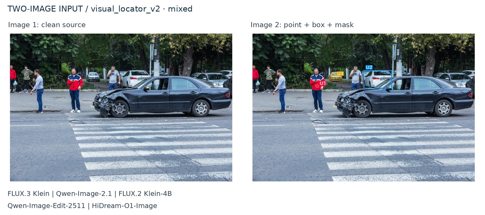

五个双图模型收到干净原图与彩色定位图；LongCat、Step1X 仅收到带标记的原图（实际输入见 4.1）。例中 U1 为 point、U2 为 box、U3 为 mask；模型应完成全部请求，且输出不保留标记。

- ref：指令包含目标的文字描述；no-ref：目标指代统一替换为 the selected region，保留操作与期望结果。ref 不表示额外参考图片。
- point / box / mask 分别提供点、框、可见源区域；none 仅依靠文字指代。mixed 保留每个 U 原有的交互形式。
- 源 mask 表示实际编辑的源区域，不是输出差分图；add 的 mask 指向已有承载物或附着部位。

## 2. 数据概览

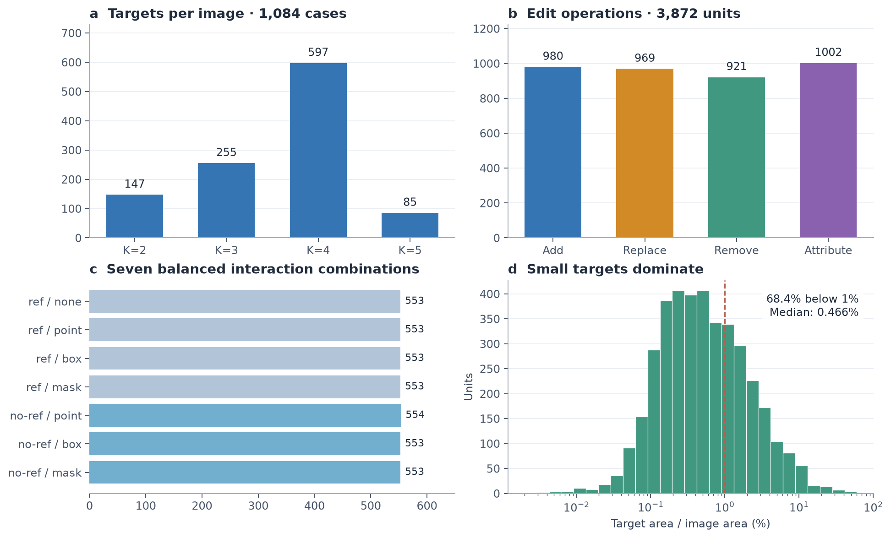

四类操作与七种交互组合近似均衡。68.4% 的单元面积小于原图的 1%，中位数为 0.466%；567 个单元包含多个可见连通分量。小目标、部件边界和遮挡使定位与完整执行更困难。

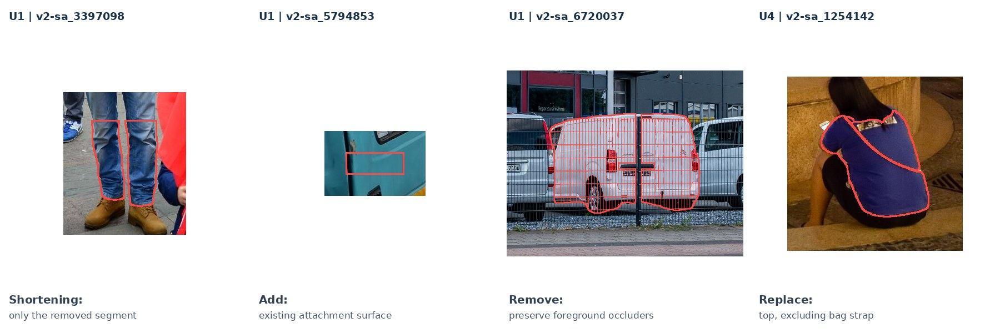

编辑范围示例（从左到右）：剪短只选被删除段；添加选承载侧板；删除车辆排除前景栅栏；替换上衣排除包带和皮肤。红线仅用于展示源 mask。

## 3. 构造与校验

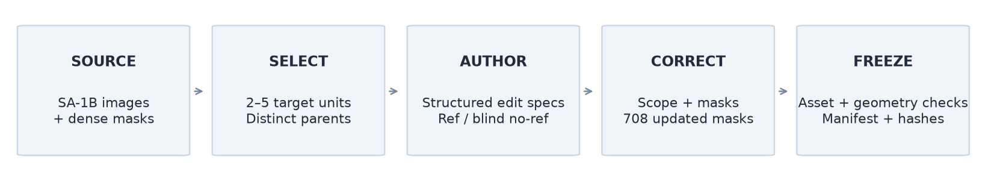

### 3.1 源数据与选样

源图来自 SA-1B，结合配套 dense annotation 的对象与可见区域 mask 构造编辑任务。保留 200 张基础样本，从 964 张新增候选中接受 884 张，形成 1,084 张唯一源图。

- 每图 2–5 个编辑单元、至少两种交互形式，并涉及至少两个独立物理父对象。
- 干净原图中可确认类别、位置、实例归属与边界；优先覆盖同类实例、部件、遮挡和紧邻保护。
- 请求自然、可执行、指代明确；无法稳定判断的目标修正或替换。新增候选排除已选图与训练 reservoir，但不据此保证模型预训练零重叠。

### 3.2 指令与区域标准

| 操作 | 指令要求 | 源 mask |
|-|-|-|
| add | 明确新增物、数量与附着关系 | 已有承载物或附着部位 |
| replace | 具有结构或类别变化；纯换色归 attribute | 被替换的原对象或部件 |
| remove | 明确整体、部件、内容物或区段 | 实际被删除的可见区域 |
| attribute | 改变指定属性，保持身份和基本结构 | 实际改变属性的表面或部件 |

协议 2.0 从同一结构化 spec 生成 ref、no-ref、中文说明与完成要求。no-ref 自动去除源目标类别、位置和宿主指代；ref/no-ref 共用源 mask，point 与 box 由该 mask 确定性生成。颜色、方位和类别均在干净原图上核实。

### 3.3 校验与修正

逐 case 对照原图、mask 与定位图，检查实例归属、部件粒度、遮挡边界和邻近保护，修正有瑕疵的指令，修正不准确的 mask。

## 4. 评测设置与评分

### 4.1 模型输入与推理

七个模型均保留 visual_locator_v2 / mixed 的原始 point、box、mask 与 U 标签。五个模型接收干净原图和定位图两张图；LongCat、Step1X 的适配器只向单图编辑接口传入带标记的原图。公开 job 中保存两张图，不代表每个 pipeline 都接收到两张。

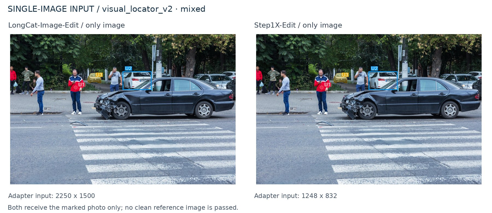

| 模型 | 实际输入 | 推理入口 / checkpoint | Steps / guidance |
|-|-|-|-|
| FLUX.3 Klein | 干净图 + 定位图 | BFL reference pipeline + prompt upsampler | 16（distilled） |
| Qwen-Image-2.1 | 干净图 + 定位图 | DiffSynth QwenImage21Pipeline | 40 / CFG 1.0 |
| FLUX.2 Klein-4B | 干净图 + 定位图 | DiffSynth Flux2ImagePipeline | 4 / guidance 1.0 |
| LongCat-Image-Edit | 仅定位图 | Diffusers LongCatImageEditPipeline | 50 / guidance 4.5 |
| Qwen-Image-Edit-2511 | 干净图 + 定位图 | DiffSynth QwenImagePipeline | 40 / CFG 4.0 |
| HiDream-O1-Image | 干净图 + 定位图 | DiffSynth HiDreamO1ImagePipeline；full | 50 / CFG 4.0 |
| Step1X-Edit | 仅定位图 | DiffSynth FluxImagePipeline；step1x-edit-i1258 | 28 / CFG 6.0 |

统一 seed=0。Step1X 在适配器内按源图比例缩放到约 1 MP、16 像素对齐；LongCat 把原尺寸定位图交给 pipeline 预处理；HiDream 按官方宽高比分桶生成约 4 MP 图像（resolution_policy=hidream_official_2k_buckets_v1，32 像素对齐），其余使用各自配置的约 1 MP 目标尺寸。最终输出映射回源图坐标。HiDream 使用 Full 权重、shift=3、noise_scale=8、keep_original_aspect=False。各模型不是等算力比较；单图/双图条件不同，排名包含输入适配的影响。

双图 prompt 指明图 1 是待编辑照片、图 2 仅用于定位；单图 prompt 指明在标记下的照片上编辑并去除标记。两者均按 U 绑定颜色与定位形式，要求同时执行全部指令。Qwen-Image-Edit-2511 使用 Picture 1/2，其余双图模型使用 Image 1/2；FLUX.3 另经过官方 prompt 扩展。单图 prompt 中“不要保留任何颜色”的英文措辞也可能产生歧义，其影响尚未做隔离验证。

HunyuanImage 尚无完整评测结果，未纳入表格。HiDream 使用上述约 4 MP 配置完成全部 1,084 个 case 的生成与评分（2026-10-21 完成）；本文指标、图表和所有案例列均对应这批结果。

### 4.2 Judge 与指标

Judge 为 Qwen3.8-Flash-Next-FP8，通过 vLLM 以 TP=8、temperature=0、seed=0 调用。每个 case 联合评判全部 U，查看源图/输出全图及同坐标局部图，结合私有 gold 指代、完成要求和保护契约评分。私有 mask 与契约不输入编辑模型。

| 维度 | 判断内容 | 通过阈值 |
|-|-|-|
| E：执行 | 正确实例/部件，完整操作、数量与可见碎块 | 4/4 |
| P：保持 | 非目标部件、邻近物、遮挡与背景保持 | ≥3/4 |
| Q：质量 | 结构、材质、边缘、接触与光影自然 | ≥3/4 |
| global_P / global_Q | 整图保持 / 整体质量 | ≥3/4 |

UnitPass = E∧P∧Q；JointPass = 所有 U 的 UnitPass ∧ global_P ∧ global_Q。单元指标按 3,872 个 U 微平均，全图指标按 1,084 个 case 平均。七个模型均有 1,084 条有效评分；新增三模型共 3,252 条，解析错误为 0。评分成功只表示记录有效，不代表编辑成功。

冻结 rubric 仍有一处“no-ref 保留部件类型”的历史表述，与协议 2.0 不完全一致；judge 同时获得 gold 指代和完成契约，本文沿用原评分口径。

### 4.3 数据与结果路径

Manifest：data/v2_2.6.0/cases.jsonl；SHA256：818ce524a1d1f363dc8ea5caa7a887b2dd0355c17a5600d1cbd696cffcf263fb。数据根：/mnt/bn/strategy-mllm-train/user/tanyue/datasets/samtok_edit_benchmark_v2。

评测结果根：/mnt/bn/strategy-mllm-train/user/tanyue/experiments2/SAMTokEdit/benchmark_v2_2.6.0_baselines。以下路径相对于该目录；model_key 见表。

| 模型 | model_key |
|-|-|
| FLUX.3 Klein | flux3_klein |
| Qwen-Image-2.1 | qwen_image_21 |
| FLUX.2 Klein-4B | flux2_klein_4b |
| LongCat-Image-Edit | longcat_image_edit |
| Qwen-Image-Edit-2511 | qwen_image_edit_2511 |
| HiDream-O1-Image | hidream_o1_image |
| Step1X-Edit | step1x_edit |

公开输入：inputs/visual_locator_v2_mixed/jobs.jsonl；实际适配参数：runs/<model_key>/config.json；生成登记：runs/<model_key>/outputs.jsonl；原始图：runs/<model_key>/shards/shardXX/images/；评分输入：judge_inputs/<model_key>/judge_jobs.jsonl；逐条分数与汇总：judge/<model_key>/Qwen3.8-Flash-Next-FP8/{scores.jsonl,report.json}。

HiDream 本批运行记录：launch/hidream_2k_20261021/{status.json,queue.log,run_environment.json}；对应生成和评分均位于上述 hidream_o1_image 路径。

仓库报告：docs/reports/2.6.0/RESULT_ANALYSIS_2_6_0_ZH.md；配套 CSV 与失败证据同目录。图像和逐模型案例审查记录：docs/publication/2.6.0/assets/、case_study_notes.json、model_case_studies.json；适配器 prompt 示例：actual_adapter_prompts.json。

## 5. 结果与分析

### 5.1 整体表现

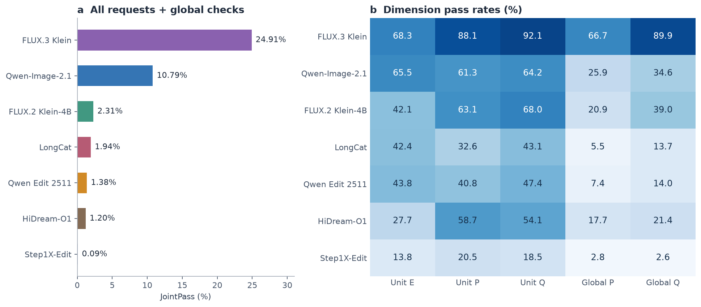

| 模型 | JointPass | E | P | Q | global_P | global_Q |
|-|-|-|-|-|-|-|
| FLUX.3 Klein | 270/1084 (24.91%) | 68.34% | 88.15% | 92.10% | 66.70% | 89.85% |
| Qwen-Image-2.1 | 117/1084 (10.79%) | 65.52% | 61.31% | 64.20% | 25.92% | 34.59% |
| FLUX.2 Klein-4B | 25/1084 (2.31%) | 42.15% | 63.12% | 68.03% | 20.94% | 39.02% |
| LongCat-Image-Edit | 21/1084 (1.94%) | 42.41% | 32.57% | 43.08% | 5.54% | 13.75% |
| Qwen-Image-Edit-2511 | 15/1084 (1.38%) | 43.80% | 40.78% | 47.39% | 7.38% | 14.02% |
| HiDream-O1-Image | 13/1084 (1.20%) | 27.69% | 58.68% | 54.08% | 17.71% | 21.40% |
| Step1X-Edit | 1/1084 (0.09%) | 13.79% | 20.53% | 18.54% | 2.77% | 2.58% |

FLUX.3 仍最好，但 JointPass 仅 24.91%。LongCat 的 E=42.41%，与 FLUX.2 的 42.15% 接近，P/Q 则低至 32.57%/43.08%，表明完成操作之外的保持与质量也构成瓶颈。HiDream 有 13 个 case 通过（1.20%），单元 E=27.69%，低于 P=58.68% 与 Q=54.08%；执行不足仍是主要瓶颈，global_P/Q 也仅为 17.71%/21.40%。Step1X 仅 1 个 case 通过。

### 5.2 多目标组合

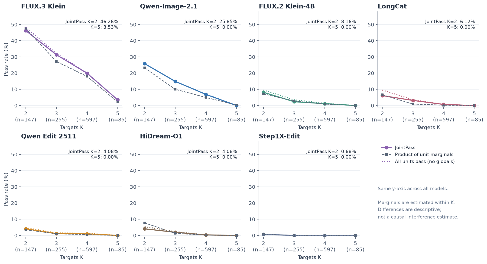

FLUX.3 在 K=2→5 时从 46.26% 降至 3.53%；其余六模型在 K=5 均为 0/85。LongCat 的 K=2/3/4/5 分别为 6.12%/3.14%/0.67%/0%；HiDream 分别为 4.08%/1.96%/0.34%/0%；Step1X 仅 K=2 有 1/147 通过。

在同一模型、同一 K 的 case 中，p_u 是 Uu 的 UnitPass 比例；∏u p_u 是假定各位置独立时“全部单元通过”的参考值。例如 LongCat 在 K=2 时乘积为 6.64%，JointPass 为 6.12%；K=3 时乘积为 0.93%，JointPass 反而为 3.14%。因此不能统一声称实测低于独立期望。

图中彩色点线展示不含 global 门槛的“全部 U 通过”，便于与乘积比较。单元边际来自多目标任务，且各 K 场景不同；共享难度、成功相关性和全图门槛都会影响差值，不能直接作为请求间干扰的因果估计。

### 5.3 定位方式

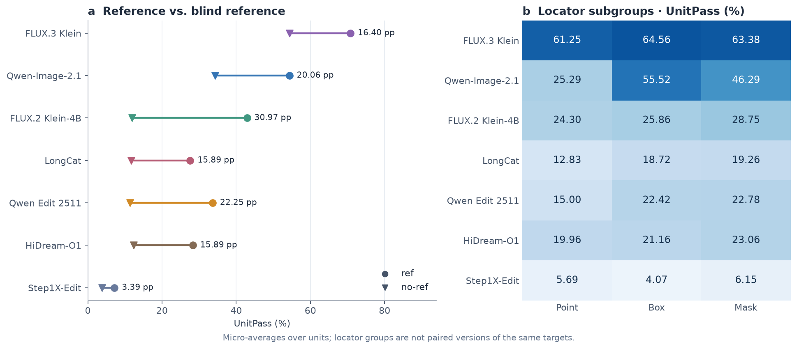

| 模型 | ref | no-ref | no-ref − ref | point | box | mask |
|-|-|-|-|-|-|-|
| FLUX.3 Klein | 70.80% | 54.40% | -16.40 pp | 61.25% | 64.56% | 63.38% |
| Qwen-Image-2.1 | 54.34% | 34.28% | -20.06 pp | 25.29% | 55.52% | 46.29% |
| FLUX.2 Klein-4B | 42.90% | 11.93% | -30.97 pp | 24.30% | 25.86% | 28.75% |
| LongCat-Image-Edit | 27.58% | 11.69% | -15.89 pp | 12.83% | 18.72% | 19.26% |
| Qwen-Image-Edit-2511 | 33.63% | 11.39% | -22.25 pp | 15.00% | 22.42% | 22.78% |
| HiDream-O1-Image | 28.30% | 12.41% | -15.89 pp | 19.96% | 21.16% | 23.06% |
| Step1X-Edit | 7.19% | 3.80% | -3.39 pp | 5.69% | 4.07% | 6.15% |

LongCat 的 no-ref 相比 ref 下降 15.89 个百分点，point 子组仅 12.83%。HiDream 从 ref 的 28.30% 降至 no-ref 的 12.41%，下降 15.89 个百分点；point/box/mask 分别为 19.96%/21.16%/23.06%。Step1X 的 ref/no-ref 差距仅 3.39 个百分点，但绝对通过率很低，不能据此认为视觉定位更强。

no-ref 为 1,660 个单元的微平均（point 554、box/mask 各 553），不是三个独立 setting 的平均。ref 共 2,212 个单元，包含 none；point/box/mask 列混合 ref 与 no-ref。各子组并非同目标配对，差值同时受样本难度影响。

### 5.4 失败模式

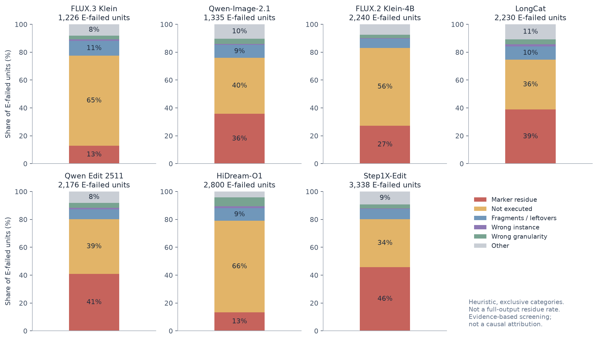

| 模型 | E 失败数 | 标记 | 未执行 | 碎块/残留 | 实例 | 粒度 | 其他 |
|-|-|-|-|-|-|-|-|
| FLUX.3 Klein | 1226 | 158 | 792 | 130 | 13 | 34 | 99 |
| Qwen-Image-2.1 | 1335 | 477 | 537 | 123 | 10 | 50 | 138 |
| FLUX.2 Klein-4B | 2240 | 611 | 1249 | 148 | 12 | 51 | 169 |
| LongCat-Image-Edit | 2230 | 867 | 797 | 214 | 32 | 77 | 243 |
| Qwen-Image-Edit-2511 | 2176 | 891 | 853 | 156 | 22 | 78 | 176 |
| HiDream-O1-Image | 2800 | 374 | 1838 | 253 | 39 | 179 | 117 |
| Step1X-Edit | 3338 | 1527 | 1151 | 241 | 12 | 96 | 311 |

当前案例可确认的失败原因如下（对应第 6 节图片）：

1. 遗漏或做错操作：FLUX.3 的包未删除，只变为蓝色；FLUX.2 的红长椅未改绿；Step1X 的远处车辆仍在。

2. 实例/部位选错：FLUX.3 把莲花放到另一只手；Qwen-Image-2.1 把椅背而非木框改黑；LongCat 将中间整尊雕像改金，右侧目标皇冠仍为原色。

3. 多请求串位：FLUX.2 将 U4 的白鞋要求应用到 U2；Qwen-Image-Edit-2511 将 U1 的喇叭袖要求应用到 U2 人物。

4. 超出编辑范围：Qwen-Image-Edit-2511 对只授权改色的外套改了袖型；Step1X 将皇冠改金扩大到多个雕像。

5. 标记被生成：Qwen-Image-2.1 的胸前红点、Qwen-Image-Edit-2511 的红框/U 标签、LongCat 的红底文字，以及 Step1X 的框/标签均出现在原始输出。它们可在 E 通过时仍导致 P/Q 失败。

6. 结构与非目标内容被改动：Step1X 用平面青色色块代替夹克；HiDream 漏改黄色背心、未删除背包，并额外生成记号笔；另一例把喇叭袖改到另一只手臂，同时改变姿势。

计数沿用旧分类器：仅筛选 E 失败单元，按标记→未执行→碎块→实例→粒度→其他的关键词优先级互斥归类；可观察原因可同时出现。标记计数不是全部输出的残留率，E 通过但 P/Q 失败的标记例子被排除。碎块类可能命中证据中对遮挡的描述，不等于全部经人工确认的碎块遗漏。

HiDream 的 2,800 个 E 失败单元中，1,838 个被归为未执行（65.64%），374 个归为标记残留，179 个归为粒度错误。人工查看的两例可见漏改、错部位和额外生成物体；记号笔由何种机制产生，尚不能仅凭这些案例确定。

## 6. 案例研究：按模型表现分析

按本次全量 JointPass 从高到低排列，每个模型两例，共 14 组模型—案例组合，涉及 7 张源图；复用场景便于跨模型对照。选例用于诊断，不代表失败比例。总览分两行：上行为 FLUX.3、Qwen-Image-2.1、FLUX.2、LongCat；下行为 Qwen-Image-Edit-2511、HiDream、Step1X；每行重复原图和定位图方便对照。

总览展示原始输出，仅缩放压缩，未添加 mask 轮廓；局部图叠加红色源 mask 轮廓并标出每个 U 的 E/P/Q。浅蓝外框与 \* 指示当前分析模型。LongCat、Step1X 只收到定位图，其余五模型收到两图；请勿把局部红轮廓误认为模型生成标记。

### 6.1 FLUX.3 Klein｜JointPass 24.91%

单元 E/P/Q 通过率：68.34 / 88.15 / 92.10（%）。保持与质量最强，但成图自然不等于请求完成。以下两例分别展示删除未执行、同一对象上的附着位置错误。

#### 案例 1：删除未执行：包变色但仍在

Case：v2-sa_10006079。U1 背心改色成功；U2 要求移除包，输出中包仍在，并变成蓝色。U2 的 E/P/Q=1/4/3。对照 Qwen-Image-2.1，包确实被移除：这是遗漏执行，不是单纯成图质量问题。

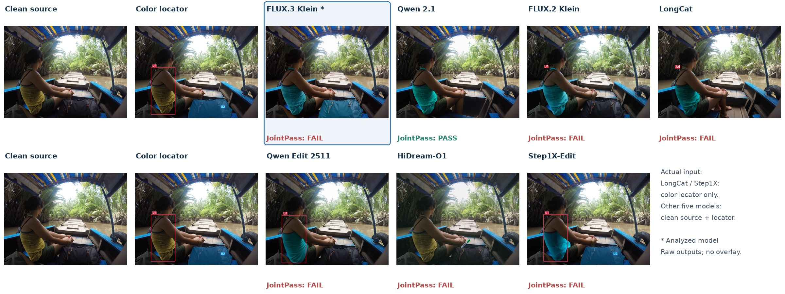

##### U1 · ref / box

Change the color of the woman’s yellow patterned tank top to teal.

将女子的黄色印花背心的颜色改为蓝绿色。

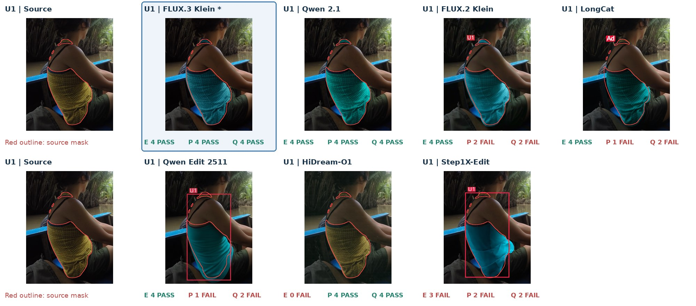

##### U2 · no-ref / mask

Remove the selected region.

移除选中区域。

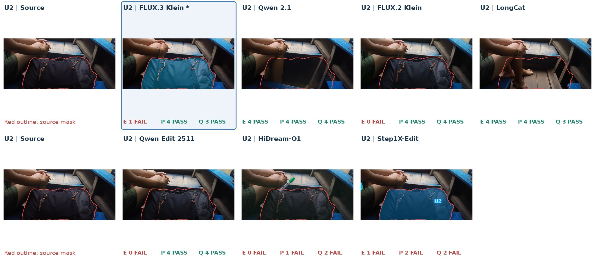

#### 案例 2：部位绑定错误：莲花放到另一只手

Case：v2-sa_5033895。U2 要求把红莲花放在中间雕像画面左侧举起的手掌，输出却放在腹前的手上；指定手掌仍为空。U2 的 E/P/Q=1/2/3。物品与主体正确，但附着部位错误。

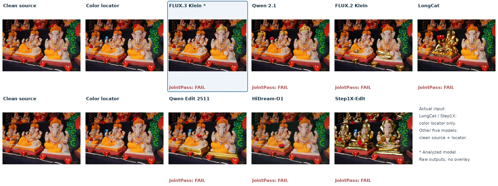

##### U1 · no-ref / point

Change the material of the selected region to polished gold.

将选中区域的材质改为抛光黄金。

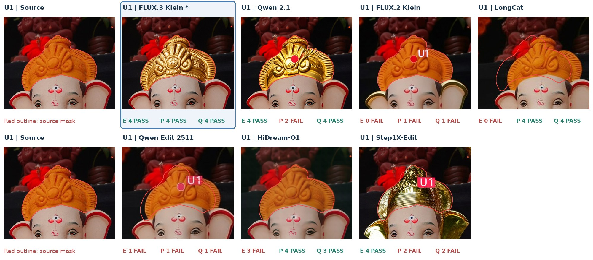

##### U2 · ref / box

Add one small red lotus flower resting on the raised palm on the image-left side of the middle statue.

给中间雕像画面左侧举起的手掌加上一朵托在掌心的小红莲花。

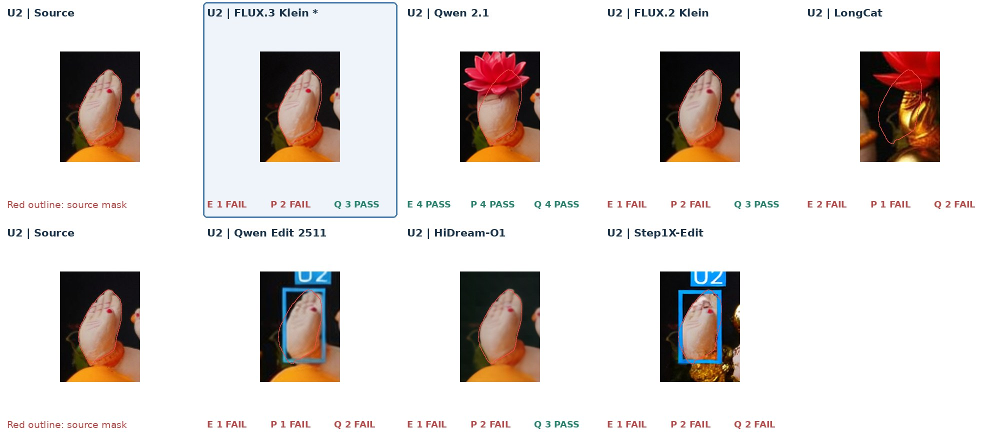

### 6.2 Qwen-Image-2.1｜JointPass 10.79%

单元 E/P/Q 通过率：65.52 / 61.31 / 64.20（%）。执行率接近 FLUX.3，保持与质量明显落后。以下两例展示标记污染，以及将指定部件的改动施加到错误区域。

#### 案例 1：执行完成，但点标记污染输出

Case：v2-sa_10044652。三个 U 的 E 都为 4；U1 上衣已换成藏蓝夹克，但胸前出现大块红色圆点，使 U1 的 P/Q 均为 2，整体失败。FLUX.3 的同一局部没有这块红点。

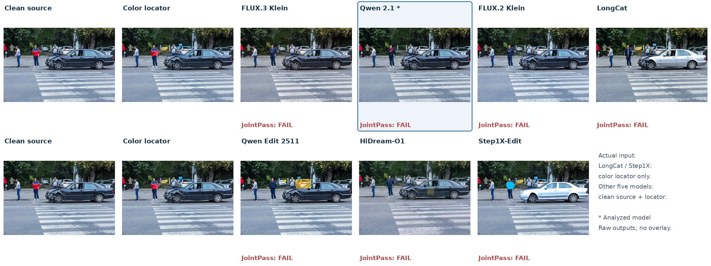

##### U1 · no-ref / point

Replace the selected region with a navy bomber jacket.

将选中区域替换为一件藏蓝色飞行员夹克。

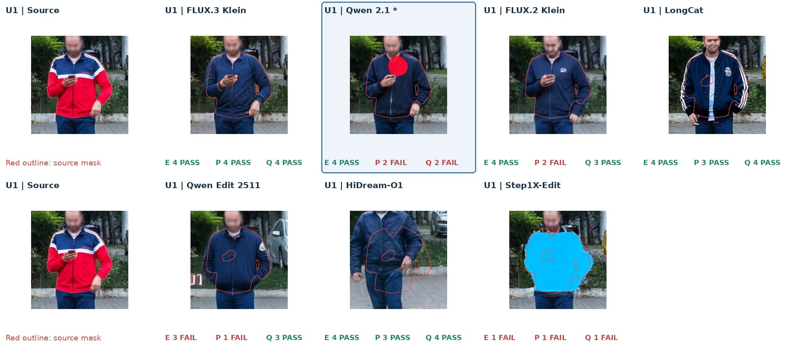

##### U2 · ref / box

Change the color of the white car behind the damaged car to silver.

将受损汽车后方的白色汽车的颜色改为银色。

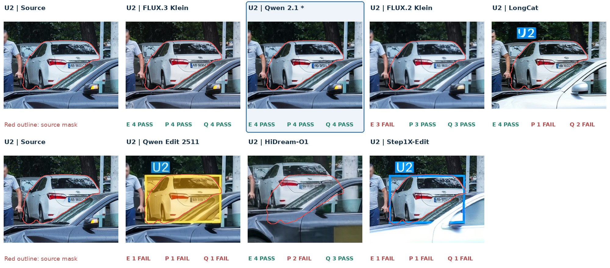

##### U3 · no-ref / mask

Remove the selected region.

移除选中区域。

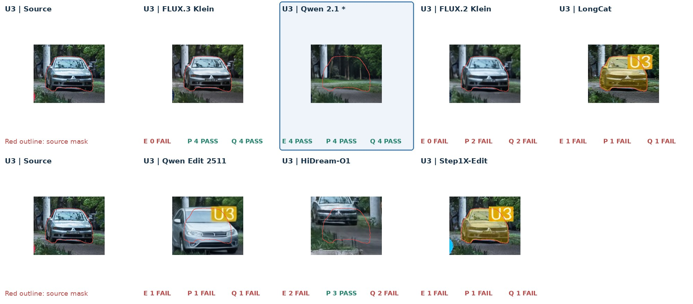

#### 案例 2：粒度错位：木框架未改，椅背变黑

Case：v2-sa_1691871。U2 指向吧椅的木质框架，要求哑光黑色。输出黑色落在椅背等区域，目标框架仍为木色；U2 的 E/P/Q=1/1/2。框内发生变化，不代表指定部件被正确编辑。

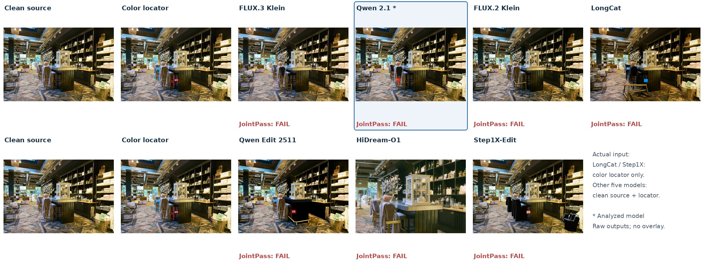

##### U1 · ref / mask

Add a brass footrest across the front legs of the nearest bar chair's wooden frame.

在最近那把吧椅木框架的前腿之间横加一根黄铜脚踏杆。

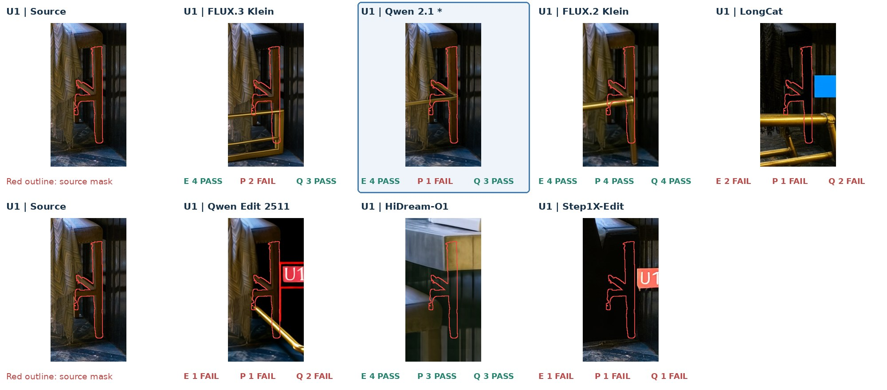

##### U2 · no-ref / box

Change the color of the selected region to matte black.

将选中区域的颜色改为哑光黑色。

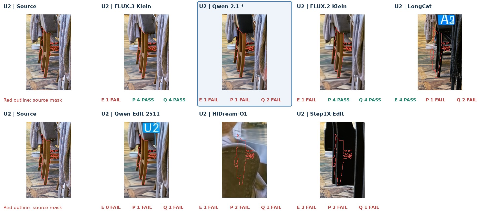

### 6.3 FLUX.2 Klein-4B｜JointPass 2.31%

单元 E/P/Q 通过率：42.15 / 63.12 / 68.03（%）。主要瓶颈是完整执行：目标可能保持原样，也可能执行了其他 U 的要求。较高的 P/Q 不能补偿遗漏或请求串位。

#### 案例 1：完全漏改：红色长椅保持原样

Case：v2-sa_10866716。U1 要求将选中的长椅改为深绿色，输出仍为红色，E/P/Q=1/4/4。虽然这一局部保持、质量通过，执行仍失败；FLUX.3 在同图中完成全部请求并获得 JointPass。

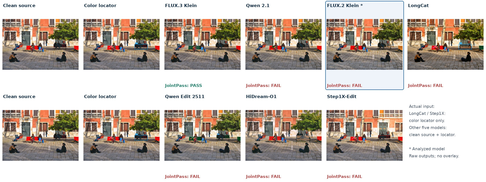

##### U1 · no-ref / point

Change the color of the selected region to dark green.

将选中区域的颜色改为墨绿色。

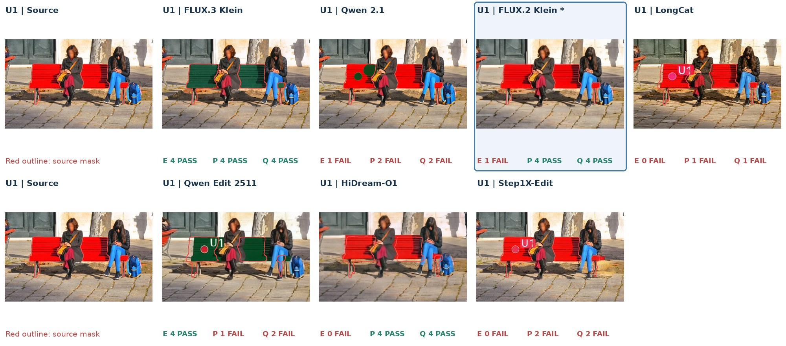

##### U2 · ref / box

Replace the bench under the tree on the right with a bench with a cast-iron backrest and wooden seat.

将树下右侧长椅的可见部分替换为铸铁靠背木座长椅。

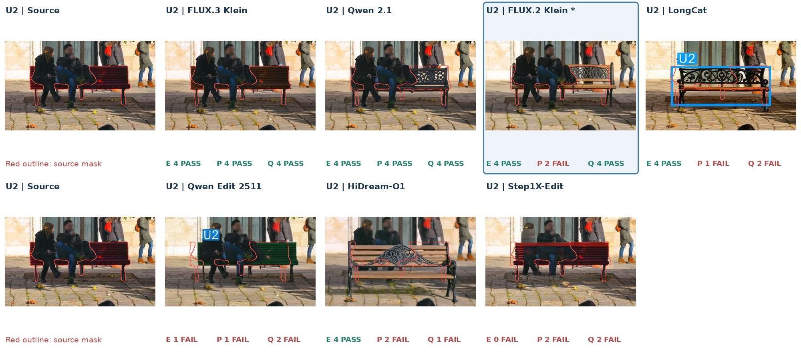

#### 案例 2：请求串位：U4 的鞋样式出现在 U2

Case：v2-sa_7813406。U2 要求黑色及膝靴，却得到白色低帮鞋——这是 U4 要求的样式；真正的 U4 红靴仍在。U2 的 E/P/Q=1/1/2，U4 为 1/4/4；U3 的侧袋也未添加。

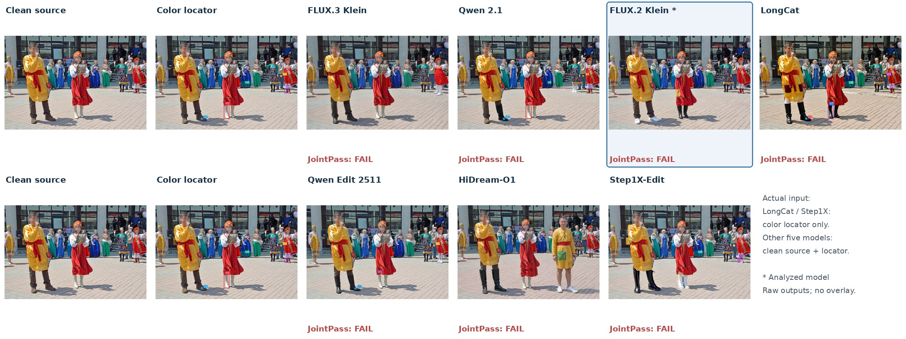

##### U1 · no-ref / box

Change the color of the selected region to dark red.

将选中区域的颜色改为深红色。

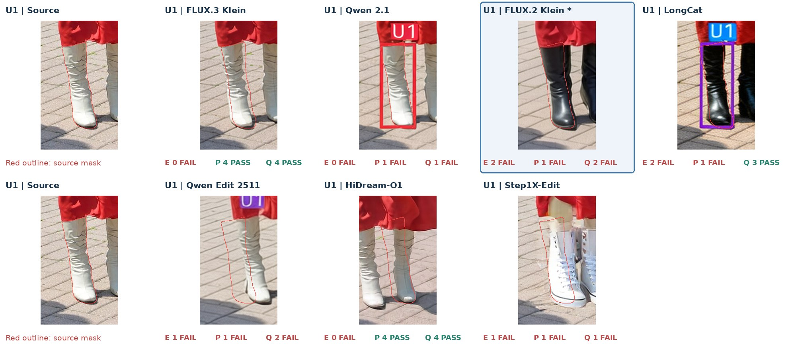

##### U2 · ref / point

Replace the image-right shoe of the foreground man in yellow with a black knee-high boot.

将前景黄衣男子画面右侧的鞋替换为黑色及膝长靴。

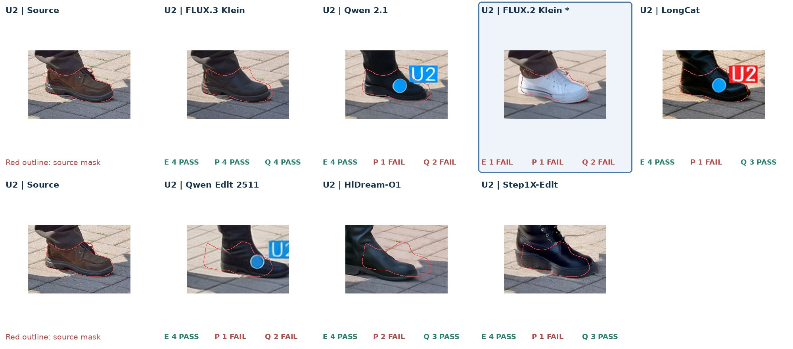

##### U3 · no-ref / point

Add one rectangular side pocket on the selected region.

给选中区域加上一个长方形侧袋。

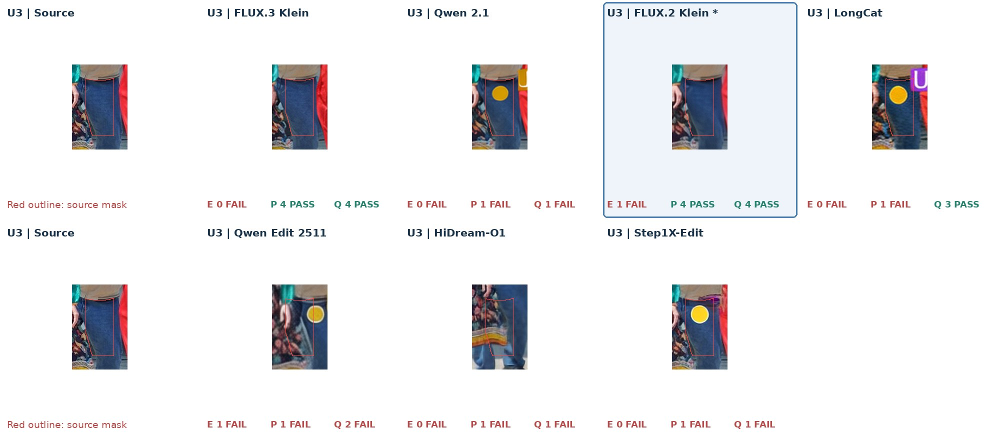

##### U4 · ref / box

Replace the image-left boot of the far-right performer in red with a white low-top canvas sneaker.

将最右侧红衣表演者画面左侧的靴子替换为一只白色低帮帆布鞋。

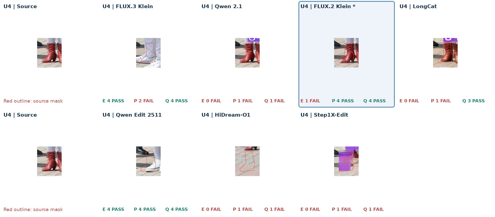

##### U5 · no-ref / mask

Remove the selected region to make it knee-length.

移除选中区域，使其成为及膝长度。

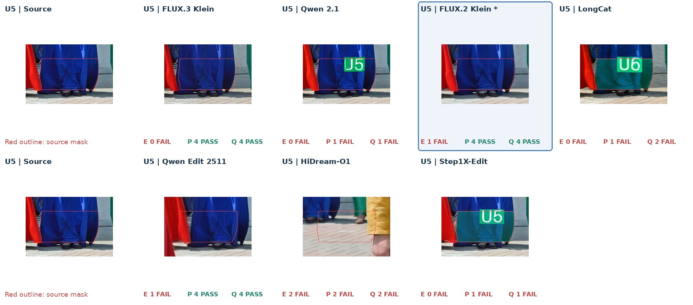

### 6.4 LongCat-Image-Edit｜JointPass 1.94%

单元 E/P/Q 通过率：42.41 / 32.57 / 43.08（%）。执行率与 FLUX.2 接近，但保持和质量更低。可完成部分操作，仍会复制标记、选错实例，或将一个 U 的属性要求扩散到其他对象。

#### 案例 1：编辑完成但仍有文字标记

Case：v2-sa_10006079。背心改为青绿色，包也已移除，两单元 E 均为 4；但肩部附近留下红底文字标记，U1 的 E/P/Q=4/1/2，整图未通过。标记是原始输出中的内容，并非展示叠加。

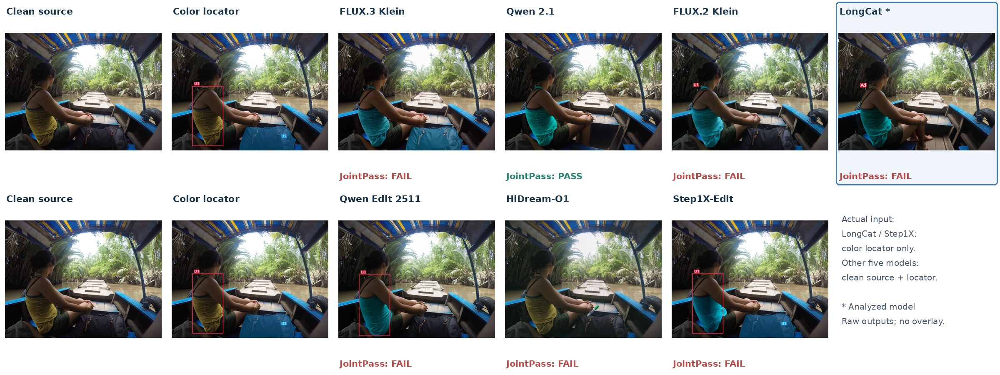

##### U1 · ref / box

Change the color of the woman’s yellow patterned tank top to teal.

将女子的黄色印花背心的颜色改为蓝绿色。

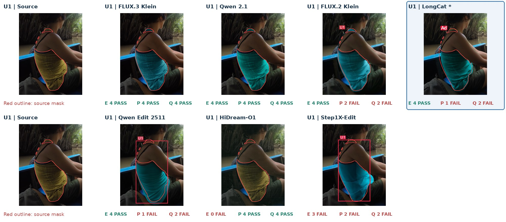

##### U2 · no-ref / mask

Remove the selected region.

移除选中区域。

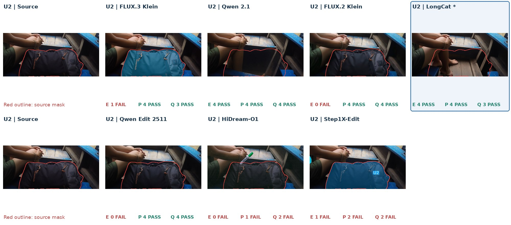

#### 案例 2：选错对象：皇冠未变，中间雕像变金

Case：v2-sa_5033895。U1 的 no-ref point 指向右前方象头雕像的皇冠；输出皇冠仍为陶土色，中间整尊雕像却变成金色。U1 的 E/P/Q=0/4/4，说明原目标未执行；中间雕像的越界改材质同时破坏 U2 的承载物保持，U2 为 2/1/2。

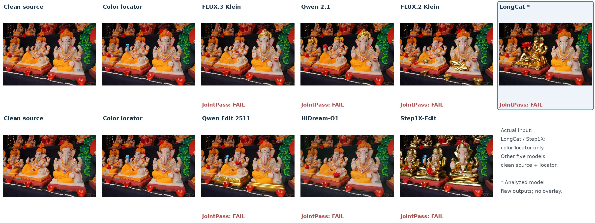

##### U1 · no-ref / point

Change the material of the selected region to polished gold.

将选中区域的材质改为抛光黄金。

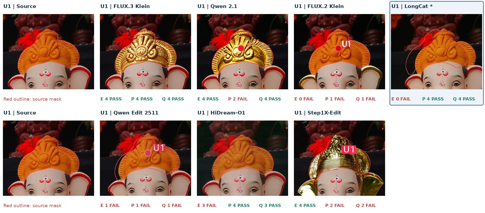

##### U2 · ref / box

Add one small red lotus flower resting on the raised palm on the image-left side of the middle statue.

给中间雕像画面左侧举起的手掌加上一朵托在掌心的小红莲花。

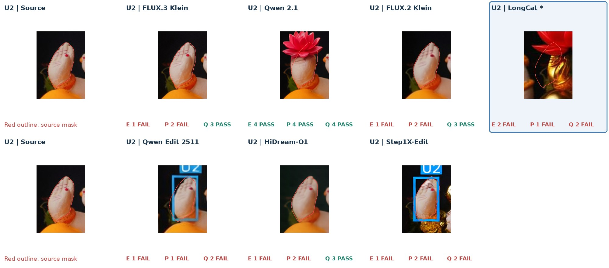

### 6.5 Qwen-Image-Edit-2511｜JointPass 1.38%

单元 E/P/Q 通过率：43.80 / 40.78 / 47.39（%）。执行和保持均较弱。以下两例展示框/标签进入输出、删除遗漏，以及把一个 U 的结构修改施加到另一个实例。

#### 案例 1：标记残留与漏改同时出现

Case：v2-sa_10006079。U1 背心变为青绿色，但红框和 U1 标签被保留，E/P/Q=4/1/2；U2 的包未移除，E=0。这个案例同时暴露保持质量问题与执行遗漏。

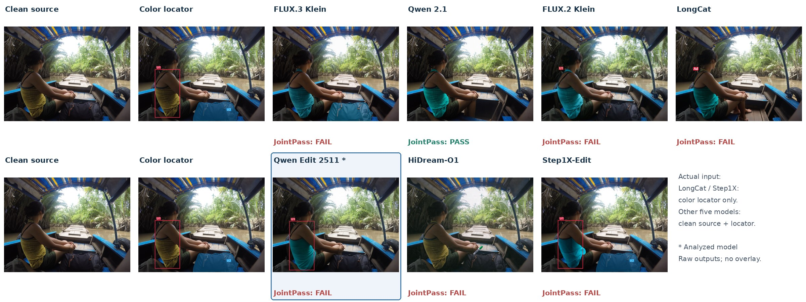

##### U1 · ref / box

Change the color of the woman’s yellow patterned tank top to teal.

将女子的黄色印花背心的颜色改为蓝绿色。

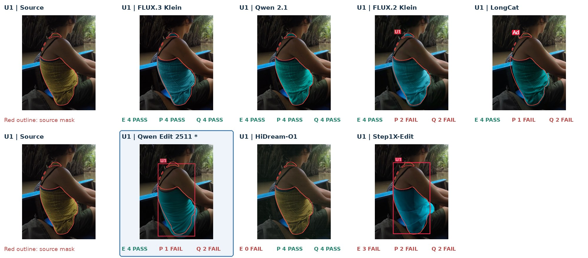

##### U2 · no-ref / mask

Remove the selected region.

移除选中区域。

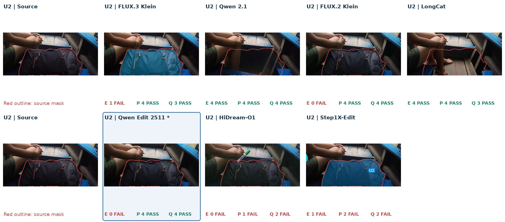

#### 案例 2：跨实例编辑：喇叭袖改到了另一人

Case：v2-sa_10063996。U1 要求左侧女性的外侧衣袖变成喇叭袖；左袖未变，右侧女性却出现喇叭袖。右侧 U2 只授权改色。U1/U2 的 E 分别为 1/3，P/Q 均为 2，且输出残留定位标记。

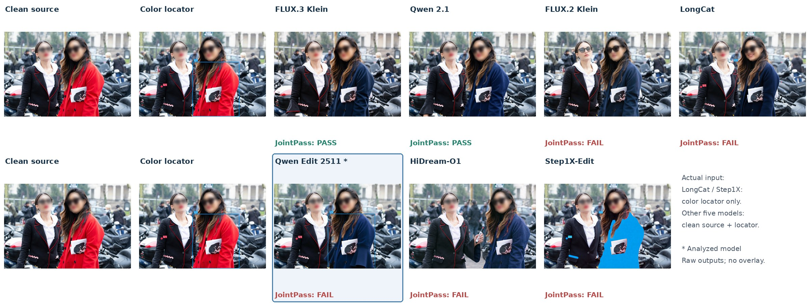

##### U1 · no-ref / point

Replace the selected region with a flared bell sleeve.

将选中区域替换为喇叭袖。

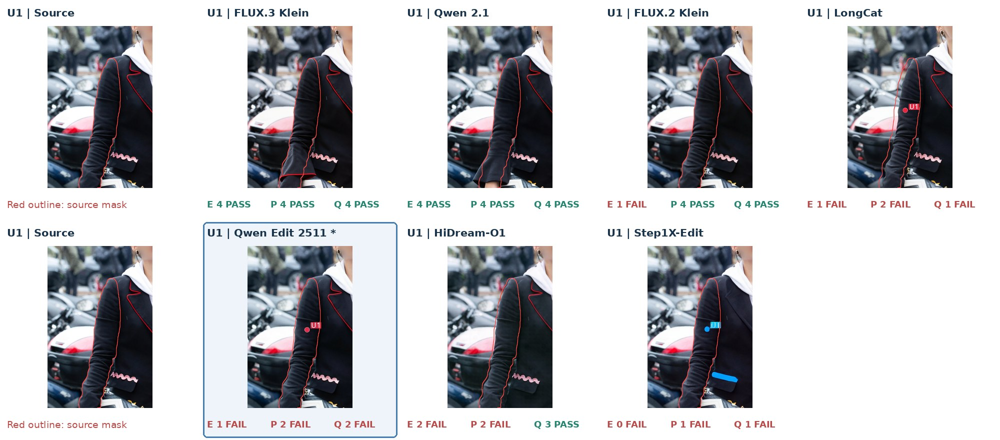

##### U2 · ref / box

Change the color of the red coat of the woman on the right to navy blue.

将右侧女性红色外套的可见面料改为藏蓝色。

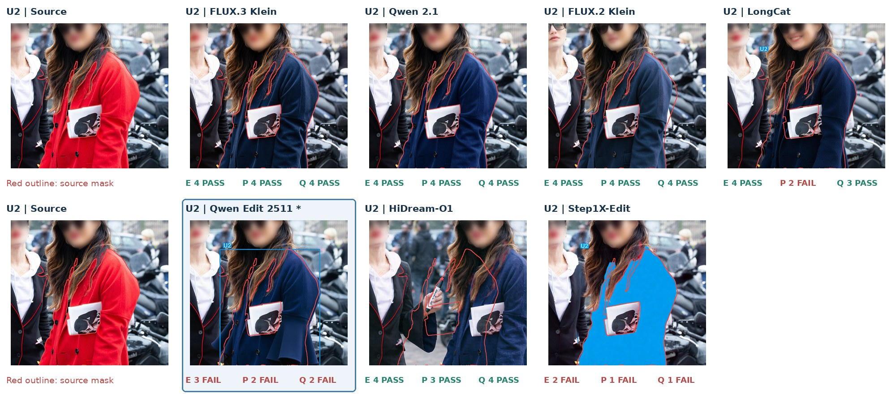

### 6.6 HiDream-O1-Image｜JointPass 1.20%

单元 E/P/Q 通过率：27.69 / 58.68 / 54.08（%）。按官方约 4 MP 尺寸生成后，本次完整评测有 13/1,084 个 case 通过。E 明显低于 P/Q；选例可见指令漏做、部位选错、额外生成物体。以下两例未见此前的整图密集噪声，但编辑执行和非目标保持仍不足。

#### 案例 1：两项请求均漏做，并额外生成记号笔

Case：v2-sa_10006079。黄色背心未改为青色（U1 E/P/Q=0/4/4），黑色背包仍在（U2=0/1/2），人物双手旁额外出现绿色笔帽的记号笔。场景可辨，但改色和删除均未执行，global_P/global_Q=2/2。记号笔出现在原始输出中，并非报告叠加；其产生机制未经隔离验证。

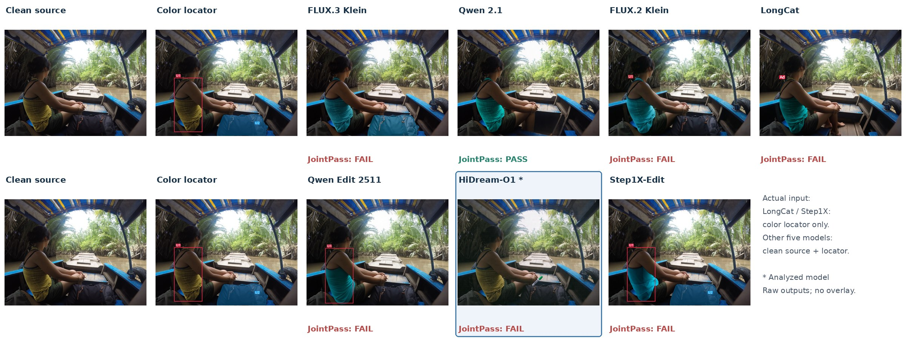

##### U1 · ref / box

Change the color of the woman’s yellow patterned tank top to teal.

将女子的黄色印花背心的颜色改为蓝绿色。

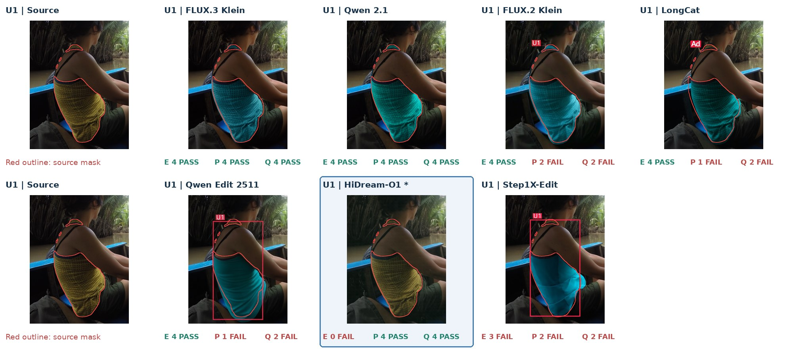

##### U2 · no-ref / mask

Remove the selected region.

移除选中区域。

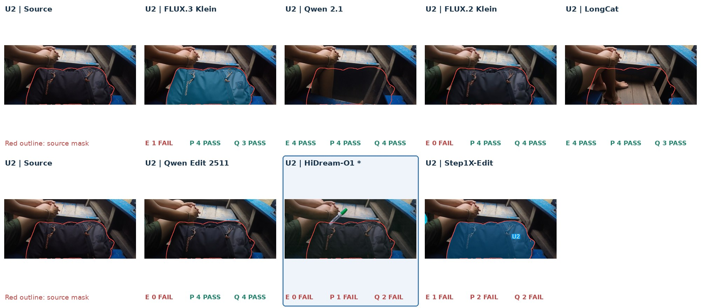

#### 案例 2：外套改色完成，喇叭袖改到另一只手臂

Case：v2-sa_10063996。右侧外套正确变为藏蓝色，U2 E/P/Q=4/3/4。U1 指向左侧人物的画面左侧外袖，输出却改变了靠近另一人的内侧手臂，新增抬手和记号笔；U1=2/2/3。画面还有额外发色变化，global_P/global_Q=2/3；局部改色成功仍不足以使整张图通过。

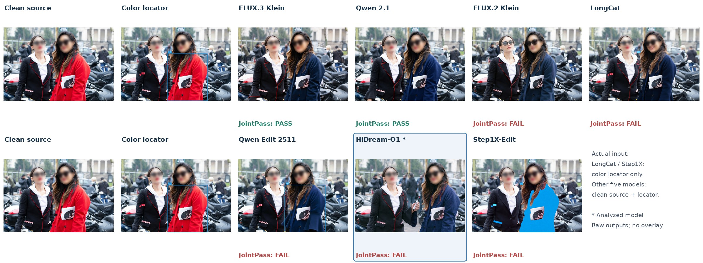

##### U1 · no-ref / point

Replace the selected region with a flared bell sleeve.

将选中区域替换为喇叭袖。

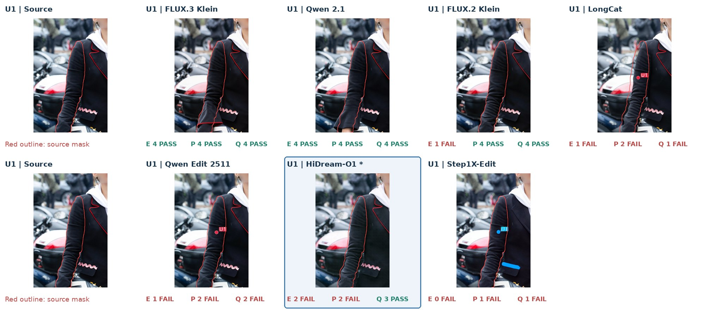

##### U2 · ref / box

Change the color of the red coat of the woman on the right to navy blue.

将右侧女性红色外套的可见面料改为藏蓝色。

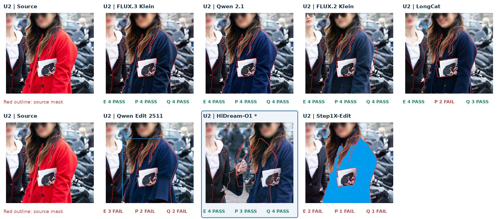

### 6.7 Step1X-Edit｜JointPass 0.09%

单元 E/P/Q 通过率：13.79 / 20.53 / 18.54（%）。本次运行仅 1 个 case 通过。原始输出可见扁平色块覆盖、标记残留与越界改材质，不能仅用“遗漏执行”概括。

#### 案例 1：用色块代替衣物，并保留定位标记

Case：v2-sa_10044652。U1 要求藏蓝飞行员夹克，输出躯干却被青色平面色块覆盖；U2 的蓝框、U3 的黄色覆盖与标签仍在，U3 指定车辆也未移除。三个 U 的 E/P/Q 均为 1/1/1；前景车辆还发生额外改色。

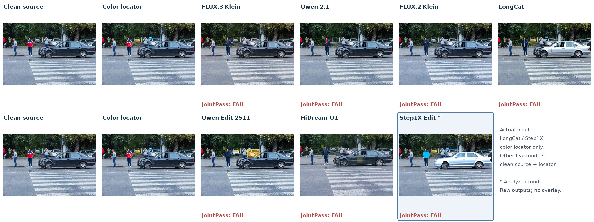

##### U1 · no-ref / point

Replace the selected region with a navy bomber jacket.

将选中区域替换为一件藏蓝色飞行员夹克。

##### U2 · ref / box

Change the color of the white car behind the damaged car to silver.

将受损汽车后方的白色汽车的颜色改为银色。

##### U3 · no-ref / mask

Remove the selected region.

移除选中区域。

#### 案例 2：局部改金扩散到整尊雕像，莲花放错位置

Case：v2-sa_5033895。U1 的皇冠确实变金，但多个雕像的大面积表面也被金属化，远超皇冠范围，U1 的 E/P/Q=4/2/2。U2 的红莲花出现在下方，指定的举起手掌仍为空，U2 为 1/2/2；定位标签也有残留。

##### U1 · no-ref / point

Change the material of the selected region to polished gold.

将选中区域的材质改为抛光黄金。

##### U2 · ref / box

Add one small red lotus flower resting on the raised palm on the image-left side of the middle statue.

给中间雕像画面左侧举起的手掌加上一朵托在掌心的小红莲花。

