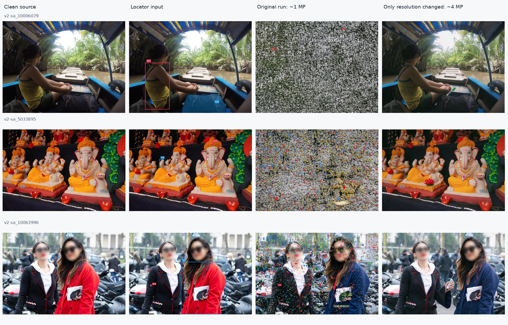
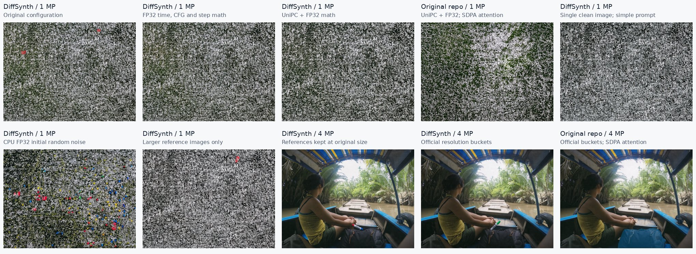

# HiDream 原始输出噪声退化排查

日期：2026-10-21。

## 结论

**已定位到主要原因：接入时把 HiDream 的生成尺寸统一设为了约 1 MP，遗漏了模型原仓库约 4 MP 的尺寸选择规则。** 这是本次适配配置的问题。原结果中的整图噪声、密集彩色伪影不能直接解释为 HiDream 的编辑能力不足。

完成 3 个 case、14 次生成对照。三个原配置重跑 PNG 的 SHA256 均与历史全量输出完全一致；保持权重、输入、prompt、seed、步数、CFG、Euler 采样不变，仅恢复官方尺寸，三个 case 的严重噪声退化均消失。原始输入和输出的文件摘要也已核对。



图中输出未叠加轮廓、标签或去噪处理，仅为排版缩放并压缩。人物面部模糊原本就存在于源图。修正后的结果仍有漏改、额外生成笔等错误；**恢复正常成像不等于编辑通过**。

## 原因在什么位置

原适配器配置是 `target_area=1024*1024`，按源图比例计算宽高，再交给 DiffSynth 的 `HiDreamO1ImagePipeline`。该 pipeline 只做 32 像素对齐，不会自动套用原仓库的预设尺寸。

模型原仓库的双图编辑会先调用 `find_closest_resolution`，按宽高比选择约 4 MP 的尺寸，例如 `2304×1728`、`2496×1664`。即使传入较小的宽高，原仓库也会将其调整到这些尺寸。DiffSynth 示例默认同样为 `2048×2048`。此前适配器显式传入约 1 MP，覆盖了这一工作分辨率。[原仓库 pipeline](https://github.com/HiDream-ai/HiDream-O1-Image/blob/2c2d29ff729e48f33e41f49edfdbd81d5ac103b4/models/pipeline.py)、[尺寸选择实现](https://github.com/HiDream-ai/HiDream-O1-Image/blob/2c2d29ff729e48f33e41f49edfdbd81d5ac103b4/models/utils.py)、[DiffSynth pipeline](https://github.com/modelscope/DiffSynth-Studio/blob/208d3abad800f09bd0acd18a134013e2ebd22c17/diffsynth/pipelines/hidream_o1_image.py)。

| Case | 原生成尺寸 | 恢复的尺寸 | 肉眼核对结果 |
|---|---:|---:|---|
| v2-sa_10006079：船上人物 | 1184×896 | 2304×1728 | 全图噪声消失，场景恢复；衣服改色、移除背包仍未正确完成 |
| v2-sa_5033895：神像 | 1248×832 | 2496×1664 | 密集噪点和场景破坏消失，神像与背景恢复 |
| v2-sa_10063996：双人街景 | 1248×832 | 2496×1664 | 遍布画面的彩色符号消失；仍有额外物体和编辑遗漏 |

这组实验支持“过低的生成分辨率触发退化”的因果判断；不能仅凭它推断模型训练分布或所有低分辨率 case 的行为。增加输出尺寸之后再缩回源图，和直接在低分辨率上去噪，不是同一过程。

## 排除了哪些解释

以下使用同一个船上人物 case。除明确列出的改动外，保持原配置；原仓库内部的初始随机数实现与 DiffSynth 不同，因此只在各自实现内部比较分辨率。

| 对照 | 严重噪声是否消失 |
|---|---|
| 1 MP，原配置 | 否 |
| 1 MP，仅把 timestep、CFG 和采样更新改成 FP32 | 否 |
| 1 MP，DiffSynth 换成 UniPC + FP32 | 否 |
| 1 MP，使用模型原仓库的 UniPC + FP32 流程 | 否 |
| 1 MP，去掉定位图，只用干净原图和简单指令 | 否 |
| 1 MP，改用 CPU FP32 初始随机噪声 | 否 |
| 1 MP，只提高参考图分辨率 | 否 |
| **4 MP，参考图仍使用原来较低的分辨率** | **是** |
| **4 MP，原 DiffSynth 采样设置** | **是** |
| **4 MP，模型原仓库流程** | **是** |



因此，报告 overlay、JPEG 压缩、定位图标记、复杂 prompt、BF16 采样计算、Euler、随机数生成方式，都不能单独解释本次噪声。FP32 和 UniPC 与原实现的差异确实存在，但不是恢复这些样本正常成像的必要改动。记录的 DiffSynth 采样步骤均为有限数值，未出现 NaN/Inf。

两套实现使用同一份本地 Full 权重；环境为 PyTorch `2.8.0+cu128`、Transformers `4.57.1`，不是官方提醒避免的 PyTorch 2.9。原仓库对照因环境没有 FlashAttention，使用了保留其两遍注意力和 GQA 语义的 PyTorch SDPA 替换，不能声称与官方 FlashAttention 路径逐位等价。[官方说明](https://github.com/HiDream-ai/HiDream-O1-Image/blob/2c2d29ff729e48f33e41f49edfdbd81d5ac103b4/README.md)。

## 修正与结果使用

- HiDream 默认配置增加 `resolution_policy=hidream_official_2k_buckets_v1`，使用原仓库完整尺寸列表和宽高比选择规则，32 像素对齐。其余已验证的采样参数保留。
- 输入仍是**干净原图 + 保留各 U 原始 point/box/mask 的定位图**。没有将所有定位方式转换成 mask。输出仍映射回源图坐标后评分。
- 新配置进入 benchmark 的运行标识；已有目录的配置一致性检查会阻止新旧结果混用。无尺寸策略字段的历史配置仍可复现原运行。
- 原 `JointPass=0/1084` 只能描述有配置缺陷的历史运行，不能作为有效模型能力排名。2026-10-21 按用户要求清理旧出图、裁剪缓存和 judge 响应缓存；仅保留少量元数据及三例逐文件一致的诊断图。修正配置的 1,084 个 case 已于 2026-10-21 16:30:45 UTC 完成全量生成与 judge，评分完整、解析错误为 0。JointPass=13/1084（1.20%）；新指标与案例见[结果报告](RESULT_ANALYSIS_2_6_0_ZH.md)，下方诊断对照仍保留历史证据。

另通过 benchmark 正式 `run_sharded.py → run-editor → adapters:edit` 入口验证一例，回执为 `jobs=1, ok=1, failed_shards=[]`。新输出与上述仅改变尺寸的对照 PNG 的 SHA256 一致，运行标识已改变。[正式入口回执](hidream_diagnosis/adapter_verification.json)。

## 证据与复现路径

| 内容 | 路径 |
|---|---|
| 推理修正 | `evaluation/diffsynth/adapters.py` |
| 对照推理脚本 | `evaluation/diagnose_hidream.py` |
| 图表生成脚本 | `evaluation/render_hidream_diagnosis.py` |
| case 摘要、输入/输出 SHA256、逐步采样统计 | [hidream_diagnosis/evidence.json](hidream_diagnosis/evidence.json) |
| 已退役原运行的元数据 | `${EXP}/launch/hidream_2k_20261021/legacy_metadata/runs/` |
| 已退役原评分的摘要 | `${EXP}/launch/hidream_2k_20261021/legacy_metadata/judge/` |
| 本次全部原始 PNG、配置、日志 | `${EXP}/diagnostics/hidream_noise_20261021/` |
| 修正后正式入口的一例验证 | `${EXP}/diagnostics/hidream_noise_20261021/adapter_fixed/` |

`EXP=/mnt/bn/strategy-mllm-train/user/tanyue/experiments2/SAMTokEdit/benchmark_v2_2.6.0_baselines`。

DiffSynth commit：`208d3abad800f09bd0acd18a134013e2ebd22c17`；模型原仓库 commit：`2c2d29ff729e48f33e41f49edfdbd81d5ac103b4`。诊断依赖 `diffusers==0.35.1` 安装在 `/tmp/samtok-hidream-diagnostic-deps`，未修改共享推理环境。所有命令在仓库根目录运行：

```bash
# 复用本次诊断目录和权重；脚本对已有 result.json 的输出跳过。
PYTHONPATH=/opt/tiger/envs/DiffSynth-Studio CUDA_VISIBLE_DEVICES=0 \
  /opt/tiger/envs/gen_tf457/bin/python evaluation/diagnose_hidream.py \
  --variants baseline native_resolution \
  --cases v2-sa_10006079 v2-sa_5033895 v2-sa_10063996

# 重建报告中的压缩图及证据清单。
/opt/tiger/envs/gen/bin/python evaluation/render_hidream_diagnosis.py
```


## 全量重跑进度

修正后的生成和评分分别写入 `${EXP}/runs/hidream_o1_image/`、`${EXP}/judge/hidream_o1_image/Qwen3.8-Flash-Next-FP8/`；旧目录已清空，新旧运行由配置和输出摘要区分。

```bash
/opt/tiger/envs/gen/bin/python evaluation/hidream_progress.py
```

队列依次执行：8 卡生成 → 1084 条生成覆盖检查 → 重建 judge 裁剪证据 → 8 卡 Qwen3.8 judge → 缺失评分重试/补解析 → 严格 report。状态每 30 秒更新到 `${EXP}/launch/hidream_2k_20261021/status.json`。删除清单见同目录 `cleanup_manifest.json`。运行日志、环境摘要及后台进程编号也保存在此目录。
