# SAMTok Edit Benchmark 2.6.0 结果分析

生成时间：2026-10-19；四个模型均为完整 1084/1084 judge 评分。Judge 模型：`Qwen3.8-Flash-Next-FP8`。

## 0. 评测配置

### 0.1 评测对象与输入

- Benchmark manifest：`data/v2_2.6.0/cases.jsonl`，共 1,084 个 `mixed` jobs。
- 源数据根：`/mnt/bn/strategy-mllm-train/user/tanyue/datasets/samtok_edit_benchmark_v2`。
- 输入协议：`visual_locator_v2`。每个 job 给模型干净 source image、区域信息图和公开 instruction；模型只需输出编辑后的完整 RGB 图片。
- 三个模型使用 `mask_full`：第二张图是灰度 label map，U1…U5 分别使用灰度值 51、102、153、204、255；颜色和形状不是输出目标。
- FLUX.3 使用 `visual_locator_v2_mixed_color`：第二张图是带颜色 locator marks 的区域图，结合 point、box、mask 和 U 标签定位。

### 0.2 生成模型与推理 setting

| 模型 | 输入 setting | 推理实现 | Steps | 关键参数 |
|---|---|---|---:|---|
| Qwen-Image-2.1 | `mask_full` | DiffSynth `QwenImage21Pipeline` | 40 | cfg_scale=1.0; grid=32 |
| Qwen-Image-Edit-2511 | `mask_full` | DiffSynth `QwenImagePipeline` | 40 | cfg_scale=4.0; zero_cond_t=true; edit_image_auto_resize=true; grid=16 |
| FLUX.2 Klein-4B | `mask_full` | DiffSynth `Flux2ImagePipeline` | 4 | cfg_scale=1.0; embedded_guidance=1.0; grid=16 |
| FLUX.3 Klein | `visual_locator_v2_mixed_color` | FLUX.3 Klein official reference inference | 16 | official prompt upsampler/PUP; grid=16 |

所有生成配置的目标面积约为 1 MP；输出在 registry 中绑定 source size、manifest SHA256、input digest 和 run configuration。生成使用 8 张 GPU（0–7），完整生成结果均为 1,084/1,084。

各模型区域输入的示例（同一 case：`v2-sa_10006079`）：

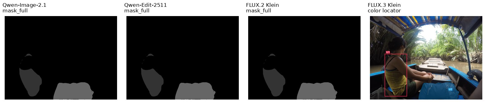

前三个模型收到的是同一类灰度 label map；FLUX.3 收到的是带颜色、U 标签和 locator marks 的区域图。

### 0.3 Judge 与通过规则

- Judge protocol：`v2_epq_numeric_all_units_1`；Judge 模型：`/mnt/bn/strategy-mllm-train/user/tanyue/models/pretrained_models/Qwen3.8-Flash-Next-FP8`。
- 推理后端：vLLM，tensor parallel size=8，GPU memory utilization=0.85，temperature=0，seed=0，max tokens=12,288。
- Judge 输入包括完整 source/output、固定坐标 source/output crops，以及只供 judge 使用的源 mask contour。模型输出本身不叠加 contour。
- 每个单元评分 E、P、Q 为 0–4 分；E=4 才通过，P/Q≥3 才通过；整图 `global_P`、`global_Q` 也要求分数≥3。
- `JointPass` 要求该 job 的所有 U 都满足 E/P/Q，并且 `global_P` 与 `global_Q` 都通过。

### 0.4 结果路径

| 内容 | 路径 |
|---|---|
| 最终报告（Git） | `docs/reports/2.6.0/RESULT_ANALYSIS_2_6_0_ZH.md` |
| 生成与 judge 外部实验根 | `/mnt/bn/strategy-mllm-train/user/tanyue/experiments2/SAMTokEdit/benchmark_v2_2.6.0_baselines/` |
| mask_full 输入 jobs | `recommended_inputs/mask_full/jobs.jsonl` |
| FLUX.3 冻结 judge 输入 | `recommended_judge_inputs/flux3_klein_color/judge_jobs.jsonl` |
| Qwen-Image-2.1 生成 | `recommended_runs/qwen_image_21_mask/outputs.jsonl` |
| Qwen-Image-Edit-2511 生成 | `recommended_runs/qwen_image_edit_2511_mask/outputs.jsonl` |
| FLUX.2 Klein-4B 生成 | `recommended_runs/flux2_klein_4b_mask/outputs.jsonl` |
| FLUX.3 Klein 生成 | `recommended_runs/flux3_klein_color/outputs.jsonl` |
| 四模型 judge 输入 | `recommended_judge_inputs/<model>/judge_jobs.jsonl` |
| 四模型 scores | `recommended_judge/<model>/Qwen3.8-Flash-Next-FP8/scores.jsonl` |
| 四模型结构化 report | `recommended_judge/<model>/Qwen3.8-Flash-Next-FP8/report.json` |
| setting 示例图 | `docs/reports/2.6.0/figures/input_settings_examples.jpg` |
| 本报告统计 CSV 与图 | `docs/reports/2.6.0/{main_table,k_jointpass,locator_impact,failure_modes}.*` |

推荐的复现入口：`evaluation/diffsynth/run_all.sh`；统计脚本：`evaluation/analyze_results.py`。本报告使用已经完成且通过完整绑定检查的四个 `scores.jsonl`，不是 partial records。

## 1. 主表

| 模型 | JointPass | E 单元通过率 | P 单元通过率 | Q 单元通过率 | global_P | global_Q |
|---|---:|---:|---:|---:|---:|---:|
| Qwen-Image-2.1 | 107/1084 (9.87%) | 55.89% | 83.52% | 84.25% | 60.24% | 75.83% |
| Qwen-Image-Edit-2511 | 41/1084 (3.78%) | 43.23% | 66.92% | 75.05% | 20.30% | 42.62% |
| FLUX.2 Klein-4B | 45/1084 (4.15%) | 46.41% | 74.25% | 84.43% | 28.60% | 62.73% |
| FLUX.3 Klein | 286/1084 (26.38%) | 68.44% | 88.53% | 91.81% | 67.62% | 90.13% |

JointPass 要求每个单元的 E/P/Q 都通过，同时 global_P 与 global_Q 通过。E 反映执行是否完成，P 反映非目标内容保持，Q 反映编辑质量。整体难度由 JointPass 体现；从单元级指标看，模型之间的主要差异可按 E、P、Q 三列比较。

## 1.1 模型输入设置

| 模型 | 区域信息输入 | 评测输入包 |
|---|---|---|
| Qwen-Image-2.1 | grayscale mask label map (mask_full) | `qwen_image_21_mask` |
| Qwen-Image-Edit-2511 | grayscale mask label map (mask_full) | `qwen_image_edit_2511_mask` |
| FLUX.2 Klein-4B | grayscale mask label map (mask_full) | `flux2_klein_4b_mask` |
| FLUX.3 Klein | color locator image (colored locator marks) | `flux3_klein_color` |

总览图中带有 `[mask]` 或 `[color]` 的模型输出面板表示该模型实际收到的区域信息形式。细节图里的红色轮廓统一是评测可视化用的源 mask 轮廓，用来对齐局部区域；它不是模型输出，也不参与输出图像评分。

## 2. 多目标组合代价

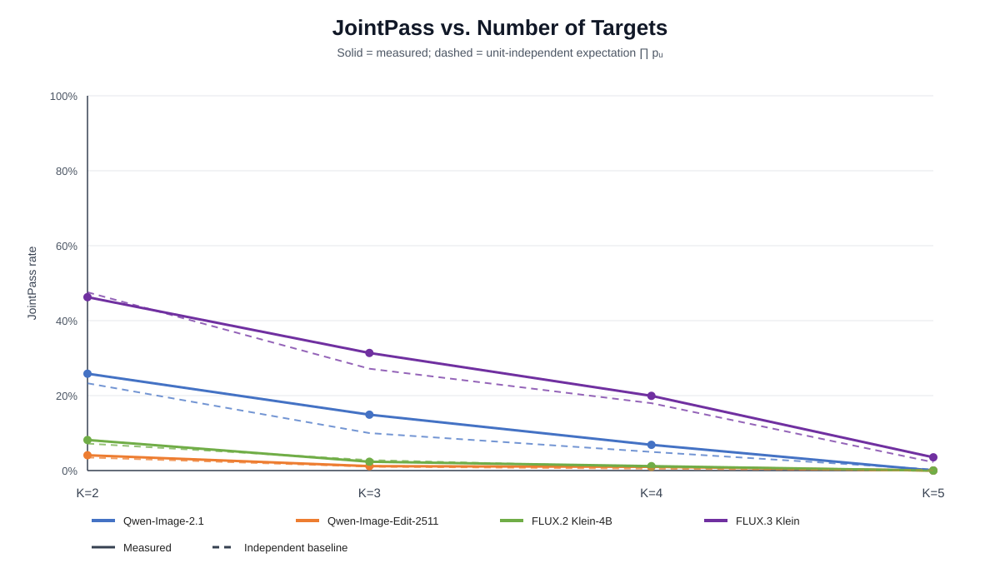

实线是实测 JointPass，虚线是各单元 E/P/Q 联合通过率乘积 `∏u p_u`。对 K 个目标，令 `p_u` 为位置 Uu 的单元联合通过率；实测曲线低于虚线表示多个请求之间存在额外干扰。图和 `k_jointpass.csv` 另外给出 `global_P × global_Q × ∏u p_u`，用于解释全图保持与整体质量对最终 JointPass 的额外压缩。

## 3. 定位方式的影响

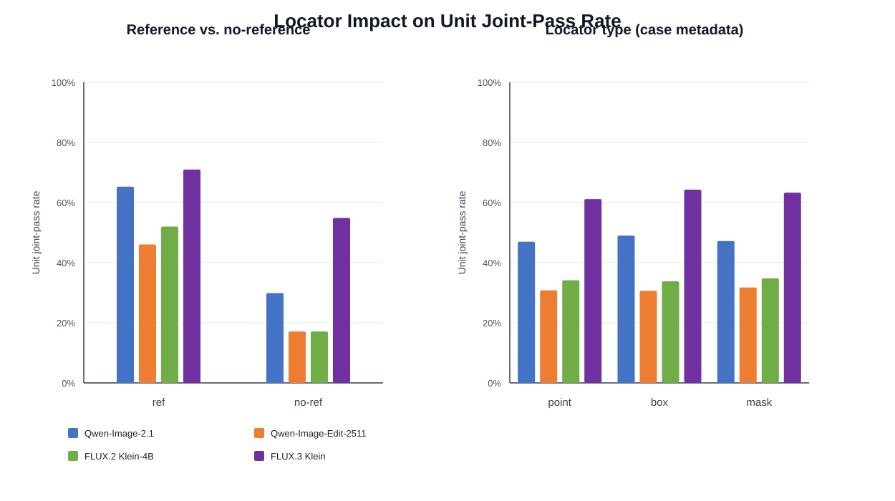

单元级 `unit_joint` 定义为该单元 E、P、Q 同时通过。左图先比较 ref 和 no-ref；no-ref 指令只写 `the selected region`，模型必须从 locator 选择实例。右图再比较 point、box、mask 三种 locator。右图的 point/box/mask 是跨 ref 与 no-ref 的总体分组；完整 E/P/Q 与样本数见 `locator_impact.csv`。

| 模型 | ref unit-joint | no-ref unit-joint | no-ref - ref |
|---|---:|---:|---:|
| Qwen-Image-2.1 | 65.28% | 29.88% | -35.40% |
| Qwen-Image-Edit-2511 | 46.07% | 17.11% | -28.96% |
| FLUX.2 Klein-4B | 52.03% | 17.11% | -34.93% |
| FLUX.3 Klein | 70.98% | 54.88% | -16.10% |

| 模型 | point | box | mask |
|---|---:|---:|---:|
| Qwen-Image-2.1 | 46.97% | 49.01% | 47.20% |
| Qwen-Image-Edit-2511 | 30.80% | 30.65% | 31.74% |
| FLUX.2 Klein-4B | 34.15% | 33.82% | 34.81% |
| FLUX.3 Klein | 61.16% | 64.29% | 63.29% |

## 4. E 失败模式

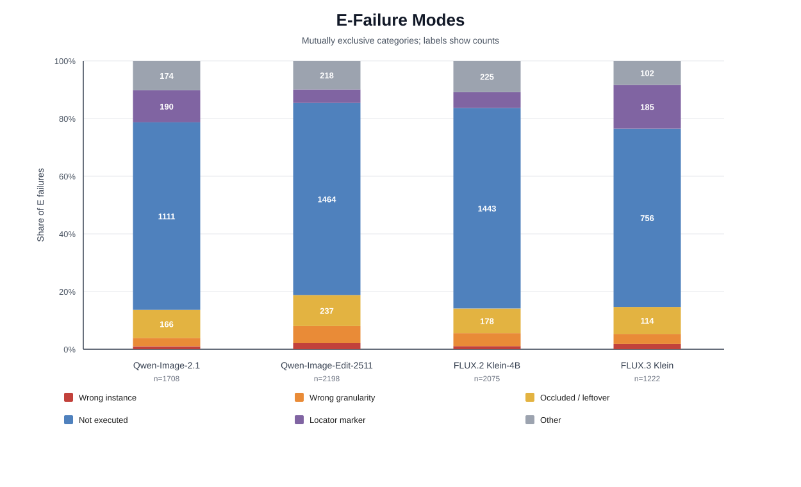

失败模式只统计 E 未通过的单元，按 judge 证据关键词和指令语义做互斥归类，优先级为：定位框/U 标签泄漏、未执行、遮挡碎片/残留、错误实例、粒度错误、其他。该统计用于定位问题，原始证据保存在每个模型的 `failure_examples_*.json`；`other E failure` 代表证据无法可靠映射到前五类。

| 模型 | 失败单元数 | 定位标记 | 未执行 | 遮挡碎片/残留 | 错误实例 | 粒度错误 | 其他 |
|---|---:|---:|---:|---:|---:|---:|---:|
| Qwen-Image-2.1 | 1708 | 190 | 1111 | 166 | 17 | 50 | 174 |
| Qwen-Image-Edit-2511 | 2198 | 103 | 1464 | 237 | 49 | 127 | 218 |
| FLUX.2 Klein-4B | 2075 | 114 | 1443 | 178 | 22 | 93 | 225 |
| FLUX.3 Klein | 1222 | 185 | 756 | 114 | 22 | 43 | 102 |

## 案例研究

以下内容已直接嵌入本报告。每个案例的总览图从左到右依次为原图、mask locator、color locator 和四个模型输出；每个 U 的局部图均叠加源 mask 轮廓。状态表中的 E/P/Q 是该 U 的逐维 judge 结果；HTML 版 [`case_studies/index.html`](case_studies/index.html) 保留了更宽的排版和完整证据。选例分别覆盖所有模型失败、只有一个模型成功、实例/部件粒度错误和 no-ref 定位失败。

### all_models_fail：`v2-sa_10006079`

English prompt:

```text
Edit the first image at its original size. Execute all numbered instructions. The second image, when present, supplies labeled locators only; omit those marks from the result. A locator selects a source instance; named parts further restrict the edit. For add it selects the support or spatial reference, not the new item outline. Preserve all unrequested content.

U1 [ref; box]: Change the color of the woman’s yellow patterned tank top to teal.
U2 [no ref; mask]: Remove the selected region.
```

中文翻译：

```text
编辑第一张图并保持原始尺寸。执行所有编号指令。第二张图（如有）只提供带标签的定位信息，输出中不得保留定位标记。定位器选择源图实例；命名部件进一步限定编辑范围。添加操作中，定位器选择支撑物或空间参考，不是新物体的轮廓。保留所有未请求内容。
U1 [有参考图；框定位]：将女性的黄色图案背心改为青绿色。
U2 [无参考图；掩码定位]：移除选定区域。
```

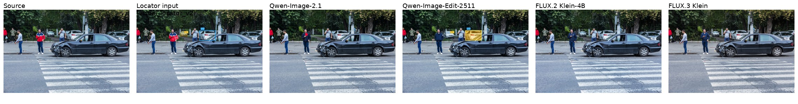

#### U1：Change the color of the woman’s yellow patterned tank top to teal.

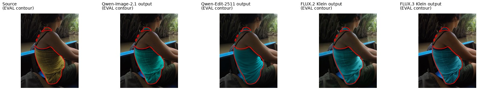

| 模型 | E | P | Q |
|---|---:|---:|---:|
| Qwen-Image-2.1 | PASS (4) | PASS (4) | PASS (4) |
| Qwen-Image-Edit-2511 | PASS (4) | PASS (4) | PASS (4) |
| FLUX.2 Klein-4B | PASS (4) | PASS (4) | PASS (4) |
| FLUX.3 Klein | PASS (4) | PASS (4) | PASS (4) |

#### U2：Remove the selected region.

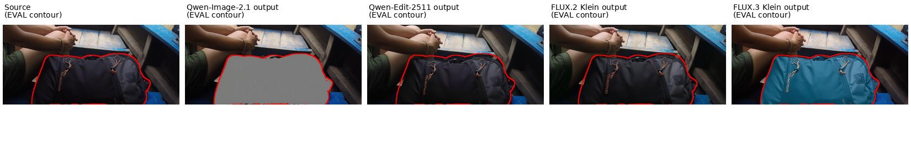

| 模型 | E | P | Q |
|---|---:|---:|---:|
| Qwen-Image-2.1 | FAIL (1) | PASS (3) | FAIL (1) |
| Qwen-Image-Edit-2511 | FAIL (0) | PASS (4) | PASS (4) |
| FLUX.2 Klein-4B | FAIL (0) | PASS (4) | PASS (4) |
| FLUX.3 Klein | FAIL (1) | PASS (4) | PASS (3) |


### only_one_model_success：`v2-sa_10044652`

English prompt:

```text
Edit the first image at its original size. Execute all numbered instructions. The second image, when present, supplies labeled locators only; omit those marks from the result. A locator selects a source instance; named parts further restrict the edit. For add it selects the support or spatial reference, not the new item outline. Preserve all unrequested content.

U1 [no ref; point]: Replace the selected region with a navy bomber jacket.
U2 [ref; box]: Change the color of the white car behind the damaged car to silver.
U3 [no ref; mask]: Remove the selected region.
```

中文翻译：

```text
编辑第一张图并保持原始尺寸。执行所有编号指令。第二张图（如有）只提供带标签的定位信息，输出中不得保留定位标记。定位器选择源图实例；命名部件进一步限定编辑范围。添加操作中，定位器选择支撑物或空间参考，不是新物体的轮廓。保留所有未请求内容。
U1 [无参考图；点定位]：将选定区域替换为海军蓝飞行员夹克。
U2 [有参考图；框定位]：将受损车辆后方的白色汽车改为银色。
U3 [无参考图；掩码定位]：移除选定区域。
```

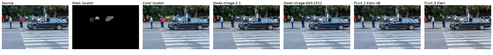

#### U1：Replace the selected region with a navy bomber jacket.

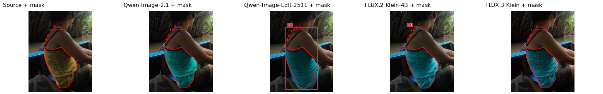

| 模型 | E | P | Q |
|---|---:|---:|---:|
| Qwen-Image-2.1 | PASS (4) | PASS (4) | PASS (4) |
| Qwen-Image-Edit-2511 | PASS (4) | PASS (3) | PASS (3) |
| FLUX.2 Klein-4B | PASS (4) | FAIL (2) | PASS (4) |
| FLUX.3 Klein | PASS (4) | PASS (4) | PASS (4) |

#### U2：Change the color of the white car behind the damaged car to silver.

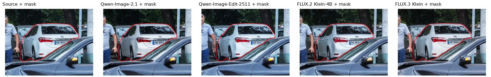

| 模型 | E | P | Q |
|---|---:|---:|---:|
| Qwen-Image-2.1 | PASS (4) | PASS (4) | PASS (4) |
| Qwen-Image-Edit-2511 | PASS (4) | PASS (4) | PASS (4) |
| FLUX.2 Klein-4B | PASS (4) | PASS (4) | PASS (3) |
| FLUX.3 Klein | PASS (4) | PASS (4) | PASS (4) |

#### U3：Remove the selected region.

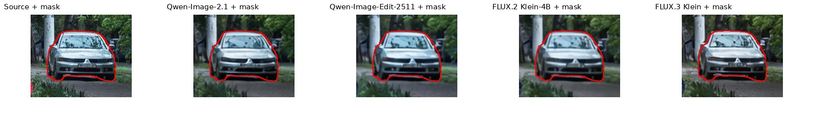

| 模型 | E | P | Q |
|---|---:|---:|---:|
| Qwen-Image-2.1 | FAIL (0) | PASS (3) | FAIL (2) |
| Qwen-Image-Edit-2511 | PASS (4) | PASS (4) | PASS (3) |
| FLUX.2 Klein-4B | PASS (4) | PASS (3) | FAIL (2) |
| FLUX.3 Klein | FAIL (1) | PASS (3) | FAIL (2) |


### granularity_error：`v2-sa_6392020`

English prompt:

```text
Edit the first image at its original size. Execute all numbered instructions. The second image, when present, supplies labeled locators only; omit those marks from the result. A locator selects a source instance; named parts further restrict the edit. For add it selects the support or spatial reference, not the new item outline. Preserve all unrequested content.

U1 [no ref; mask]: Remove the selected region.
U2 [ref; none]: Replace the red top of the long-haired woman facing away in the middle with a short-sleeved hooded top.
U3 [ref; mask]: Add one small flap chest pocket sewn onto the T-shirt of the seated man on the left.
U4 [no ref; box]: Change the color of the selected region to orange.
U5 [ref; point]: Remove the sleeves from the T-shirt of the person with hands behind their back at the left rear.
```

中文翻译：

```text
编辑第一张图并保持原始尺寸。执行所有编号指令。第二张图（如有）只提供带标签的定位信息，输出中不得保留定位标记。定位器选择源图实例；命名部件进一步限定编辑范围。添加操作中，定位器选择支撑物或空间参考，不是新物体的轮廓。保留所有未请求内容。
U1 [无参考图；掩码定位]：移除选定区域。
U2 [有参考图；无额外定位]：将中间背对镜头、长发女性的红色上衣替换为短袖连帽上衣。
U3 [有参考图；掩码定位]：在左侧坐着男子的 T 恤上缝制一个小翻盖胸袋。
U4 [无参考图；框定位]：将选定区域改为橙色。
U5 [有参考图；点定位]：移除左后方双手背在身后的人的 T 恤袖子。
```

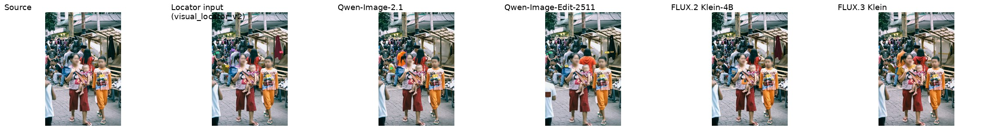

#### U1：Remove the selected region.

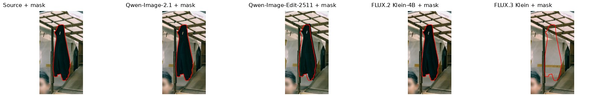

| 模型 | E | P | Q |
|---|---:|---:|---:|
| Qwen-Image-2.1 | FAIL (0) | PASS (4) | PASS (4) |
| Qwen-Image-Edit-2511 | FAIL (0) | PASS (4) | PASS (4) |
| FLUX.2 Klein-4B | FAIL (0) | PASS (4) | PASS (4) |
| FLUX.3 Klein | PASS (4) | PASS (4) | PASS (4) |

#### U2：Replace the red top of the long-haired woman facing away in the middle with a short-sleeved hooded top.

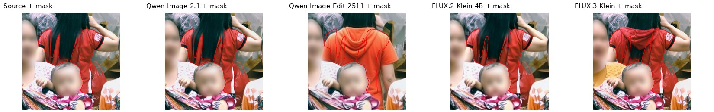

| 模型 | E | P | Q |
|---|---:|---:|---:|
| Qwen-Image-2.1 | FAIL (0) | PASS (4) | PASS (4) |
| Qwen-Image-Edit-2511 | PASS (4) | PASS (4) | PASS (4) |
| FLUX.2 Klein-4B | PASS (4) | PASS (4) | PASS (4) |
| FLUX.3 Klein | PASS (4) | PASS (4) | PASS (4) |

#### U3：Add one small flap chest pocket sewn onto the T-shirt of the seated man on the left.

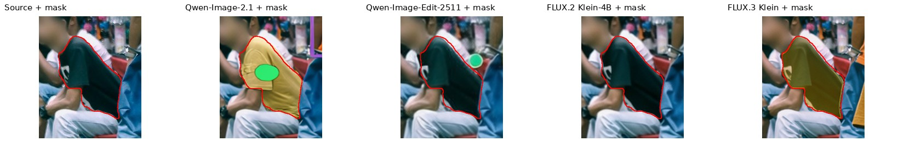

| 模型 | E | P | Q |
|---|---:|---:|---:|
| Qwen-Image-2.1 | FAIL (3) | PASS (4) | FAIL (2) |
| Qwen-Image-Edit-2511 | FAIL (0) | PASS (4) | PASS (4) |
| FLUX.2 Klein-4B | FAIL (0) | PASS (4) | PASS (4) |
| FLUX.3 Klein | FAIL (2) | FAIL (2) | FAIL (2) |

#### U4：Change the color of the selected region to orange.

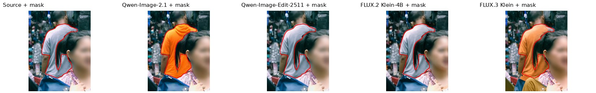

| 模型 | E | P | Q |
|---|---:|---:|---:|
| Qwen-Image-2.1 | FAIL (2) | PASS (4) | PASS (3) |
| Qwen-Image-Edit-2511 | FAIL (0) | PASS (4) | PASS (4) |
| FLUX.2 Klein-4B | FAIL (0) | PASS (4) | PASS (4) |
| FLUX.3 Klein | PASS (4) | FAIL (2) | PASS (3) |

#### U5：Remove the sleeves from the T-shirt of the person with hands behind their back at the left rear.

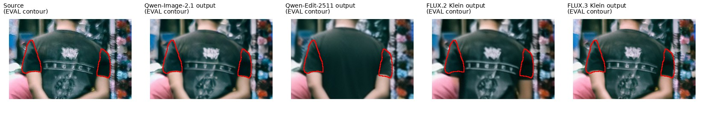

| 模型 | E | P | Q |
|---|---:|---:|---:|
| Qwen-Image-2.1 | PASS (4) | PASS (4) | PASS (3) |
| Qwen-Image-Edit-2511 | PASS (4) | FAIL (2) | PASS (3) |
| FLUX.2 Klein-4B | PASS (4) | PASS (4) | PASS (4) |
| FLUX.3 Klein | FAIL (1) | PASS (4) | PASS (3) |


### no_ref_localization_failure：`v2-sa_7813406`

English prompt:

```text
Edit the first image at its original size. Execute all numbered instructions. The second image, when present, supplies labeled locators only; omit those marks from the result. A locator selects a source instance; named parts further restrict the edit. For add it selects the support or spatial reference, not the new item outline. Preserve all unrequested content.

U1 [no ref; box]: Change the color of the selected region to dark red.
U2 [ref; point]: Replace the image-right shoe of the foreground man in yellow with a black knee-high boot.
U3 [no ref; point]: Add one rectangular side pocket on the selected region.
U4 [ref; box]: Replace the image-left boot of the far-right performer in red with a white low-top canvas sneaker.
U5 [no ref; mask]: Remove the selected region to make it knee-length.
```

中文翻译：

```text
编辑第一张图并保持原始尺寸。执行所有编号指令。第二张图（如有）只提供带标签的定位信息，输出中不得保留定位标记。定位器选择源图实例；命名部件进一步限定编辑范围。添加操作中，定位器选择支撑物或空间参考，不是新物体的轮廓。保留所有未请求内容。
U1 [无参考图；框定位]：将选定区域改为深红色。
U2 [有参考图；点定位]：将前景黄色衣服男子图像右侧的鞋替换为黑色过膝靴。
U3 [无参考图；点定位]：在选定区域添加一个矩形侧袋。
U4 [有参考图；框定位]：将最右侧表演者图像左侧的红色靴子替换为白色低帮帆布鞋。
U5 [无参考图；掩码定位]：移除选定区域，使其达到膝盖长度。
```

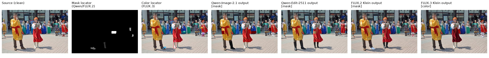

#### U1：Change the color of the selected region to dark red.

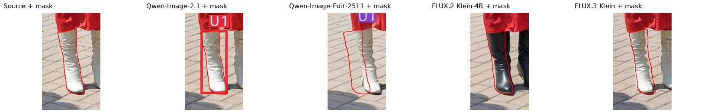

| 模型 | E | P | Q |
|---|---:|---:|---:|
| Qwen-Image-2.1 | FAIL (0) | PASS (4) | PASS (4) |
| Qwen-Image-Edit-2511 | FAIL (1) | FAIL (2) | PASS (4) |
| FLUX.2 Klein-4B | FAIL (1) | FAIL (1) | PASS (3) |
| FLUX.3 Klein | FAIL (1) | FAIL (2) | PASS (3) |

#### U2：Replace the image-right shoe of the foreground man in yellow with a black knee-high boot.

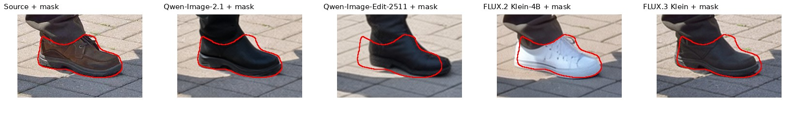

| 模型 | E | P | Q |
|---|---:|---:|---:|
| Qwen-Image-2.1 | PASS (4) | PASS (4) | PASS (4) |
| Qwen-Image-Edit-2511 | PASS (4) | FAIL (2) | PASS (4) |
| FLUX.2 Klein-4B | FAIL (1) | PASS (3) | PASS (3) |
| FLUX.3 Klein | PASS (4) | FAIL (2) | PASS (3) |

#### U3：Add one rectangular side pocket on the selected region.

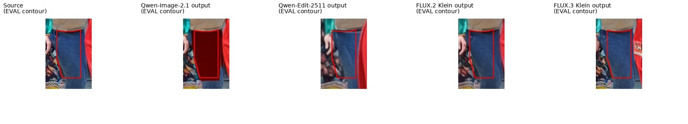

| 模型 | E | P | Q |
|---|---:|---:|---:|
| Qwen-Image-2.1 | FAIL (1) | FAIL (1) | FAIL (1) |
| Qwen-Image-Edit-2511 | FAIL (1) | PASS (4) | PASS (3) |
| FLUX.2 Klein-4B | FAIL (0) | PASS (4) | PASS (4) |
| FLUX.3 Klein | FAIL (0) | PASS (4) | PASS (4) |

#### U4：Replace the image-left boot of the far-right performer in red with a white low-top canvas sneaker.

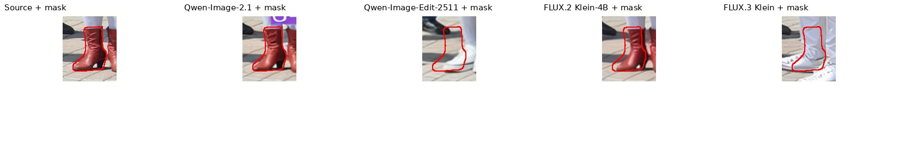

| 模型 | E | P | Q |
|---|---:|---:|---:|
| Qwen-Image-2.1 | PASS (4) | PASS (4) | PASS (3) |
| Qwen-Image-Edit-2511 | PASS (4) | FAIL (2) | FAIL (2) |
| FLUX.2 Klein-4B | FAIL (1) | PASS (3) | PASS (3) |
| FLUX.3 Klein | FAIL (2) | FAIL (2) | FAIL (2) |

#### U5：Remove the selected region to make it knee-length.

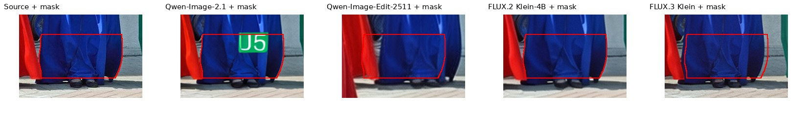

| 模型 | E | P | Q |
|---|---:|---:|---:|
| Qwen-Image-2.1 | FAIL (0) | FAIL (1) | FAIL (1) |
| Qwen-Image-Edit-2511 | FAIL (1) | PASS (4) | PASS (3) |
| FLUX.2 Klein-4B | FAIL (0) | PASS (4) | PASS (4) |
| FLUX.3 Klein | FAIL (1) | PASS (4) | PASS (4) |

### 产物

- `main_table.csv`：主表数据
- `k_jointpass.csv`：K 曲线与独立基线数据
- `locator_impact.csv`：ref/no-ref、point/box/mask 单元级数据
- `failure_modes.csv`：失败模式计数
- `figures/*.svg`：三张可直接打开的 SVG 图
- `case_studies/index.html`：同一批案例的宽屏版页面
